# IronWrap — End-to-End Delivery Plan

How we get from **today (experimental GHL stack)** to the **spec's final state** (`final-spec-pack/`).
This is the execution overlay: sequencing, dependencies, owners, and exit gates. Chapter
references (e.g. `02 §Phase 3`) point at the spec for detail. Dates are relative weeks; the
A2P registration is the long pole, so it starts on day zero.

## Current status vs spec — snapshot (2026-07-07)

Honest two-layer view: **Built** = code deployed + unit-verified · **Operating** = running on live
traffic/data in production. The Worker bus is real and current: D1/R2/queues/cron, Gmail instant-ack,
Google Drive filing, JobNimbus push, and QuickBooks webhook capture are implemented. The operating gap
is live-source cutover: website/Make still must feed `/ingest/website`, and A2P/Engage, compliance,
QuickBooks Payments/webhook, JobNimbus config, and AssistAI remain account/owner gates.

| Phase | Built | Operating (live) |
|---|---|---|
| 0 · Foundations | 🟢 bus deployed (D1/R2/queues/cron/secrets); maintainer; Google decisions locked | 🟡 bus live; JobNimbus key rotation + A2P/Engage + compliance still owner gates |
| 1 · Lead spine + instant-ack | 🟢 spine, dedup, reconcile+heartbeat, dead-letter, brand-tagging, Gmail ack, GHL rescue (103) — verified | 🔴 real lead feed not cut over; website/Make must POST to `/ingest/website` |
| 2 · Messaging + retire GHL | 🟡 Gmail email path built; CASL drafts | 🔴 needs A2P + JobNimbus Engage; GHL still has live/legacy routes to retire |
| 3 · Field · docs · proposals | 🟢 photo/measurement/QuickBooks endpoints + Drive folder-on-job-mint — verified; JobNimbus native e-sign is the proposal path | 🟡 Google Drive creds exist; Jotform/RoofRuler/QB live hooks still need cutover; OCR ladder + QB↔JN sync + JN fields unbuilt |
| 4 · Phone AI (AssistAI) | 🟡 eval framework doc | 🔴 not configured |
| 5 · QA · security · compliance · launch | 🟡 compliance drafts + QA matrix (`docs/QA-TEST-MATRIX.md`) | 🔴 not started; keys not rotated; no sign-off |

> The bus, the Phase-3 endpoints, and the email/SMS code are all real — but a roofing lead has **not yet
> traveled the owned path end-to-end in production.** Closing that gap is credentials + careful (UI, not
> API) integration, not more code. The credential-by-credential unlock order is in `docs/ACTIVATION-CHECKLIST.md`.

## From → To

| Area | Today (experimental) | Target (spec final) |
|---|---|---|
| Lead front door | Website/FB → **GHL** (10 live Make scenarios) | All sources → **Make/Workers bus → owned D1/R2 FIRST → JobNimbus** |
| System of record | None (GHL holds it) | **Cloudflare D1 + R2** (owned), JobNimbus = consumer |
| CRM / job truth | GHL + partial JobNimbus | **JobNimbus** (spine) |
| Instant response | none | **Instant-ack / MCTB <60s, 24/7** |
| SMS / email | Google Workspace live for email; SMS not live | **Engage SMS** (post-A2P) + **Google Workspace brand mailboxes** |
| Storage | OneDrive (GHL-keyed folders) | **Google Drive** (Google Workspace, supersedes OneDrive, 2026-07-01), JobNimbus-job-number-keyed |
| Accounting/payments | BookIPI/Stripe/MileIQ legacy | **QuickBooks** (catalog + invoices + POs + mileage) + **QuickBooks Payments**; BookIPI/Stripe/MileIQ retire |
| Measurements | Make RoofRuler intake (AI Extract) | RoofRuler/AppliCad → toMarkdown → Mistral fallback, on the spine |
| Phone AI | none | **AssistAI** (eval-gated) → managed Retell → voicemail floor |
| Brands | mixed | **IronWrap + iRoof Alberta**, brand-tagged end to end |
| GHL | live hub | **retired** (data rescued first) |

## Sequencing principles

1. **A2P on day zero** — it gates Engage SMS (1–3 wks, not a config flip). Everything else routes around it.
2. **Instant-ack ships value on day one** via the *interim* channel (email + owner alert); the prospect-SMS leg switches on at A2P approval.
3. **Owned-store-first is the keystone** — stand up D1/R2 + the bus before repointing any lead source.
4. **Migrate, don't rebuild** — reuse what already works in Make (especially RoofRuler intake), move it onto the JobNimbus/Drive spine, then retire GHL.
5. **Managed over self-host; name a maintainer** — this is owned code now; the build/maintenance owner is decision #0 (see Gates).
6. **Compliance gates are hard launch-blockers**, not paperwork (`09`).

## Phase overview

| # | Phase | Exit gate | Depends on | ~Effort |
|---|---|---|---|---|
| 0 | Foundations & unblock | Bus deployed; A2P submitted; owners named | — | wk 0–1 |
| 1 | Lead spine + instant-ack (interim) | Every lead → D1/R2 → JN; <60s email ack; reconcile green | 0 | wk 1–2 |
| 2 | Messaging + retire GHL | Engage SMS live; GHL decommissioned; CASL ledger live | 1 + A2P approved | wk 3–4 |
| 3 | Field · documents · proposals | Jotform photos, RoofRuler, proposals, QuickBooks on the spine | 1 | wk 3–5 (∥) |
| 4 | Phone AI (gated) | AssistAI passes written eval (≥85%, 0 catastrophic) | 2 | wk 5–6 |
| 5 | QA · security · launch | Full QA + compliance gate + owner sign-off | 1–4 | wk 6–7 |

## Phases in detail

### Phase 0 — Foundations & unblock (wk 0–1)
- **Decide (done):** build/maintenance owner; Google Workspace/Drive; two-brand handling.
- **A2P 10DLC + Canadian carrier registration — submit today** (`02 §0.5`, `09`). Long pole.
- **Provision & own the Twilio business DID** (portable; AssistAI/Engage later).
- **Rotate the JobNimbus API key** (it was shared in chat) and issue a dedicated bus key.
- **Deploy the owned data layer / bus** (`workers-bus/`): `wrangler d1/r2/queues create` → migrate → `wrangler secret put` → `deploy`. Decide **hybrid**: Workers bus for the heavy lifting + keep the Make Core seat for connectors/observability.
- **Verify website form post destinations** (both brand domains) so they can be repointed.
- *Exit:* bus deployed + healthy; A2P submitted (tracking); DID owned; owners named.

### Phase 1 — Lead spine + instant-ack interim (wk 1–2)
- Repoint website/GBP/manual leads → bus → **D1/R2 first** → JobNimbus, with **dedup, dead-letter (Sheet+email), daily reconciliation + heartbeat, partial-write repair** (`01`,`04 §WF1/§WF8`,`06`).
- **Instant-ack / MCTB interim** live: prospect **email** + owner alert <60s, off the owned-store write (`04 §WF7`).
- **Brand tagging** on the envelope (`03`).
- **Rescue GHL data:** fix the Make import `record_type_name` (`"Lead"`→`Customer`), run the one-time GHL→JobNimbus import, verify; stop routing *new* leads to GHL.
- *Exit:* every test lead (both brands) lands in D1/R2 + JN, deduped, with a <60s email ack; reconciliation green; GHL no longer the front door.

### Phase 2 — Messaging + retire GHL (wk 3–4, after A2P)
- A2P approved → **Engage 2-way SMS** live → MCTB **prospect-SMS leg** switches on.
- **Google Workspace brand-mailbox email** (SPF/DKIM/DMARC + bounce monitoring) for nurture/review; JN native email stays off. Microsoft 365 mirrors only during migration.
- **CASL consent ledger** live in JobNimbus + dual-written (`09`); review-request flow with stop conditions.
- **Retire GHL:** decommission/disable the experimental scenarios, confirm nothing depends on them.
- *Exit:* SMS round-trips; review/nurture send via brand mailboxes; GHL off; consent enforced.

### Phase 3 — Field · documents · proposals (wk 3–5, parallel with 2)
- **Jotform "Jobsite Photo"** form live (device GPS at submit, offline) → bus → **Google Drive** job folder + JN (`02 §2B`; supersedes OneDrive, see Gates #3).
- **RoofRuler/AppliCad intake** hardened (deterministic → `toMarkdown()` → Mistral only for hard docs); migrate the existing Make RoofRuler scenario onto the spine (`07`); re-point off `quote@ironwrapexteriors.com` when that mailbox migrates to Google Workspace.
- **Google Drive folder automation** keyed by **JobNimbus job number** (migrate from GHL-lead-number keying); **migrate historical job files from OneDrive** during the same cutover (some contact/job/file mapping needs manual fixing — owner flagged this).
- **Proposals:** JobNimbus native e-sign / HTML+PDF; DocuSeal remains a benched escape hatch only (`07`).
- **QuickBooks** as catalog + invoice + PO master; **QuickBooks Payments** for invoice payments (`04 §WF4`); BookIPI/Stripe/MileIQ retire.
- **Business-process scenarios** (Proposal Sent → Contract Signed → Deposit Paid → Job Started → Completion): build in this order once the lead spine is capturing live traffic — full detail in `final-spec-pack/04` Workflows 3/3C/5/5C/6.
- *Exit:* a job runs measurements → proposal → deposit with photos/folders auto-filed; no manual retyping.

### Phase 4 — Phone AI (gated, wk 5–6)
- Configure **AssistAI**; run the **written scored eval** (15–20 calls; ≥85% capture+routing, zero catastrophic) (`05`). Voicemail floor always on; hard minute cap/budget alert.
- Managed **Retell** only if AssistAI fails the gate. (4-vendor DIY stack stays killed.)
- *Exit:* eval passed + Ilya approves production call behavior; MCTB confirmed on every missed path.

### Phase 5 — QA · security · launch (wk 6–7)
- **End-to-end QA** across every path + both brands (`10` test matrix): web/quote/contact/service leads, duplicate, file upload, missed call, dual-write repair, interim+SMS ack, reconciliation, RoofRuler, proposal, deposit.
- **Security hardening** (`09 §Final`): rotate all creds, MFA, named users, least-privilege, secrets manager, vendor register, field allowlists.
- **Compliance go-live gate** (`09`): privacy notice (names cross-border processors incl. Google, temporary Microsoft mirror, Cloudflare, Make, Mistral), CASL + unsubscribe tested, A2P approved, DNCL policy, call-recording notice, retention schedule, breach playbook, signed DPAs/ZDR.
- **Owner sign-off** (`11`).
- *Exit:* "What Counts As Shipped" (`README`) fully satisfied.

## Critical path & timeline

```mermaid
gantt
  dateFormat X
  axisFormat wk%s
  section Long pole
  A2P 10DLC + carrier registration       :crit, a2p, 0, 3
  section Build
  P0 Foundations + deploy bus            :p0, 0, 1
  P1 Lead spine + interim instant-ack    :p1, after p0, 1
  P3 Field/docs/proposals (parallel)     :p3, after p1, 2
  section Gated on A2P
  P2 Engage SMS + retire GHL             :p2, after a2p, 1
  section Gated on eval
  P4 Phone AI (AssistAI eval)            :p4, after p2, 1
  section Launch
  P5 QA + security + compliance + signoff:crit, p5, after p4, 1
```

Day-one value (interim email instant-ack + lead spine) lands in wk 1–2 regardless of the A2P pole.

## Current → target migration map (experimental Make → disposition)

| Existing Make scenario(s) | Disposition |
|---|---|
| GHL → JobNimbus Import / Bulk Import | **Fix `record_type` → run once (rescue) → retire** |
| GHL webform lead | **Replace** with bus website intake (D1/R2-first) |
| GHL Lead#/Job# → OneDrive folder (create/rename/move) | **Retire/re-key to JobNimbus job number + Google Drive** on the spine |
| RoofRuler Report Processing (AI Extract + OneDrive) | **Migrate carefully**: current direct Make-mailhook path works; add dedup before changing feeds, then file to Google Drive |
| GHL Opportunity file uploads / "Before" / Signed-off→DONE | **Re-trigger from JobNimbus stages** |
| Jotform Completion Form (inactive) | **Activate** on the spine (Phase 3) |
| Facebook Lead Ads (inactive) | Re-enable later as a bus source (gated with paid ads) |

## Gates & decisions needed from the owner

1. ✅ **Build/maintenance owner — DECIDED: Ilia (owner) via Claude Code** (CC = the dev/ops capacity).
2. ✅ **Two live actions done:** JobNimbus write path live-tested + gate flipped to `true`; Make bulk-import fixed (`record_type`→`Customer`, `status`→`New`, dropped invalid `source_name`) — ready to run the one-time rescue.
3. ✅ **Standing decisions confirmed:** two brands. **Superseded 2026-07-01 (owner-directed, see
   `final-spec-pack/00`):** storage moves OneDrive → **Google Drive**; email moves Microsoft
   365/Gmail-split → **Google Workspace** (both brands, on a new Workspace built on the unassigned
   IronWrap Workspace); SMS reconfirmed as **JobNimbus Engage** (Twilio stays
   DID-only, no change); accounting refined to **QuickBooks** (catalog + invoices + POs + mileage)
   with **QuickBooks Payments**, retiring BookIPI/Stripe/MileIQ.
4. ✅ **Five business-process scenarios locked** (Proposal Sent → Contract Signed → Deposit Paid →
   Job Started → Completion): full SOP in `final-spec-pack/04` Workflows 3/3C/5/5C/6. Two items
   still need owner/real-world confirmation: whether Engage can trigger from pipeline automations
   (vs. manual-template-only), and the actual WCB Alberta filing mechanism (no API assumed yet).
5. Phase-gated buys (default deferred): AssistAI minutes, managed Retell (only on eval fail), Mistral OCR (hard docs only), CallRail (only with paid ads), Renoworks, Paradigm. DocuSeal stays the e-sign fallback bench (JobNimbus native e-sign is still first choice for Proposal Sent).
6. Compliance artifacts (lawyer-reviewed where noted in `09`).

## Risk register

| Risk | Mitigation |
|---|---|
| A2P approval slips | Interim email/owner-alert ack ships day one; SMS leg switches on later |
| No-devops shop owns custom code | Name a maintainer (Gate #1); hybrid keeps Make Core as the visual fallback |
| GHL-rescue duplicates in JobNimbus | Idempotency via `external_id`/`bus:` tag; verify a sample before bulk run |
| Dual-write partial failure | Already designed out: single owned-store write + retried JN push + sweep (`06`) |
| Two-brand sender/deliverability | Per-brand SPF/DKIM/DMARC; brand on the envelope drives sender/GBP/review |
| Compliance miss at launch | Hard go-live gate (`09`); nothing texts/calls before A2P + consent + notices |

## Immediate next actions (this week)

1. ✅ Maintainer named (Ilia via Claude Code). ✅ JobNimbus write path validated + gate on. ✅ Google Workspace/Drive path built.
2. **Wire one real lead source to `/ingest/website`** — website server-side forward or one Make UI HTTP module.
3. **Submit A2P 10DLC + Canadian carrier registration** for JobNimbus Engage — biggest remaining SMS unblock.
4. **Rotate the JobNimbus API key** (it was shared in chat) + issue a dedicated bus key.
5. Connect Jotform photo intake and QuickBooks webhook after the first live lead path is proven.
6. Retire/disable one-time GHL rescue and old routes only after replacement proof exists.

## Definition of done
The plan is delivered when `final-spec-pack/README.md` "What Counts As Shipped" is fully true:
all sources land via the bus, dual-written with instant-ack and green reconciliation; JobNimbus
owns job number/stage; folders, proposals, deposits, materials, completion, invoice, review, and
field photos work end to end (both brands); AssistAI passes its gate; A2P/consent/compliance
gates approved; GHL retired; security hardening complete.
