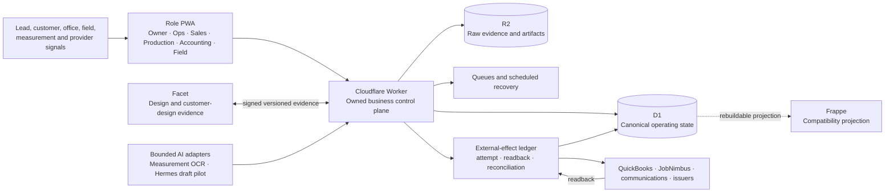
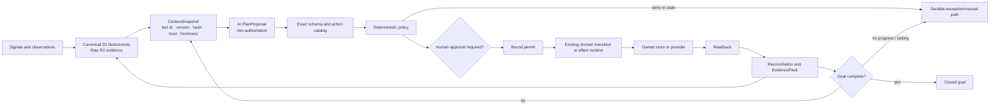

# IronWrap AI-Native Architecture

Status: canonical architecture map and target
Owner: IronWrap OS product owner
Last source verification: 2026-08-23
Review trigger: authority, lifecycle, repository, integration, AI, capability, or proof-state change

## Purpose and truth boundary

This document is the canonical map of what IronWrap OS is, what the audited repository currently
implements, and how the system becomes AI-native without giving a model business authority.

It does not replace:

- [`AUTONOMOUS-OPERATING-SYSTEM.md`](./AUTONOMOUS-OPERATING-SYSTEM.md), which owns the complete
  company target and human work model;
- [`AUTHORITY-AND-EVIDENCE-CONTRACT.md`](./AUTHORITY-AND-EVIDENCE-CONTRACT.md), which owns binding
  transition, evidence, safety, approval, side-effect, and reconciliation rules;
- [`CAPABILITY-MATRIX.md`](./CAPABILITY-MATRIX.md), which owns mutable implementation,
  configuration, and proof status; or
- [`COMPLIANCE-REGISTER.md`](./COMPLIANCE-REGISTER.md), which owns external-control review.

Repository prose never proves deployment, runtime health, customer acceptance, or production
operation. Code, configuration, CI, artifacts, deployments, provider readbacks, reference runs,
and customer outcomes are separate evidence classes.

## Definition

IronWrap OS is an evidence-first operating system for a roofing, exterior-construction, and metal
fabrication company. It turns signals into governed, reconciled business transitions:

```text
AI or a person interprets and proposes
  -> deterministic policy authorizes
  -> an exact permit binds the action
  -> a controlled tool executes
  -> the provider or owned store is read back
  -> reconciliation and evidence close the loop
```

AI is never the system of record, never holds provider credentials, never mints its own authority,
and never converts uncertainty into business truth.

## Current executable topology



The primary executable modules are:

| Module | Interface and responsibility |
|---|---|
| [`workers-bus/`](../workers-bus/) | Worker routes, domain transitions, D1/R2 persistence, queues, effects, provider readback, and reconciliation |
| [`app/`](../app/) | Same-origin role and customer surfaces, offline field capture, and approval experiences |
| [`frappe-apps/ironwrap_roofing/`](../frappe-apps/ironwrap_roofing/) | Temporary compatibility projection and legacy command adapters; no new operating authority |
| [`mcp/`](../mcp/) | Bounded read, preview, compatibility, and recovery adapters; not a second policy or state layer |
| [`hermes/`](../hermes/) | Role/tool configuration and the narrow desktop drafting pilot; not a resident autonomous runtime |
| Facet repository | Separate design bounded context, signed evidence producer, and canonical owner of the accepted configurator lineage |

## Authority map

| Fact or transition | Authority | Supporting evidence | AI role |
|---|---|---|---|
| Lead, customer, property, job | D1 plus Worker policy | Source receipts in R2 | Classify, summarize, propose |
| Measurement | Accepted D1 measurement version | Original reports/images in R2 | Extract review-required candidates |
| Design artifact and design decision | Facet inside its bounded context | Frozen artifacts and signed event | Design assistance only |
| Design-to-job commercial association | IronWrap D1 | Signed Facet receipt plus office association | None |
| Quote, proposal, publication | IronWrap D1 | Versioned artifacts and delivery receipts | Draft/explain only |
| Customer acceptance | IronWrap D1 bound to the exact current publication | Customer identity, challenge, terms, receipt | Prohibited |
| Production gates and assignment | IronWrap D1 | Permits, crew/gate versions, receipts | Recommend only |
| Work package and safety | IronWrap D1 | Field evidence, raw timestamps/media | Summarize and escalate only |
| Posted invoice/payment fact | Authenticated accounting-provider readback | Provider ID and response hash | None |
| Accounting intent and reconciliation | IronWrap D1 | Basis, approval, effect, provider readback | Explain exceptions only |
| AI plan | Append-only coordination audit | Context/model/prompt/schema hashes | Non-authoritative proposal |
| Policy decision and permit | Deterministic versioned policy | Exact inputs, actor, scope, expiry | None |

Facet cannot change a quote, proposal, contract acceptance, production schedule, or accounting
record. Frappe cannot originate or authorize operating truth. QuickBooks is authoritative only for
the posted facts it actually returns. External actors and issuers remain authoritative only for
their legal, professional, customer, physical, or issuer scope.

## Current maturity

The source audit represented by this document found:

| Area | Current code-grounded state | Required unusually-strong state |
|---|---|---|
| Core technical design | Strong | One authority per fact, explicit contracts, no bypass around effects or reconciliation |
| Lead/job/field foundation | Strong, with acceptance-driven activation projection and a read-only phase route | Orthogonal state machines and a deterministic derived job phase |
| Safety/evidence/accounting control | Unusually strong in source | Preserve fail-closed controls and prove deployed failure/recovery cases |
| Repository and migration coherence | Mixed | Two active products, explicit compatibility retirement, governed migration ownership |
| Configured capability | Partial | Per-capability readiness, dependency/readback proof, TTL, and fallback |
| End-to-end commercial closure | Incomplete | No-seed native lead-to-reconciled-closeout journey |
| Production/customer proof | Not established by this audit | Technical reference proof may be established; customer proof remains false until real customers exist |

The machine-checked snapshot is intentionally conservative:

<!-- ai-native-architecture-contract:start -->

```json
{
  "schema": "ironwrap_ai_native_architecture_contract_v1",
  "authority": {
    "operating_state": "d1_worker",
    "raw_evidence": "r2",
    "frappe": "compatibility_projection",
    "facet": "design_evidence_producer",
    "quickbooks": "posted_accounting_facts",
    "ai": "non_authoritative_proposal"
  },
  "product_topology": {
    "active_products": [
      "ironwrap_os",
      "facet"
    ],
    "facet_repository": "Iron-Wrap/facet",
    "home_config_3d": "retired_draft_lineage_absorbed_into_facet",
    "home_config_3d_execution_lane": false
  },
  "maturity": {
    "core_technical_design": "strong",
    "lead_job_field_foundation": "strong_with_acceptance_projection",
    "safety_evidence_accounting_controls": "unusually_strong_in_source",
    "repository_migration_coherence": "mixed",
    "configured_capability": "partial",
    "end_to_end_commercial_closure": "incomplete",
    "production_customer_proof": "not_established"
  },
  "commercial_reachability": {
    "approved_quote_revision_writer": "authenticated_role_api",
    "proposal_revision_writer": "authenticated_role_api",
    "proposal_publication_settlement_writer": "authenticated_role_api_readback_required",
    "customer_acceptance_writer": "production",
    "acceptance_to_deposit_derivation": "acceptance_queue_and_authenticated_recovery_api"
  },
  "configuration": {
    "effect_runtime_enabled": true,
    "quickbooks_oauth_enabled": false,
    "quickbooks_final_invoice_enabled": false,
    "hermes_desktop_enabled": false,
    "public_estimator_enabled": false,
    "newo_enabled": false,
    "postiz_enabled": false,
    "facet_routes_configured": false,
    "proposal_template_configured": false
  },
  "proof": {
    "repository_verified_for_this_audit": true,
    "deployed_exact_source_verified": false,
    "provider_readback_journey_verified": false,
    "production_reference_journey_verified": false,
    "customer_validated": false
  }
}
```

<!-- ai-native-architecture-contract:end -->

`tools/validate-documentation.mjs` derives the checkable source/configuration facts and fails when
this snapshot drifts. A future implementation must update code and this contract together; it
must not merely change the prose to green.

## Existing control kernel

The target reuses these implemented deep modules:

- [`operating-core.ts`](../workers-bus/src/operating-core.ts) atomically materializes customer,
  property, job, estimate, gates, consent, events, and audit state.
- [`effect-runtime.ts`](../workers-bus/src/effect-runtime.ts) leases attempts, blocks blind retry of
  unknown outcomes, requires provider confirmation, reconciles, and creates durable exceptions.
  Gmail's accepted send response is its confirmation under the send-only scope; a missing response
  stays unknown because an independent mailbox read is not authorized. This confirms provider
  acceptance, not independent body readback or recipient delivery; delivery readiness still needs
  its own authenticated proof and cannot be minted by the send adapter. New default Gmail and
  portal-decision effect keys omit the recipient; a retry first checks an existing
  recipient-bearing legacy key so an in-flight send is not sent again under a new key.
  The `0142` D1 guard rejects the second key if old and new Worker versions overlap; the
  new Worker re-reads an old key that wins after its first lookup. Apply that migration
  before routing traffic to the new Worker version. An old Worker that loses the race
  fails closed, and rollback must keep the guard in place.
  Historical ledger rows remain subject to the privacy workflow.
- [`commercial-store.ts`](../workers-bus/src/commercial-store.ts) owns immutable quote/proposal
  revision chains, money checks, authority, publication, and acceptance bindings.
- [`customer-contract-acceptance.ts`](../workers-bus/src/customer-contract-acceptance.ts) binds a
  customer decision to the exact current publication and terms and rejects drift atomically.
- [`production-gate-clearance.ts`](../workers-bus/src/production-gate-clearance.ts) clears the
  deposit gate only from reconciled settlement evidence.
- [`native-final-invoice-producer.ts`](../workers-bus/src/native-final-invoice-producer.ts) derives
  final-invoice intent from completion, accepted commercial truth, prior invoices, provider
  mapping, tax policy, and evidence.
- [`safety-actions.ts`](../workers-bus/src/safety-actions.ts) and the field outbox preserve raw
  evidence, bound time, duplicate-safe replay, and protected stop/make-safe behavior.

The OS must deepen these modules, not create a second authority or orchestration stack beside them.

## Current closure gaps

The native commercial chain is not yet reachable from start to finish:

```text
lead intake
  -> triage
  -> measurement / Facet design
  -> approved quote revision          [authenticated role API]
  -> proposal revision                [production route]
  -> publication effect + settlement [authenticated route; succeeded readback required]
  -> customer acceptance              [production path]
  -> deposit intent                   [acceptance-created queue; provider/tax/policy blockers remain explicit]
  -> reconciled deposit / gate clear  [implemented]
  -> native assignment / work package [implemented]
  -> completion / final invoice       [implemented]
  -> QuickBooks execution/readback    [implemented but disabled]
```

Lifecycle projection is acceptance-driven for lead conversion/customer activation, and
`GET /api/v1/jobs/{job}/phase` is a read-only projector over authoritative commercial, gate,
assignment, work-package, safety, accounting, closeout, and warranty facts. A reconciled provider
journey and customer proof remain open.

## Target AI coordination loop



Only one new generic append-only coordination aggregate is justified. A `coordination_run` records
the goal, context hash, model/prompt/schema hashes, proposed steps, fact citations, policy results,
existing permit/effect/transition references, progress ceilings, and terminal result. It must not
duplicate commercial permits, approval stores, effect attempts, provider receipts, or exceptions.

Every proposed action must cite exact current facts, use a registered action kind, declare
preconditions/freshness/risk/readback, and either obtain a deterministic permit or stop. Unknown
fields, stale context, missing citations, or an unregistered action cause abstention.

## Autonomy levels

| Level | Examples | Authorization |
|---|---|---|
| A0 observe/explain | Summaries, blockers, evidence lookup | Automatic; citations required |
| A1 draft | Lead follow-up, proposal narrative, exception explanation | Automatic draft; no effect |
| A2 reversible bounded action | Request missing evidence, send an approved consented template | Deterministic permit after technical proof |
| A3 consequential action | Publish proposal, schedule job, create provider invoice intent | Human approval plus exact permit/readback |
| Human-only | Customer acceptance, safety-stop release, waiver, refund/write-off, legal certification | AI prohibited |

Workers always retain unconditional report/stop/make-safe rights. AI cannot release a safety stop,
waive a gate, accept for a customer, approve its own output, or establish accounting truth.

## Orthogonal lifecycles and derived phase

Do not encode the entire company in one mutable job-status enum. Keep independent authoritative
state machines for:

1. lead qualification and conversion;
2. measurement/design/quote/proposal/publication/acceptance revisions;
3. production gates;
4. append-only crew assignment;
5. work-package acknowledgement/execution/hold points/completion;
6. safety occurrence, stop, make-safe, correction, and independent release;
7. accounting intent, execution, readback, and reconciliation; and
8. closeout, warranty, and service.

Expose a read-only derived `job_phase`:

| Phase | Deterministic predicate |
|---|---|
| `qualified` | Qualified lead/job exists and commercial work has not started |
| `qualification_pending` | The lead/job is not currently qualified or converted |
| `commercial_in_progress` | Measurement, design, quote, or proposal exists without binding acceptance |
| `deposit_pending` | Exact accepted publication is bound and the required deposit is not yet derived and reconciled |
| `production_ready` | Every required gate is currently cleared |
| `scheduled` | A current valid assignment exists |
| `in_progress` | A current work package has started |
| `substantially_complete` | Required completion packet is accepted |
| `financially_closed` | Current completion packet and final invoice balance are fully reconciled |
| `cancelled` | An authoritative cancellation supersedes active progress |

The phase is a projector/read model. It is never a second writable truth.
Warranty terms remain a `warranty_declared` fact; no warranty phase is projected until a durable
native activation record exists.

## Role journeys

- **Owner:** exception-first `Now`, approvals, policy, cash/safety exposure, capability health, and
  source-linked explanations.
- **Sales:** qualification, missing evidence, measurement/Facet design, quote, proposal,
  publication, and customer handoff.
- **Operations/production:** gate blockers, crew/readiness, assignment, work packages, and
  reconciliation exceptions.
- **Field:** `Today`, acknowledgement, offline evidence, hold points, stop/make-safe, and completion.
- **Accounting:** provider mapping/tax basis, deposit/final intent, approval, provider readback, and
  reconciliation.
- **Customer:** the exact current proposal/terms, genuine acceptance, derived status, closeout, and
  warranty/service.

AI appears inside these scoped journeys as proposals and explanations. It is not a global chatbot
with ambient authority.

## Interaction and workflow composition contract

Boards, pipelines, and Kanban lanes are read models over the orthogonal lifecycle facts above. A
versioned workflow view defines ordered lanes as deterministic predicates and declares which typed
commands may be requested from each lane. It does not own a second mutable status field.

A drag-and-drop gesture is therefore a command request, not a direct record update. It carries the
tenant, aggregate ID and version, workflow-view version, requested transition, actor, and stable
idempotency key. The Worker reloads current facts and rechecks role, policy, evidence, gates, and
preconditions. A stale, unauthorized, or blocked drop leaves authoritative state unchanged and
returns the exact blocker and recovery path.

Automations consume committed domain events through versioned rules. A rule may request an existing
typed internal transition or submit an external action through permit -> effect -> provider readback
-> reconciliation. Rule version, matched inputs, policy result, action reference, and terminal
outcome are auditable. Tenant-supplied arbitrary hooks or scripts may not mutate operating state,
send externally, or manufacture authority.

Operational forms are schema-driven collection surfaces, not generic document editors. A versioned
form definition declares typed fields, per-field read/write authority, provenance, conditional
evidence requirements, validation, retention, offline behavior, and correction audit. Form
configuration may change the collection experience; it cannot create a new business fact, bypass a
domain transition, or weaken evidence and approval rules.

## Conversational owner control surface

The owner-facing AI surface is an additional client of the same read models and action catalog. It
may answer source-linked questions, explain blockers and exceptions, draft bounded artifacts,
request a governed action, present approval when policy requires it, and show effect readback and
reconciliation. It must expose uncertainty, missing evidence, and the exact human or system needed
to continue.

An MCP server or skill interprets intent and transports typed requests only. It receives neither
ambient authority nor provider credentials, and it cannot bypass Worker policy or write directly to
D1, Frappe, Facet, QuickBooks, or another provider. Consequential actions retain their existing
approval, permit, effect, and readback contracts. Role screens, exception queues, audit history, and
recovery controls remain mandatory fallbacks; conversational control does not eliminate the UI.

## Production reference journey without customers

The technical production bar uses an isolated `reference` tenant and company-controlled actors.
Every entity is visibly labelled `REFERENCE TEST - DO NOT SERVICE`. The run uses the exact
production artifact, APIs, queues, policy, storage, scheduler, and provider adapters without direct
database seeds or test-only business helpers.

The reference journey must prove:

1. signal -> raw receipt -> canonical lead/customer/property/job;
2. qualification -> measurement -> signed Facet design/customer-design evidence;
3. native approved quote -> proposal -> ledgered publication -> provider readback;
4. exact customer acceptance -> deposit intent -> provider readback -> gate clearance;
5. all gates -> assignment -> offline work packages -> hold points -> safety stop/release;
6. completion -> final invoice -> provider readback/reconciliation -> closeout/warranty; and
7. joined evidence, backup/restore, rollback, replay, and no-progress exception handling.

Required injected failures include duplicate/replay, stale facts, prompt injection, proposal drift,
lost provider response, provider refusal, permission denial, offline conflict, safety stop, gate
staleness, payment mismatch, email or magic-link provider outage, Cloudflare edge/ingress outage,
PWA/Worker/compatibility-projection version skew, partial rollout recovery, supplier catalog
staleness or unit mismatch, QuickBooks realm/token/readback mismatch, and backup/rollback failure.

The permitted conclusion is **technical production reference journey established for exact source
and configuration**. Customer adoption, usability, conversion, willingness to pay, field
effectiveness, and business acceptance remain **not established** until independently evidenced by
real customers and workers.

## Capability readiness

Every capability advances independently through:

```text
implemented
  -> built
  -> configured
  -> provider_reachable_and_readback_verified
  -> enabled
  -> technically_proven
  -> customer_validated
```

Each state needs an owner, source SHA, configuration digest, dependencies, proof timestamp/TTL,
blocker, and safe fallback. Readiness profiles are `core`, `commercial_closure`, `field_closure`,
`accounting_closure`, and `reference_journey`. Optional Newo, Postiz, and public-estimator paths do
not block the core journey unless product policy explicitly adds them.

Every provider integration also has a versioned manifest: provider and tenant identity, supported
direction and actions, authentication scopes, data classification, authority boundary,
idempotency/retry policy, required readback and reconciliation, failure fallback, readiness state,
and proof TTL. The Integrations surface is a view over reviewed manifests and configuration; it is
not a runtime marketplace for arbitrary hooks or plugins.

## Repository and migration coherence

- The active product topology has exactly two products: IronWrap OS and Facet. Home Config 3D was
  draft lineage whose accepted capability is already absorbed into Facet; it has no current
  repository, roadmap, deployment, ownership, parity, or Wayfinder lane.
- IronWrap is the company operating authority.
- `Job` is the canonical IronWrap operating and commercial aggregate. `Facet Project` is a separate
  design aggregate. The target is a stable Job kernel plus a versioned `job_kind`/operating profile
  and domain-specific extensions, not one generic Project monolith.
- Existing `roof_job_id` identities remain stable while portability is introduced through expand,
  dual-read comparison, writer switch, and explicit compatibility projection. Do not mass-rename
  tables, routes, events, or evidence references before commercial closure and migration proof.
- Facet remains a separate active customer-facing design/measurement product boundary and signed
  design-evidence producer. IronWrap owns operating association and every commercial transition.
- Facet is the canonical implementation owner for accepted Capture, parser, geometry, rendering,
  pricing, catalog, and computer-vision lineage. A surviving idea found in retired Home Config 3D
  history is triaged as a Facet backlog input; it never creates a parallel porting obligation or a
  second product authority.
- Frappe is compatibility only. While its wheel ships, its required tests and exact
  stage/promote/readback/rollback receipts must be release-blocking; remove the wheel and that
  release gate together after the last consumer and rollback proof are gone.
- Retire old Frappe approval/scheduling broker paths after native equivalents have parity and live
  rollback evidence.
- Do not renumber historical D1 migrations. Record reserved gaps and authority cutovers in a
  machine-readable migration manifest.
- Migrate with expand -> dual-read comparison -> writer switch -> read-only projection -> parity
  proof -> deletion.
- An `Operating Pack` is a future versioned configuration bundle for proven combinations of roles,
  views, forms, policies, workflows, integrations, and job kinds. A pack can reference existing
  authority contracts but cannot mint authority or executable tenant code. Build packs only after
  the same configuration has been proven repeatedly; defer a template marketplace until independent
  packs have upgrade, rollback, isolation, and compatibility proof.

## Delivery order and gates

1. **Truth and authority:** architecture contract, capability states, migration ownership, one
   writer per fact.
2. **Commercial closure:** production quote writer, publication settlement, acceptance-driven
   deposit derivation, configured accounting readback.
3. **Lifecycle and role workflow:** lead conversion, customer activation, derived phase and
   invariants, governed workflow views, schema-driven forms, and a role-by-role offline matrix.
4. **Thin AI coordinator:** context snapshot, action catalog, one coordination aggregate, bounded
   lead/exception use cases and the owner conversational surface first.
5. **Configuration:** minimum provider set, versioned integration manifests, readiness profiles,
   supplier-catalog snapshots, and provider readback/reconciliation.
6. **Reference proof:** exact-source journey plus the required edge, email, version-skew, offline,
   catalog, provider, and recovery drills and EvidencePack.
7. **Retirement:** Frappe brokers/wheel and duplicate predecessor paths after parity proof.
8. **Customer validation:** only real users may change `customer_validated` from false.

Machine gates must prove one writer per authority, contract hashes, effect/readback coverage,
no-seed commercial reachability, offline/safety behavior, accounting reconciliation, AI grounding
and abstention, recovery, and evidence-class claim discipline.
