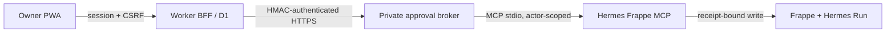

# Hermes approval broker contract

The approval rail turns one bounded Hermes preview into one human-approved,
audited mutation. It is deliberately not a generic remote-control API.

## First vertical

`dry_run_mark_lead_triaged` → `request_mark_lead_triaged` only.

This is the first brokered action because it changes one local Lead Envelope
triage annotation and cannot send a communication, alter bus transport, create
a quote, or mutate accounting. The existing MCP write continues to re-run the
preview and verify the exact signed receipt before the Frappe command can run.

## Trust boundaries

- The PWA never receives a private signing key, Frappe API credential, dry-run
  signing key, or raw MCP capability.
- The Worker owns the durable, tenant-scoped approval-request record in D1. It
  does not sign approvals or call Frappe directly for the approved write.
- The broker owns the Ed25519 private key and actor-scoped MCP environment. It
  accepts only HMAC-authenticated Worker requests over HTTPS and only the
  bounded lead-triage preview/execute endpoints. It is a constrained policy
  enforcement point, not a generic MCP proxy: browser data cannot choose a
  tool, role, actor, site, approver, or Frappe path.
- Frappe remains the executed business audit: the existing MCP request creates
  and finalizes the immutable `Hermes Run` only after receipt verification.

## Durable request state

`Pending → Executing → Executed | Denied | Expired | Failed | Audit Failed |
Execution Uncertain`

An approval decision atomically claims one `Pending` request with its expected
version and idempotency key. A transport failure after the broker is called is
`Execution Uncertain`, never retried automatically: the underlying MCP write
may already have created a `Hermes Run` or mutated Frappe. Operators reconcile
that state against the recorded `run_id`; reconciliation records an outcome
and evidence without reopening the mutation.

The persisted request binds all of the following: tenant, broker site, agent
role, actor, exact target, canonical write arguments, preview/diff digests,
dry-run receipt, expiry, approver, execution idempotency key, and final Hermes
Run/result reference. It is a mutable current projection backed by an
append-only D1 event ledger; database triggers reject rewrite/delete of static
evidence or events. The browser response is an allowlisted review DTO, not a
JSON pass-through: it excludes both receipt types, raw write arguments, and
arbitrary broker/MCP output.

## User-facing contract

- Office users can read the approval inbox. Only the configured approver whose
  Frappe identity matches `APP_APPROVAL_APPROVER_ID` can decide.
- An approval requires a current CSRF token, a recent interactive session, a
  request version, and an idempotency key.
- The card renders only the exact preview: before state, proposed patch, policy
  result, expiry, and action outcome. It never claims a customer was contacted
  or that a lead was triaged until the executed Hermes Run proves it.
- Rejection is durable and does not invoke the broker.

## Production gates

1. Broker host uses its own runtime identity and private key; its public key
   and bound approver identity are configured in the MCP host.
2. Worker-to-broker HTTPS is HMAC authenticated in both directions with a
   short timestamp window; browser origins are never accepted by the broker.
3. Broker request, execution, expiry, denial, conflicting decision,
   unauthorized identity, stale preview, audit-failure, and ambiguous-network
   paths have deterministic tests.
4. A controlled live proof archives the preview, approval decision, protected
   triage result, and executed Hermes Run for one Untriaged lead.
