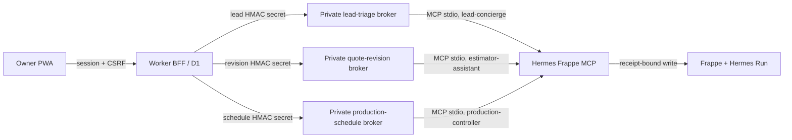

# Hermes approval broker contracts

The approval rail turns one bounded Hermes preview into one human-approved,
audited mutation. It is deliberately not a generic remote-control API.

This is the current implemented transitional control, not the final human boundary. Under the
reliable-agent target, a routine digital action may move to machine-issued policy authority only
after the canonical side-effect, idempotency, reconciliation, rollback, and audit contracts are
implemented and tested. Existing approval gates remain binding until that replacement lands.
Legal, customer-consent, physical-acceptance, relationship-sensitive, and safety-critical human
authority is never removed by this transition.

## Bounded verticals

| Authority | Fixed dry run → write | Role | D1 ledger | Private routes |
| --- | --- | --- | --- | --- |
| Lead triage | `dry_run_mark_lead_triaged` → `request_mark_lead_triaged` | `lead-concierge` | `approval_requests` / `approval_request_events` | `/v1/lead-triage/preview`, `/v1/lead-triage/execute` |
| Quote-revision shell | `dry_run_quote_revision` → `request_create_quote_revision` | `estimator-assistant` | `quote_revision_approval_requests` / `quote_revision_approval_request_events` | `/v1/quote-revision/preview`, `/v1/quote-revision/execute` |
| Production schedule | `dry_run_job_assignment` → `request_create_job_assignment` | `production-controller` | `production_schedule_approval_requests` / `production_schedule_approval_request_events` | `/v1/production-schedule/preview`, `/v1/production-schedule/execute` |

The brokers are distinct processes with different private URLs, HMAC secrets,
key IDs, listener ports, and role-scoped MCP children. Neither is a generic
remote-control API, and no browser request can choose its tool, role, actor,
site, approver, or Frappe path.

### Lead-triage vertical

`dry_run_mark_lead_triaged` → `request_mark_lead_triaged` only.

This is the first brokered action because it changes one local Lead Envelope
triage annotation and cannot send a communication, alter bus transport, create
a quote, or mutate accounting. The existing MCP write continues to re-run the
preview and verify the exact signed receipt before the Frappe command can run.

## Trust boundaries

- The PWA never receives a private signing key, Frappe API credential, dry-run
  signing key, or raw MCP capability.
- The Worker owns the durable, tenant-scoped approval-request record in D1. It
  does not sign approvals or call Frappe directly for the approved write.
- Each broker owns the Ed25519 private key and actor-scoped MCP environment.
  It accepts only HMAC-authenticated Worker requests over HTTPS and only its
  two bounded endpoints. It is a constrained policy enforcement point, not a
  generic MCP proxy.
- Frappe remains the executed business audit: the existing MCP request creates
  and finalizes the immutable `Hermes Run` only after receipt verification.

## Durable request state

`Pending → Executing → Executed | Denied | Expired | Failed | Audit Failed |
Execution Uncertain`

An approval decision atomically claims one `Pending` request with its expected
version and idempotency key. A transport failure after the broker is called is
`Execution Uncertain`, never retried automatically: the underlying MCP write
may already have created a `Hermes Run` or mutated Frappe. Operators reconcile
that state against the recorded `run_id`; reconciliation records an outcome
and evidence without reopening the mutation.

The persisted request binds all of the following: tenant, broker site, agent
role, actor, exact target, canonical write arguments, preview/diff digests,
dry-run receipt, expiry, approver, execution idempotency key, and final Hermes
Run/result reference. It is a mutable current projection backed by an
append-only D1 event ledger; database triggers reject rewrite/delete of static
evidence or events. The browser response is an allowlisted review DTO, not a
JSON pass-through: it excludes both receipt types, raw write arguments, and
arbitrary broker/MCP output.

### Quote-revision shell vertical

The quote-revision broker can create only a fresh, append-only `Draft` Customer
Quote shell. It binds the source quote, Frappe Roof Job, correction reason,
new deterministic target, fresh version, actor, approver, run, receipt, and
expiry. It cannot copy or set price, tax, scope, payment, approval, acceptance,
customer terms, or any customer communication. An `Accepted` or contract-linked
source fails closed to the Change Order path.

The ledger stores only a redacted approval preview: source identity, version,
status, modified time; Draft target/version/supersedes; and correction reason.
Its browser projection adds fixed no-effect flags. A separate `receipt_preview_digest` binds the full
private dry run without retaining commercial source fields in D1. Immediately
before signing, the broker re-runs the full dry run and requires both the
redacted and receipt-bound digests, source, target, version, and supersedes
lineage to match. Any drift fails before write; a post-invocation failure is
`Execution Uncertain` and is never retried.

### Production-schedule vertical

The production schedule authority can create only an append-only `Production`
`Job Assignment` for one active Crew Profile with a required scheduled start.
The browser may provide only the Roof Job, Crew Profile, bounded timing, and
an optional superseded assignment plus correction reason. It cannot select an
individual user, assignment type/status, target ID, tool, actor, site, receipt,
or write arguments. The private broker derives the deterministic assignment
target, uses fixed `Production` / `Assigned` semantics, requires the complete
non-blocking Deposit, Materials, Safety, Access, Weather, and Crew gate set,
and rechecks those facts immediately before the receipt-bound Frappe write.
At that final Frappe document-validation fence, the Roof Job lock also rejects
an active `Needs Review` or `Shortage` Supplier Order and prevents competing
logical current scheduled Production assignments. A correction is valid only
when it supersedes the sole current assignment; the browser, Worker preview,
and broker packet are never authority for either fact.

The D1 projection contains only the safe target, crew, timing, correction
lineage, a boolean eligible-gate signal, and no-effect flags. It never exposes
raw gate detail, Frappe credentials, receipts, tool names, private args, or
broker output. A correction is always a new request and new assignment that
supersedes the previous assignment; no existing assignment is edited.

## User-facing contract

- Office users can read the approval inbox. Only the configured approver whose
  Frappe identity matches `APP_APPROVAL_APPROVER_ID` can decide.
- An approval requires a current CSRF token, a recent interactive session, a
  request version, and an idempotency key.
- The card renders only the exact preview: before state, proposed patch, policy
  result, expiry, and action outcome. It never claims a customer was contacted
  or that a lead was triaged until the executed Hermes Run proves it.
- Rejection is durable and does not invoke the broker.
- The initial `/approvals` PWA is a review/decision surface, not a generic lead
  editor. A contextual Sales preparation route may submit only an explicitly
  `Untriaged` Lead Envelope and its internal summary when the BFF grants
  `approval.prepare`; trusted dry-run and write boundaries enforce that status again.
  It displays `approval.approve`, `approval.reject`, and `approval.reconcile` only
  when the BFF grants those capabilities; it never infers authority from the
  visible role.
- Decision actions are online-only. The PWA never places an approval in its
  field outbox, retries a timed-out broker call, or displays a success state
  without the returned terminal ledger state.
- Production Runway remains a source-backed read. Its owner-only contextual
  `/production/schedule/:jobId` page can submit a bounded schedule preparation
  only when the Worker grants `production_schedule_approval.prepare` for that
  exact job and active Crew Profile list. It stages a request; it does not
  schedule or dispatch directly. Its configured approver is separate:
  `APP_PRODUCTION_SCHEDULE_APPROVER_ID` with its own recent-session bound.

## Worker BFF routes

All routes are `private, no-store`; mutation routes additionally require the
exact allowed origin and session CSRF token.

| Method | Route | Authority | Contract |
| --- | --- | --- | --- |
| GET | `/api/v1/approvals` | owner or ops | allowlisted list DTO plus server-issued capability names |
| GET | `/api/v1/approvals/:id` | owner or ops | current allowlisted DTO; pending expiry is re-evaluated before return |
| POST | `/api/v1/approvals/lead-triage` | owner or ops with Frappe identity | contextual PWA preparation only; strict `{lead_envelope_id,triage_summary}` body, Worker-derived request text, fixed tool/actor/site, and prepare idempotency key |
| POST | `/api/v1/approvals/:id/approve` | configured owner only | recent session, expected version, decision idempotency key, broker execution, terminal ledger event |
| POST | `/api/v1/approvals/:id/reject` | configured owner only | recent session, expected version, reason, decision idempotency key; no broker call |
| POST | `/api/v1/approvals/:id/reconcile` | configured owner only | recent session, expected version, one immutable evidence/outcome append; does not reopen or retry |
| GET | `/api/v1/quote-revision-approvals` | owner or ops | separate safe Draft-shell queue; never a lead-triage variant |
| GET | `/api/v1/quote-revision-approvals/:id` | owner or ops | current safe quote-revision DTO; re-evaluates pending expiry |
| POST | `/api/v1/quote-revision-approvals` | owner or ops with Frappe identity | fixed job/source/reason preparation and broker-derived target; no tool proxy |
| POST | `/api/v1/quote-revision-approvals/:id/approve` | configured owner only | distinct broker, recent session, expected version, decision idempotency, terminal ledger event |
| POST | `/api/v1/quote-revision-approvals/:id/reject` | configured owner only | durable rejection; no broker invocation |
| POST | `/api/v1/quote-revision-approvals/:id/reconcile` | configured owner only | one immutable uncertainty evidence/outcome append; no reopen/retry |
| GET | `/api/v1/production-schedule-approvals` | configured owner only | isolated safe schedule-approval ledger; no generic production writer |
| GET | `/api/v1/production-schedule-approvals/:id` | configured owner only | current safe DTO; pending expiry is re-evaluated before return |
| POST | `/api/v1/production-schedule-approvals` | configured owner only | contextual source-backed strict `{roof_job_id,crew_profile_id,scheduled_start,scheduled_end,supersedes_assignment_id,correction_reason}` preparation; target/tool/role/site stay server-derived |
| POST | `/api/v1/production-schedule-approvals/:id/approve` | configured owner only | independent broker, recent session, expected version, decision idempotency, terminal ledger event |
| POST | `/api/v1/production-schedule-approvals/:id/reject` | configured owner only | durable rejection; no broker invocation |
| POST | `/api/v1/production-schedule-approvals/:id/reconcile` | configured owner only | immutable uncertainty evidence/outcome append; no reopen/retry |

`Execution Uncertain` is a terminal mutation state, not a temporary UI error.
The stored `run_id` is the reconciliation key; a later reconciliation records
evidence without reopening the request or issuing another write.

The installed `/approvals` PWA remains exclusively lead-triage review and decision. Sales reaches
that queue only through a contextual preparation page for an explicit `Untriaged` Lead Envelope
with `approval.prepare`; it sends only the Frappe lead name and internal triage summary, never a
customer message or browser-authored request text. The dedicated estimator PWA reaches the
quote-revision routes through a
capability-gated workbench entry, a correction-reason-only preparation screen,
and isolated queue/detail screens. It never reuses the lead inbox, exposes a
generic approval selector, or renders receipt/write/commercial fields. This is
local application and mocked-browser proof only; it does not replace the live
broker, migration, authenticated-browser, or operator-acceptance gates below.

## Production gates

1. Broker host uses its own runtime identity and private key; its public key
   and bound approver identity are configured in the MCP host.
2. Worker-to-broker HTTPS is HMAC authenticated in both directions with a
   short timestamp window; browser origins are never accepted by the broker.
   The service binds loopback only and is reached through a separately scoped,
   TLS-protected internal tunnel/Access path.
3. Broker request, execution, expiry, denial, conflicting decision,
   unauthorized identity, stale preview, audit-failure, and ambiguous-network
   paths have deterministic tests.
4. A controlled live proof archives the preview, approval decision, protected
   triage result, and executed Hermes Run for one Untriaged lead.
5. The quote-revision service uses
   `deploy/quote-revision-approval-broker.service.example` and its own
   root-readable environment file, secrets, port, role identity, and Frappe
   credential. A controlled proof must show one Draft shell with matching
   source/version, redacted queue projection, and executed Hermes Run—without
   price, tax, scope, payment, acceptance, or customer-message mutation.
