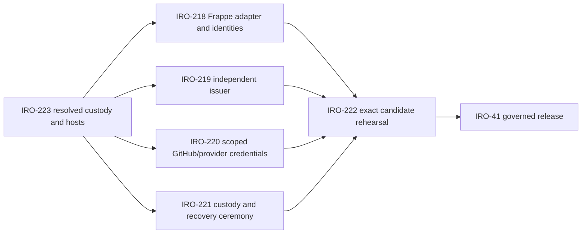
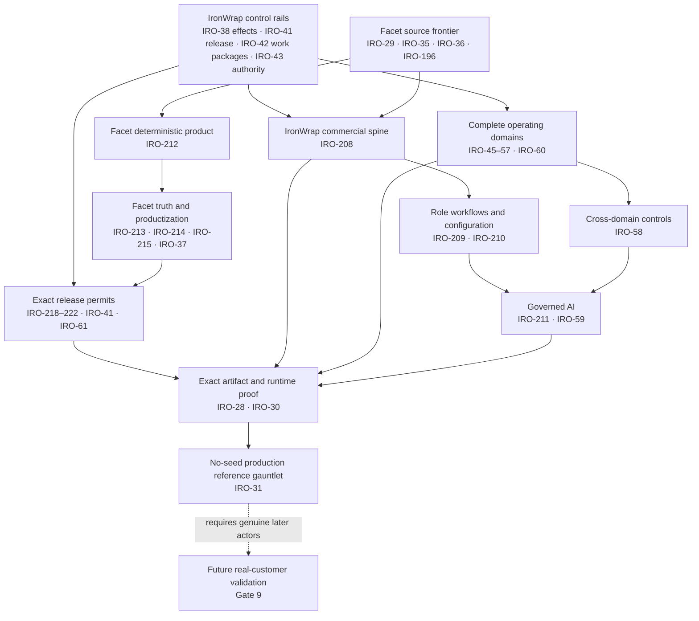

# Capability Matrix

Status: canonical implementation gap register
Owner: IronWrap OS product owner
Last verified: 2026-08-31 (Multica G1.11 domain-row proof-label relabeling pass)
Latest phase delta verified: 2026-08-27 — Locally-validated (IRO-242 branch-local schema
fields/templates and the default-off R2 generation/effect/readback/reconciliation path pass focused
repository tests on that branch checkout). Not Configured, Runtime-proven, Business-accepted, or
Customer-validated; not exact-main CI, activation, deployment, or production proof.
Release activation delta verified: 2026-08-29 — Locally-validated (branch-local workflow source
invokes the trusted-base Frappe adapter preflight and promote/readback/rollback commands, binds
their signed receipts, and persists incomplete automatic rollback as recovery-required evidence;
source and test evidence only on that branch checkout). Not Configured, Runtime-proven,
Business-accepted, or Customer-validated.
Review trigger: merged capability, changed proof, deployment, or production acceptance

## Status vocabulary

This file uses the single proof-label vocabulary defined in
[`DOCUMENTATION-CONTRACT.md`](./DOCUMENTATION-CONTRACT.md#required-truth-labels) — Target,
Source-present, Locally-validated, Configured, Runtime-proven, Business-accepted, Customer-validated —
plus its orthogonal qualifiers (Partial, `<class>, repository-verified <date>`, `Blocked: <reason>`).
It does not define its own terms. Every row in this file now carries exactly one of those classes:
the "Seven-area maturity snapshot" and "Capability-by-capability target" tables were relabeled in the
2026-08-31 G1.11 pass using the migration map in `DOCUMENTATION-CONTRACT.md`'s "Migration from prior
vocabularies", completing the migration `DOCUMENTATION-CONTRACT.md` opened and
`IRONWRAP-OS-PRODUCT-TEAM-SPEC.md` §9.2 continued. The prior ten-term vocabulary (Implemented, Built,
Provider-reachable, Technically proven, Target-only, External proof required, and the rest) is retired
here; the narrative "Implemented substrate" sections below use "Implemented" as a section heading for
what source exists, never as a proof claim.

This file does not claim current deployment or production state. Fresh live evidence must come from
the launch/readiness tooling and the named external authority.

## Seven-area maturity snapshot

Area state uses the six canonical proof classes named under "Status vocabulary" above, never a bare
"Strong", "Mixed", "Partial", or "Not established" standing in for a class. The class recorded is the
weakest class any part of the named area earns; `Partial` and `Blocked: <reason>` are orthogonal
qualifiers attached to that class, never a substitute for one. This repository matrix does not by itself establish Configured or above; the admission note under
"Capability-by-capability target" defines the separate environment evidence those classes require.

| Area | Current state | Next gate |
|---|---|---|
| Core technical design | Locally-validated. One-writer-per-fact transitions, the versioned transition envelope, and the effect/reconciliation kernel pass focused checks on this checkout (`workers-bus/test/transition-kernel.test.ts`, `effect-runtime.test.ts`, `operating-core.test.ts`, `store.test.ts`, `core.test.ts`), and the Worker migration set is checked against isolated local D1 state. Its current count is declared in the machine-checked repository evidence contract below. "Strong" was a judgement about the design, not a proof class; the design is validated in the repository and nowhere else. | keep one authority per fact and remove remaining compatibility dependencies |
| Lead/job/field foundation | Locally-validated, Partial. Acceptance-driven lead conversion, customer activation, and a read-only derived phase route pass focused checks (`workers-bus/test/d1-native-operating-intake.test.ts`, `native-lead-queue.test.ts`, `operating-core.test.ts`, `work-package-actions.test.ts`, `field-actions-d1.test.ts`; `app/e2e/now-work-list.spec.ts`, `field-pwa.spec.ts`). Multi-worker offline packages, full evidence-slot enforcement, and a real-device reference drill are Target — every check above runs headless. | continue orthogonal lifecycle coverage and real reference proof |
| Safety/evidence/accounting controls | Locally-validated. Stop-work, occurrence, corrective-action, evidence, and accounting-reconciliation controls pass focused checks (`workers-bus/test/safety-lifecycle.test.ts`, `operational-safety.test.ts`, the 22 `accounting-*.test.ts` files, `effect-runtime.test.ts`). "Unusually strong in source" described the code, not a class: these source checks do not establish deployed provider, device, failure, or recovery proof. | deployed provider/device/failure and recovery proof |
| Repository/migration coherence | Locally-validated, Partial. The Worker migration set is checked against isolated local D1 state (current count below), the DocType contract validator pins 79 DocTypes, and `node tools/validate-documentation.mjs` passes on this checkout. "Mixed" described completeness, not proof: duplicate brokers and the Frappe wheel are not retired and migration ranges and cutovers are not yet governed, so that half stays Target. | retire duplicate brokers/Frappe wheel and govern migration ranges/cutovers |
| Configured capability | Target, Blocked: exact environment evidence required. Repository flags and readiness checks cannot establish that flags, secret identities, and the exact deployed artifact are jointly bound in a named environment. The readiness evaluator is locally validated (`workers-bus/test/capability-readiness.test.ts`, `readiness-probe.test.ts`, `node tools/production-readiness.mjs contract`); its result must be read from the named environment before a capability advances. | minimum-provider readiness profiles with readback and proof TTLs |
| End-to-end commercial closure | Locally-validated, Partial, Blocked: provider/tax configuration and QuickBooks keys. Native quote/publication routes and the acceptance-created deposit derivation queue pass focused checks (`workers-bus/test/commercial-proposal-api.test.ts`, `customer-contract-acceptance.test.ts`, `iro208-commercial-reference.test.ts`, the `accounting-*.test.ts` family). No no-seed route through provider mapping, tax policy, accounting readback, gate clearance, and closeout has been executed. | no-seed route through provider mapping, tax policy, accounting readback, gate clearance, and closeout |
| Production/customer proof | Target. CI and QA deployment receipts are separate from an authenticated full reference journey, accountable business acceptance, and real-customer use. Read the exact revision and environment from fresh release evidence; this matrix does not assert current deployment state. `customer_validated` remains false until independent customer evidence exists. | controlled production reference journey; real-customer validation remains a separate later gate |

The architecture, authority map, user journeys, AI loop, derived lifecycle, and reference-tenant
rules are canonical in [`AI-NATIVE-ARCHITECTURE.md`](./AI-NATIVE-ARCHITECTURE.md).

## Repository evidence contract

The documentation gate derives stable repository facts from the current checkout and compares them
with this contract. PWA and Worker suite totals are not hand-authored facts: CI reads them from each
real test run and emits them in a mutable receipt outside canonical prose. That receipt separately
binds the authored source commit, pull-request base commit, and exact tested checkout/tree to the
workflow SHA, event, refs, run, attempt, and job.
It never upgrades merge, deployment, runtime, business acceptance, or production proof by
implication.

<!-- capability-evidence-contract:start -->

```json
{
  "schema": "ironwrap_capability_contract_v1",
  "expected": {
    "frappe_doctypes": {
      "total": 79,
      "top_level": 60,
      "child": 19
    },
    "d1_migrations": {
      "count": 143,
      "latest": "0206_agent_draft_closing.sql"
    }
  },
  "test_observation_policy": {
    "pwa": "observe_per_receipt",
    "worker": "observe_per_receipt"
  },
  "proof_state_policy": {
    "source": "derive_per_receipt",
    "local_tests": "observe_separately",
    "ci": "observe_separately",
    "merge": "never_infer",
    "deploy": "never_infer",
    "runtime": "never_infer",
    "business_acceptance": "never_infer",
    "production_proof": "never_infer",
    "technical_reference_proof": "never_infer",
    "customer_validation": "never_infer"
  }
}
```

<!-- capability-evidence-contract:end -->

The expected structural counts change only with the same reviewed source change that adds or
removes the underlying contract. A mismatch fails documentation validation. Test totals are
observed from each successful run and never pinned in this shared document. The generated receipt
is an exact-source and tested-checkout repository/CI observation, not a release permit.

## Sep 1 remaining honesty (2026-08-21)

Repository-only. None of the following is live proof, deployment, or Done for a real customer job.

- IRO-52 S6/S7 holdback and payroll stay HTTP 501 until owner policy names a posting target.
- IRO-49 supplier packets stay internal (`external_supplier_contact: false`). No customer or supplier send.
- IRO-46 / IRO-47 shop travelers and assemblies remain target-only; no empty shop tables and no second pricing engine exist.
  This is not in tension with the Shop row of "Capability-by-capability target": that row is about the shop
  order/reservation/route/QC/yield/bundle/handover chain, which exists as seven DocTypes and is locally validated by
  `frappe-apps/ironwrap_roofing/tests/test_shop_fabrication_api.py`. Travelers and assemblies are separate objects
  that do not exist at all — there is no `shop_traveler` or assembly DocType and the string "traveler" appears
  nowhere in the tree (verified 2026-08-31 at `main` @ `63a28e43`). Both statements are true about different scopes.
- IRO-50 scheduler capacity remains target-only; no solver or booking surface exists.
- IRO-53 / IRO-55 / IRO-57 / IRO-58 / IRO-59 / IRO-60 / IRO-190 remain target-only or partial. Do not mark them Done.
- Do not de-roofify `operating_roof_jobs`. Money, portal, Facet, and QuickBooks still key that identity.
- JobNimbus has no owned D1 import adapter yet; it remains pending a join to `/admin/crm-import/{dry-run,execute}`. Dual-write is not retired.
- IRO-31 / IRO-193 / IRO-28 live OCR / IRO-52 S12 remain blocked on a live qa URL, owner participation, a usable measurement-OCR provider, and QuickBooks keys. Do not treat a local `--check` as that proof.

## Canonical operating-authority migration

Target: D1 plus the Worker is the sole owned authority for normalized operating state, transitions,
policy, audit, and reconciliation. R2 retains raw evidence. QuickBooks and genuine external actors
remain authoritative only for their exact posted-accounting, legal, professional, customer, or
physical scopes.

Current implementation: office sales/estimator/today/work-package/Facet/QuickBooks-final-invoice
reads already use D1. Default `/ready` is the owned office plane and does not AND leftover
Frappe/Newo credentials. Money-intent job lookup, production-gate clearance, and customer material
decisions persist on D1. The 79 current DocTypes are leftover compatibility evidence, not the
target architecture. Frappe activation remains optional (apps tree, Hermes ERPNext MCP and local
`--profile frappe` compose). While the compatibility app ships, its unittest, lint and wheel checks
remain mandatory in `make check` and the `contracts` CI job. Optional activation does not waive
the architecture contract's stage/promote/readback/rollback evidence requirements; repository
checks alone do not establish those release receipts.

The cutover is incomplete until leftover projection consumers are gone and a live issuer/rollback
has been proven. Projection failure cannot change authoritative D1 state.

### Job vocabulary and portability target

`Job` is the canonical IronWrap operating/commercial aggregate. Existing `roof_job_id` values are
stable identities and remain valid evidence references. The target is a Job kernel with a versioned
`job_kind`/operating profile and domain-specific extensions, not a generic Project record containing
every trade and workflow.

Portability starts only after deterministic commercial closure. Use expand -> dual-read comparison
-> writer switch -> compatibility projection -> parity proof; do not mass-rename D1 tables, routes,
events, or evidence. A `Facet Project` remains a separate design aggregate and is associated to an
IronWrap Job only through the governed evidence contract.

### Commercial, lifecycle, and AI reachability

Current source tracing distinguishes implemented modules from reachable production flows:

- `recordCommercialQuoteRevision` is reachable through the authenticated commercial quote route;
  the route re-evaluates the active tenant job graph and policy permit.
- `recordCommercialProposalRevision` is reachable through the app API.
- `recordCommercialProposalPublication` is reachable through the authenticated settlement route;
  only a canonical succeeded effect with matching tenant, permit, intent, aggregate, and action is
  accepted.
- native customer acceptance is production-reachable and atomically binds the exact quote,
  proposal, publication, terms, challenge, and customer decision.
- The emailed acceptance token has a private, no-store preview of the current bound quote version,
  total in cents, currency, validity date, proposal title and summary, and exact approved terms.
  A withdrawn or changed publication stops that preview; the confirmation route still performs
  its own binding check before committing.
- acceptance creates exactly one durable deposit-derivation queue row in the same D1 transaction;
  authenticated accounting recovery replays that queue and derives an intent only when provider
  mapping, tax policy, and authority-ceiling facts match. Missing configuration remains blocked.
- native assignment, work-package, safety, completion, and final-invoice derivation exist.
- Sales can read one active job's plan and its paged native proof through `GET /api/v1/jobs/{job}`
  and `GET /api/v1/jobs/{job}/proof` with `estimator:read`. Both reads are tenant-scoped,
  `private, no-store`, and expose only `job.read` as an allowed action. This does not grant
  `jobs:read:any`: job history, customer history, and the commercial phase remain closed to sales.
  The Figma-derived estimator screen and authenticated QA are still required before acceptance.
- acceptance projects qualified leads to `converted` and prospect customers to `active`; the
  read-only job-phase route spans the independent commercial, production, safety, accounting,
  closeout, and warranty facts without becoming a writable status. It requires `jobs:read:any`
  and is served `private, no-store` (2026-09-16): it used to admit any `canReadJobs` session, so a
  crew holding only `jobs:read:assigned` could read any job's quote totals, terms, acceptance and
  accounting intents by id, from a response with no cache directive.
- `GET /api/v1/jobs/{job}/commercial-context` (2026-09-16, `sales:read`, `private, no-store`) is
  the shared commercial context a person or agent reads before writing to a customer. It composes
  the job-phase reader instead of the store's `getCurrentCommercial*` helpers, which are keyed by
  quote or pack, accept any status and read "none" and "ambiguous" as the same `null`. It adds one
  offer state for where the quote -> proposal -> publication -> acceptance chain stops (a draft
  quote, a terms mismatch, a withdrawn publication, an acceptance under a later-withdrawn
  publication and each ambiguity are named, not collapsed), `expired` by the same date rule
  customer acceptance enforces, the customer's email and the lead's email consent row, the named
  limits of that row (no revocation, no expiry, not bound to the address, estimate follow-up only),
  and closed follow-up blockers: `job_cancelled`, `lead_disqualified`, `customer_archived`,
  `recipient_email_missing`, `consent_missing`, `consent_not_granted`,
  `consent_recipient_mismatch` (the consent belongs to the lead's address and the recipient is a
  different one) and `commercial_facts_ambiguous`. Only the offer chain's own stale reasons are
  passed on; the phase reader's gate, closeout and accounting reasons are not shown to sales.
- Its source binding is the exact set of facts a follow-up is written against: job version, lead
  version, whether the customer is archived (not the customer's version, which moves when any of
  that customer's jobs is accepted), the offer state and whether the quote has lapsed (so "no quote"
  and "two quotes" differ, and a quote expiring moves it without any write), the quote, proposal,
  publication, acceptance and consent revisions, and a case-insensitive recipient hash — with a
  canonical SHA-256 and a component diff so a stale decision can say what moved. It creates no
  fact, permit or communication. An office-entered lead has no consent row — only the public
  estimator writes one — so its follow-up is blocked `consent_missing`, by design.
- The phase reader now says `commercial.quote_head_not_approved` for a sole draft, under-review,
  rejected or expired quote instead of `quote_head_missing`, and reports
  `commercial.customer_acceptance_publication_withdrawn` with the acceptance rather than hiding an
  exact acceptance whose publication was withdrawn afterwards; the phase itself still does not
  advance on it.
- `workers-bus/src/commercial-context.ts`, covered by `test/commercial-context.test.ts` and by
  checkpoints inside `test/iro208-commercial-reference.test.ts`, which follow the real no-seed chain
  from intake to acceptance and a real draft quote, and assert each state and binding change on
  real records. An independent multi-agent review of the first version found the consent/recipient
  gap, the stale-reason leak, the none/ambiguous and expiry blind spots in the binding, the hidden
  withdrawn acceptance, the unblocked disqualified lead and six test gaps; all are fixed here and
  each fix is proven to fail without it. Repository tests only; the durable draft, decision and
  governed send that consume it are a separate slice.
- measurement OCR is a bounded review-required AI interpreter. Hermes is a disabled,
  `lead_follow_up_draft` pilot.
- AI team coordination is Locally-validated, Partial (`workers-bus/src/agents/`,
  `test/agents-policy.test.ts`, `test/agents-api.test.ts`, `test/agents-control.test.ts`,
  `test/agents-memory.test.ts`, `test/authority-record-native.test.ts`; `agent-host/`,
  `cd agent-host && npm test`). The Worker carries the
  contract catalog byte for byte, records each run as an append-only `coordination_run` with its
  context snapshot and tool manifest, and decides every proposed step by deterministic policy: an
  unregistered action or argument, a missing, unknown or stale citation, or a ceiling abstains,
  and people-only actions are refused. The owner sets delegation, pauses a specialist or clears an
  auditor hold from a fresh app session, one signed in within the last five minutes; a second
  factor and step-up evidence on the setting record are not built yet. A reviewer decides a
  waiting step's exact version. An
  approval reads the step's cited facts again, so a fact that changed since the proposal abstains
  the step, and its transaction refuses a delegation setting that changed after it was read. The
  protective exception and hold bindings execute against owned records with readback, and so does
  an approved `authority.record`: the internal worker competency command runs natively in D1 in
  the decision's own transaction, with an owned-store readback on its receipt. Every other
  approved step records the decision and abstains, so no other agent step has a business effect;
  `import.retry_failed` and `lead_fact.confirm` have no executor yet, so an approval returns their
  step to the reviewer to do by hand. `lead_fact.propose` records a draft from the inbound event the
  run answers, an event that came by an inbound channel, for the lead that event is about, and may
  cite only that event (`signal/<id>`); the host offers it once the receptionist's allowlist names it. An open proposal
  is the fact `lead_proposal/<step_id>` (read at
  `sales:read`), linked from its lead, so a later run about the lead can confirm it; a
  `lead_fact.confirm` must name an open proposal of the same lead and tenant (else `fact_missing`
  or, once used or superseded, `fact_stale`) and may only repeat its values (else `fact_conflict`).
  The app has no import screen, so the Retry a person would use for an import run's failed items is
  not built yet. A prepared people-only act (`access.prepare_change`,
  `delegation.propose_change`) waits in the Needs you of the person who performs it, under a hold
  too, and never under Done for you. It closes once: `applied_by_person` when the person's role
  change or the owner's delegation or practice setting for its record lands, naming what is set
  and whether it is what the draft proposed (`as_proposed`: the same role, or the same setting and,
  within limits, the same ceiling), `superseded` when a newer draft for the same record replaces
  it; migration 0206 lets only that close past the decided-step guard. A "Not now" for it is not
  built yet.
  `authority.record` answers only a press on compliance's view for that action, and
  `access.prepare_change` an owner's or staff member's ask or any press.
  Every signal carries the actor the Worker writes: owner, staff and worker actors for a person's
  ask or request, and `null` for watch firings, handoffs and inbound events; it writes no
  `external` actor yet.
  Shared memory gives a run's snapshot the signal's subject and the objects it
  links to (job, customer, lead, property, roof, measurement, crew, inventory position, money
  item) through the role screens' readers, as far as the specialist's reviewer role may read them,
  versioned by an append-only fact-version ledger (`0202`); every cited fact is read again before
  the step is decided, and run rows keep fact refs only, never values. D1 holds no supplier or
  conversation object yet, so those cannot be cited. Shadow mode (`0203`) records a shadowed action's
  proposals with no effect and counts agreement with people's decisions; no shadow comparator is
  registered yet, so shadow steps without a decision end unscored. A flagged catastrophe demotes a
  within-limits action to asks first. A within-limits setting also reads as asks first after a
  step under it ends `unknown`, with a readback mismatch or done by a person, after a catalog or
  step-policy change (the step policy is at version 5), after a later hold, and after a run of the
  specialist ends without a qualified route; that run, or a catastrophe on the action, also stops
  a practice-only action's practice runs until the owner confirms it again. The undo fallback is
  not built yet, and practice runs do not stop under a hold yet. The earned-autonomy window counts
  scored decisions of runs under the current step policy and the specialist's current release,
  never a refused run's matches, and a catastrophe since the window began blocks the bar.
  `delegation.propose_change` is registered: a proposal to act within limits below the bar is
  refused, the owner's preview is `GET /api/v1/agent-team/specialists/:id/preview`, and each pair
  is the fact `delegation/<specialist>:<action>`. Within-limits steps
  carry their setting's id, but the auditor's check of them (every step until 20 clean ones, then
  one in ten) is not built yet. An audit from the reviewed run's own model family is not
  accepted. A run's open sends the specialist's current qualifications, and a live or shadow run's
  v3 close keeps its output only on one of them; a close on an older close model is accepted and
  is not held to a qualification. The host sends the newest close model it knows that is no newer
  than the Worker's: the v3 close to a Worker naming close model 3 or later. A synthetic run closes
  only on a Worker whose `AGENT_DATA_CLASS` is synthetic. Seven cadence watches fire from the cron
  with deterministic conditions (`0204`), the four owner reports, `delegation_review` and
  `import_failed_items` among them, and the event-triggered `new_inbound` fires from the inbound
  producer below; the other watches, event-triggered or not, do not fire yet, and nothing emits
  `injection.flagged` yet.
  The inbound producer (`workers-bus/src/agents/inbound.ts`, `test/agents-inbound.test.ts`)
  appends one `event` signal for `lead_concierge`, watch `new_inbound`, per inbound envelope from
  generic ingest, office capture, the estimator and Newo: at the end of `insertEnvelope`, best
  effort and waited on at most two seconds, so intake never fails on it, and from the five-minute
  cron's sweep for any envelope of the last two days still without one; its dedupe key
  `inbound:<envelope_id>` keeps it to one. A CRM import's envelopes, release-smoke rows and
  envelopes with neither a phone nor an email give none. Its source is the channel, its subject the lead the envelope
  becomes, and its content exactly `envelope_id`, `channel`, `brand`, `received_via`, `sender`,
  `has_phone`, `has_email`, `service`, `excerpt` and `form_fields` (contract "The inbound signal");
  the sender's match to an existing customer is recorded only and links nothing. The excerpt and
  the form fields may hold a name, a number or an address, which the receptionist needs: they are
  `untrusted_text` inside its run and reach no watch digest or owner report snapshot, since no
  watch condition reads an inbound signal and a report run reads only its own watch signal and the
  objects that signal names.
  `AGENT_INBOUND_FROM` switches the producer: blank in production, pinned by a test, until agent
  signals have a retention and erasure path aligned with envelope retention and then the owner's
  go-live decision; 2026-10-20T15:52:43Z in qa and local (synthetic data), so on from that
  instant there.
  Repository tests only; no deploy has run it yet. Not built yet: email, SMS, WhatsApp and social
  inbound do not exist in the Worker, and WhatsApp, a first-class channel for the owner, is a named
  gap; `newo_call` is built but no Newo call makes an envelope while `NEWO_ENABLED` is false; a
  repeat from the same contact within 72 hours makes no envelope, so no signal; an inbound from a
  customer with an accepted job is not routed to `customer_care_warranty`; and `received_via`
  stays `null` until intake records it.
  The agent host runs specialists through a provider gateway over Claude and Codex sign-ins, and
  takes signals in the order the Worker feeds them: the contract's queue priority is not
  implemented yet. The five HTTP adapters (`openai_compatible`, `anthropic_messages`, `gemini`,
  `bedrock`, `vertex`) and the `cloud_identity` credential mode are not built yet. No live provider
  call, deployment or reference run has happened.
- AI team contract f5 (owner rulings D-01 to D-10 and Q1 to Q10; `docs/AI-TEAM-CONTRACT.md` "Owner
  rulings", "Dial levels" and "Appendix: autonomy screen mapping") is Target, Partial, with one
  Locally-validated part. The owner's caps are Locally-validated: every send outside IronWrap and
  every price commitment asks first, and so does every commitment of money to an outside party, live
  answering the owner's exception (D-05, D-09, Q4, L04). Twenty-four actions carry it:
  `quote.commit_revision`, `quote.apply_discount`, `change_order.commit`, `ad_spend.commit`,
  `supplier_bill.approve`, `customer_message.send` (every purpose), `visit.confirm`,
  `portal_link.send`, `proposal.publish`, `change_order.send_for_decision`, `remedy.offer`,
  `campaign.send`, `invoice.commit_intent`, `rfq.send`, `purchase_order.place`,
  `purchase_order.change`, `purchase_order.expedite`, `supplier_message.send`,
  `supplier_return.request`, `document.request`, `cost_recovery.claim`, `content.publish`,
  `review_response.publish` and `insurance_supplement.send`. Four actions that send nothing and
  commit no price stay delegable (`dead_letter.replay`, `privacy_incident.contain`, `content.stop`,
  `proposal.withdraw`). None of the twenty-four is delegable, so the Worker refuses every delegation
  setting for them (`not_delegable`), never lists them as delegation candidates, refuses a
  `delegation.propose_change` for them (`delegation_not_earnable`), serves no
  `delegation/<specialist>:<action>` fact or preview for them, and runs a within-limits setting
  recorded before the cap as asks first (`test/agents-control.test.ts`, "the owner's caps keep every
  outside send and price commitment at asks first"); before the caps the Worker accepted within
  limits for all twenty-four. The rest is not built yet:
  - The dial (D-09): the Worker's `off` setting stops a delegable `A2` or `A3` action, but Off for
    a Prepares action or an action whose `delegable` is false takes no setting; Auto with undo has
    no undo flow, no non-protective action has a proven machine path (a within-limits step asks
    first), and the Worker accepts within limits whatever an action's undo, so the app's "Auto with
    undo" pill (`app/src/components/ai/words.ts`, owner ruling) runs ahead of any undo flow; no
    autonomy screen shows the dial; "Facts only, live" has no live conversation runtime.
  - Customer reminders (Q4 as the owner revised it: by approval, never automatic): no customer
    message purpose covers a visit reminder, and `customer_message.send` is not registered; it
    always asks first, so no reminder can run automatically.
  - Voice reception (D-02, D-03): `config/newo/production.expected.json` books in `request_only`
    mode, its tools check availability and record a request, and no tool holds a slot; the mid-call
    webhook is unverified (YELLOW, Newo assumption A-05). The reception script and configuration
    in `config/newo` still transfer a caller to the owner's line first, where D-03 allows no live
    transfer.
  - Live answering (D-07): no record behind `reception_settings:<tenant>` exists; the AI
    receptionist's playbook reads it as a placeholder fact.
  - Free text running an action (D-04): `POST /api/v1/agent-team/ask` runs nothing itself, and the
    face's run may propose only its own actions or hand work to the owning specialist
    (`handoff.create`); an ask shows its answer, its view and that view's actions, never a decision;
    `authority.record` answers only a press; the app has no Ask IronWrap screen.
  - Single-holder self-approval (D-08, basis `only_holder`) is not on `main`: Track C's A1 slice
    (#17, not merged) records it for production gate waiver decisions.
  - Operation sets (Q1): each person has one app role, and the reviewer is a role; Track C's
    operation-sets slice builds the four sets.
  - A prepared people-only draft: "Not now" is not built, and `payee.unfreeze_prepare` and
    `safety_stop.release_prepare` drafts (no registered arguments) do not close. A closed draft's
    receipt shows its note on its "Since then" row; no screen hosts the answer message that shows
    `VIEW_REFUSED` under the answer.
  - Q3: the `portfolio_candidate` watch is parked (event-triggered watches do not fire yet), and
    tenant policy lists no company pages.
  - Q5, the cancellation-window hold: Track C's A5 slice is to hold a purchase order through its
    job link, so a stock coil order with no job passes, and to hold shop cutting once the shop has
    its first write.
  - Q6, "No deposit under this contract": acceptance still queues a deposit derivation; Track C's
    A2 slice (#22, not merged) clears Deposit by contract.
  - Q7's release by a named outside person; Q10 (no permit line among the six production gates,
    no default hold points, no daily hazard acknowledgement); L04 for every send but proposal
    publication (migration 0156); L05 (no Worker code checks the margin floor); L08 (no route
    records a person's acceptance of completed work); L09 (no payee record or guard in D1); and
    L10 (no shop-run screen for the first piece).

The control kernel is therefore stronger than the reachable commercial chain. Close the missing
deterministic transitions before expanding AI autonomy.

### Machine release admission

IRO-41 branch-local implementation:

- a protected-source `workflow_run` contract admits exactly one event - a push-sourced CI success
  pinned to `main` (the release is admitted after its merge, from the squash commit that is still
  the tip); a pull_request-sourced CI success, including a Dependabot PR, never releases or merges,
  and the release tokens hold no contents or pull-request write permission. Admission uses
  generation N enforcement from the squash commit's parent and binds the exact PR/head/base/merge
  tree and CI run/check IDs. Automated checks are the only gate (owner decision,
  2026-09-24): there is no reviewer GO receipt and no independent evidence issuer;
- one aggregate artifact binds Worker, PWA, and leftover Frappe wheel digests; isolated qa
  proves config/secret-name readback, authenticated smoke, content-complete D1 restore, and the
  prior Worker operating against migrated schema before the workflow assembles and signs a
  short-lived permit;
- the durable D1 ledger provides atomic policy genesis/CAS, single-use permit admission, and
  immutable success/rollback receipts; a migration failure after source merge records a distinct
  recovery-required outcome without claiming a D1 rollback; production promotion and rollback bind
  exact Worker/PWA, provider, recovery, and post-smoke/post-rollback readbacks; the train is
  Worker/PWA/D1 only (`RELEASE_FRAPPE_SCOPE: out-of-scope`) because the Frappe candidate
  identities came from the retired issuer; and
- release policy hashing includes the executable CI/deploy/permit/promotion boundary, so candidate
  source cannot approve weakening that boundary for its own release.

The current deploy workflow creates `frappe/ironwrap_roofing.whl` and binds its digest into the
artifact and permit, but it does not
deliver those bytes to an immutable provider-stage revision or invoke the checked-in
`service-adapter` client. The production receipt records Frappe as not promoted; Worker recovery
records `automatic_rollback_incomplete` durably if the recovery step cannot complete. These are
repository-owned source contracts. No reachable adapter, provider command, qa/production
Frappe identity, or live receipt is proven.

The checked-in publication evidence snapshot observed at `2026-08-22T23:53:36Z` records the private
shared codebase `Iron-Wrap/release-control-plane`, default branch `main`, and bootstrap commit
`6a4f8a166ad5c86180dc95b4b31ffa64f472f7fd`; the snapshot records no repository CI workflows. That
exact source provides the authenticated Node HTTP adapter, durable single-service file ledger,
pinned IronWrap contract snapshot, and eight passing local tests.
Source publication proves only repository availability; it does not prove later repository state,
repository CI, an HTTPS deployment, the provider command, scoped credentials, Frappe identities,
or any live stage/promote/readback/rollback receipt.

#### Release-control custody and dependency chain

Retired for release admission on 2026-09-24: `deploy.yml` no longer calls the independent issuer or
the Frappe adapter, so this chain and the shared release-control code are history, not release
requirements.

[IRO-223](https://linear.app/mindburn/issue/IRO-223) resolved the human and infrastructure boundary:

- the shared code must run as separate IronWrap and Facet deployments with product-scoped keys,
  receipts, policy ledgers, and promotion authority;
- Ivan owns business approval and GitHub merge authority; Sergey owns provider, Cloudflare, DNS,
  and the Frappe adapter host; Andrei owns the independent issuer/reviewer; Ilya owns permit signing,
  the policy ledger, and business counter-approval;
- all four may participate in the repository and business process, but participation grants no
  protected credential by implication;
- the issuer runs in a separately controlled Cloudflare account outside the product account, while
  the Frappe adapter runs on the Frappe VPS under a dedicated OS/service identity; and
- IRO-219's implemented v2 trigger accepts only the exact canonical request freshness window
  (`issuer-request` creates five minutes; the trigger caps lifetime at ten minutes and rejects
  expired replays). It only queues the independently controlled issuer work: it has no findings,
  provider evidence, or receipt-signing/publication authority. The existing `review-sign`,
  `review-publish`, `release-evidence-sign`, and `release-evidence-publish` primitives remain
  the independent custodian's separate boundary; this repository does not claim their external
  credentials or runtime provisioning; and
- recovery is a dormant, logged 2-of-3 ceremony among non-primary custodians. Ivan may hold one
  share but cannot recover authority alone. Every path fails closed and rollback may select only a
  previously admitted durable claim.

The native blocker graph is deliberate:



IRO-218 must define the immutable artifact-stage transport and provider revision mapping before its
adapter can truthfully promote anything. The client and provider time budgets must also be made
compatible before live migration work. IRO-222 then requires authenticated disposable qa,
exact promote/readback, forced restore/rollback, denial, replay, and custody evidence; source tests
or a reachable process alone cannot close it.

External proof remains required for the installed predecessor enforcer, protected-branch behavior,
GitHub secret inventory, isolated qa credentials/readiness, production DNS/readiness, provider
mutations, automatic merge, durable provider readback, and a complete rollback-capable production
run. Repository tests do not satisfy any of those live states.

The checked-in qa contract is intentionally fail-closed: an empty
`ESTIMATOR_PRICE_LIST_JSON` provides no legacy pricing authority, and
`APP_PRICING_CATALOG_ENABLED=false` keeps the catalog API and new catalog imports
off.
After an accepted cutover, the flag can be enabled; only a reviewed D1 catalog
activation can then price a new estimator import. Saved imports retain their
verified pricing snapshot across that switch. `PROPOSAL_TEMPLATE_DOC_ID` is omitted,
notification sender/recipient values are empty, and required notification/OCR
secret presence has no live readback in this branch. The release preflight must
report those blockers before migration/upload; it cannot treat a red `/ready`
result as acceptable.

The governed workflow also treats a provider command with a lost or nonzero response as unknown
until active-deployment readback resolves it. Failed post-deploy qa runs restore the captured
previous revision and emit a cleanup-only receipt; production recovery attempts Frappe rollback
when Frappe promotion ran and Worker rollback when Worker promotion ran, then requires exact
Worker, PWA, applicable Frappe, health, and readiness proof. If that recovery step itself fails,
the durable ledger records `automatic_rollback_incomplete` as recovery-required evidence rather
than claiming a successful rollback.

### Fleet/equipment delta (2026-08-18, IRO-54 merged over the reviewed assembly)

Fresh local checks for the IRO-54 merge over the reviewed IRO-36/38/41/42/43 assembly moved these
counts. They are branch-local repository facts only; nothing here claims a deployed, runtime,
real-vehicle, or business-accepted fleet capability.

| Contract | Before | After |
|---|---|---|
| Frappe model | 68 DocTypes (51 top-level + 17 child) | 78 DocTypes (59 top-level + 19 child) |
| Frappe tests | 254 | 330 |
| D1 migration chain | 45 migrations | 46 migrations |
| D1 recovery inventory | 87 tables / 130 index bindings / 170 trigger bindings | 88 tables / 132 index bindings / 170 trigger bindings |
| Worker tests | 579 | 597 |
| PWA tests | 363 | 369 |

The fleet release fence is proved by policy tests only. A real vehicle day, a controlled physical
inspection, and provider telematics evidence remain external proof this repository cannot supply.

The fence's perimeter is the Cargo Load, which is the only record that binds a Fleet Asset to a
Roof Job. It engages from the planned (`Draft`) load onward, so scheduling is fenced before the
truck is loaded; the driver, weight, and custody comparisons apply from `Loaded`, when those facts
first exist. A job that binds no asset through a Cargo Load has nothing for the fence to check.

### Fleet capture surface delta (IRO-54 branch, 2026-08-20, after merging `main` @ d196127)

The IRO-54 capture routes shipped with no production caller: the rail could be posted to, and
nothing in the product posted to it. This lane adds the read that makes a screen possible and the
screen itself. Repository-only checks; nothing here claims a deployed, runtime, real-vehicle, or
business-accepted capability.

Numbers are re-measured on this branch **with `main` merged in**, against `main` @ `d196127`
measured the same way, so the delta is this lane's and not another lane's.

| Contract | `main` @ d196127 | This branch |
|---|---|---|
| Frappe tests | 340 | 372 |
| Worker tests | 904 | 913 |
| PWA tests | 474 | 485 |
| PWA Playwright specs | 4 | 5 |
| D1 migration chain | 58 migrations | 58 migrations (unchanged; this lane adds none) |

The fence itself is unchanged. `domain_policy.fleet_release_blockers` is a read-only accessor that
calls the same `_require_fleet_asset_ready` / `_require_driver_authority_ready` fences the release
path calls and returns their violations instead of raising, so the sentence a driver reads on a
phone and the refusal dispatch would raise cannot drift; `tests/test_fleet_operations_policy.py`
pins that equivalence code-for-code and message-for-message. The blocker itself is built in exactly
one function (`domain_policy._open_out_of_service_defect_violation`), and the defect statuses the
fence counts are one constant (`domain_policy.OPEN_OUT_OF_SERVICE_DEFECT_STATUSES`) read by both the
locked release-fence count and the panel's unlocked one, so the screen cannot hold a stale copy of
what "open" means; `tests/test_fleet_panel_api.py` walks that constant status by status.

Photo evidence on a fleet capture remains absent and is not faked by this lane. The capture
envelope is bounded JSON (`workers-bus/src/fleet-actions.ts`), the browser outbox refuses
attachments on every fleet kind by design, and `record_asset_defect` never writes the
`Asset Defect.evidence_item` link the DocType already carries. Wiring a camera into the rail is a
fleet evidence-rail lane, not a screen change.

### Service lifecycle delta (IRO-56 branch, 2026-08-19, after merging `main` @ 394de9b)

Repository-only checks re-run on the IRO-56 service-lifecycle branch **with `main` merged in**, so
every number below is the union of this lane and everything already on `main`. This is not
deployment, runtime, or business-acceptance evidence.

| Contract | Result |
|---|---|
| Frappe model | 79 DocTypes: 60 top-level and 19 child |
| D1 migration chain | 49 migrations applied in order to an isolated local database; this lane takes `0056` and the IRO-62 forward repair on `main` takes `0057`, each above every number in flight on an open PR head when it was numbered, so `0048`-`0055` is a deliberate gap |
| D1 backup/restore contract | All 104 migration-defined production tables, 154 indexes, and 219 trigger bindings validated by the deployment verifier |
| Deployment contract | 267 checks passed, 0 failed |
| Worker | 867 tests and typecheck passed; every migration applied through Wrangler and the Worker bundled with `--dry-run` |
| Frappe | 337 unit tests, Ruff, and compileall passed |
| Deployment/recovery tools | 106 readiness tests and 12 launch-proof tests passed |
| PWA | 474 tests, typecheck, lint, Prettier, and build passed |
| PWA browser (Playwright), MCP | Not re-run locally on this branch; prior evidence is not current-head proof |

The lifecycle is reachable from the running product: `workers-bus/src/service-cases.ts` owns the
`/api/v1/service-cases` office routes wired into `workers-bus/src/app-api.ts`, and the PWA serves
them at `/service` (callback desk) and `/service/$caseId` (one case end to end). Cost recovery
records intent only. Already-recorded legacy uncertainty can still be reconciled from independent
evidence, but no supplier, manufacturer, or insurer is called from any code path.

End-to-end evidence (Multica ELEC-21) drove that journey from a real browser against a local stack
and returned two defects, both fixed on this branch and both now covered by tests: every lifecycle
transition answered `409 Conflict` after committing, because D1 counts trigger-written rows in
`meta.changes` and the write guards read that count; and the callback desk listed a single case,
because an absent `?limit=` parsed as `0` rather than as the default. Neither was visible to the
lane's route tests until the fake D1 in those tests was aligned with D1's `meta.changes` semantics.

## Implemented substrate

### Owned intake and evidence spine

Implemented:

- Cloudflare Worker routing for health/readiness, public, BFF, ingest, webhook, admin, and scheduled
  work.
- Raw-first intake for lead, photo, measurement, estimate, QuickBooks, and Newo paths.
- D1 envelopes, audit, dead letter, source counts, heartbeat, dedup, replay, auth, field action,
  field Work Package action, approval, portal, measurement, rate-limit, outbox, and Newo ledgers.
- R2 raw/evidence references.
- Queue/retry/reconciliation behavior, including an automated dead-letter reconciliation sweep on
  the five-minute cron: dead envelopes are re-driven with exponential backoff and a bounded attempt
  cap, both counted from the `replay_requests` ledger rather than `envelopes.attempts`, which two
  unrelated intake/mirror retry paths already own. The cap is scoped to one outage episode — the
  ledger rows booked since the envelope's currently open dead-letter run began — so an envelope that
  exhausted its budget once and recovered is not manual-only for life. Reaching the cap ends
  automatic recovery only: the envelope stays `dead` with its dead-letter row open, so
  `POST /admin/replay` still works. Migration `0080_replay_requests_envelope_idx.sql` adds the
  per-envelope index that read needs; `0081_dead_letter_terminal_recovery_backfill.sql` closes the
  dead-letter rows the terminal `jn_skipped` and `erpnext_no_token` skips stranded open before
  ELEC-137 made both close them, which is what keeps `/admin/status` healing when the system does.
- Idempotency and approval ledgers.
- Backup/restore contracts with fail-closed target selection and immutable completion markers.

IRO-38 branch-local side-effect substrate:

- Migration `0042_external_effect_runtime.sql` adds one provider-neutral effect, append-only
  attempt/event, and exception ledger. The Worker runtime binds stable business idempotency to
  per-attempt identities, leases provider execution, requires authoritative readback before
  success, leaves unknown outcomes unretryable until reconciliation, and starts compensation as
  a separately auditable effect.
- Worker adapters for Frappe, Google, JobNimbus, Newo, Postiz, QuickBooks, customer acceptance,
  Facet projection, field evidence, and Work Package actions use this ledger when the deployed
  `EFFECT_RUNTIME_ENABLED=true` boundary is available; otherwise mutation adapters fail closed.
  QuickBooks Pending projection retains its dedicated issuer authority and verifies material
  fields through the issuer-scoped readback command before the effect can succeed.
- Service-case cost recovery is not an effect-runtime adapter yet. The owner may record a pending
  intent, but the known lease/result endpoint shapes answer a structured, non-retryable `501` naming
  the missing provider adapter and evidence resolver. They create no external effect, consume no
  attempt, and accept no operator settlement; only historical `uncertain` rows remain reconcilable.
- Writable ERPNext MCP processes require Worker claim/settle configuration. The MCP retains its
  Frappe credentials and provider call; the Worker owns the durable lease and settlement state.
  This branch has repository tests for the remote claim/provider/readback/settle sequence, but no
  live provider, deployment, or business-acceptance proof.
- The `/admin/effects/*` bearer (`EFFECT_RUNTIME_TOKEN`) handles only actions named `mcp.*`, the
  MCP host's effects, plus the QA seed's `proposal.publish` through `qa-synthetic-publication` on a
  Worker whose `AGENT_DATA_CLASS` is `synthetic` (qa and local). It never claims, settles,
  reconciles or retries anything else. `proposal.publish`, `proposal.withdraw`,
  `customer.email.send` and `operations.email.send` answer 403 `effect_outside_send_token_refused`:
  only the bus may execute them, and no production path sends a proposal yet. Every other action
  outside `mcp.*` answers 403 `effect_runtime_action_not_allowed`. A `qa-synthetic-*` provider
  outside the seed's pair, or on any Worker that is not `synthetic`, answers 403
  `effect_provider_not_allowed`. A proposal send claimed with a retry answers 422
  `effect_outside_send_retry_forbidden`. Settle, reconcile and retry run on the server's clock.
  The allowlist is enforced in the Worker only: D1 cannot tell a bearer write from a bus write,
  because neither an attempt nor an event records who claimed it (a B2 follow-up). Migration
  `0164_outside_send_effect_guards.sql` holds a proposal send to one attempt in D1 (retry limit 0,
  never `retry`) and moves an `unknown` proposal send to `succeeded` or `reconciled` only with a
  person's delivery confirmation (0156). That guard is keyed on the action alone, so a proposal send
  claimed under another aggregate type is held the same way. 0156 confirms publishes only, so an
  unknown withdrawal stays unknown until its creator brings an evidence path. A send whose provider
  answered cannot be recorded as not delivered by a person, in the Worker or in D1 (409
  `proposal_delivery_confirmation_conflict_needs_provider_evidence`): its readback conflicted, or
  it refused the send and a later check then said it ran or could not tell, an inconclusive check
  of a refused send included. The rule reads that send's own latest move into the exception. Such a
  send stays a manual exception and keeps blocking a second send of the same revision until a
  provider check that cites the provider's answer exists (planned, not built); "delivered" stays
  open. Nothing reaches this today: no bearer path takes a real proposal send, and no in-process
  caller reconciles one. Checks:
  `workers-bus/test/outside-send-guards.test.ts`, `commercial-proposal-api.test.ts`,
  `qa-seed-journey.test.ts`.
- A person checks a proposal send's delivery (#15b-1b, migration
  `0167_proposal_delivery_checks.sql`): `POST /api/v1/commercial/proposal-publications/delivery-checks`
  (people only: the commercial set in a person's own session, CSRF and an Idempotency-Key) reads
  back what the provider knows inside that request and keeps one append-only, audited
  `proposal_delivery_checks` row (`sent`, `bounced`, `not_found`, `unknown` or
  `provider_unavailable`), dated as the readback starts. No check moves the send, and none sends
  anything; a send whose lease ran out is checked only once the `*/5` lease sweep has recorded it as
  unknown. Each send keeps at most 20 checks of each kind (a citable complete-scan `not_found`, a
  found message `sent`, and every other answer), and the read's `check_allowed` is false once no
  further check could be kept.
  Only the QA stand-in has a readback, on a synthetic Worker; every other provider answers `unknown`
  / `readback_not_supported`, so `not_found` (a complete scan begun after the provider's window) is
  never written before Proof P1. `GET …/proposal-publications/delivery` derives one delivery state
  per revision; the `*/5` cron opens one owner-visible exception
  (`proposal_delivery_unconfirmed_stale`) for any `proposal.publish` send left unknown
  `PROPOSAL_DELIVERY_ESCALATION_MS` (four hours, an interim technical default) after its attempt
  ended. A send whose provider answered (a readback conflict from `reconciling` or from `failed`)
  may be recorded as not delivered only by citing a check of that send, newer than the conflict,
  with `not_found` and a complete scan; until P1 it stays an exception. Once a check found the
  message `sent`, no send is recorded as not delivered, cited or not, through 0156's path or out of
  a conflict (409 `proposal_delivery_confirmation_check_contradicted`); a `bounced` check leaves "not
  delivered" open, the way to send again. 0167 re-creates 0164's evidence guard so that, from B2
  on, a check dated at the move may justify it; a check-justified move to `succeeded` needs the
  send's own permit, whose holder records the publication (D1 refuses it otherwise:
  `proposal_delivery_settle_permit_holder_missing`). No Worker path makes that move yet: the in-bus
  executor, the Gmail readback and the auto-record (Part B) are not built. Checks:
  `workers-bus/test/proposal-delivery-checks.test.ts`.

ELEC-86 Facet v2 chain and customer portal switch-on (2026-08-20):

- `FACET_V2_INGEST_ENABLED` and `APP_FACET_LAUNCH_ENABLED` are `"true"` in every environment;
  `APP_CUSTOMER_PORTAL_ENABLED` and
  `APP_CUSTOMER_CONTRACT_ACCEPTANCE_ENABLED` are `"true"` for production, local and qa. A flag alone
  opens nothing: `facetV2ConsumerConfig`, `launchConfig`, `projectionSettings` and
  `customerAcceptanceBackendConfigured` each return null/false without their key material, so a
  deployed environment that has not been provisioned answers 503.
- The canonical compatibility flag is `FACET_DESIGN_FRAPPE_PROJECTION_ENABLED`; it is default-off
  (`false`) in every checked-in environment. Controlled repository/local proof may inject it for the
  bounded command, but that does not change the configured baseline or establish runtime proof.
- Qa runs the portal together with `APP_BFF_ENABLED: "true"`, because `customerPortalConfigured`
  reports false whenever the portal is on without the office control plane that revokes customer
  links, which turns `/ready` red and blocks the release.
- Repository-verified locally, on the `deploy/local` stack with native ingest/launch gates on: an owner session
  issues a Facet launch capability (`POST /api/v1/estimator/jobs/{job}/facet-launches`), a Facet-
  signed customer-decision event is accepted at `POST /ingest/facet-design` with
  `result: accepted_associated` and `detail_code: exact_identity_project_association_verified`, and
  a signed IronWrap receipt is returned.
- **Step 4 defect closed in ELEC-91.** The projection now creates the blank Draft Customer Quote
  against a real Frappe v15 site. Four faults sat in series, all of the same class — a fixture that
  returns literally empty values described a site that does not exist:
  1. `Customer Quote` defaults `currency` to `CAD` and `payment_status` to `Not Due`, and
     `Document.insert()` applies defaults before `validate` runs, so the trusted snapshot taken
     before `insert()` described a document the guard never saw. The bounded command now resolves
     the DocType's own `frappe.new_doc()` defaults into the payload up front, so `insert()` changes
     nothing and the trusted tuple stays exact — the guard itself is unchanged.
  2. Blankness is now commercial, not literal, on both sides: a schema default and a numeric column's
     stored `0` are the schema speaking, and a value that merely *differs* from the default is still
     refused.
  3. The Worker's readback treated an absent key as populated, but Frappe's REST response omits NULL
     fields entirely, so it could never be satisfied by a real site.
  4. `received_at` is `new Date().toISOString()`; MariaDB rejects that shape, so claim timestamps
     drop the offset marker — and only the marker: they are stored as naive UTC, the convention the
     rest of this app reads Frappe Datetimes by, not moved onto the site clock.
  `tools/validate-facet-blank-quote-contract.mjs` holds the Worker's blank-quote table, the Frappe
  app's `BLANK_QUOTE_FIELDS` and `customer_quote.json` to one description in CI.
  For `approved`/`corrected`, this is a blank, non-customer-safe `Draft` Customer Quote. On every
  chain advance the endpoint marks the predecessor projected quote `Rejected`; only an active
  decision gets a replacement. The compatibility draft supplies no price, line items, taxes,
  payment schedule, or commercial terms. Evidence Item and Integration Reconciliation records
  remain the review trail, not permission to change the approved source quote.
- **Step-5 gap, closed by ELEC-92 (below).** A Proposal Evidence Pack could only be promoted
  Draft → Approved by the Owner Operator MCP command `request_publish_proposal_evidence_pack`;
  no Worker/PWA route published one, so the portal read model returned `proposal: null` and the
  acceptance challenge answered 404.

ELEC-94 customer-facing option comparison and material decision (2026-08-20):

- Step 3 of the core workflow ("apply materials, products, and colors") now exists as a
  traversable path inside IronWrap's own customer surface. `Option Package` and
  `Customer Decision` were both exist-only DocTypes with zero callers; the portal read model now
  projects Approved-only `Option Package` rows for the bound job, and
  `POST /api/v1/customer-portal/decision` records the customer's choice as a `Customer Decision`.
- The comparison is built natively in the PWA from `options_json`, not embedded from Facet. Facet
  remains evidence-only: its signed v2 producer contract deliberately strips share capability from
  the evidence it emits, and it ships no viewer-only build that could be embedded inside a
  paired-device budget. See ELEC-89 for the rejected embed and deep-link alternatives.
- Migration `0069_customer_portal_decision_intents.sql` is 0029's acceptance-intent machine minus
  the email challenge: one row per `Idempotency-Key`, an immutable R2 receipt written before the
  native D1 commit is attempted, a single-attempt lease, and a terminal result replayed verbatim.
  The challenge is absent on purpose — a material preference is provisional, not a legal act.
- A portal-originated `Customer Decision` never moves a `Customer Quote`. It is a signal an
  estimator confirms, matching the human-verification-in-the-loop rule and the fact that
  `Customer Decision` carries no approval state of its own.
-   Fail-closed by default. `APP_CUSTOMER_PORTAL_DECISION_ENABLED` mirrors the acceptance flag. The
  native D1 intent plus immutable R2 receipt is authoritative; no Frappe decision issuer is
  provisioned for this path. The read half degrades to a read-only comparison rather than
  disappearing.
- `/portal` had no e2e coverage of any kind before this lane. `app/e2e/customer-portal-materials.spec.ts`
  drives the comparison and the decision POST on a Pixel 5 viewport with no-horizontal-scroll and
  44px-target assertions, and the acceptance server gained the portal fixture handlers it lacked.

Customer portal first open of a proposal (B1, migration 0163):

- `customer_portal_proposal_views` keeps one row per portal link and proposal publication, never
  updated and deleted only once it is older than 3 years: the first time someone holding the
  customer's link opened that published proposal. It stores ids and one timestamp, never an IP
  address, user agent, location or later visit. D1 checks the link, job, customer and `published`
  publication, and holds the time to within 60 seconds of its own clock. The data class, its
  retention (at most 3 years) and its notice are recorded in
  [`COMPLIANCE-REGISTER.md`](./COMPLIANCE-REGISTER.md).
- Fail-closed by default. `APP_CUSTOMER_PORTAL_PROPOSAL_VIEWS_ENABLED` is `"false"` in production,
  local and qa, and can go on once the owner approves the portal privacy notice text that says the
  first open is recorded and kept for at most 3 years.
- Staff: the app sends `staff_preview: true` while an office sign-in is live in that browser, and
  the Worker never records such a request; nor one from the device that issued the link. A staff
  member on another device or browser without a sign-in counts as the customer.
- The record is written after the response (`waitUntil`), so a slow or failed write never changes
  the customer's page.
- Retention: D1 refuses to delete a row younger than 3 years by its own clock, and the daily cron
  deletes older rows before it prunes portal links. That link prune now keeps every link that a
  RESTRICT key names (acceptance challenges and intents, material decisions, first opens), instead
  of failing as a whole once one such link is a year past its end.
- No staff read model shows the first open yet; the delivery read model behind frame 8(b) is not
  built.

ELEC-133 legible authority refusals and a clean first boot (2026-08-21):

- **A refusal a crew's certification triggers now reaches the approver as a reason.** The gate
  itself was already correct and fail-closed; what it could not do was say what it refused. Frappe
  answered `417` with `[authority_missing_current_authority] ...`, `erpRequestDirect` read the
  response body and dropped it, the surviving `erpnext_http_417: EXPECTATION FAILED` was not JSON,
  so `parseToolPayload` threw `mcp_tool_payload_invalid` and the broker could only report
  `execution_uncertain` / `broker_mcp_call_ambiguous`. The approving office user saw a `502` and
  "something went wrong" about a decision the system had made deliberately (ELEC-132 defect B).
- Only a refusal the domain authored travels. The carried text must arrive on `417` (the single
  status `validate_business_document` uses), in the `[code] field: message` shape a `PolicyViolation`
  formats, and from `_server_messages`/`exception` — never from `exc`, where Frappe puts the Python
  traceback. A `LinkValidationError` on the same status stays opaque, and both classifications are
  pinned by verbatim captures from a live local stack.
- `require_authority_gate` names the requirement that failed, so the message says which crew member
  and which certificate rather than restating that requirements are unsatisfied. It names only the
  caller's own declared requirement, never the records that were searched or the locked tenant.
- A proven refusal is `failed`, not `execution_uncertain`. Frappe rolled back before writing and the
  Hermes Run records `mutation_applied: 0` for the same attempt, so the approver gets `422` and no
  reconciliation work is queued for a write that never happened. Only a refusal carrying its own
  proof of non-application qualifies; every other failure keeps the ambiguity it had.
- Migration `0079_production_schedule_approval_refusal.sql` adds one nullable column so the reason
  survives the response an approver happened to be looking at. It is bounded, single-line,
  write-once, and permitted only on `failed`, enforced independently at the storage boundary, in the
  Worker's re-derivation of the broker outcome, and in the PWA contract.
- `parseToolPayload` no longer reads an errored tool result as a payload. It survived only by
  failing `JSON.parse`, so a well-formed error body would have been read back as a successful write.
- **Not delivered here:** the PWA has no production-schedule *approve* surface at all
  (`approveProductionScheduleApproval` has no caller outside its own module), so the approving
  office user is still an API client. That is a separate wiring gap, recorded rather than fixed.
- **First boot on a fresh checkout works again.** `deploy/local/frappe-init.sh` reached for
  `frappe.core.doctype.user.user.generate_keys`, which only resolves once something has imported the
  User controller in that interpreter. Every caller created its user first, so the attribute was
  there by accident until PR #106 added `owner@ironwrap.local` — already created by
  `provision_operator_users` in a separate `bench console` — and the create branch was skipped. All
  six key-minting blocks now import `generate_keys` by name (ELEC-132 defect A).

ELEC-92 owner-facing proposal publication (2026-08-20):

- `/api/v1/proposal-publication-approvals` is the second door onto exactly that owner-operator
  command. Prepare (`approvals:prepare` + CSRF + `Idempotency-Key`) records a receipt-bound
  approval request; approve (owner only) releases it. The Worker holds no signing key: the
  private `proposal-publication` broker re-runs `dry_run_publish_proposal_evidence_pack` as a
  pre-write source fence, verifies the stored signed dry-run receipt, mints the Ed25519 approval
  receipt, and invokes `request_publish_proposal_evidence_pack`. Frappe's
  `publish_proposal_evidence_pack` is unchanged, so every approval, anchor, and evidence check the
  MCP path enforces is enforced here.
- Migration `0068_proposal_publication_approval_requests.sql` is a fourth isolated approval
  vertical alongside `0016`/`0017`/`0020`. A partial unique index permits one live intent per pack,
  because publication is legal only out of Draft and is therefore not repeatable in Frappe.
- The browser receives an allowlisted projection only: no receipt, no raw write arguments, no
  private digest, and no approver identity inside the preview. An ambiguous broker call becomes
  `execution_uncertain` reconciliation work, never an automatic retry.
- The PWA action sits on the estimator workbench beside customer-link issuance
  (`app/src/proposal/proposal-publication-action.tsx`): prepare, then a confirmation that states
  what the customer will see and that no message, link, signature, or quote change occurs.
- Fail-closed by default. `APP_PROPOSAL_PUBLICATION_ENABLED` is `"false"` in production and
  qa and `"true"` only on `deploy/local`; while it is off the routes answer 404 and the read
  model advertises no actions.
- **Estimator workbench reachability.** The strict PWA contract did not know about the
  `computed_takeoff`/`computed_estimate` previews or the `economics` block the Worker already
  returns, so every job carrying measurement values failed the parse and the page rendered
  "Measurement workbench is unavailable" — including the job this traverse runs on. The contract now
  accepts them, pinned by a verbatim capture of the live read model
  (`app/src/estimator/estimator-workbench-live-shape.fixture.json`).
- **Four real-site defects were found on the way and fixed in a separate Frappe-side change**, not
  in this lane: a stored Frappe Datetime arrives as a `datetime` while the surrounding contract is
  text, so `!=`/`_text` comparisons rejected every real record while accepting every dict-built
  fixture. The remaining live sites are the proposal measurement provenance check and the price-rule
  snapshot identity check in `domain_policy`; the former Frappe customer-acceptance command has
  since been retired in favor of native D1 commercial acceptance.

IRO-44 safety substrate (merged in #59; the "branch-local" qualifier this section carried was
stale from before that merge):

- Migration `0047_safety_lifecycle.sql` adds owned safety equipment, physical safety occurrence,
  external notification, corrective action, immutable readiness snapshot, and offline safety-action
  ledgers. Physical safety events are a separate aggregate from `Automation Incident`, which remains
  an integration-failure record.
- Reporting a hazard or injury, making an area safe, and condemning equipment take no authority
  argument and are reachable by any active tenant user. Inspection, rescue command, external
  notification, independent verification, and stop release each require the exact current role, and
  the occurrence reporter, corrective-action owner, and evidence capturer are all refused
  verification of that closure.
- Lifting a safety-occurrence stop enforces owner rule L06 the way a Work Package stop release
  does. The person who raised the stop never lifts it, under any identity they carry, and there is
  no exception for working alone. Only a person's own cookie session lifts a stop, never an agent
  or service credential. Migration `0165` records who lifted the stop. In D1 it refuses a lift by
  the raiser, a lift that names nobody or an unknown user, and a lift without that person's own
  `released` event. The occurrence and its event now commit in one batch. The release by another
  Staff member or a named outside person when nobody else can lift the stop (Q7) is not built.
  Proof is repository tests only.
- `/api/v1/safety/actions` is a separate D1/R2 ledger from the Work Package rail, so a report
  survives having no current work package, no assignment, and no network. Duplicate offline reports
  of the same physical event converge on one occurrence.
- Work Package acknowledge/start/complete and production-schedule approval both consume current
  safety readiness and record an immutable snapshot of what they saw, including a refusal. Stopping
  work is never gated by that readiness.
- Merged to `main` in #59 (2026-08-18), including the offline safety panel the PWA field surface
  renders (`app/src/field/safety-action-panel.tsx`, `app/src/field/safety-action-panel.test.tsx`),
  so this is no longer a branch-local repository check. It carries repository tests, including one
  emergency drill covering rescue, failed PPE, a duplicate offline report, a late corrective action,
  and independent release. It still has no deployment, runtime, business-acceptance, or real-device
  proof.
- Direction (2026-08-21, Ivan via IRO-195 cutover): this D1 substrate is the system of record for
  operational safety. A Frappe-side projection of the occurrence, equipment, notification, and
  corrective-action ledgers is obsolete and will not be built. Frappe `Safety Plan` /
  acknowledgement remains the preconstruction plan object and is not a substitute for these
  ledgers. Remaining IRO-44 proof is the real-device emergency/rescue drill (deploy-gated on
  IRO-30 / IRO-194).

IRO-62 shipped-migration remediation:

- `0028_work_package_actions.sql` shipped on 2026-07-30 and the one successful Deploy
  (`987ccbc6`, 2026-08-13) applied it in production. The reviewed assembly later edited that file
  in place to widen its `action_kind` CHECK with `complete_work`. Wrangler keys the D1 migration
  ledger by filename, so the edit can never reach a database that already applied `0028`: every
  `complete_work` receipt insert aborts there on the CHECK.
- `0028` is restored to its shipped bytes and the widening is delivered forward by
  `0057_work_package_completion_action_kind.sql`, a bounded copy-preserving rebuild of the single
  `field_work_package_actions` table. A database that already applied `0028` and a database built
  from a clean chain converge on the same table, index set, and constraint text.
- Proof is branch-local repository proof only: the applied chain, the production starting state,
  and the row-preserving rebuild are asserted in `workers-bus/test/app-migration.test.ts`. Nothing
  here claims the remediation has been deployed.

IRO-45 branch-local inventory ledger:

- Migration `0067_inventory_control.sql` adds tenant item/UOM/conversion/location/bin/lot
  identity, an append-only inventory command/event ledger, the position projection, lot and
  FIFO valuation layers with explicit freight/tax/discount allocation, physical receipt
  lines, AP invoice lines, three-way match, count sessions/lines, barcode/label/scan capture,
  exceptions, job-cost attribution, and provider reconciliation rows.
- Conservation is structural: a position moves only by the exact delta of the event it
  names, a conserving command's movements must net to zero in quantity and value, and
  reserved plus quarantined can never exceed on-hand, so negative and phantom stock are
  unrepresentable rather than merely discouraged.
- Quantities are scaled integers and money is minor units; UOM conversion is a versioned
  rational row whose inexact results are refused rather than rounded.
- A count freezes its bin, a non-zero variance requires an independent decided approval, a
  value-bearing adjustment additionally requires a distinct finance reviewer, and neither the
  counter nor the receiver may approve their own variance or quarantine release.
- An AP invoice line is admissible only from a succeeded IRO-38 effect whose readback digest
  matches; a provider webhook is never match proof. Since
  `0169_inventory_invoice_readback_action.sql` the cited effect must also be a
  `quickbooks.bill.read` through the line's own provider; a `supplier_ap` line is refused
  (`inventory_invoice_line_supplier_ap_readback_unsupported`) until a read action exists for that
  provider. No Worker code writes an AP invoice line yet.
- An unrecognised offline barcode is captured as `observed_pending_validation` and never
  creates stock; scan replay converges on one observation per device action.
- The Worker store is `src/inventory-control.ts` with tests in
  `test/inventory-control.test.ts`, and `src/inventory-control-api.ts` binds it to
  `/api/v1/inventory` off the authenticated app router with effective-role actor binding,
  covered by `test/inventory-control-api.test.ts`. This branch has repository tests only: no
  PWA surface, no provider adapter, no deployment, and no business-acceptance proof.

Office user invitations and access management (branch-local, 2026-08-23):

- Migration `0111_office_user_invites.sql` adds `app_user_invites`: one office-issued credential
  per row, bound to one tenant, one normalized mailbox and one `access_role`, storing only the
  SHA-256 of a 43-character secret that is emailed once. It is the same credential shape as the
  `0014` device pairing — expiring, single-use, revocable — and the same reasons apply: a database
  export contains nothing replayable, and the secret travels in a URL fragment so it never reaches
  a request line or a Worker log. A partial unique index keeps exactly one invitation open per
  mailbox; a re-issue supersedes the previous one inside the same D1 batch.
- `workers-bus/src/app-user-invites.ts` and `src/app-user-invite-store.ts` own the capability;
  `src/app-api.ts` binds it to `GET|POST /api/v1/admin/user-invites`,
  `POST /api/v1/admin/user-invites/{inviteId}/resend|revoke`, the unauthenticated
  `POST /api/v1/auth/invites/accept`, and the two id-addressed people routes
  `POST /api/v1/admin/app-users/{userId}/role` and `.../access`, alongside the
  `GET /api/v1/admin/app-users` list they need.
- Accepting produces a grant, never a session. The materialization and the claim are one D1 batch
  under one open-invitation predicate, so a replay cannot create a second account, re-grade a live
  one, or resurrect a withdrawn one; the invitee is then delivered the product's ordinary
  magic link through the existing issuer, and a crew invitation is told its phone still needs an
  office-issued pairing because crew never receive an email session.
- Authority is decided in the Worker: office role for every route, owner-only for anything that
  hands out or takes back ownership, and no self-service role change or self-removal — which is
  also what makes the tenant impossible to lock out of itself. Withdrawing access closes the live
  sessions, the open sign-in link, the paired devices and any open invitation in the same act.
- The issuing surface is deliberately not an account-existence oracle: issuing, re-sending and
  revoking answer with the invitation's own state and nothing else, identically for a mailbox that
  is unknown, already active, or deactivated.
- Repository tests only (`workers-bus/test/app-user-invites.test.ts`, 23 cases driving the real
  Worker against a D1 built from the committed migration chain). There is no PWA surface on this
  branch, no deployed environment, no real mailbox, and no business-acceptance proof. The
  pre-existing `POST /api/v1/admin/app-users` upsert remains reachable and still permits an
  operations session to provision an owner; closing that is a separate change to a route this lane
  does not own.

Missing for autonomous target:

- general event/transition envelope across every company aggregate;
- shop/workforce/quality event ledgers (operational safety lives on the D1 IRO-44 substrate; fleet and accounting already have D1/Frappe hybrid ledgers);
- inventory HTTP routes, warehouse/receiving PWA surfaces, and the QuickBooks
  Bill/PurchaseOrder/Vendor adapter that would feed the AP readback;
- universal evidence freshness, revocation, conflict, and compensation semantics;
- production proof across one real end-to-end job.

### Tenant company setup and the Settings hub (repository implementation)

Implemented:

- Migration `0110_tenant_company_profile_and_setup.sql` adds three owned tables: the tenant
  company profile, its append-only revision ledger, and per-person notification preferences.
  Forward migration `0115_company_profile_convergence.sql` adds the customer-facing service area,
  email, website, second address line, country, multi-brand labels, and validated logo metadata to
  that same profile row. It does not edit the landed `0110` migration or create another profile
  document. Identity and the three operating conventions are required from the first save;
  contact and address may be saved empty and completed later, which is what lets the checklist
  report a genuine partial state instead of demanding one perfect save.
- `workers-bus/src/company-setup-store.ts` owns the transitions. A profile update states the
  version it read and carries an idempotency key: a stale version is
  `company_profile_version_conflict`, a repeated key with the same body replays the first
  outcome, and a repeated key with a different body is
  `company_profile_idempotency_conflict`. The profile row and its revision commit in one D1
  batch, so a rejected revision can never leave a bumped version behind.
- `workers-bus/src/company-setup-api.ts` is the one production router owner and binds the aggregate
  to the same-origin BFF: `GET`/`PUT /api/v1/admin/company-profile` and
  `PUT`/`DELETE /api/v1/admin/company-profile/logo` (owner/ops; mutations require CSRF, the
  expected profile version, and `Idempotency-Key`),
  `GET /api/v1/admin/setup-progress` (owner/ops), and
  `GET`/`PUT /api/v1/notification-preferences` (every authenticated person, for themselves).
  Bodies are validated key-exactly; a session whose tenant is not the configured tenant is
  refused before a row is read.
- `workers-bus/src/company-profile.ts` is a D1-backed public-brand facade plus the logo-byte
  boundary. D1 is the only source for company/profile fields, the revision, and logo metadata;
  R2 stores only validated, content-addressed logo bytes. The public estimate and
  `/public/company-logo` resolve the same profile used by the Settings API, and the retired R2
  profile JSON reader/writer and duplicate `app-api.ts` handlers are gone.
- The setup read model is a projector over `tenant_company_profiles`, `app_users`,
  `app_devices`, `quickbooks_connections`, `operating_leads`, and
  `app_user_notification_preferences`, plus the deployment's own capability flags. Each step
  carries its requirements; a step is `done` when every applicable requirement is met,
  `in_progress` when some are, `skipped` when this deployment has every requirement's capability
  switched off, and `later` when nothing is met and real work is still waiting. A requirement
  stops applying only because a capability is off, never because someone dismissed the row.
- `handleAppApi` now treats `PUT`, `PATCH`, and `DELETE` as mutations for origin validation. It
  previously treated only `POST` as one, so the first non-`POST` route would have accepted a
  request with no `Origin` header without validating it.
- Notification preferences are persisted and returned only. There is no delivery mechanism: the
  write response states `delivery.enabled = false` with
  `notification_delivery_not_implemented`, so no surface can imply a message will be sent.
- The PWA company screen edits the full customer identity, address, time zone, currency, and week
  start, sends the version it read with one stable idempotency key per network attempt, and uses
  the same concurrency contract for logo upload/removal. The Setup page gets every status and the
  completion total from `/api/v1/admin/setup-progress`; it no longer guesses from client-visible
  profile or user fields.

Repository tests cover the migration chain, production-router reachability, role and cross-tenant
refusal, CSRF, key-exact validation, size/type limits, profile and logo concurrency/replay, public
brand/logo behavior, PWA mutation headers/version binding, and server-derived Setup statuses. This
is source and local/CI evidence only: it is not deployment, runtime, provider, business-acceptance,
production, or customer proof.

Missing for autonomous target:

- notification delivery with consent, suppression, channel preference, effect ledger, and
  provider reconciliation;
- more than one company profile per tenant for a genuine multi-office model (one profile can
  already name every configured public brand);
- a change-of-currency or change-of-time-zone rule for records already priced or scheduled under
  the previous value;
- garbage collection for an unreferenced content-addressed logo object left by a rejected
  optimistic-version race, replacement, or removal. Logo mutations intentionally never delete
  R2 objects synchronously: a concurrent later update could make the old content version canonical
  before that delete ran and leave the public profile pointing at missing bytes. The safe write
  order prevents broken public references but can leave inert bytes behind; any future collector
  must re-read canonical D1 references and apply a retention window before deletion;
- deployment, runtime, and real-owner acceptance proof.

Operator search-and-jump (2026-08-23):

- The office had no search of any kind: no endpoint, no index, no shortcut. `GET /api/v1/search`
  is the server half of the command palette. It is a read projection only -- one bounded, grouped,
  role-scoped result set per query -- and it creates no fact, no transition, and no authority.
- Groups are gated on the permission that already opens the surface each result links to:
  `jobs` on `jobs:read:any` (every active job) or `jobs:read:assigned` (only the jobs the caller's
  own current assignment opens); `leads` on `sales:read`; `customers` on `jobs:read:any`, and only
  for a customer that owns an openable active job, carrying the same name and phone the job
  packet's `contact` block already returns; `go_to` for every role, mirroring `navigationForRole`
  in `app/src/lib/roles.ts`. A field session therefore cannot reach a lead; search offers no job,
  customer, or money result to sales, even though sales may read a known active job's plan through
  the separate scoped route above. An accounting session receives its own destinations and neither
  operating register.
- Bounded and honest by construction: a hard cap of eight rows per group, a stable
  `<matched column> COLLATE NOCASE, <id>` order, an explicit `more_results` flag from a read of
  one row past the cap rather than silent truncation, and a stated `outcome` of `results`,
  `no_matches`, or `query_too_short`. Nothing is fuzzy: the query is reduced to a conservative
  character allowlist, routed by an exact rule to one column family (`@` means email, a leading
  digit or `+` means a number, anything else is a name), and matched as a case-insensitive prefix.
  `%` and `_` cannot survive normalization, so no wildcard reaches SQL and a query is never
  widened into a different customer.
- `0112_operator_search_prefix_indexes.sql` adds seven `COLLATE NOCASE` prefix indexes and one
  customer-to-open-job index. No new table and no new column. Without them SQLite answers each
  keystroke with a full tenant scan plus a sort; with them every lookup is a bounded index range,
  which is what makes the endpoint safe to call on every keystroke.
- The Worker store is `src/app-search.ts`, wired into `src/app-api.ts`, covered by
  `test/app-search.test.ts`. Repository tests only: no PWA palette is wired to it on this branch,
  no deployment, no runtime verification, and no business-acceptance proof.

Customer job history (2026-09-15):

- A finished job left the product entirely. `buildJobReadModel` refuses any status outside
  `Won`/`In Production`, and operator search restricts both its `jobs` and its `customers` group to
  the same two live statuses, so a completed or cancelled job could not be found, could not be
  opened by direct URL, and did not exist for the customer who paid for it. An office taking a call
  about a roof done two winters ago had nothing to read.
- `GET /api/v1/jobs/{job}/customer-history` is a read projection only -- the customer behind one
  job, then that customer's jobs in the same tenant, all statuses, newest first. It creates no
  fact, no transition, and no authority, and it opens no job: each row states whether the job route
  will open it, and the client offers a link only where that is true.
- Gated on `jobs:read:any`, which is strictly narrower than the job route beside it. A crew member
  holds `jobs:read:assigned` and is refused, because this customer's other work includes addresses
  nobody dispatched them to; widening the field packet to carry it would be a new disclosure. Both
  queries are tenant-scoped, the answer is `private, no-store`, and a job in another tenant is a
  404 rather than a refusal that confirms it exists.
- Bounded and honest by construction: twenty rows, read one past the cap so `truncated` is a fact
  rather than an inference from a full page, and the client says so rather than letting a capped
  page read as the whole history. A customer with no earlier work is stated out loud, so "no
  history" cannot be mistaken for "not permitted to see history".
- Not cached to the device, unlike the job packet beside it. The packet is cached so a crew keeps
  today's work underground; this is office context held by roles that work online, and writing
  those addresses to durable storage would buy an offline case nobody asked for.
- The Worker store is `src/customer-job-history.ts`, wired into `src/app-api.ts`, covered by
  `test/customer-job-history.test.ts` against a real SQLite D1 built from the full migration chain.
  That suite cross-checks the `openable` flag against the live job route rather than against a
  constant beside it, so the two cannot drift apart silently. The PWA half is
  `app/src/customers/`, rendered on the job packet, covered by
  `customer-history-section.test.tsx`. Repository tests only: no deployment, no runtime
  verification, and no business-acceptance proof. Operator search still cannot find a closed job --
  this read reaches history through an open one, and widening search is separate work.

Job packet measurements, and what an empty packet slot is allowed to claim (2026-09-15):

- `buildJobReadModel` returned seven hard-coded empty slots on the owned path -- scope clauses,
  measurements, material takeoffs, supplier orders, change orders, safety plan, access instructions
  -- each honestly flagged in `stale_fields`, but the PWA never read those flags. Every empty panel
  rendered "No items are in this work plan", so a crew on a roof was told this job had no approved
  scope and no change orders. That is a claim about the job, made by a screen that had simply not
  been given the data, and it is the one thing a field surface must never say by accident.
- Measurements are now read, because the rows were already there.
  `native_measurement_revisions` (0103) has carried them since the native measurement authority
  landed; nothing but the wiring was missing. `listCurrentJobMeasurements` returns the newest
  revision of each measurement root that resolved to this job, `matched` only, summary columns only
  -- `projection_json` is capped at two megabytes by the schema and the geometry stays where the
  estimator reads it. The table is append-only (no UPDATE against it exists in this Worker), so
  "current" means the highest `revision_number` per root and `review_required` is a fact about the
  revision shown rather than a flag someone may have cleared. The packet says "Flagged for review"
  or "No review flagged" and claims nothing further.
- A failed measurement read costs that one panel, not the packet: the read resolves to `null`, the
  crew still gets the job, and `packet.measurements.native_unavailable` stays on -- which is the
  difference between "none" and "could not read".
- The remaining six slots still carry nothing, and now say so. An uncarried slot reads "This screen
  does not carry X yet. Do not read that as none -- ask the office before you rely on it", and its
  count reads "Not shown here" rather than "0 items". A slot the server did look up and found empty
  still says "No items are in this work plan", because that one is true.
- The "Some job details may be old" disclosure no longer repeats them. A marker belongs there only
  if nothing else on the screen explains it; the `.native_unavailable` slots now explain themselves
  in place, and listing them twice put six lines of machine vocabulary ("Packet Materials Takeoffs
  Native Unavailable") in front of a crew on every job forever, burying the rare marker that means
  something -- a stale address, a contact phone that did not come back. `packet.contact.
  access_instructions` stays listed, because it has no panel of its own.
- Worker: `listCurrentJobMeasurements` in `src/measurement-intake-store.ts`, wired into
  `buildJobReadModel`, covered by `test/job-packet-measurements.test.ts` against a real SQLite D1
  over the full migration chain -- including the schema's own receipt and job-anchor triggers, so
  the fixture is a real intake in flight rather than a plausible row. PWA: `PacketDetail` in
  `app/src/field/field-pages.tsx`, covered in `job-page.test.tsx`. Repository tests only: no
  deployment, no runtime verification, and no business-acceptance proof. Scope clauses, takeoffs,
  supplier orders, change orders and safety plans have no owned D1 table at all -- they are not
  wiring gaps and are not closed by this change.

The record of a finished job (2026-09-15):

- A job had one reading and it was the work plan. `buildJobReadModel` refuses anything outside
  `Won`/`In Production` because everything it carries -- the assignment, the work package, the
  actions -- stops existing when the work does; `buildJobProofReadModel` refuses the same way. So a
  completed job had no route at all: the office could not open the roof a customer was calling
  about, and nobody could see what had been done to it. Operator search hid those jobs too, and
  hid any customer whose only work was finished, on the stated grounds that there was nowhere to
  send anyone.
- `GET /api/v1/jobs/{job}/history` is the second reading: the record. Any status, no work package,
  no assignment, and `allowed_actions` empty by construction -- nothing rendered from it may be a
  control. `buildJobHistoryReadModel` carries job identity, address, customer name and phone, the
  final gate states, and the proof.
- The proof was the part that made this look large and was not. `listFieldWorkPackageEvidenceFromD1`
  is keyed on assignment, work package, version and release attempt -- exactly the rows a finished
  job no longer has -- but `field_actions.job_id` outlives all of them. `listJobEvidenceFromD1`
  reads by tenant and job under the same trust predicates (verified, manifested, stored in R2),
  newest first, one row past the cap. Both reads now share one column list and one row mapper, so a
  second reader cannot drift from the first on what counts as evidence.
- `proof_unavailable` exists because an empty proof stream and an unreadable one look identical and
  mean opposite things. The page refuses to render the second as the first: "nothing was
  photographed on this roof" is a claim it would be in no position to make.
- Gated on `jobs:read:any`, mirrored in the PWA by a new `jobHistory` role surface (owner, ops,
  production). Deliberately narrower than the `job` surface beside it: a crew holds
  `jobs:read:assigned` and is shown today's work, not the history of work that is over, which
  reaches properties they were never dispatched to.
- Search follows, now that a destination exists. A `jobs:read:any` caller finds jobs in every
  status and each row points at whichever reading exists -- `/jobs/{id}` while live,
  `/jobs/{id}/history` once finished -- through one `jobHref` helper, so no result can link at a
  404. Customers follow the same rule: still only customers that own a job this caller can open, but
  that set now includes finished work, which is how a repeat customer whose roof was done two
  winters ago became findable by name. A customer with no job at all is still not in the register,
  and an assigned crew's palette is unchanged at the two live statuses.
- Worker: `buildJobHistoryReadModel` in `src/app-read-models.ts`, `listJobEvidenceFromD1` in
  `src/field-actions.ts`, `jobHref` and `REACHABLE_JOB_STATUSES` in `src/app-search.ts`, covered by
  `test/job-history.test.ts` against a real SQLite D1 over the full migration chain -- through the
  schema's own work-package binding trigger, so the evidence fixture is a real capture rather than
  a plausible row -- and by `test/app-search.test.ts`. PWA: `app/src/jobs/`, routed at
  `/jobs/$jobId/history`, covered by `job-history-page.test.tsx`. Repository tests only: no
  deployment, no runtime verification, and no business-acceptance proof.
- Proven in a browser as well as in unit tests: `app/e2e/job-history.spec.ts` drives the built app
  on a 390px phone under an office session, opens the record, follows a customer's finished work to
  it, checks the uncarried-slot wording, checks that unreadable proof never renders as no proof, and
  runs axe over the page with no WCAG A/AA violations. It runs in CI as its own step, because
  `test:pwa` hands the app a field session and would self-skip the file. The browser found one thing
  the unit tests could not: the uncarried-slot explanation sits inside a collapsed `details`, so the
  closed panel carries the signal ("Not shown here") and the reason is one tap in.

### Frappe compatibility core (retirement in progress)

Implemented model families:

- lead, customer, property, roof job, appointment, receptionist, estimate;
- measurement, roof area, visual model, evidence, field check-in;
- takeoff, supplier quote/order, price rule, quote, option, scope;
- contract acceptance, customer decision, change order, insurance supplement;
- production gate, crew, assignment, safety plan/acknowledgement, job compliance, and individually
  versioned Authority Record;
- payment milestone, completion, warranty, review request;
- communication consent/event;
- versioned Work Package, step, hold point, and immutable Work Package event records;
- controlled item, material lot, shop order, nonconformance;
- reconciliation, automation incident, Hermes run, tenant export, white-label tenant, market watch.

Material cutover gaps:

- move normalized operating aggregates and transition policy to D1 without losing stable IDs,
  version history, evidence, authority, corrections, or reconciliation;
- replace office, field, customer, Facet, QuickBooks, MCP, readiness, deployment, and recovery
  consumers with D1-native contracts;
- export and reconcile existing Frappe records, prove compatibility rollback, then remove the
  projection and its release artifact;

Remaining autonomous-company model gaps independent of Frappe retirement:

- legal entity, owner/delegation, licence, permit application/inspection, policy version;
- employee, applicant, apprenticeship, training, competency evidence, HR case, time/payroll;
- subcontractor agreement, WCB clearance lifecycle, insurance certificate, trade authorization;
- item master, warehouse/bin, lot/coil/sheet, reservation, remnant, scrap, count, transfer;
- work centre, machine, tooling, route/operation, calibration, maintenance, downtime;
- receiving inspection, first-piece/in-process/final inspection, NCR, quarantine, disposition;
- carrier status, collision, toll/parking, and tire/key registers (vehicle, trailer, driver, inspection, maintenance, and cargo are implemented);
- production-proven physical evidence-slot capture and independent hold release across real devices;
- controlled assembly/manufacturer document/technical bulletin/recall/claims substantiation;
- complete jurisdiction rules and live issuer readback continuity for Authority Records;
- invoice/holdback/refund/filing/payroll mirrors and provider reconciliation;
- service case, complaint, callback diagnosis, responsibility, remedy, and recovery;
- insurance policy/claim, legal hold, continuity exercise, and audit finding.

### Hermes and MCP

Implemented:

- role-filtered reads, dry-runs, reviewed writes, policy checks, signed receipts, and audit.
- owner, lead, estimator, production, field, finance-reconciliation, closeout, and support roles.
- no direct accounting mutation.
- D1/Worker, temporary Frappe compatibility, and Newo seams.
- versioned deterministic lead-triage shadow evaluation with an adversarial corpus; it is
  informational only and cannot issue a receipt, activate policy, reach a route, or write a record.
- default-off owner/ops desktop text pilot with separate one-time fragment pairing, a device-bound
  15-minute `task_envelope_v1`, and exactly three fixed read/draft MCP tools for
  `lead_follow_up_draft` handoff.

Current constraint:

- most consequential Frappe writes require a human approval receipt;
- the shared effect runtime is an execution/reconciliation substrate, not a grant of autonomous
  business authority; policy, approval, provider evidence, and human boundaries remain required;
- an unknown or conflicting provider result remains reconciliation/manual-exception work and is
  never blindly retried; the ledger does not establish accounting truth;
- a `shadow_eligible` lead-triage result still requires the existing human approval receipt;
- customer communication is generally record-only;
- desktop-native Gmail, Outlook, Calendar, Drive, OneDrive, Teams, and Slack observations are
  optional untrusted read/draft context; connector credentials never enter IronWrap;
- desktop submission stops at a handoff to `dry_run_communication_event`; a separate human approval
  receipt is still required before `request_record_communication_event` records Draft or Blocked;
- desktop Facet, capture, and vision workflows are deferred;
- routine autonomous external supplier, customer, accounting, regulator, and machine authority
  policies are not present; IRO-38 does not claim those target capabilities.

Target changes:

- preserve the existing human-approved path as the safe compatibility level;
- add scoped policy-issued machine authority receipts for routine digital transitions;
- retain humans for physical work, customer choice/person request, exceptional judgment, and
  legally required signoff;
- add procurement, inventory, shop, safety, quality, workforce, fleet/facility, tax, customer
  success, security/privacy, and independent-audit roles;
- separate policy authoring, activation, execution, and audit;
- make all side effects idempotent and provider-reconciled;
- expose an owner conversational surface that can query, explain, draft, request a registered
  action, present required approval, and show readback/reconciliation without becoming an authority;
- keep MCP and skills as intent/action-catalog adapters with no provider credentials, direct D1
  writes, or bypass around policy, permits, effects, and human-only decisions.

### PWA

Implemented surfaces:

- public estimate;
- authentication, field bootstrap, device pairing;
- today, job detail, offline check-in, and proof;
- owner, approval inbox, sales, production, Newo operations;
- estimator workbench and quote revision;
- production schedule approval;
- customer portal links and resolution, plus email-bound customer contract confirmation;
- settings.

Target gaps:

- real-device acceptance of versioned multi-worker packages, offline completion, evidence-slot
  capture, and independent hold release;
- a role-by-role offline capability matrix that distinguishes cached shell/read models, queueable
  field evidence, reconnection reconciliation, and online-only commercial/accounting decisions;
- governed workflow boards whose lanes are versioned predicates and whose drag/drop gestures submit
  typed commands with aggregate-version preconditions rather than editing a generic status;
- schema-driven operational forms — **server/domain source implemented; PWA and production proof
  absent** — typed fields, field-level authority, provenance, evidence, conditional visibility,
  offline conflict/correction, append-only attributable definitions, DB-enforced immutable value
  history, monotonic current versions, same-scope lineage, full command fingerprints, closed
  validators, object/evidence receipts, and retention guards are present. Authenticated owner
  configuration and current-session record routes derive authority from the session and omit
  unauthorized fields. The owner/role PWA, merge/exact-main evidence, deployed runtime and business
  acceptance remain open;
- governed generated documents — **server/source implementation; activation and PWA proof open** —
  append-only template revisions, exact read-authorized input snapshots, bounded actor/service
  authority, generation attempts, and append-only terminal/reconciliation receipts are present.
  The owner-only command composes the universal effect ledger with immutable R2 PUT plus exact HEAD
  checksum/size/content-type readback; ambiguous outcomes remain unknown until server reconciliation,
  and verified output can atomically create a server-minted derived attachment receipt/value. The
  capability is false in every checked-in environment. The PWA carries the reader half on the job
  workflow surface (`app/src/documents/`): it resolves an administrator's template layout against
  the reader's authority-filtered record values and never renders a value the record read withheld.
  That reader now has a server source. `GET /api/v1/documents/{entity_type}/{entity_id}`
  (`recordDocuments`, `workers-bus/src/schema-forms-api.ts`) publishes active current template
  revisions for the session's tenant to whoever may already read the record, gated by
  `recordReadableByActor` - the same record-level gate `listAuthorizedSchemaFieldValues` applies,
  extracted so the two reads cannot drift. It carries LAYOUT only: no block carries a value, so it
  cannot become a second, weaker path to data that
  `GET /api/v1/schema-fields/{entity_type}/{entity_id}` already governs per field, and a reader
  missing authority on a bound field still receives the block for the client to mark withheld. An
  unknown entity type, a record outside the tenant, and a role that may not read that kind of
  record are one indistinguishable 404; a record that carries none is `200` with an empty array.
  `POST /api/v1/document-generations` stays owner-only and unchanged.
  `workers-bus/test/record-documents-api.test.ts` parses real handler responses with the client's
  own `entityDocumentsResponseSchema`, so the two halves are proven to agree rather than assumed
  to; see [`RECORD-DOCUMENTS-READ-CONTRACT.md`](RECORD-DOCUMENTS-READ-CONTRACT.md). Authoring
  templates in the PWA, merge/exact-main evidence, named-environment activation/readback, deployed
  runtime, business acceptance, and customer proof remain open;
- honest presentation of unavailable capabilities: the server half ships
  (`GET /api/v1/capabilities`, embedded in `GET /api/v1/field/bootstrap`), so every role can now
  distinguish absent, off, on-but-unconfigured, dependency-blocked and indeterminate from an
  ordinary fault. No PWA surface consumes it yet, so a user still meets a `404` or a `503` at first
  use; the presentation rules a surface must follow are in
  [`CAPABILITY-SIGNAL-CONTRACT.md`](CAPABILITY-SIGNAL-CONTRACT.md);
- the office command palette itself: `GET /api/v1/search` answers, but no PWA shortcut, grouped
  result list, or keyboard navigation consumes it yet;
- shop floor, warehouse, receiving, inventory, counter sale, and delivery;
- employee/competency/training and subcontractor clearance;
- fleet incident/collision lifecycle and shop-machine work-centre tooling;
- real-device emergency/rescue drill on the existing D1 safety panel (report/rescue/make-safe already ship); quality NCR/quarantine surfaces;
- customer complaint/warranty service surfaces in the portal and mobile field app;
- compliance/licence/permit/claims calendars;
- finance/cash/tax exception views;
- accessible human escalation and relationship-sensitive handoff across every customer surface;
- real-device, high-volume, offline, accessibility, and business acceptance proof.

### Provider integrations

Implemented or represented:

- JobNimbus bridge;
- JobNimbus one-way migration readiness (read-only snapshot export, jnid-keyed idempotent import
  into a local Frappe, reconciliation verdict; see `docs/JOBNIMBUS-MIGRATION-MAP.md`) — proven
  against the synthetic fixture only; live snapshot and any system-of-record change remain gated;
- existing-CRM import into a fresh tenant (provider-agnostic canonical format plus a GoHighLevel
  adapter, dry-run planner, deterministic idempotent execute into the D1 operating core, stage
  placement with capped verdicts, per-field disposition report; see `docs/CRM-IMPORT-MAP.md`) —
  proven against the synthetic fixture only; no real customer export has been seen and no self-service
  upload surface exists;
- Google email/Drive paths;
- QuickBooks raw webhook receipts, immutable Webhook Seen projections for exact invoice-to-job links, and Pending reconciliation work;
- Newo inbound/control/reconciliation;
- Cloudflare D1/R2/Queue/Workers;
- append-only, tenant-scoped integration manifests and provider proof facts, versioned readiness
  profiles with explicit dependencies, and one deterministic fail-closed evaluator exposed through
  the authenticated owner/operations Integrations page. This is repository capability only: the
  source now has default-off owner/operations manifest and profile admission commands with strict
  registry validation, current-role checks, atomic version admission and exact replay. They append
  declarations only; the Integrations page has no editor and no arbitrary hook surface. Newly
  admitted profiles receive a deterministic digest of their normalized specification and source
  identity, while historical rows are not retroactively attested. No tenant is configured or proven
  by these commands alone: the evaluator still lacks a separately authenticated, provider-bound
  proof issuer/readback path, and no live provider or deployment receipt has been accepted. The UI
  therefore labels success as repository checks rather than provider-authenticated proof;
- a per-request runtime capability signal, separate from the proof-fact evaluator above and
  answering a different question: is a capability absent from the build, switched off, on but
  unconfigured, blocked on a dependency, indeterminate, or reachable. One registry
  (`workers-bus/src/capability-signal.ts`) is read by both `GET /api/v1/capabilities` and
  `tools/production-readiness.mjs`, so the runtime answer and the readiness contract cannot
  diverge; every role receives the subset its permissions reach, and only `owner`/`ops` receive
  binding names and dependency detail. It reports reachability and never proof — `proof_claimed` is
  a constant `false` — so it does not and cannot upgrade any label on this page. See
  [`CAPABILITY-SIGNAL-CONTRACT.md`](CAPABILITY-SIGNAL-CONTRACT.md);
- temporary Frappe compatibility projection and Hermes;
- temporary Make/Jotform/RoofRuler compatibility paths.

Target gaps:

- proof-backed retirement of temporary CRM/automation bridges;
- governed issuance of each tenant's approved manifest/profile/proof facts, including an adopted
  canonical profile-digest contract and authenticated issuer/evidence integrity; the read-only
  source checkpoint intentionally does not invent an unsafe configuration command path;
- configured reference-tenant manifests and fresh proof/readback for every required email, magic
  link, Facet, QuickBooks sandbox or production realm, OCR, supplier, communications, Cloudflare,
  backup/restore, and observability rail, followed by expiry, drift, disablement, rollback, and
  second-tenant drills;
- direct customer send with consent/delivery/suppression reconciliation;
- versioned supplier catalog snapshots with external material identity, unit/currency, price/freight,
  effective/expiry dates, availability/lead time, source hash, and estimate/takeoff consumption
  lineage;
- direct supplier transmission/acknowledgement and provider reconciliation;
- permit/regulator submission/status;
- WCB clearance retrieval/status;
- authenticated provider-detail reads and reconciliation for invoice/payment/credit/refund/payroll/tax facts; webhook identity alone never establishes paid, posted, or reconciled truth;
- legal/commercial e-sign determination, cancellation, and business-acceptance proof;
- machine, scanner, scale, printer, vehicle, wearable, and sensor identity/telemetry;
- vendor failure and provider-switch continuity.

## Capability-by-capability target

Row state uses the six canonical proof classes named under "Status vocabulary" above, never a prior
vocabulary and never a bare "Strong"/"Partial"/"Incomplete" standing in for a class. The class
recorded is the weakest class any part of the row's named scope earns; `Partial` and
`Blocked: <reason>` are orthogonal qualifiers attached to that class, never a substitute for one.

**This table does not establish Configured, Runtime-proven, Business-accepted, or Customer-validated.**
Those classes require fresh evidence for the exact capability, revision, and named environment.
Repository configuration and synthetic checks cannot establish bound secret identities, deployed
bytes, provider readback, or accountable acceptance. Read those facts through the release and
readiness tooling; historical CI failures or successes are not permanent capability facts.

Each `Locally-validated` row names its deterministic checks. A current validation claim must cite
an exact-source receipt from the Worker suite (`npm test --prefix workers-bus`), the PWA suite
(`npm test --prefix app`), the Frappe contract suite (`python -m unittest discover -s tests -t .`
in `frappe-apps/ironwrap_roofing`), and the applicable repository validators. Test totals belong
in those receipts, not in a frozen narrative. The Frappe unittest, lint, and wheel steps remain
in `make check` (the `contracts` CI job); their passing result is a source gate, not live proof.

| Domain | Current state | Autonomous target gap | Proof required |
|---|---|---|---|
| Governance | Target. No corporate, delegation, or policy object exists among the 79 DocTypes or in `workers-bus/src`, and no check covers one — only target prose and the owner role. | corporate/delegation/policy objects and activation separation | policy change audit |
| Legal/licence | Locally-validated. Tenant-scoped, individually versioned Authority Records for Person/Organization Worker/Subcontractor subjects, issuer/jurisdiction/evidence hashes, effective/expiry, verification, revocation, contradiction, and supersession; schedule, Work Package, and shop release consumers resolve exact current versions. An owner or ops user reads the current heads at `/people` over `GET /api/v1/authority-records`, which computes each verdict with the same head selection and lifecycle fence the schedule and Work Package consumers use, so the desk cannot disagree with what stops work; a record that a newer version supersedes is not shown as a head. An owner or production user holding `authority:approve` records, verifies or revokes an internal Worker Competency at `POST /api/v1/authority-records/commands`, or approves the AI compliance checker's `authority.record` step, and the Worker writes each change natively in D1 as a new version superseding the identity's current head, in one batch that claims, writes, completes and reads back, re-checks the head, and refuses an approver whose login shares a user id, email or Frappe user with any login the worker's reference names; that worker cannot decline the step either. Two logins of one person that share none of those are not detected, because no person-to-user record links them yet. An identity holds at most 32 versions, the fence's lineage bound, and its last slot is kept for a revocation. Verification and revocation references and correction reasons are shown only to a reader holding `authority:approve`. External kinds keep the issuer rail, and its MCP tool refuses an internal competency. Checks: `workers-bus/test/authority-records.test.ts` (bounded sparse canonical shape, exactly one current verified head, tenant-bound replay-safe actions, fail-closed invalid lifecycle heads, completion binding the exact business actor, one head per record on the desk with the fence's verdict, desk tenant isolation and refusal without `authority:read`), `workers-bus/test/authority-record-native.test.ts` (record, verify and revoke on one database, one head per identity, coherent states, window and subject checks, external-kind refusal, approver and self-approval refusals including a second login that shares a coordinate, head, first-version, subject and revoked-session races inside the batch, the 32-version bound with its revocation slot, readable references and reasons on the action and hidden from readers without `authority:approve`, logins without or with a blank Frappe user, histories that are not one version line, idempotent replay, the approved AI step with its owned-store receipt, a non-approver deciding it, stale cited facts and a delegation change between proposal and decision), `mcp/erpnext-roofing-mcp/test/operations.test.mjs`, `app/src/people/people-page.test.tsx`, `frappe-apps/ironwrap_roofing/tests/test_authority_record.py`, `test_authority_policy.py`. No live issuer is called from any code path, including the desk, so there is no readback and nothing above Locally-validated. | complete jurisdiction rules and live issuer integration/readback reconciliation | issuer recheck and blocked release |
| Marketing | Locally-validated, Partial. Lead source and market watch records plus a source-implemented, default-off Postiz intent/review/effect/readback path. Check: `workers-bus/test/postiz.test.ts` (exact-idempotent bounded drafts with PII/HTML failing closed, human-gated approval, an unknown create response never retried, readback alone proving publication, exact-id absence and ambiguity becoming explicit drift). Market Watch Item carries only the DocType contract check. Postiz is off in every checked-in environment and nothing has been published; the claims ledger, governed campaign release, and suppression are Target. | claims ledger, governed campaign release, suppression, and configured provider proof | unsupported claim rejected; approval/readback reconciled |
| Lead intake | Locally-validated, Partial. Native D1 intake spine — lead envelope, queue, triage handoff, and CRM import plan/execute. Checks: `workers-bus/test/d1-native-operating-intake.test.ts`, `native-lead-queue.test.ts`, `d1-synthetic-lead.test.ts`, `crm-import-plan.test.ts`, `crm-import-store.test.ts`, `crm-import-api.test.ts`. JobNimbus still has no owned D1 import adapter and dual-write is not retired, so no real dual-brand lead has been reconciled and no runtime claim exists. | all real sources cut over and bridge retirement | real dual-brand lead, reconcile |
| Consent/comms | Locally-validated, Partial. Communication Consent and Communication Event records with required-field and write-once enforcement, and acknowledgement handling that records provider acceptance rather than delivery. Checks: `frappe-apps/ironwrap_roofing/tests/test_domain_policy.py` (consent and communication-event record validation), `workers-bus/test/notify.test.ts` ("provider acceptance, never delivery"; no eligible channel is recorded as such instead of being assumed sent). No provider send path is enabled anywhere, so the autonomous send/reply/STOP/suppression loop is Target. | autonomous provider send and response/suppression loop | opt-in/send/reply/STOP/reconcile |
| Qualification | Locally-validated, Partial. Lead triage with a shadow-authority policy and adversarial corpus, plus the instant-estimate session. Checks: `node tools/validate-lead-triage-shadow-authority.mjs` and its validator test, `workers-bus/test/lead-triage-shadow-authority.test.ts`, `frappe-apps/ironwrap_roofing/tests/test_lead_triage_api.py`, `app/e2e/lead-triage.spec.ts`. The complete service/authority/risk policy is Target and no live lead has been triaged. | complete service/authority/risk policy | adversarial lead suite |
| Survey | Locally-validated, Partial, Blocked: a live qa URL, owner participation, and a usable measurement-OCR provider. Measurement report/value intake, roof graph, geometry, takeoff, and evidence capture pass focused checks (`workers-bus/test/measurement-intake.test.ts`, `roof-graph.test.ts`, `geometry.test.ts`, `takeoff.test.ts`, `measurement-deltas-store.test.ts`, `native-measurement-recovery.test.ts`; `node tools/applicad-xml-proof.mjs --check`). `measurement-ocr-e2e-proof.test.ts` pins the deterministic contract, not a live extraction. No real site, frozen evaluation set, tolerance/calibration run, or conflicting-source resolution exists. | field work package, calibration, conflict resolution, and Facet-owned CV candidate extraction with uncertainty and human review | real site, frozen evaluation set, tolerance/calibration, and conflicting source test |
| Design | Source-present, Partial. Scope Clause, Option Package, and proposal evidence records exist and pass the DocType/permission and domain-policy contract checks (`frappe-apps/ironwrap_roofing/tests/test_schema_contract.py`, `test_document_validation.py`, `test_domain_policy.py`), and the Facet design ingest/projection seam is locally validated (`workers-bus/test/facet-design-ingest.test.ts`, `facet-design-projection.test.ts`, `facet-design-v2-protocol.test.ts`). The row's own subject — controlled assemblies, details, bulletins, and engineer/permit propagation — has no object, no route, and no check anywhere in the tree, so the row records the class its weakest named scope earns. | controlled assemblies, details, bulletins, engineer/permit | system/version conflict block |
| Estimate | Locally-validated, Partial. Takeoff, governed D1 pricing revisions and activation receipts, immutable estimator import pins, quote authoring, and revision approval pass focused checks (`workers-bus/test/takeoff.test.ts`, `pricing.test.ts`, `pricing-catalog.test.ts`, `estimator-native-store.test.ts`, `estimator-workbench.test.ts`, `quote-revision-approval-api.test.ts`, `quote-revision-approval-store.test.ts`). The catalog UI is pending Figma extraction; hosted gates, restore and a real pricing/estimate journey are unverified. Shop, labour, equipment, and risk costing remain Target; no estimate has been closed against a real job's actuals. | Figma-derived catalog UI, complete shop/labour/equipment/risk costing, live restore and estimate journey | estimate-to-actual closed job |
| Contract | Locally-validated, Partial, Blocked: provider/tax configuration and QuickBooks keys. Authenticated native quote/publication routes, exact customer acceptance, and an acceptance-created durable deposit derivation queue pass focused checks (`workers-bus/test/commercial-proposal-api.test.ts`, `proposal-publication-approval-api.test.ts`, `customer-contract-acceptance.test.ts`, `portal-decision-confirmation.test.ts`, `iro208-commercial-reference.test.ts`; `app/src/portal/customer-contract-acceptance-page.test.tsx`). QuickBooks execution is off in every environment and no tax or accounting readback has run, so configured delivery/readback publication, correct agreement selection, cancellation, e-sign determination, and live business proof stay open. | configured delivery/readback publication, successful provider/tax/accounting reconciliation, correct agreement selection, cancellation, legal/commercial e-sign determination, and live business proof | deterministic quote-to-deposit reference path plus residential/commercial customer scenarios |
| Preconstruction | Locally-validated, Partial. Seven gates plus current Crew/Safety/Access Authority Record links and owner-attributed waivers; legacy Crew Profile summaries remain projections only. Checks: `workers-bus/test/production-gate-clearance.test.ts` (an ops session reads the runway but never clears a gate; an owner with no Frappe identity clears on D1; a clearance without CSRF or an idempotency key is refused before any read; a waiver persists attributed to the app user), `frappe-apps/ironwrap_roofing/tests/test_production_gate_api.py`; `app/e2e/production-plan.spec.ts`. No live issuer freshness and no stale permit/WCB/weather injection has been run. | complete multi-domain readiness and live issuer-backed freshness | stale permit/WCB/weather injection |
| Procurement | Locally-validated, Partial. Supplier quote/order records plus signed internal transmission, evidence-backed acknowledgement, and receipt/shortage conservation facts; `Ordered` is internal only. Checks: `workers-bus/test/supplier-send-closed.test.ts` (supplier send stays an internal packet with `external_supplier_contact` false), and the supplier record contracts in `frappe-apps/ironwrap_roofing/tests/test_domain_policy.py` and `test_schema_contract.py`. No supplier is contacted from any code path; versioned catalog sync, substitution, three-way match, and provider reconciliation are Target. | versioned catalog sync, vendor onboarding, direct supplier transmission/acknowledgement, substitution, three-way match, and provider reconciliation | catalog drift/unit mismatch plus duplicate/short/backorder test |
| Inventory | Locally-validated, Partial. Signed controlled-item approval plus a D1 item/lot/bin/position ledger and authenticated HTTP routes with conserving receive/reserve/issue/return/transfer/yield/count movements, lot and FIFO valuation, and separation-of-duties approvals. Checks: `workers-bus/test/inventory-control.test.ts`, `inventory-control-api.test.ts`. No warehouse or receiving PWA surface, no provider AP adapter, and no live reconciliation exist, so transition-specific route authority and verified authority/policy binding remain Target. | transition-specific route authority, verified authority/policy binding, warehouse/receiving PWA capture, provider AP adapter, and live reconciliation | receive-reserve-use-yield-reconcile |
| Shop | Locally-validated, Partial. Signed release, reservation, setup route, independent first-piece and final QC, yield, labeled bundles, custody handover, and provider-mirror billing-basis readiness. Check: `frappe-apps/ironwrap_roofing/tests/test_shop_fabrication_api.py` — 29 cases covering release with source locking, sorted-lot reservation conserving balance and rejecting authoritative drift, setup-route derivation with hold/resume, first-piece pass and failure hold with self-inspection refused, final QC yield/bundle/remnant lineage, handover custody with generic evidence refused and replay/stale state rejected, and billing basis rebinding against re-checked handoff evidence. That suite runs in `make check`, so it is a merge gate, not live proof. Shop travelers and controlled assemblies are a different scope and remain Target: no `shop_traveler` or assembly DocType exists and "traveler" appears nowhere in the tree — which is exactly what the "Sep 1 remaining honesty" note says, so the two sections do not conflict. Cutting/fabrication event capture, work-centre tooling/maintenance, physical dispatch proof, and live reconciliation are Target. | cutting/fabrication event capture, work-centre tooling/maintenance, physical dispatch proof, and live reconciliation | physical synthetic/real shop batch including handover and billing basis |
| Scheduling | Locally-validated, Partial. D1 owns append-only assignment revisions, conflict checks, and an approval ledger; the older Frappe approval broker is compatibility residue. The crew roster a schedule reads is set through `GET/POST /api/v1/admin/crews` and `POST /api/v1/admin/crews/{crew_id}/members` (`workers-bus/src/crew-roster.ts`): an owner or ops person's own cookie session with CSRF only (agents, connectors and service tokens refused), members limited to active field users, every change idempotent by its natural key and expected version, with one `audit_log` event (`automation = crew_roster`) in the same batch. Checks: `workers-bus/test/operating-job-assignment-store.test.ts`, `operating-job-assignment-recovery.test.ts`, `production-schedule-approval-api.test.ts`, `production-schedule-approval-store.test.ts`, `approval-store.test.ts`, `crew-roster.test.ts`. Scheduler capacity is Target — no solver and no booking surface exists — and no dispatcher has accepted a schedule. | constraint solver, authoritative lifecycle projection, weather/material/crew inputs, and policy-bounded reschedule proposals | conflict/weather/material reference test and real dispatcher acceptance |
| Workflow composition | Locally-validated, Partial. D1 owns the generic pipeline/stage/card model and safe-movement contract, append-only schema-field/value/template histories, owner-only configuration routes, current-session field authority, and a default-off owner R2 generation command closed by effect/readback/receipt reconciliation including durable `not_executed` and `manual_exception` outcomes. Checks: `workers-bus/test/pipeline-board-store.test.ts`, `pipeline-board-api.test.ts`, `pipeline-board-schema.test.ts`, `pipeline-board-read.test.ts`, `pipeline-admin-api.test.ts`, `pipeline-automation.test.ts`, `pipeline-automation-documents.test.ts`, `schema-forms.test.ts`, `schema-forms-api.test.ts`, `document-generation-r2-api.test.ts`, `record-documents-api.test.ts`, `document-templates.test.ts`; `app/e2e/pipeline-board.spec.ts`, `pipeline-card-placement.spec.ts`, `owner-configuration.spec.ts`, `schema-job-card.spec.ts`, `job-documents.spec.ts`. Correcting a stale claim in this row: the pipeline, schema-field, document-template, and automation administration surfaces are built and covered from a phone by `owner-configuration.spec.ts`; what does not exist is drag-and-drop — `app/src/pipeline` has no `draggable`, `onDragStart`, or `onDrop` handler and movement is a typed Move command. Document generation is `false` in every checked-in environment and no named environment has activated or runtime-proven it. | versioned role/work-type views over orthogonal state machines, merged admin-configurable pipelines and stages, typed command gestures, committed-event automations, schema/document PWA surfaces, and named-environment proof under the canonical Target contract | stale-version drop rejected, gate blocker preserved, event replay idempotent, field authority and same-scope correction enforced without silent overwrite, document R2 ambiguity reconciled without duplicate objects/effects/receipts, and real runtime readback |
| Human field work | Locally-validated, Partial. Assignment-scoped Work Package with exact Authority Record requirements, offline cached instructions, protected acknowledgement/stop intents, and online start only after every independently verified hold release. Checks: `workers-bus/test/work-package-actions.test.ts`, `native-work-package-store.test.ts`, `native-work-package-recovery.test.ts`, `field-actions.test.ts`, `field-actions-d1.test.ts`, `work-package-office-api.test.ts`; `frappe-apps/ironwrap_roofing/tests/test_work_package_api.py`, `test_field_evidence_api.py`; `app/e2e/field-work-package-and-safety.spec.ts`, `field-pwa.spec.ts`, `field-checkin-refusals.spec.ts`. Multi-worker acknowledgement, full physical evidence-slot enforcement, and real-device acceptance are Target — every check above runs headless. | multi-worker acknowledgement, full physical evidence-slot enforcement, and real-device acceptance | full offline job/day |
| Safety | Locally-validated, Partial. D1 system of record (IRO-44, #59): nine ledgers for equipment, occurrences, notifications, corrective actions, readiness snapshots, and offline device actions, plus the PWA safety panel; Frappe Safety Plan/acknowledgement remains the preconstruction plan object only — no Frappe projection of the D1 ledgers will be built (IRO-195, 2026-08-21). Crew Profile competence, WCB, and active-stop release fences consume readiness. Checks: `workers-bus/test/safety-lifecycle.test.ts` (reporting and making safe need no authority; rescue, control, release, and closure each require exact authority; a stop releases only after control and a completed rescue; a duplicate offline report converges on one occurrence; failed PPE quarantines the item and blocks its holder; an overdue high-risk corrective action blocks its scope), `operational-safety.test.ts`; `frappe-apps/ironwrap_roofing/tests/test_safety_acknowledgement_api.py`; `app/src/field/safety-action-panel.test.tsx`, `app/e2e/field-work-package-and-safety.spec.ts`. No real-device capture, no live regulatory submission, no real-world proof. | real-device capture, live regulatory submission, and real-world proof | stop/emergency drill on real devices |
| Work Package stop release | Locally-validated, Partial. `POST /api/v1/work-packages/{id}/stop-releases` records one append-only, tenant-scoped release of the crew stop that holds an exact Blocked version (`0145_work_package_stop_releases.sql`) and, in the same D1 statement, returns the version to the status the stop interrupted, so office reissue reopens only through a release; `GET` returns the holding stop and the release history. Only a person's own cookie session in the owner, ops, or production role who neither raised nor reported the stop, under any identity either carries, may release, citing verified, stored Work Package evidence of the same tenant and job captured strictly after that stop, and a reason; D1 re-checks the releaser, independence, evidence, its capture order (`0152_work_package_stop_release_evidence_order.sql`), and stop scope, refuses update, delete, and replace, and the re-created 0143 guards admit a status change or supersession only for a released stop. Checks: `workers-bus/test/work-package-stop-release.test.ts` (every refusal, replay and conflict, independence across identity aliases, evidence captured before or at the stop refused on the route and in D1, tenant isolation, append-only triggers, the re-created guards, and office reissue before and after release), `app-migration.test.ts` (0152 keeps every 0145 clause, and applying 0145 and 0152 after 0202 gives the sorted chain's schema), `native-work-package-recovery.test.ts`. No PWA release screen, structured office follow-up record, or real-device drill. | PWA release screen and structured office follow-up record | stop/release drill on real devices |
| Quality | Locally-validated, Partial. Independent first-piece and final inspection, Quality Hold, and NCR/quarantine behaviour is exercised by `frappe-apps/ironwrap_roofing/tests/test_shop_fabrication_api.py` (pass and failure outcomes, hold on failure, self-inspection refused, injected fields rejected without save, remnant lineage on final QC), with the Nonconformance record contract pinned by `test_schema_contract.py` and `test_document_validation.py`; that suite runs in `make check`. ITP and the disposition workflow have no object and no check and are Target, and no seeded defect containment or final-inspection regression has run outside these unit cases. | ITP, disposition workflow, and live proof | seeded defect containment and final-inspection regression |
| Change | Source-present, Partial. Change Order and Change Order Item records exist, pass the DocType/permission, write-once, and document-validation contract checks (`frappe-apps/ironwrap_roofing/tests/test_schema_contract.py`, `test_document_validation.py`, `test_domain_policy.py`), and are consumed by final-invoice derivation (`test_quickbooks_final_invoice_api.py`; `workers-bus/test/quickbooks-final-invoice.test.ts`). No check covers the row's actual subject — propagation of a change into design, work package, order, and schedule — so it earns nothing above Source-present, and no hidden-condition scenario has been run. | full design/work-package/order/schedule propagation | hidden-condition scenario |
| Closeout | Source-present, Partial. Completion Packet, Warranty Packet, and Review Request records exist and pass the DocType/permission and domain-policy contract checks, and Completion Packet is consumed by final-invoice derivation (`frappe-apps/ironwrap_roofing/tests/test_quickbooks_final_invoice_api.py`; `workers-bus/test/quickbooks-final-invoice.test.ts`, `native-final-invoice-producer.test.ts`). Inspection, as-built, registration, and the accounting/archive loop have no object and no check, and no real closeout or recovery has run. | inspection, as-built, registration, accounting and archive loop | real closeout and recovery |
| Warranty/service | Locally-validated, Partial. Versioned Service Case bound to customer/property/job/asset/warranty/consent, duplicate-linked intake, human-authority triage, diagnosis-issued service Work Package, separate remedy verification and customer acceptance, pending supplier/manufacturer/insurer recovery intent, safe reconciliation of historical unknown attempts, and fail-closed owner-only execution/result endpoints; history-preserving reopen and the office BFF surface (`/api/v1/service-cases`) are reachable from the PWA at `/service`. Checks: `workers-bus/test/service-case-store.test.ts`, `service-cases-api.test.ts`; `frappe-apps/ironwrap_roofing/tests/test_service_case_bus_contract.py`; `app/e2e/service-calls.spec.ts`. Cost recovery is not an effect-runtime adapter and no supplier, manufacturer, or insurer is called from any code path, so configured callback and live recovery settlement remain Target. | re-seat cost-recovery execution on the IRO-38 runtime with a configured provider adapter and evidence resolver; add dispatch/scheduling integration, customer portal and mobile service surfaces, and live recovery settlement/readback | intent refusal, duplicate/replay, legacy unknown reconciliation, then configured callback end to end |
| Finance | Locally-validated, Partial, Blocked: QuickBooks keys and an owner posting policy for holdback/payroll. D1 derives native final-invoice intent from completion and queues/derives the acceptance-bound deposit intent through the same accounting controls; webhook identity alone never establishes payment, posting, or reconciliation truth. Checks: the 22 `workers-bus/test/accounting-*.test.ts` files (hash agreement end to end, partial/over/duplicate payment classification with the cumulative invariant held, compensation, append-only inserts, tax snapshots, and the holdback/payroll 501 contract), `quickbooks-final-invoice.test.ts`, `native-final-invoice-producer.test.ts`; `app/src/accounting/*.test.ts(x)`; `app/e2e/accounting-money-desk.spec.ts`. QuickBooks execution is disabled in every environment, no provider call has been made from any code path, and no accountant has signed anything off. | configured authenticated provider detail, provider-issued invoice/holdback/payment/refund/tax/payroll contracts, and accountant-approved reconciliation | configured reference journey, provider sandbox/readback, linked mirror, and accountant signoff |
| Workforce | Source-present, Partial. Crew Profile/Crew Member projections plus individually versioned worker/subcontractor competency, trade, WCB, permit, inspection, insurance, and manufacturer Authority Records consumed by schedule/field/shop gates; the Authority Record half is locally validated under Legal/licence above. The workforce subject itself — HR, apprenticeship, time, accommodation, and live issuer readback continuity — has no object and no check beyond the read-only `/people` desk that lists what is already on file, and Crew Profile carries only the DocType/permission contract check, so the row records Source-present. | HR, apprenticeship, time, accommodation, and live issuer readback continuity | worker lifecycle |
| Fleet/equipment | Locally-validated, Partial. Versioned asset/driver/inspection/defect/maintenance/usage/cargo/custody records, offline pre/post-trip and defect capture bound to an actor who holds or drives the asset, a driver-scoped read (`/api/v1/fleet/panel`) that reports the release fence's own verdict per asset, a mobile-first field surface at `/vehicle` that files all three captures and states a refusal in plain language, and a release fence that blocks unsafe, overdue, unlicensed, overloaded, or wrong-custody assets carried on a job's Cargo Load. Checks: `workers-bus/test/fleet-actions.test.ts`, `fleet-native-authority.test.ts`, `fleet-panel.test.ts`, `fleet-collision.test.ts`, `fleet-photo-evidence.test.ts` (which pins the refusal: photo refs are bounded JSON, never raw bytes, and a missing or mismatched stored photo fails closed); `frappe-apps/ironwrap_roofing/tests/test_fleet_operations_policy.py`, `test_fleet_panel_api.py`, `test_fleet_operations_api.py`; `app/e2e/fleet-capture.spec.ts`. Photo evidence on a fleet capture is absent rather than unproven — the envelope is JSON-only and `Asset Defect.evidence_item` is never written. No unsafe-asset release has been blocked on a real vehicle. | photo evidence on a fleet capture (the envelope is JSON-only and `Asset Defect.evidence_item` is never written), telematics/sensor identity, collision and fleet incident lifecycle, shop machine and work-centre tooling, facility assets, and real-vehicle proof | unsafe asset release blocked on a real vehicle day |
| Facility | Target. Deployment infrastructure only: no facility, building, fire, security, or environmental operating object exists among the 79 DocTypes or in `workers-bus/src`, and no check covers one. | shop/building/fire/security/environmental operations | facility inspection/drill |
| Privacy/security | Locally-validated, Partial. Tenant isolation, consent records, and toolchain hygiene pass named checks on this checkout: `node tools/validate-tenant-config.mjs`, `node tools/validate-ingest-doctype-coverage.mjs` (every DocType the Worker writes is swept for tenant leakage), `deploy/local/frappe-marker-sweep.test.mjs`, and `npm audit` for both `app` and `workers-bus` with and without `--omit=dev`, all four reporting 0 vulnerabilities — so the dev-toolchain advisories this row's gap column asks about are currently clear rather than accepted. The owner-only report/intake inventory and exact R2 readback for attributable receipts have focused local checks (`workers-bus/test/job-measurement-report.test.ts`, `measurement-intake-privacy.test.ts`). Null-tenant historical intake, other data classes, subject matching, DSAR, breach, and retention/destruction have no complete object or check; no restore, breach, access, or production-audit drill has been run. | complete data inventory, DSAR, breach, retention/destruction; resolve or explicitly accept dev-toolchain advisories | restore, breach, access, production-audit tests |
| Insurance/risk | Source-present, Partial. Insurance Supplement, Insurance Supplement Evidence, and Job Compliance Record exist and pass the DocType/permission and domain-policy contract checks, and supplements are read by estimator pricing (`workers-bus/test/estimator-native-store.test.ts`). Policy, claim, notification, and recovery lifecycles have no object and no check, and no claim tabletop has run. | policy/claim/notification/recovery | claim tabletop |
| Audit | Locally-validated, Partial. Append-only audit, effect, gate, evidence, and reconciliation records. Checks: `workers-bus/test/effect-runtime.test.ts` (business idempotency binds the complete immutable effect envelope; an unknown outcome never retries until reconciled and each retry carries a new attempt identity; an authoritative readback reconciles a lost provider response without a second dispatch; inconclusive reconciliation opens a terminal exception and never authorizes retry), `transition-kernel.test.ts`, `accounting-reconciliation.test.ts`, `accounting-append-only-inserts.test.ts`, `dead-letter-sweep-episodes.test.ts`. Hermes is a disabled narrow draft pilot (`hermes-draft.test.ts`), not the operating authority or a resident coordinator. No deterministic full-job reconstruction has been performed end to end. | independent cross-domain audit, anomaly closure, and a thin context/plan/policy/permit/readback coordinator | deterministic full-job reconstruction before model-assisted anomaly trials |
| White label | Source-present, Partial. Tenant config generation, Worker config derivation with no source-tenant references surviving, and runtime tenant identity pass named checks (`node --test tools/generate-tenant-config.test.mjs`, `tools/generate-tenant-worker-config.test.mjs`, `tools/validate-tenant-runtime.test.mjs`; `node tools/validate-tenant-config.mjs`). The White Label Tenant and Tenant Export Run records themselves carry only the DocType/permission contract check and no export has been exercised, so the row records the weakest part of its scope. No second tenant, isolation proof, or pack upgrade/rollback exists; versioned Operating Packs and a marketplace are Target. | complete operating-domain isolation and managed ops; versioned Operating Packs only after repeated configurations, with marketplace deferred until upgrade/rollback/isolation proof | second real tenant proof plus pack compatibility/rollback |

## Gap audit of the previous operating model

The previous high-level model correctly identified the broad company functions but was
insufficient as an implementation contract in these areas:

1. It did not define the machine authority receipt that replaces routine human approval.
2. It did not specify a canonical transition envelope or aggregate version precondition.
3. It did not define evidence freshness, revocation, correction, and source conflict.
4. It treated human evidence capture as a concept rather than an exact work-package schema.
5. It did not define AI as an untrusted proposal source behind deterministic policy, permits,
   side-effect readback, reconciliation, and human/physical authority boundaries.
6. It did not define offline/degraded physical execution.
7. It did not define shop work centres, routes, tooling, first-piece inspection, NCR, or yield
   objects.
8. It did not define inventory lot/remnant/quarantine/count/valuation transitions.
9. It did not define employee, apprenticeship, competency, WCB, and subcontractor lifecycles.
10. It did not define fleet/carrier/cargo/equipment/facility control objects.
11. It did not define controlled assemblies and manufacturer/code revision propagation.
12. It did not define service-case diagnosis, responsibility, remedy, and cost recovery.
13. It did not define customer correction/appeal/person-request mechanics.
14. It did not define side-effect ambiguous-result and compensation behavior.
15. It did not distinguish repository, deployment, runtime, business acceptance, and production
    proof in a machine-enforced documentation policy.
16. It did not define pipeline lanes as read models or drag/drop as a versioned typed command.
17. It did not define schema-driven forms, field-level authority, or offline collection policy.
18. It did not define provider integration manifests or supplier-catalog consumption lineage.
19. It did not separate the IronWrap Job kernel from the Facet Project design aggregate or define a
    safe `roof_job_id` portability path.

The canonical operating and authority contracts now close the specification gaps. The
implementation gaps in this matrix remain real.

## End-to-end execution program

This is the canonical mutable implementation plan. Architecture and company scope remain in
[`AI-NATIVE-ARCHITECTURE.md`](./AI-NATIVE-ARCHITECTURE.md) and
[`AUTONOMOUS-OPERATING-SYSTEM.md`](./AUTONOMOUS-OPERATING-SYSTEM.md). Linear
[IRO-1](https://linear.app/mindburn/issue/IRO-1) and
[IRO-2](https://linear.app/mindburn/issue/IRO-2) are execution maps, not competing sources of
truth. Their tickets may change state without rewriting architecture; a changed target, authority,
dependency, or proof bar changes this file and the owning contract in the same reviewed change.

The program has exactly two product lanes:

| Product | Owns | Does not own |
|---|---|---|
| IronWrap OS | lead/job/customer/property, commercial transitions, production, field, safety, inventory/shop, providers, accounting intent/reconciliation, operating AI | Facet project/design truth |
| Facet | tenant project, attributable measurement/design, 3D/configuration, visual estimate, customer design-decision evidence, signed evidence delivery | IronWrap quote/publication/contract/deposit/schedule/invoice/accounting truth |

Home Config 3D is retired draft lineage already absorbed into Facet. It has no third workstream,
repository disposition, parity burden, release, deployment, or proof gate. Any useful historical
idea becomes an ordinary Facet backlog input.

### Program outcome and pre-customer ceiling

The pre-customer completion target is an exact-source, fully configured, deployed, rollback-capable
technical production reference journey across both products, using company-controlled actors and
visibly synthetic tenants/properties. It must exercise production APIs, queues, stores, providers,
devices, policies, effects, readbacks, reconciliation, backup/restore, and recovery without direct
database seeds or test-only business helpers.

That result may set `technical_reference_proven=true` for the exact artifact/configuration. It may
not set `customer_validated=true`, claim real adoption, establish willingness to pay, or satisfy
business/customer acceptance. Gate 9 remains deliberately open until real customers and workers
exist; this is an evidence boundary, not unfinished pre-customer engineering.

### Dependency graph and execution frontier



The immediate parallel frontier is the non-overlapping control/product work that unblocks every
later path:

- [IRO-38](https://linear.app/mindburn/issue/IRO-38),
  [IRO-42](https://linear.app/mindburn/issue/IRO-42), and
  [IRO-43](https://linear.app/mindburn/issue/IRO-43) in IronWrap OS, with independent privacy work
  [IRO-60](https://linear.app/mindburn/issue/IRO-60) also unblocked;
- [IRO-218](https://linear.app/mindburn/issue/IRO-218) through
  [IRO-221](https://linear.app/mindburn/issue/IRO-221), which converge on the exact rehearsal in
  [IRO-222](https://linear.app/mindburn/issue/IRO-222) before
  [IRO-41](https://linear.app/mindburn/issue/IRO-41) may close;
- [IRO-29](https://linear.app/mindburn/issue/IRO-29),
  [IRO-35](https://linear.app/mindburn/issue/IRO-35),
  [IRO-36](https://linear.app/mindburn/issue/IRO-36), and the parallel repository-coherence lane
  [IRO-196](https://linear.app/mindburn/issue/IRO-196) in Facet; and
- [IRO-28](https://linear.app/mindburn/issue/IRO-28) for live OCR/provider proof and
  [IRO-198](https://linear.app/mindburn/issue/IRO-198) for the already-implemented optional
  OmniRoute fallback's external origin/configuration; neither upgrades the larger reference journey
  by implication.

Every leaf closes through the same minimum ladder: contract and owner -> source and migration ->
focused negative-path tests -> role/API reachability -> full repository gates -> exact artifact ->
configured/readback proof -> failure and rollback drill -> immutable EvidencePack. A later ticket
may begin behind a stable versioned contract, but it cannot pass its exit gate while a native
`blockedBy` relation remains open.

### Workstreams, ownership, and exit evidence

| Workstream | Owning tickets | Required output | Exit evidence |
|---|---|---|---|
| Authority, effects, and release rails | [IRO-38](https://linear.app/mindburn/issue/IRO-38), [IRO-218](https://linear.app/mindburn/issue/IRO-218)–[IRO-223](https://linear.app/mindburn/issue/IRO-223), [IRO-41](https://linear.app/mindburn/issue/IRO-41), [IRO-61](https://linear.app/mindburn/issue/IRO-61) | one transition/effect/readback/unknown/compensation contract, split-custody release control, and exact-artifact permits for both products | wrong identity, ambiguous provider result, failed migration, rollback, replay, expired-permit, and custody-recovery drills |
| Facet deterministic product | [IRO-29](https://linear.app/mindburn/issue/IRO-29), [IRO-35](https://linear.app/mindburn/issue/IRO-35), [IRO-36](https://linear.app/mindburn/issue/IRO-36), [IRO-212](https://linear.app/mindburn/issue/IRO-212) | no-placeholder project/import/design/estimate/revision/customer-design/signed-event loop | no-seed deterministic reconstruction and signed consumer receipt; never an IronWrap sale |
| Facet measurement, catalog, and tenancy | [IRO-213](https://linear.app/mindburn/issue/IRO-213), [IRO-214](https://linear.app/mindburn/issue/IRO-214), [IRO-215](https://linear.app/mindburn/issue/IRO-215), [IRO-37](https://linear.app/mindburn/issue/IRO-37), [IRO-196](https://linear.app/mindburn/issue/IRO-196) | attributable facts, CV abstention/evals, versioned catalog/price/takeoff, two-tenant config/offline/restore, migrated lineage, coherent typed source | calibrated references, drift/unit/price failures, cross-tenant denial, upgrade/rollback/restore, full Facet gates |
| Native commercial closure | [IRO-208](https://linear.app/mindburn/issue/IRO-208), [IRO-47](https://linear.app/mindburn/issue/IRO-47), [IRO-48](https://linear.app/mindburn/issue/IRO-48), [IRO-51](https://linear.app/mindburn/issue/IRO-51), [IRO-52](https://linear.app/mindburn/issue/IRO-52) | lead conversion through approved quote, publication readback, exact acceptance, deposit, change/closeout, communications, and accounting reconciliation | public/role-API no-seed reference path with duplicate, drift, refusal, unknown-result, mismatch, cancel, and reopen tests |
| Human and physical operation | [IRO-42](https://linear.app/mindburn/issue/IRO-42)–[IRO-57](https://linear.app/mindburn/issue/IRO-57), plus [IRO-60](https://linear.app/mindburn/issue/IRO-60) | work/authority, inventory/shop/supplier/schedule, HR/fleet/facility/service/continuity/privacy loops | real-device or calibrated physical reference drills where physical facts matter; synthetic records never invent them |
| Role workflow and configuration | [IRO-209](https://linear.app/mindburn/issue/IRO-209), [IRO-210](https://linear.app/mindburn/issue/IRO-210), [IRO-198](https://linear.app/mindburn/issue/IRO-198) | predicate-based boards, typed Kanban commands, event automations, schema forms, role/offline matrix, readiness profiles, integration manifests, and configured optional LLM fallback | stale/unauthorized command rejection, replay, offline conflict, expired proof, provider/route/realm drift, fallback failure, disable/rollback |
| Audit and governed AI | [IRO-58](https://linear.app/mindburn/issue/IRO-58), [IRO-211](https://linear.app/mindburn/issue/IRO-211), [IRO-59](https://linear.app/mindburn/issue/IRO-59) | cross-domain invariants/reconstruction, then one thin coordination run and the owner/Agent Center clients | reconstruction, unsupported-claim, prompt-injection, stale/conflicting context, abstention, revoke/kill, and reconciled-action evals |
| Deployment and reference proof | [IRO-28](https://linear.app/mindburn/issue/IRO-28), [IRO-30](https://linear.app/mindburn/issue/IRO-30), [IRO-31](https://linear.app/mindburn/issue/IRO-31) | identical reviewed artifacts deployed with exact config/provider identities, then the joined two-product reference portfolio | authenticated smoke, provider readback, backup/restore, version skew, outages, rollback, replay, joined EvidencePack |

### Open human decision frontier

Two accounting choices cannot be derived from source and must not be guessed:

- [IRO-217](https://linear.app/mindburn/issue/IRO-217) chooses the holdback basis, QuickBooks mapping,
  tax/release behavior, and genuine release authority; and
- [IRO-216](https://linear.app/mindburn/issue/IRO-216) chooses the payroll system of record,
  calculation/posting boundary, approval/payment/filing authority, and provider contract.

Both are unassigned `wayfinder:grilling` decisions and block only the corresponding
[IRO-52](https://linear.app/mindburn/issue/IRO-52) implementation. They do not authorize an agent to
invent legal or accounting policy, and later accountant business acceptance remains separate from
pre-customer sandbox/reference proof.

### Maturity closure matrix

| Area | Unusually-strong exit condition | Program owners |
|---|---|---|
| Core technical design | one writer per fact; versioned schemas/policies; no direct provider or store bypass; invariant and migration checks fail closed | IRO-38, IRO-218–223, IRO-41, IRO-58, IRO-61 |
| Lead/job/field foundation | native lead/customer/job activation, derived phase, multi-worker offline packages, corrections, evidence slots, authority freshness, and real-device reference drill | IRO-208, IRO-42, IRO-43, IRO-209 |
| Safety/evidence/accounting controls | current strong source controls survive deployed stop/release, ambiguous effect, mismatch, recovery, fraud/anomaly, and accountant-reviewed sandbox cases | IRO-38, IRO-44, IRO-52, IRO-58 |
| Repository/migration coherence | two products only; Facet owns absorbed draft lineage; D1/Worker owns IronWrap; one shared but authority-isolated release-control codebase; ordered manifests, expand/compare/switch/project/delete, build-once artifacts, no required Frappe path | IRO-37, IRO-218–223, IRO-41, IRO-61, IRO-195, IRO-196 |
| Configured capability | every required action has a fresh readiness verdict, exact provider/tenant identity, scoped secret, authenticated readback, TTL, fallback, and rollback | IRO-210, IRO-215, IRO-28, IRO-30 |
| End-to-end commercial closure | no-seed Facet design evidence reaches an IronWrap job and the native quote/publication/acceptance/deposit/work/final-invoice path reconciles without test-only writers | IRO-212, IRO-36, IRO-208, IRO-47, IRO-48, IRO-52 |
| Production/customer proof | exact deployed technical reference EvidencePack is reproducible; `customer_validated` remains false until later genuine use and acceptance | IRO-30, IRO-31; future Gate 9 |

## Build order and gates

Build in dependency order. Parallelize only leaves that do not share an authority writer, migration
range, release artifact, or unresolved contract. Do not create all agents first.

### Gate 0: documentation and authority

- canonical contracts and documentation validator;
- no legacy/generated/customer documents in Git;
- implementation versus live proof vocabulary;
- policy, transition, evidence, and human work-package schemas;
- canonical Job/Facet Project vocabulary and a staged portability contract;
- exactly two active products, with Facet as the canonical owner of all accepted Home Config 3D
  draft lineage and no third execution or parity lane;
- ordered migration manifests, reserved-range handling, authority cutovers, and rollback ownership;
- map coverage for every open target gap and native blocker edges before implementation claims.

Exit: documentation validation passes in both repositories; IRO-1/IRO-2 contain every active leaf;
no current document assigns work to retired lineage or promotes a proof class.

### Gate 1: work package and evidence

- generic versioned work package, step, hold point, evidence slot, stop, supersession;
- offline field execution and duplicate-safe replay;
- evidence freshness/conflict/correction;
- independent release.

Why first: every physical domain consumes this contract.

### Gate 2: people, safety, and external authority

- person/employee/subcontractor/competency/trade/apprenticeship/WCB;
- licence/permit/inspection/manufacturer authority;
- safety equipment, incident, emergency, corrective action;
- expiry/revocation/freshness checks.

### Gate 3: item, inventory, shop, and quality

- item/lot/bin/reservation/remnant/scrap/count;
- receiving and three-way identity;
- work centre/machine/tooling/route/operation;
- first-piece/in-process/final inspection, NCR, quarantine, disposition;
- labels, bundles, loading, delivery, and yield.

### Gate 4: deterministic commercial closure

- [IRO-208](https://linear.app/mindburn/issue/IRO-208): production-reachable lead conversion,
  customer activation, approved-quote revision, delivery-readback publication, acceptance-driven
  deposit, reconciliation, and derived lifecycle projection;
- [IRO-212](https://linear.app/mindburn/issue/IRO-212): deterministic Facet project-to-signed-design
  reference journey through the governed consumer receipt;
- [IRO-47](https://linear.app/mindburn/issue/IRO-47) and
  [IRO-48](https://linear.app/mindburn/issue/IRO-48): complete estimate basis, agreement/change,
  propagation, cancellation, closeout, and reopen behavior;
- [IRO-51](https://linear.app/mindburn/issue/IRO-51) and
  [IRO-52](https://linear.app/mindburn/issue/IRO-52): consented communication and configured
  accounting effect/readback/reconciliation after the IRO-216/IRO-217 policy decisions.

Why before AI: a coordinator cannot safely operate a commercial transition that no production
command can perform.

Exit: a no-seed API journey reaches reconciled deposit and proves drift, duplicate, refusal,
unknown-result, mismatch, cancellation, and recovery paths. It does not claim customer validation.

### Gate 5: complete physical and service operating loops

- [IRO-209](https://linear.app/mindburn/issue/IRO-209): governed role/work-type boards,
  typed-command drag/drop, committed-event automations, schema-driven forms, and the complete
  role/offline matrix;
- supplier catalog snapshot/sync plus procurement transmit/ack/reconcile and schedule/reschedule;
- workforce, vehicle/equipment/facility, complaint/warranty/service, and insurance/continuity;
- customer communication send/suppression;
- accounting invoice/payment/refund/holdback/tax reconciliation.

### Gate 6: thin governed AI coordinator

- [IRO-211](https://linear.app/mindburn/issue/IRO-211): event-fed company/job ContextSnapshots with
  provenance and freshness;
- typed PlanProposals with assumptions, confidence, evidence requirements, and expiry;
- deterministic policy evaluation and scoped permit issuance outside the model;
- effect submission, provider readback, reconciliation, and bounded human escalation;
- owner conversational query/explain/draft/request/approve/readback experience over the same action
  catalog, with role screens and exception queues retained as fallback;
- evals for abstention, stale/conflicting evidence, prompt injection, and replay safety.

[IRO-59](https://linear.app/mindburn/issue/IRO-59) adds persistent named agents, routines,
handoffs, and Agent Center only after the thin coordinator and [IRO-58](https://linear.app/mindburn/issue/IRO-58)
cross-domain invariants are proven. It reuses the same run/action/effect contracts rather than
creating a second orchestration authority.

### Gate 7: configured reference environment

- [IRO-218](https://linear.app/mindburn/issue/IRO-218) through
  [IRO-221](https://linear.app/mindburn/issue/IRO-221): deploy separately authenticated Frappe and
  issuer services, scoped GitHub/provider credentials, product-isolated keys/ledgers, and the logged
  custody/recovery ceremony resolved by IRO-223;
- [IRO-210](https://linear.app/mindburn/issue/IRO-210) and
  [IRO-215](https://linear.app/mindburn/issue/IRO-215): named providers, non-secret configuration,
  secret identities, authenticated readback, versioned integration manifests, readiness/proof TTL,
  two-tenant isolation, offline behavior, disablement, and rollback;
- [IRO-198](https://linear.app/mindburn/issue/IRO-198): provision and read back the optional
  OmniRoute origin/key when the reference profile selects that fallback; absence does not block a
  profile with a healthy primary provider;
- role-by-role offline profiles and reconciliation behavior;
- fail-closed readiness profiles for the exact reference journey;
- recovery/rollback drills and proof expiry.

### Gate 8: technical production-reference proof

- [IRO-222](https://linear.app/mindburn/issue/IRO-222): prove the exact IronWrap candidate through
  isolated qa, adapter/provider readback, backup, forced restore, rollback, replay, denial,
  and custody evidence before IRO-41 release admission;
- one controlled synthetic/reference job through every applicable state;
- one supply-only shop order and one warranty/service case;
- email/magic-link and edge/ingress outages, PWA/Worker/projection version skew, partial rollout
  recovery, supplier-catalog drift, provider realm/readback mismatch, and offline conflict drills;
- one safety stop and one quality NCR drill;
- one second-tenant isolation/export/restore proof;
- exact source, deployment, provider, runtime, evidence, and reconciliation receipts.

Exit: [IRO-30](https://linear.app/mindburn/issue/IRO-30) proves deployment/runtime/backup/rollback
identity for both products and [IRO-31](https://linear.app/mindburn/issue/IRO-31) produces the joined
EvidencePack. The only permitted claim is technical production reference proof for that exact
source/artifact/configuration.

### Gate 9: customer validation

- a real customer independently completes and accepts the defined journey;
- operator/accountant/field/customer usability and exception evidence is captured;
- commercial outcome, support load, and repeatability are measured without promoting reference
  proof into customer proof.

This gate is intentionally outside the pre-customer program. Its open state does not block a fully
implemented and technically proven production system; it blocks only customer/business claims.

## Completion definitions

## Slice evidence ledger (design / source / runtime / live kept apart)

One maintained record per connected UI-to-persistence slice. "Design" names the accepted board or
records that none is accepted; "Source" names the commit and focused checks; "Runtime" names a
proof against a running Worker or the browser acceptance fixture; "Live" is a named-environment
readback. A passing screen or CI run in one column never fills another.

| Slice | Design | Source | Runtime | Live |
|---|---|---|---|---|
| Safety equipment inspection, corrective-action evidence/verification/closure, offline evidence queue, reconnect drain, held-session policy, revision-bound inspection verdict (IRO-253) | Sep 2 candidate `ironwrap-os-redesign` boards `Safety equipment`, `Corrective action` (occurrence-centric; runtime is action-centric and offers no stop release); acceptance lineage not established | `codex/iro-253-safety-completion` up to `84f00ce9` (PR #266): `workers-bus/test/safety-lifecycle.test.ts` 27/27, `app/src/safety/*.test.tsx`, `outbox.test.ts`, `auth-boundary.test.tsx`; before/after regressions recorded in the review-ready packets | `app/e2e/safety-desk.spec.ts` 7/7 against the acceptance fixture at 390 and 1440 px, axe clean, light and dark; hosted CI run 34767340614 SUCCESS | none; `deploy.yml` admission blocked on release provisioning (IRO-219/220/221) |
| Make a document from the job shelf (owner): `POST /api/v1/document-generations` with CSRF + idempotency key, receipt shown per outcome (`succeeded`, `unknown`, `not_executed`, `manual_exception`, `failed`), off state when the capability is off, no control for other roles, offline disables the control, retry replays the same key | Sep 2 board `Make a document` (NDocument) describes a completion-packet preview with withheld fields; runtime is the existing shelf plus one action and a receipt, no preview of the rendered file | this branch: `app/src/documents/document-{contracts,api,section}.ts(x)`, `document-section.test.tsx` (owner success, three roles refused, capability off, refused outcome with same-key retry, unavailable) 33/33; Worker: latest-receipt recovery read by idempotency key and bounded, digest-checked, sandboxed file retrieval (`schema-forms-api.ts`, from #268); `workers-bus/test/document-generation-r2-api.test.ts` proves D1/R2 attempt, receipt, replay, reconciliation, recovery read and retrieval bounds; the recovery client (`document-request.ts`) has no screen consumer until Phase 3 | `app/e2e/job-document-generation.spec.ts` (owner session, committed flag off: off panel, no control, direct command refused 503) plus `job-documents.spec.ts` 3/3; render pass at 390/768/1440 light, dark, reduced motion (transitions collapse to 0), axe 0 on 6 states | none; `APP_DOCUMENT_GENERATION_ENABLED` is `false` in production and local and `true` only in qa for owner testing, so the live production success path is unproven by definition |
| Office resolution of an unconfirmed crew item: `POST /api/v1/field-item-resolutions` (owner or ops person session, CSRF + `field-item-resolution:<uuid>` idempotency key; exact replay returns the original, changed intent conflicts; machine credentials refused) binds `arrived`/`duplicate` to the settled stored crew write by device action id, item kind, stored request hash and canonical record, and writes `not_arrived` only while no crew write exists; an AI field coordinator proposal reference is checked and recorded beside the confirming person; `GET /api/v1/field-item-resolutions?device_action_id=` returns a field session its own answers; the outbox settles `arrived`/`duplicate` without a resend ("The office confirmed it has this.") and resends once on `not_arrived`. Collision reports and corrective-action evidence stay unbound (`field_item_kind_unbound`) | none; no new screen, the existing saved-work guidance shows the answer | `claude/field-item-resolution`: migration `0150_field_item_resolutions.sql`, `workers-bus/test/field-item-resolutions.test.ts`, `app/src/storage/outbox-office-resolution.test.ts`, `app/src/storage/outbox-failure.test.ts` | none | none |
| Failed Newo handoff resolution: `POST/GET /api/v1/newo/operations/handoffs/{session_id}/resolution` (owner or ops person session, CSRF + Idempotency-Key; exact replay returns the stored record, changed intent conflicts; machine actors refused) | A person records `called_back`, `unreachable` or `not_needed` with `resolved_by` and `resolved_at`; the Newo reconcile and the operations exception list count only failed handoffs with no resolution, never by age; Newo stays disabled | `claude/newo-handoff-resolution`: migration `0151_newo_handoff_resolutions.sql`, `workers-bus/test/newo-handoff-resolution.test.ts` | none | none |

| Independent release issuer (IRO-219): `/v2/independent-issuer` accepts the admission job's canonical trigger, validates it independently, refuses foreign repository/requester/reviewer/task/key-version, ledgers one acknowledgement per request digest, replays it inside the window and refuses it after, and publishes no receipt | none; the service has no design board, it is an authority contract from `docs/LAUNCH-RUNBOOK.md` | `release-issuer/` on this branch: 18 node tests, of which one runs thirty request shapes through both this validator and the enforcer's exported `validateIndependentIssuerRequest` and fails on any disagreement; the handler suite runs against a real SQLite ledger built from the shipped migration, including the append-only triggers | none; the Worker has never been deployed and no live trigger has reached it. The enforcer's own suite covers the caller half | none; `RELEASE_INDEPENDENT_ISSUER_URL` and `_TOKEN` are unset, so every `Deploy` run still stops at `release_admission_missing_external_secret` |

Finite missing states for these two slices, to be closed or explicitly excluded: (a) the live
"on" state of document generation on a real R2 bucket. Closed on this branch: (b) readback of the
generated file through its receipt: `GET /api/v1/document-generations/:receiptId/document`
(owner-only, tenant-scoped, digest-checked; Worker test covers success, non-owner refusal, foreign
tenant, tampered object, missing object, and a receipt that never succeeded) and the "Open the
document" link on the shelf receipt, with pending and sign-in-ended states (unit tests; browser
proof waits for an environment with the flag on); (c) tablet 768 px render of the safety
desk, light and dark, axe clean; (d) access loss mid-form on the corrective and inspection pages
(401 answered by the fixture's revoke switch): findings and the action stay on screen, nothing is
recorded, controls re-enable after re-read, browser test in `safety-desk.spec.ts` and unit cases
on both pages; (e) the safety desk and equipment list in the dark theme at 1440 px, axe clean.

The pre-customer implementation and technical production-reference program is complete only when:

- every target gap above is implemented or explicitly excluded by owner policy;
- every row has fresh repository evidence;
- live external dependencies pass their own gates;
- a controlled technical reference journey proves the eleven end-to-end criteria in
  [`AUTONOMOUS-OPERATING-SYSTEM.md`](./AUTONOMOUS-OPERATING-SYSTEM.md);
- no current operation depends on a hidden spreadsheet, private chat, untracked checklist, or
  historical document;
- no required operation, read model, readiness verdict, release artifact, or rollback path depends
  on Frappe.

At that point the exact system may be called Source-present, Locally-validated, Configured, and
Runtime-proven, and rollback-capable, where its receipts support each of those classes separately. It
is still not Business-accepted or Customer-validated.

Full customer and commercial proof additionally requires Gate 9: attributable real-customer,
operator, field, accounting, and owner evidence. It is established separately and is never inferred
from the reference tenant.
