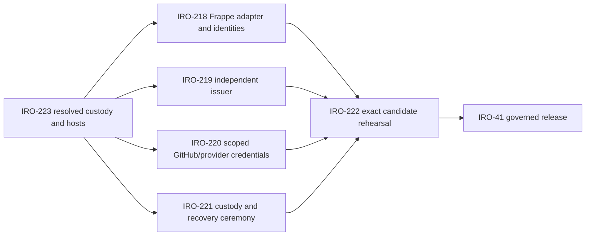
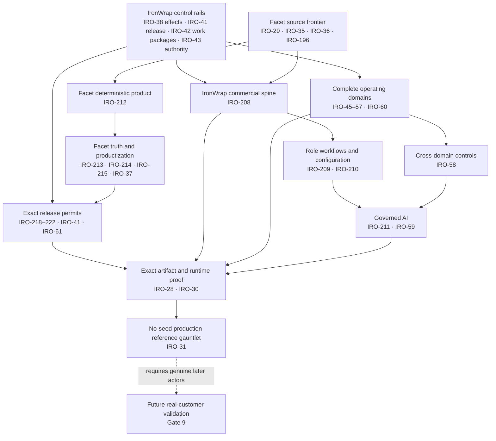

# Capability Matrix

Status: canonical implementation gap register
Owner: IronWrap OS product owner
Last verified: 2026-08-23
Latest phase delta verified: 2026-08-23 (release-control source publication and dependency audit: a checked-in remote-readback snapshot records the private shared repository at exact bootstrap commit `6a4f8a166ad5c86180dc95b4b31ffa64f472f7fd` with no repository CI workflows at observation time, provider-stage transport, or deployed adapter; IRO-218–IRO-221 provision the independent release services, and IRO-222 proves the exact IronWrap candidate before IRO-41 may close. Repository checks only, not deployed, runtime-verified, business-accepted, or production-proven)
Review trigger: merged capability, changed proof, deployment, or production acceptance

## Status vocabulary

- **Implemented**: code/configuration exists in the repository.
- **Built**: the implementation passes its required repository build and focused checks.
- **Configured**: required non-secret values and secret identities exist for one named environment.
- **Provider-reachable**: authenticated reachability and exact provider readback are freshly proven.
- **Technically proven**: the capability completed its production reference path and failure drills.
- **Customer-validated**: real customers independently used and accepted the defined workflow or
  outcome; synthetic/reference operation can never establish this state.
- **Repository-verified**: a fresh deterministic check passed against the named commit.
- **Partial**: useful implementation exists but a material target boundary is missing.
- **Target-only**: required by the autonomous operating system but not implemented.
- **External proof required**: completion depends on a live provider, device, authority, customer, or
  physical workflow.

This file does not claim current deployment or production state. Fresh live evidence must come from
the launch/readiness tooling and the named external authority.

## Seven-area maturity snapshot

| Area | Current state | Next gate |
|---|---|---|
| Core technical design | Strong | keep one authority per fact and remove remaining compatibility dependencies |
| Lead/job/field foundation | Strong with lifecycle projection gaps | close lead conversion/customer activation and derive job phase from authoritative sub-states |
| Safety/evidence/accounting controls | Unusually strong in source | deployed provider/device/failure and recovery proof |
| Repository/migration coherence | Mixed | retire duplicate brokers/Frappe wheel and govern migration ranges/cutovers |
| Configured capability | Partial | minimum-provider readiness profiles with readback and proof TTLs |
| End-to-end commercial closure | Incomplete | native quote writer, publication settlement, acceptance-driven deposit, configured accounting path |
| Production/customer proof | Not established | controlled production reference journey; real-customer validation remains a separate later gate |

The architecture, authority map, user journeys, AI loop, derived lifecycle, and reference-tenant
rules are canonical in [`AI-NATIVE-ARCHITECTURE.md`](./AI-NATIVE-ARCHITECTURE.md).

## Repository evidence contract

The documentation gate derives repository facts from the current checkout and compares them with
this contract. CI also reads the real PWA and Worker test-run outputs, then emits a mutable receipt
outside canonical prose. That receipt separately binds the authored source commit, pull-request
base commit, and exact tested checkout/tree to the workflow SHA, event, refs, run, attempt, and job.
It never upgrades merge, deployment, runtime, business acceptance, or production proof by
implication.

<!-- capability-evidence-contract:start -->

```json
{
  "schema": "ironwrap_capability_contract_v1",
  "expected": {
    "frappe_doctypes": {
      "total": 79,
      "top_level": 60,
      "child": 19
    },
    "d1_migrations": {
      "count": 87,
      "latest": "0113_pipeline_board_core.sql"
    },
    "tests": {
      "pwa": 586,
      "worker": 1367
    }
  },
  "proof_state_policy": {
    "source": "derive_per_receipt",
    "local_tests": "observe_separately",
    "ci": "observe_separately",
    "merge": "never_infer",
    "deploy": "never_infer",
    "runtime": "never_infer",
    "business_acceptance": "never_infer",
    "production_proof": "never_infer",
    "technical_reference_proof": "never_infer",
    "customer_validation": "never_infer"
  }
}
```

<!-- capability-evidence-contract:end -->

The expected counts change only with the same reviewed source change that adds or removes the
underlying contract. A mismatch fails documentation validation. The generated receipt is an
exact-source and tested-checkout repository/CI observation, not a release permit.

## Canonical operating-authority migration

Target: D1 plus the Worker is the sole owned authority for normalized operating state, transitions,
policy, audit, and reconciliation. R2 retains raw evidence. QuickBooks and genuine external actors
remain authoritative only for their exact posted-accounting, legal, professional, customer, or
physical scopes.

Current implementation: office sales/estimator/today/work-package/Facet/QuickBooks-final-invoice
reads already use D1. Default `/ready` is the owned office plane and does not AND leftover
Frappe/Newo credentials. Money-intent job lookup, production-gate clearance, and customer material
decisions persist on D1. The 79 current DocTypes are leftover compatibility evidence, not the
target architecture. Frappe remains an optional projection (apps tree, Hermes ERPNext MCP, local
`--profile frappe` compose, optional CI unittest/wheel) and is not a merge or release blocker.

The cutover is incomplete until leftover projection consumers are gone and a live issuer/rollback
has been proven. Projection failure cannot change authoritative D1 state.

### Job vocabulary and portability target

`Job` is the canonical IronWrap operating/commercial aggregate. Existing `roof_job_id` values are
stable identities and remain valid evidence references. The target is a Job kernel with a versioned
`job_kind`/operating profile and domain-specific extensions, not a generic Project record containing
every trade and workflow.

Portability starts only after deterministic commercial closure. Use expand -> dual-read comparison
-> writer switch -> compatibility projection -> parity proof; do not mass-rename D1 tables, routes,
events, or evidence. A `Facet Project` remains a separate design aggregate and is associated to an
IronWrap Job only through the governed evidence contract.

### Commercial, lifecycle, and AI reachability

Current source tracing distinguishes implemented modules from reachable production flows:

- `recordCommercialQuoteRevision` has only test seed callers; there is no native production writer
  for an approved quote revision.
- `recordCommercialProposalRevision` is reachable through the app API.
- `recordCommercialProposalPublication` has only test callers; there is no native production
  settlement path binding a successful delivery effect and readback to publication.
- native customer acceptance is production-reachable and atomically binds the exact quote,
  proposal, publication, terms, challenge, and customer decision.
- deposit intent can be created through accounting controls and reconciled deposit can clear its
  gate, but acceptance does not yet deterministically derive that intent.
- native assignment, work-package, safety, completion, and final-invoice derivation exist.
- lead `converted`, customer activation, and a coherent current job phase are not projected from
  all authoritative sub-states.
- measurement OCR is a bounded review-required AI interpreter. Hermes is a disabled,
  `lead_follow_up_draft` pilot. No resident context -> plan -> policy -> permit -> action ->
  readback -> reconciliation coordinator exists.

The control kernel is therefore stronger than the reachable commercial chain. Close the missing
deterministic transitions before expanding AI autonomy.

### Machine release admission

IRO-41 branch-local implementation:

- a protected-source `workflow_run` contract admits exactly two events - a pull_request-sourced CI
  success (the release is admitted before its merge, which the pipeline performs) and a push-sourced
  CI success pinned to `main` (the release is admitted after its merge, from the squash commit that
  is still the tip); both use generation N enforcement from the predecessor commit, bind the exact
  PR/head/base/merge tree and CI run/check IDs, publish exact-digest candidate artifacts to an
  independently permissioned issuer trigger, wait for the acknowledged issuer run's signed
  review/full-surface evidence, and reject unresolved P0/P1 findings;
- one aggregate artifact binds Worker and PWA identities and currently carries a Frappe wheel
  digest; while that wheel ships, isolated staging must also bind its exact bytes to an immutable
  provider revision and prove adapter-authenticated stage, readback, restore, and rollback alongside
  config/secret-name readback, authenticated smoke, content-complete D1 restore, and the prior
  Worker operating against migrated schema before a short-lived permit can be assembled;
- the durable D1 ledger provides atomic policy genesis/CAS, single-use permit admission, and
  immutable success/rollback receipts; a migration failure after source merge records a distinct
  recovery-required outcome without claiming a D1 rollback; production promotion and rollback bind
  exact Worker/PWA, provider, recovery, and post-smoke/post-rollback readbacks; signed Frappe
  adapter promote/readback/rollback receipts are required release evidence while the Frappe wheel
  ships, and the gate retires only when the wheel and its last compatibility consumer do; and
- release policy hashing includes the executable CI/deploy/permit/promotion boundary, so candidate
  source cannot approve weakening that boundary for its own release.

The current deploy workflow creates `frappe/ironwrap_roofing.whl` and validates its digest, but it
does not deliver those bytes to an immutable provider-stage revision or invoke the checked-in
`service-adapter` client. Receipt filenames in an artifact upload list are not execution evidence.
No reachable adapter, provider command, staging/production Frappe identity, or live receipt is
proven. That is the exact gap owned by the release-control chain below.

The checked-in publication evidence snapshot observed at `2026-08-22T23:53:36Z` records the private
shared codebase `Iron-Wrap/release-control-plane`, default branch `main`, and bootstrap commit
`6a4f8a166ad5c86180dc95b4b31ffa64f472f7fd`; the snapshot records no repository CI workflows. That
exact source provides the authenticated Node HTTP adapter, durable single-service file ledger,
pinned IronWrap contract snapshot, and eight passing local tests.
Source publication proves only repository availability; it does not prove later repository state,
repository CI, an HTTPS deployment, the provider command, scoped credentials, Frappe identities,
or any live stage/promote/readback/rollback receipt.

#### Release-control custody and dependency chain

[IRO-223](https://linear.app/mindburn/issue/IRO-223) resolved the human and infrastructure boundary:

- the shared code must run as separate IronWrap and Facet deployments with product-scoped keys,
  receipts, policy ledgers, and promotion authority;
- Ivan owns business approval and GitHub merge authority; Sergey owns provider, Cloudflare, DNS,
  and the Frappe adapter host; Andrei owns the independent issuer/reviewer; Ilya owns permit signing,
  the policy ledger, and business counter-approval;
- all four may participate in the repository and business process, but participation grants no
  protected credential by implication;
- the issuer runs in a separately controlled Cloudflare account outside the product account, while
  the Frappe adapter runs on the Frappe VPS under a dedicated OS/service identity; and
- IRO-219's implemented v2 trigger accepts only the exact canonical request freshness window
  (`issuer-request` creates five minutes; the trigger caps lifetime at ten minutes and rejects
  expired replays). It only queues the independently controlled issuer work: it has no findings,
  provider evidence, or receipt-signing/publication authority. The existing `review-sign`,
  `review-publish`, `release-evidence-sign`, and `release-evidence-publish` primitives remain
  the independent custodian's separate boundary; this repository does not claim their external
  credentials or runtime provisioning; and
- recovery is a dormant, logged 2-of-3 ceremony among non-primary custodians. Ivan may hold one
  share but cannot recover authority alone. Every path fails closed and rollback may select only a
  previously admitted durable claim.

The native blocker graph is deliberate:



IRO-218 must define the immutable artifact-stage transport and provider revision mapping before its
adapter can truthfully promote anything. The client and provider time budgets must also be made
compatible before live migration work. IRO-222 then requires authenticated disposable staging,
exact promote/readback, forced restore/rollback, denial, replay, and custody evidence; source tests
or a reachable process alone cannot close it.

External proof remains required for the installed predecessor enforcer, protected-branch behavior,
independent HTTPS review/evidence issuer and publication authority, GitHub secret inventory,
isolated
staging credentials/readiness, production DNS/readiness, provider mutations, genuine IRO-7 actor
and business receipts, automatic merge, durable provider readback, and a complete rollback-capable
production run. Repository tests do not satisfy any of those live states.

The checked-in staging contract is intentionally fail-closed today: its named environment omits
`ESTIMATOR_PRICE_LIST_JSON` and `PROPOSAL_TEMPLATE_DOC_ID`, its notification sender/recipient values
are empty, and required notification/OCR secret presence has no live readback in this branch. The
release preflight reports those exact blockers before migration/upload; it does not disable the
capabilities or treat a red `/ready` result as acceptable.

The governed workflow also treats a provider command with a lost or nonzero response as unknown
until active-deployment readback resolves it. Failed post-deploy staging runs restore the captured
previous revision and emit a cleanup-only receipt; production recovery attempts rollback whenever
production promotion ran, then requires exact Worker, PWA, health, and readiness proof.

### Fleet/equipment delta (2026-08-18, IRO-54 merged over the reviewed assembly)

Fresh local checks for the IRO-54 merge over the reviewed IRO-36/38/41/42/43 assembly moved these
counts. They are branch-local repository facts only; nothing here claims a deployed, runtime,
real-vehicle, or business-accepted fleet capability.

| Contract | Before | After |
|---|---|---|
| Frappe model | 68 DocTypes (51 top-level + 17 child) | 78 DocTypes (59 top-level + 19 child) |
| Frappe tests | 254 | 330 |
| D1 migration chain | 45 migrations | 46 migrations |
| D1 recovery inventory | 87 tables / 130 index bindings / 170 trigger bindings | 88 tables / 132 index bindings / 170 trigger bindings |
| Worker tests | 579 | 597 |
| PWA tests | 363 | 369 |

The fleet release fence is proved by policy tests only. A real vehicle day, a controlled physical
inspection, and provider telematics evidence remain external proof this repository cannot supply.

The fence's perimeter is the Cargo Load, which is the only record that binds a Fleet Asset to a
Roof Job. It engages from the planned (`Draft`) load onward, so scheduling is fenced before the
truck is loaded; the driver, weight, and custody comparisons apply from `Loaded`, when those facts
first exist. A job that binds no asset through a Cargo Load has nothing for the fence to check.

### Fleet capture surface delta (IRO-54 branch, 2026-08-20, after merging `main` @ d196127)

The IRO-54 capture routes shipped with no production caller: the rail could be posted to, and
nothing in the product posted to it. This lane adds the read that makes a screen possible and the
screen itself. Repository-only checks; nothing here claims a deployed, runtime, real-vehicle, or
business-accepted capability.

Numbers are re-measured on this branch **with `main` merged in**, against `main` @ `d196127`
measured the same way, so the delta is this lane's and not another lane's.

| Contract | `main` @ d196127 | This branch |
|---|---|---|
| Frappe tests | 340 | 372 |
| Worker tests | 904 | 913 |
| PWA tests | 474 | 485 |
| PWA Playwright specs | 4 | 5 |
| D1 migration chain | 58 migrations | 58 migrations (unchanged; this lane adds none) |

The fence itself is unchanged. `domain_policy.fleet_release_blockers` is a read-only accessor that
calls the same `_require_fleet_asset_ready` / `_require_driver_authority_ready` fences the release
path calls and returns their violations instead of raising, so the sentence a driver reads on a
phone and the refusal dispatch would raise cannot drift; `tests/test_fleet_operations_policy.py`
pins that equivalence code-for-code and message-for-message. The blocker itself is built in exactly
one function (`domain_policy._open_out_of_service_defect_violation`), and the defect statuses the
fence counts are one constant (`domain_policy.OPEN_OUT_OF_SERVICE_DEFECT_STATUSES`) read by both the
locked release-fence count and the panel's unlocked one, so the screen cannot hold a stale copy of
what "open" means; `tests/test_fleet_panel_api.py` walks that constant status by status.

Photo evidence on a fleet capture remains absent and is not faked by this lane. The capture
envelope is bounded JSON (`workers-bus/src/fleet-actions.ts`), the browser outbox refuses
attachments on every fleet kind by design, and `record_asset_defect` never writes the
`Asset Defect.evidence_item` link the DocType already carries. Wiring a camera into the rail is a
fleet evidence-rail lane, not a screen change.

### Service lifecycle delta (IRO-56 branch, 2026-08-19, after merging `main` @ 394de9b)

Repository-only checks re-run on the IRO-56 service-lifecycle branch **with `main` merged in**, so
every number below is the union of this lane and everything already on `main`. This is not
deployment, runtime, or business-acceptance evidence.

| Contract | Result |
|---|---|
| Frappe model | 79 DocTypes: 60 top-level and 19 child |
| D1 migration chain | 49 migrations applied in order to an isolated local database; this lane takes `0056` and the IRO-62 forward repair on `main` takes `0057`, each above every number in flight on an open PR head when it was numbered, so `0048`-`0055` is a deliberate gap |
| D1 backup/restore contract | All 104 migration-defined production tables, 154 indexes, and 219 trigger bindings validated by the deployment verifier |
| Deployment contract | 267 checks passed, 0 failed |
| Worker | 867 tests and typecheck passed; every migration applied through Wrangler and the Worker bundled with `--dry-run` |
| Frappe | 337 unit tests, Ruff, and compileall passed |
| Deployment/recovery tools | 106 readiness tests and 12 launch-proof tests passed |
| PWA | 474 tests, typecheck, lint, Prettier, and build passed |
| PWA browser (Playwright), MCP | Not re-run locally on this branch; prior evidence is not current-head proof |

The lifecycle is reachable from the running product: `workers-bus/src/service-cases.ts` owns the
`/api/v1/service-cases` office routes wired into `workers-bus/src/app-api.ts`, and the PWA serves
them at `/service` (callback desk) and `/service/$caseId` (one case end to end). Cost recovery
records intent and an operator-observed result only; no supplier, manufacturer, or insurer is
called from any code path.

End-to-end evidence (Multica ELEC-21) drove that journey from a real browser against a local stack
and returned two defects, both fixed on this branch and both now covered by tests: every lifecycle
transition answered `409 Conflict` after committing, because D1 counts trigger-written rows in
`meta.changes` and the write guards read that count; and the callback desk listed a single case,
because an absent `?limit=` parsed as `0` rather than as the default. Neither was visible to the
lane's route tests until the fake D1 in those tests was aligned with D1's `meta.changes` semantics.

## Implemented substrate

### Owned intake and evidence spine

Implemented:

- Cloudflare Worker routing for health/readiness, public, BFF, ingest, webhook, admin, and scheduled
  work.
- Raw-first intake for lead, photo, measurement, estimate, QuickBooks, and Newo paths.
- D1 envelopes, audit, dead letter, source counts, heartbeat, dedup, replay, auth, field action,
  field Work Package action, approval, portal, measurement, rate-limit, outbox, and Newo ledgers.
- R2 raw/evidence references.
- Queue/retry/reconciliation behavior, including an automated dead-letter reconciliation sweep on
  the five-minute cron: dead envelopes are re-driven with exponential backoff and a bounded attempt
  cap, both counted from the `replay_requests` ledger rather than `envelopes.attempts`, which two
  unrelated intake/mirror retry paths already own. The cap is scoped to one outage episode — the
  ledger rows booked since the envelope's currently open dead-letter run began — so an envelope that
  exhausted its budget once and recovered is not manual-only for life. Reaching the cap ends
  automatic recovery only: the envelope stays `dead` with its dead-letter row open, so
  `POST /admin/replay` still works. Migration `0080_replay_requests_envelope_idx.sql` adds the
  per-envelope index that read needs; `0081_dead_letter_terminal_recovery_backfill.sql` closes the
  dead-letter rows the terminal `jn_skipped` and `erpnext_no_token` skips stranded open before
  ELEC-137 made both close them, which is what keeps `/admin/status` healing when the system does.
- Idempotency and approval ledgers.
- Backup/restore contracts with fail-closed target selection and immutable completion markers.

IRO-38 branch-local side-effect substrate:

- Migration `0042_external_effect_runtime.sql` adds one provider-neutral effect, append-only
  attempt/event, and exception ledger. The Worker runtime binds stable business idempotency to
  per-attempt identities, leases provider execution, requires authoritative readback before
  success, leaves unknown outcomes unretryable until reconciliation, and starts compensation as
  a separately auditable effect.
- Worker adapters for Frappe, Google, JobNimbus, Newo, Postiz, QuickBooks, customer acceptance,
  Facet projection, field evidence, and Work Package actions use this ledger when the deployed
  `EFFECT_RUNTIME_ENABLED=true` boundary is available; otherwise mutation adapters fail closed.
  QuickBooks Pending projection retains its dedicated issuer authority and verifies material
  fields through the issuer-scoped readback command before the effect can succeed.
- Writable ERPNext MCP processes require Worker claim/settle configuration. The MCP retains its
  Frappe credentials and provider call; the Worker owns the durable lease and settlement state.
  This branch has repository tests for the remote claim/provider/readback/settle sequence, but no
  live provider, deployment, or business-acceptance proof.

ELEC-86 Facet v2 chain and customer portal switch-on (2026-08-20):

- `FACET_V2_INGEST_ENABLED`, `FACET_V2_FRAPPE_PROJECTION_ENABLED` and `APP_FACET_LAUNCH_ENABLED` are
  `"true"` in every environment; `APP_CUSTOMER_PORTAL_ENABLED` and
  `APP_CUSTOMER_CONTRACT_ACCEPTANCE_ENABLED` are `"true"` for production and local. A flag alone
  opens nothing: `facetV2ConsumerConfig`, `launchConfig`, `projectionSettings` and
  `customerAcceptanceBackendConfigured` each return null/false without their key material, so a
  deployed environment that has not been provisioned answers 503.
- Staging keeps the portal off because it runs with `APP_BFF_ENABLED: "false"`, and
  `customerPortalConfigured` reports false whenever the portal is on without the office control
  plane that revokes customer links — which turns `/ready` red and blocks the release.
- Repository-verified locally, on the `deploy/local` stack with those flags on: an owner session
  issues a Facet launch capability (`POST /api/v1/estimator/jobs/{job}/facet-launches`), a Facet-
  signed customer-decision event is accepted at `POST /ingest/facet-design` with
  `result: accepted_associated` and `detail_code: exact_identity_project_association_verified`, and
  a signed IronWrap receipt is returned.
- **Step 4 defect closed in ELEC-91.** The projection now creates the blank Draft Customer Quote
  against a real Frappe v15 site. Four faults sat in series, all of the same class — a fixture that
  returns literally empty values described a site that does not exist:
  1. `Customer Quote` defaults `currency` to `CAD` and `payment_status` to `Not Due`, and
     `Document.insert()` applies defaults before `validate` runs, so the trusted snapshot taken
     before `insert()` described a document the guard never saw. The bounded command now resolves
     the DocType's own `frappe.new_doc()` defaults into the payload up front, so `insert()` changes
     nothing and the trusted tuple stays exact — the guard itself is unchanged.
  2. Blankness is now commercial, not literal, on both sides: a schema default and a numeric column's
     stored `0` are the schema speaking, and a value that merely *differs* from the default is still
     refused.
  3. The Worker's readback treated an absent key as populated, but Frappe's REST response omits NULL
     fields entirely, so it could never be satisfied by a real site.
  4. `received_at` is `new Date().toISOString()`; MariaDB rejects that shape, so claim timestamps
     drop the offset marker — and only the marker: they are stored as naive UTC, the convention the
     rest of this app reads Frappe Datetimes by, not moved onto the site clock.
  `tools/validate-facet-blank-quote-contract.mjs` holds the Worker's blank-quote table, the Frappe
  app's `BLANK_QUOTE_FIELDS` and `customer_quote.json` to one description in CI.
- **Step-5 gap, closed by ELEC-92 (below).** A Proposal Evidence Pack could only be promoted
  Draft → Approved by the Owner Operator MCP command `request_publish_proposal_evidence_pack`;
  no Worker/PWA route published one, so the portal read model returned `proposal: null` and the
  acceptance challenge answered 404.

ELEC-94 customer-facing option comparison and material decision (2026-08-20):

- Step 3 of the core workflow ("apply materials, products, and colors") now exists as a
  traversable path inside IronWrap's own customer surface. `Option Package` and
  `Customer Decision` were both exist-only DocTypes with zero callers; the portal read model now
  projects Approved-only `Option Package` rows for the bound job, and
  `POST /api/v1/customer-portal/decision` records the customer's choice as a `Customer Decision`.
- The comparison is built natively in the PWA from `options_json`, not embedded from Facet. Facet
  remains evidence-only: its signed v2 producer contract deliberately strips share capability from
  the evidence it emits, and it ships no viewer-only build that could be embedded inside a
  paired-device budget. See ELEC-89 for the rejected embed and deep-link alternatives.
- Migration `0069_customer_portal_decision_intents.sql` is 0029's acceptance-intent machine minus
  the email challenge: one row per `Idempotency-Key`, an immutable R2 receipt written before the
  Frappe effect is attempted, a single-attempt lease, and a terminal result replayed verbatim.
  The challenge is absent on purpose — a material preference is provisional, not a legal act.
- A portal-originated `Customer Decision` never moves a `Customer Quote`. It is a signal an
  estimator confirms, matching the human-verification-in-the-loop rule and the fact that
  `Customer Decision` carries no approval state of its own.
- Frappe-side authority is a dedicated `IronWrap Customer Decision Service` role that may create a
  `Customer Decision` and its receipt `Evidence Item` and read the three anchors it binds — it can
  never sign a contract or write a quote, unlike the acceptance service identity.
-   Fail-closed by default. `APP_CUSTOMER_PORTAL_DECISION_ENABLED` mirrors the acceptance flag, and
  the route additionally requires its own HMAC secret. IRO-195 removed leftover Frappe service
  credentials from this required path; the native commit records the choice on D1 after the R2
  receipt. The read half degrades to a read-only comparison rather than disappearing.
- `/portal` had no e2e coverage of any kind before this lane. `app/e2e/customer-portal-materials.spec.ts`
  drives the comparison and the decision POST on a Pixel 5 viewport with no-horizontal-scroll and
  44px-target assertions, and the acceptance server gained the portal fixture handlers it lacked.

ELEC-133 legible authority refusals and a clean first boot (2026-08-21):

- **A refusal a crew's certification triggers now reaches the approver as a reason.** The gate
  itself was already correct and fail-closed; what it could not do was say what it refused. Frappe
  answered `417` with `[authority_missing_current_authority] ...`, `erpRequestDirect` read the
  response body and dropped it, the surviving `erpnext_http_417: EXPECTATION FAILED` was not JSON,
  so `parseToolPayload` threw `mcp_tool_payload_invalid` and the broker could only report
  `execution_uncertain` / `broker_mcp_call_ambiguous`. The approving office user saw a `502` and
  "something went wrong" about a decision the system had made deliberately (ELEC-132 defect B).
- Only a refusal the domain authored travels. The carried text must arrive on `417` (the single
  status `validate_business_document` uses), in the `[code] field: message` shape a `PolicyViolation`
  formats, and from `_server_messages`/`exception` — never from `exc`, where Frappe puts the Python
  traceback. A `LinkValidationError` on the same status stays opaque, and both classifications are
  pinned by verbatim captures from a live local stack.
- `require_authority_gate` names the requirement that failed, so the message says which crew member
  and which certificate rather than restating that requirements are unsatisfied. It names only the
  caller's own declared requirement, never the records that were searched or the locked tenant.
- A proven refusal is `failed`, not `execution_uncertain`. Frappe rolled back before writing and the
  Hermes Run records `mutation_applied: 0` for the same attempt, so the approver gets `422` and no
  reconciliation work is queued for a write that never happened. Only a refusal carrying its own
  proof of non-application qualifies; every other failure keeps the ambiguity it had.
- Migration `0079_production_schedule_approval_refusal.sql` adds one nullable column so the reason
  survives the response an approver happened to be looking at. It is bounded, single-line,
  write-once, and permitted only on `failed`, enforced independently at the storage boundary, in the
  Worker's re-derivation of the broker outcome, and in the PWA contract.
- `parseToolPayload` no longer reads an errored tool result as a payload. It survived only by
  failing `JSON.parse`, so a well-formed error body would have been read back as a successful write.
- **Not delivered here:** the PWA has no production-schedule *approve* surface at all
  (`approveProductionScheduleApproval` has no caller outside its own module), so the approving
  office user is still an API client. That is a separate wiring gap, recorded rather than fixed.
- **First boot on a fresh checkout works again.** `deploy/local/frappe-init.sh` reached for
  `frappe.core.doctype.user.user.generate_keys`, which only resolves once something has imported the
  User controller in that interpreter. Every caller created its user first, so the attribute was
  there by accident until PR #106 added `owner@ironwrap.local` — already created by
  `provision_operator_users` in a separate `bench console` — and the create branch was skipped. All
  six key-minting blocks now import `generate_keys` by name (ELEC-132 defect A).

ELEC-92 owner-facing proposal publication (2026-08-20):

- `/api/v1/proposal-publication-approvals` is the second door onto exactly that owner-operator
  command. Prepare (`approvals:prepare` + CSRF + `Idempotency-Key`) records a receipt-bound
  approval request; approve (owner only) releases it. The Worker holds no signing key: the
  private `proposal-publication` broker re-runs `dry_run_publish_proposal_evidence_pack` as a
  pre-write source fence, verifies the stored signed dry-run receipt, mints the Ed25519 approval
  receipt, and invokes `request_publish_proposal_evidence_pack`. Frappe's
  `publish_proposal_evidence_pack` is unchanged, so every approval, anchor, and evidence check the
  MCP path enforces is enforced here.
- Migration `0068_proposal_publication_approval_requests.sql` is a fourth isolated approval
  vertical alongside `0016`/`0017`/`0020`. A partial unique index permits one live intent per pack,
  because publication is legal only out of Draft and is therefore not repeatable in Frappe.
- The browser receives an allowlisted projection only: no receipt, no raw write arguments, no
  private digest, and no approver identity inside the preview. An ambiguous broker call becomes
  `execution_uncertain` reconciliation work, never an automatic retry.
- The PWA action sits on the estimator workbench beside customer-link issuance
  (`app/src/proposal/proposal-publication-action.tsx`): prepare, then a confirmation that states
  what the customer will see and that no message, link, signature, or quote change occurs.
- Fail-closed by default. `APP_PROPOSAL_PUBLICATION_ENABLED` is `"false"` in production and
  staging and `"true"` only on `deploy/local`; while it is off the routes answer 404 and the read
  model advertises no actions.
- **Estimator workbench reachability.** The strict PWA contract did not know about the
  `computed_takeoff`/`computed_estimate` previews or the `economics` block the Worker already
  returns, so every job carrying measurement values failed the parse and the page rendered
  "Measurement workbench is unavailable" — including the job this traverse runs on. The contract now
  accepts them, pinned by a verbatim capture of the live read model
  (`app/src/estimator/estimator-workbench-live-shape.fixture.json`).
- **Four real-site defects were found on the way and fixed in a separate Frappe-side change**, not
  in this lane: a stored Frappe Datetime arrives as a `datetime` while the surrounding contract is
  text, so `!=`/`_text` comparisons rejected every real record while accepting every dict-built
  fixture. The remaining live sites are the proposal measurement provenance check and the price-rule
  snapshot identity check in `domain_policy`; the former Frappe customer-acceptance command has
  since been retired in favor of native D1 commercial acceptance.

IRO-44 safety substrate (merged in #59; the "branch-local" qualifier this section carried was
stale from before that merge):

- Migration `0047_safety_lifecycle.sql` adds owned safety equipment, physical safety occurrence,
  external notification, corrective action, immutable readiness snapshot, and offline safety-action
  ledgers. Physical safety events are a separate aggregate from `Automation Incident`, which remains
  an integration-failure record.
- Reporting a hazard or injury, making an area safe, and condemning equipment take no authority
  argument and are reachable by any active tenant user. Inspection, rescue command, external
  notification, independent verification, and stop release each require the exact current role, and
  the occurrence reporter, corrective-action owner, and evidence capturer are all refused
  verification of that closure.
- `/api/v1/safety/actions` is a separate D1/R2 ledger from the Work Package rail, so a report
  survives having no current work package, no assignment, and no network. Duplicate offline reports
  of the same physical event converge on one occurrence.
- Work Package acknowledge/start/complete and production-schedule approval both consume current
  safety readiness and record an immutable snapshot of what they saw, including a refusal. Stopping
  work is never gated by that readiness.
- Merged to `main` in #59 (2026-08-18), including the offline safety panel the PWA field surface
  renders (`app/src/field/safety-action-panel.tsx`, `app/src/field/safety-action-panel.test.tsx`),
  so this is no longer a branch-local repository check. It carries repository tests, including one
  emergency drill covering rescue, failed PPE, a duplicate offline report, a late corrective action,
  and independent release. It still has no deployment, runtime, business-acceptance, or real-device
  proof.
- Direction (2026-08-21, Ivan via IRO-195 cutover): this D1 substrate is the system of record for
  operational safety. A Frappe-side projection of the occurrence, equipment, notification, and
  corrective-action ledgers is obsolete and will not be built. Frappe `Safety Plan` /
  acknowledgement remains the preconstruction plan object and is not a substitute for these
  ledgers. Remaining IRO-44 proof is the real-device emergency/rescue drill (deploy-gated on
  IRO-30 / IRO-194).

IRO-62 shipped-migration remediation:

- `0028_work_package_actions.sql` shipped on 2026-07-30 and the one successful Deploy
  (`987ccbc6`, 2026-08-13) applied it in production. The reviewed assembly later edited that file
  in place to widen its `action_kind` CHECK with `complete_work`. Wrangler keys the D1 migration
  ledger by filename, so the edit can never reach a database that already applied `0028`: every
  `complete_work` receipt insert aborts there on the CHECK.
- `0028` is restored to its shipped bytes and the widening is delivered forward by
  `0057_work_package_completion_action_kind.sql`, a bounded copy-preserving rebuild of the single
  `field_work_package_actions` table. A database that already applied `0028` and a database built
  from a clean chain converge on the same table, index set, and constraint text.
- Proof is branch-local repository proof only: the applied chain, the production starting state,
  and the row-preserving rebuild are asserted in `workers-bus/test/app-migration.test.ts`. Nothing
  here claims the remediation has been deployed.

IRO-45 branch-local inventory ledger:

- Migration `0067_inventory_control.sql` adds tenant item/UOM/conversion/location/bin/lot
  identity, an append-only inventory command/event ledger, the position projection, lot and
  FIFO valuation layers with explicit freight/tax/discount allocation, physical receipt
  lines, AP invoice lines, three-way match, count sessions/lines, barcode/label/scan capture,
  exceptions, job-cost attribution, and provider reconciliation rows.
- Conservation is structural: a position moves only by the exact delta of the event it
  names, a conserving command's movements must net to zero in quantity and value, and
  reserved plus quarantined can never exceed on-hand, so negative and phantom stock are
  unrepresentable rather than merely discouraged.
- Quantities are scaled integers and money is minor units; UOM conversion is a versioned
  rational row whose inexact results are refused rather than rounded.
- A count freezes its bin, a non-zero variance requires an independent decided approval, a
  value-bearing adjustment additionally requires a distinct finance reviewer, and neither the
  counter nor the receiver may approve their own variance or quarantine release.
- An AP invoice line is admissible only from a succeeded IRO-38 effect whose readback digest
  matches; a provider webhook is never match proof.
- An unrecognised offline barcode is captured as `observed_pending_validation` and never
  creates stock; scan replay converges on one observation per device action.
- The Worker store is `src/inventory-control.ts` with tests in
  `test/inventory-control.test.ts`, and `src/inventory-control-api.ts` binds it to
  `/api/v1/inventory` off the authenticated app router with effective-role actor binding,
  covered by `test/inventory-control-api.test.ts`. This branch has repository tests only: no
  PWA surface, no provider adapter, no deployment, and no business-acceptance proof.

Office user invitations and access management (branch-local, 2026-08-23):

- Migration `0111_office_user_invites.sql` adds `app_user_invites`: one office-issued credential
  per row, bound to one tenant, one normalized mailbox and one `access_role`, storing only the
  SHA-256 of a 43-character secret that is emailed once. It is the same credential shape as the
  `0014` device pairing — expiring, single-use, revocable — and the same reasons apply: a database
  export contains nothing replayable, and the secret travels in a URL fragment so it never reaches
  a request line or a Worker log. A partial unique index keeps exactly one invitation open per
  mailbox; a re-issue supersedes the previous one inside the same D1 batch.
- `workers-bus/src/app-user-invites.ts` and `src/app-user-invite-store.ts` own the capability;
  `src/app-api.ts` binds it to `GET|POST /api/v1/admin/user-invites`,
  `POST /api/v1/admin/user-invites/{inviteId}/resend|revoke`, the unauthenticated
  `POST /api/v1/auth/invites/accept`, and the two id-addressed people routes
  `POST /api/v1/admin/app-users/{userId}/role` and `.../access`, alongside the
  `GET /api/v1/admin/app-users` list they need.
- Accepting produces a grant, never a session. The materialization and the claim are one D1 batch
  under one open-invitation predicate, so a replay cannot create a second account, re-grade a live
  one, or resurrect a withdrawn one; the invitee is then delivered the product's ordinary
  magic link through the existing issuer, and a crew invitation is told its phone still needs an
  office-issued pairing because crew never receive an email session.
- Authority is decided in the Worker: office role for every route, owner-only for anything that
  hands out or takes back ownership, and no self-service role change or self-removal — which is
  also what makes the tenant impossible to lock out of itself. Withdrawing access closes the live
  sessions, the open sign-in link, the paired devices and any open invitation in the same act.
- The issuing surface is deliberately not an account-existence oracle: issuing, re-sending and
  revoking answer with the invitation's own state and nothing else, identically for a mailbox that
  is unknown, already active, or deactivated.
- Repository tests only (`workers-bus/test/app-user-invites.test.ts`, 23 cases driving the real
  Worker against a D1 built from the committed migration chain). There is no PWA surface on this
  branch, no deployed environment, no real mailbox, and no business-acceptance proof. The
  pre-existing `POST /api/v1/admin/app-users` upsert remains reachable and still permits an
  operations session to provision an owner; closing that is a separate change to a route this lane
  does not own.

Missing for autonomous target:

- general event/transition envelope across every company aggregate;
- shop/workforce/quality event ledgers (operational safety lives on the D1 IRO-44 substrate; fleet and accounting already have D1/Frappe hybrid ledgers);
- inventory HTTP routes, warehouse/receiving PWA surfaces, and the QuickBooks
  Bill/PurchaseOrder/Vendor adapter that would feed the AP readback;
- universal evidence freshness, revocation, conflict, and compensation semantics;
- production proof across one real end-to-end job.

Operator search-and-jump (2026-08-23):

- The office had no search of any kind: no endpoint, no index, no shortcut. `GET /api/v1/search`
  is the server half of the command palette. It is a read projection only -- one bounded, grouped,
  role-scoped result set per query -- and it creates no fact, no transition, and no authority.
- Groups are gated on the permission that already opens the surface each result links to:
  `jobs` on `jobs:read:any` (every active job) or `jobs:read:assigned` (only the jobs the caller's
  own current assignment opens); `leads` on `sales:read`; `customers` on `jobs:read:any`, and only
  for a customer that owns an openable active job, carrying the same name and phone the job
  packet's `contact` block already returns; `go_to` for every role, mirroring `navigationForRole`
  in `app/src/lib/roles.ts`. A field session therefore cannot reach a lead, a sales session cannot
  reach a job, customer, or money record, and an accounting session receives its own destinations
  and neither operating register.
- Bounded and honest by construction: a hard cap of eight rows per group, a stable
  `<matched column> COLLATE NOCASE, <id>` order, an explicit `more_results` flag from a read of
  one row past the cap rather than silent truncation, and a stated `outcome` of `results`,
  `no_matches`, or `query_too_short`. Nothing is fuzzy: the query is reduced to a conservative
  character allowlist, routed by an exact rule to one column family (`@` means email, a leading
  digit or `+` means a number, anything else is a name), and matched as a case-insensitive prefix.
  `%` and `_` cannot survive normalization, so no wildcard reaches SQL and a query is never
  widened into a different customer.
- `0112_operator_search_prefix_indexes.sql` adds seven `COLLATE NOCASE` prefix indexes and one
  customer-to-open-job index. No new table and no new column. Without them SQLite answers each
  keystroke with a full tenant scan plus a sort; with them every lookup is a bounded index range,
  which is what makes the endpoint safe to call on every keystroke.
- The Worker store is `src/app-search.ts`, wired into `src/app-api.ts`, covered by
  `test/app-search.test.ts`. Repository tests only: no PWA palette is wired to it on this branch,
  no deployment, no runtime verification, and no business-acceptance proof.

### Frappe compatibility core (retirement in progress)

Implemented model families:

- lead, customer, property, roof job, appointment, receptionist, estimate;
- measurement, roof area, visual model, evidence, field check-in;
- takeoff, supplier quote/order, price rule, quote, option, scope;
- contract acceptance, customer decision, change order, insurance supplement;
- production gate, crew, assignment, safety plan/acknowledgement, job compliance, and individually
  versioned Authority Record;
- payment milestone, completion, warranty, review request;
- communication consent/event;
- versioned Work Package, step, hold point, and immutable Work Package event records;
- controlled item, material lot, shop order, nonconformance;
- reconciliation, automation incident, Hermes run, tenant export, white-label tenant, market watch.

Material cutover gaps:

- move normalized operating aggregates and transition policy to D1 without losing stable IDs,
  version history, evidence, authority, corrections, or reconciliation;
- replace office, field, customer, Facet, QuickBooks, MCP, readiness, deployment, and recovery
  consumers with D1-native contracts;
- export and reconcile existing Frappe records, prove compatibility rollback, then remove the
  projection and its release artifact;

Remaining autonomous-company model gaps independent of Frappe retirement:

- legal entity, owner/delegation, licence, permit application/inspection, policy version;
- employee, applicant, apprenticeship, training, competency evidence, HR case, time/payroll;
- subcontractor agreement, WCB clearance lifecycle, insurance certificate, trade authorization;
- item master, warehouse/bin, lot/coil/sheet, reservation, remnant, scrap, count, transfer;
- work centre, machine, tooling, route/operation, calibration, maintenance, downtime;
- receiving inspection, first-piece/in-process/final inspection, NCR, quarantine, disposition;
- carrier status, collision, toll/parking, and tire/key registers (vehicle, trailer, driver, inspection, maintenance, and cargo are implemented);
- production-proven physical evidence-slot capture and independent hold release across real devices;
- controlled assembly/manufacturer document/technical bulletin/recall/claims substantiation;
- complete jurisdiction rules and live issuer readback continuity for Authority Records;
- invoice/holdback/refund/filing/payroll mirrors and provider reconciliation;
- service case, complaint, callback diagnosis, responsibility, remedy, and recovery;
- insurance policy/claim, legal hold, continuity exercise, and audit finding.

### Hermes and MCP

Implemented:

- role-filtered reads, dry-runs, reviewed writes, policy checks, signed receipts, and audit.
- owner, lead, estimator, production, field, finance-reconciliation, closeout, and support roles.
- no direct accounting mutation.
- D1/Worker, temporary Frappe compatibility, and Newo seams.
- versioned deterministic lead-triage shadow evaluation with an adversarial corpus; it is
  informational only and cannot issue a receipt, activate policy, reach a route, or write a record.
- default-off owner/ops desktop text pilot with separate one-time fragment pairing, a device-bound
  15-minute `task_envelope_v1`, and exactly three fixed read/draft MCP tools for
  `lead_follow_up_draft` handoff.

Current constraint:

- most consequential Frappe writes require a human approval receipt;
- the shared effect runtime is an execution/reconciliation substrate, not a grant of autonomous
  business authority; policy, approval, provider evidence, and human boundaries remain required;
- an unknown or conflicting provider result remains reconciliation/manual-exception work and is
  never blindly retried; the ledger does not establish accounting truth;
- a `shadow_eligible` lead-triage result still requires the existing human approval receipt;
- customer communication is generally record-only;
- desktop-native Gmail, Outlook, Calendar, Drive, OneDrive, Teams, and Slack observations are
  optional untrusted read/draft context; connector credentials never enter IronWrap;
- desktop submission stops at a handoff to `dry_run_communication_event`; a separate human approval
  receipt is still required before `request_record_communication_event` records Draft or Blocked;
- desktop Facet, capture, and vision workflows are deferred;
- routine autonomous external supplier, customer, accounting, regulator, and machine authority
  policies are not present; IRO-38 does not claim those target capabilities.

Target changes:

- preserve the existing human-approved path as the safe compatibility level;
- add scoped policy-issued machine authority receipts for routine digital transitions;
- retain humans for physical work, customer choice/person request, exceptional judgment, and
  legally required signoff;
- add procurement, inventory, shop, safety, quality, workforce, fleet/facility, tax, customer
  success, security/privacy, and independent-audit roles;
- separate policy authoring, activation, execution, and audit;
- make all side effects idempotent and provider-reconciled;
- expose an owner conversational surface that can query, explain, draft, request a registered
  action, present required approval, and show readback/reconciliation without becoming an authority;
- keep MCP and skills as intent/action-catalog adapters with no provider credentials, direct D1
  writes, or bypass around policy, permits, effects, and human-only decisions.

### PWA

Implemented surfaces:

- public estimate;
- authentication, field bootstrap, device pairing;
- today, job detail, offline check-in, and proof;
- owner, approval inbox, sales, production, Newo operations;
- estimator workbench and quote revision;
- production schedule approval;
- customer portal links and resolution, plus email-bound customer contract confirmation;
- settings.

Target gaps:

- real-device acceptance of versioned multi-worker packages, offline completion, evidence-slot
  capture, and independent hold release;
- a role-by-role offline capability matrix that distinguishes cached shell/read models, queueable
  field evidence, reconnection reconciliation, and online-only commercial/accounting decisions;
- governed workflow boards whose lanes are versioned predicates and whose drag/drop gestures submit
  typed commands with aggregate-version preconditions rather than editing a generic status;
- schema-driven operational forms with typed fields, field-level authority, provenance,
  conditional evidence, versioning, offline policy, and correction audit;
- the office command palette itself: `GET /api/v1/search` answers, but no PWA shortcut, grouped
  result list, or keyboard navigation consumes it yet;
- shop floor, warehouse, receiving, inventory, counter sale, and delivery;
- employee/competency/training and subcontractor clearance;
- fleet incident/collision lifecycle and shop-machine work-centre tooling;
- real-device emergency/rescue drill on the existing D1 safety panel (report/rescue/make-safe already ship); quality NCR/quarantine surfaces;
- customer complaint/warranty service surfaces in the portal and mobile field app;
- compliance/licence/permit/claims calendars;
- finance/cash/tax exception views;
- accessible human escalation and relationship-sensitive handoff across every customer surface;
- real-device, high-volume, offline, accessibility, and business acceptance proof.

### Provider integrations

Implemented or represented:

- JobNimbus bridge;
- JobNimbus one-way migration readiness (read-only snapshot export, jnid-keyed idempotent import
  into a local Frappe, reconciliation verdict; see `docs/JOBNIMBUS-MIGRATION-MAP.md`) — proven
  against the synthetic fixture only; live snapshot and any system-of-record change remain gated;
- existing-CRM import into a fresh tenant (provider-agnostic canonical format plus a GoHighLevel
  adapter, dry-run planner, deterministic idempotent execute into the D1 operating core, stage
  placement with capped verdicts, per-field disposition report; see `docs/CRM-IMPORT-MAP.md`) —
  proven against the synthetic fixture only; no real customer export has been seen and no self-service
  upload surface exists;
- Google email/Drive paths;
- QuickBooks raw webhook receipts, immutable Webhook Seen projections for exact invoice-to-job links, and Pending reconciliation work;
- Newo inbound/control/reconciliation;
- Cloudflare D1/R2/Queue/Workers;
- temporary Frappe compatibility projection and Hermes;
- temporary Make/Jotform/RoofRuler compatibility paths.

Target gaps:

- proof-backed retirement of temporary CRM/automation bridges;
- a versioned integration manifest per provider/tenant/action covering direction, auth scopes, data
  class, authority, idempotency/retry, readback/reconciliation, fallback, readiness, and proof TTL;
- an Integrations surface over reviewed manifests rather than a tenant-executable plugin/hook engine;
- direct customer send with consent/delivery/suppression reconciliation;
- versioned supplier catalog snapshots with external material identity, unit/currency, price/freight,
  effective/expiry dates, availability/lead time, source hash, and estimate/takeoff consumption
  lineage;
- direct supplier transmission/acknowledgement and provider reconciliation;
- permit/regulator submission/status;
- WCB clearance retrieval/status;
- authenticated provider-detail reads and reconciliation for invoice/payment/credit/refund/payroll/tax facts; webhook identity alone never establishes paid, posted, or reconciled truth;
- legal/commercial e-sign determination, cancellation, and business-acceptance proof;
- machine, scanner, scale, printer, vehicle, wearable, and sensor identity/telemetry;
- vendor failure and provider-switch continuity.

## Capability-by-capability target

| Domain | Current state | Autonomous target gap | Proof required |
|---|---|---|---|
| Governance | Target prose and owner role | corporate/delegation/policy objects and activation separation | policy change audit |
| Legal/licence | tenant-scoped, individually versioned Authority Records for Person/Organization Worker/Subcontractor subjects, issuer/jurisdiction/evidence hashes, effective/expiry, verification, revocation, contradiction, and supersession; schedule, Work Package, and shop release consumers resolve exact current versions | complete jurisdiction rules and live issuer integration/readback reconciliation | issuer recheck and blocked release |
| Marketing | lead source + market watch; source-implemented but default-off Postiz intent/review/effect/readback path | claims ledger, governed campaign release, suppression, and configured provider proof | unsupported claim rejected; approval/readback reconciled |
| Lead intake | Strong implemented spine | all real sources cut over and bridge retirement | real dual-brand lead, reconcile |
| Consent/comms | consent/event records and policy checks | autonomous provider send and response/suppression loop | opt-in/send/reply/STOP/reconcile |
| Qualification | lead triage + estimate session | complete service/authority/risk policy | adversarial lead suite |
| Survey | measurement/roof graph/evidence | field work package, calibration, conflict resolution, and Facet-owned CV candidate extraction with uncertainty and human review | real site, frozen evaluation set, tolerance/calibration, and conflicting source test |
| Design | scope/options/quote evidence | controlled assemblies, details, bulletins, engineer/permit | system/version conflict block |
| Estimate | takeoff/price/quote/revision | complete shop/labour/equipment/risk costing | estimate-to-actual closed job |
| Contract | Partial: native acceptance is production-reachable and atomically pins an approved quote, proposal publication, terms snapshot, challenge, and decision; the approved-quote writer and publication settlement are not production-reachable, and acceptance does not derive the deposit intent | native approved-quote writer, delivery-readback publication settlement, acceptance-driven deposit intent, correct agreement selection, cancellation, legal/commercial e-sign determination, and live business proof | deterministic quote-to-deposit reference path plus residential/commercial customer scenarios |
| Preconstruction | seven gates plus current Crew/Safety/Access Authority Record links and owner-attributed waivers; legacy Crew Profile summaries remain projections only | complete multi-domain readiness and live issuer-backed freshness | stale permit/WCB/weather injection |
| Procurement | Partial: supplier quote/order records plus signed internal transmission, evidence-backed acknowledgement, and receipt/shortage conservation facts; `Ordered` is internal only | versioned catalog sync, vendor onboarding, direct supplier transmission/acknowledgement, substitution, three-way match, and provider reconciliation | catalog drift/unit mismatch plus duplicate/short/backorder test |
| Inventory | Partial: signed controlled-item approval plus a D1 item/lot/bin/position ledger and authenticated HTTP routes with conserving receive/reserve/issue/return/transfer/yield/count movements, lot and FIFO valuation, and separation-of-duties approvals | transition-specific route authority, verified authority/policy binding, warehouse/receiving PWA capture, provider AP adapter, and live reconciliation | receive-reserve-use-yield-reconcile |
| Shop | Partial: signed release, reservation, setup route, independent first-piece/final QC, yield, labeled bundles, custody handover, and provider-mirror billing-basis readiness | cutting/fabrication event capture, work-centre tooling/maintenance, physical dispatch proof, and live reconciliation | physical synthetic/real shop batch including handover and billing basis |
| Scheduling | Partial: D1 owns append-only assignment revisions, conflict checks, and an approval ledger; the older Frappe approval broker is compatibility residue | constraint solver, authoritative lifecycle projection, weather/material/crew inputs, and policy-bounded reschedule proposals | conflict/weather/material reference test and real dispatcher acceptance |
| Workflow composition | Partial: D1 owns a generic pipeline/stage/card model (`0113_pipeline_board_core.sql`) and the server-enforced safe-movement contract behind `/api/v1/pipelines` - adjacent-forward direct, backward/skip/role-restricted refused without an explicit confirmation, a bounded undo that appends a reversing transition instead of deleting one, and role scope taken from the pipeline's owning role. Card layout is data-driven from a per-pipeline card template rather than a per-vertical field list, and every transition writes an append-only audit row plus an automation-outbox row that nothing drains yet. Pipeline/stage administration and the drag-and-drop surface itself are not built. | versioned role/work-type views over orthogonal state machines, admin-configurable pipelines and stages, typed command gestures, committed-event automations that consume the outbox, and schema-driven forms | stale-version drop rejected, gate blocker preserved, event replay idempotent, and form authority enforced |
| Human field work | assignment-scoped Work Package with exact Authority Record requirements, offline cached instructions, protected acknowledgement/stop intents, online start after every independently verified hold release | multi-worker acknowledgement, full physical evidence-slot enforcement, and real-device acceptance | full offline job/day |
| Safety | D1 system of record (IRO-44, #59): nine ledgers for equipment, occurrences, notifications, corrective actions, readiness snapshots, and offline device actions, plus the PWA safety panel; Frappe Safety Plan/acknowledgement remains the preconstruction plan object only — no Frappe projection of the D1 ledgers will be built (IRO-195, 2026-08-21). Crew Profile competence, WCB, and active-stop release fences still consume readiness. | real-device capture, live regulatory submission, and real-world proof | stop/emergency drill on real devices |
| Quality | Partial: signed independent first-piece/final inspection, Quality Hold, NCR/quarantine, and verified evidence | ITP, disposition workflow, and live proof | seeded defect containment and final-inspection regression |
| Change | change order/supplement | full design/work-package/order/schedule propagation | hidden-condition scenario |
| Closeout | completion/warranty/review records | inspection, as-built, registration, accounting and archive loop | real closeout and recovery |
| Warranty/service | Partial: versioned Service Case bound to customer/property/job/asset/warranty/consent, duplicate-linked intake, human-authority triage, diagnosis-issued service Work Package, separate remedy verification and customer acceptance, evidence-bound supplier/manufacturer/insurer recovery on the one-attempt effect shape, history-preserving reopen, and an office BFF surface (`/api/v1/service-cases`) reachable from the PWA at `/service` | dispatch/scheduling integration, customer portal and mobile service surfaces, re-seat onto the IRO-38 canonical effect runtime, and live recovery settlement | callback end to end |
| Finance | Partial: D1 derives native final-invoice intent from completion and controls deposit/final-invoice effects and reconciliation; QuickBooks final-invoice execution is disabled and required accounting configuration/readback is incomplete; webhook identity alone never establishes payment, posting, or reconciliation truth | configured authenticated provider detail, provider-issued invoice/holdback/payment/refund/tax/payroll contracts, acceptance-driven deposit intent, and accountant-approved reconciliation | configured reference journey, provider sandbox/readback, linked mirror, and accountant signoff |
| Workforce | Crew Profile/Crew Member projections plus individually versioned worker/subcontractor competency, trade, WCB, permit, inspection, insurance, and manufacturer Authority Records consumed by schedule/field/shop gates | HR, apprenticeship, time, accommodation, and live issuer readback continuity | worker lifecycle |
| Fleet/equipment | Partial: versioned asset/driver/inspection/defect/maintenance/usage/cargo/custody records, offline pre/post-trip and defect capture bound to an actor who holds or drives the asset, a driver-scoped read (`/api/v1/fleet/panel`) that reports the release fence's own verdict per asset, a mobile-first field surface at `/vehicle` that files all three captures and states a refusal in plain language, and a release fence that blocks unsafe, overdue, unlicensed, overloaded, or wrong-custody assets carried on a job's Cargo Load | photo evidence on a fleet capture (the envelope is JSON-only and `Asset Defect.evidence_item` is never written), telematics/sensor identity, collision and fleet incident lifecycle, shop machine and work-centre tooling, facility assets, and real-vehicle proof | unsafe asset release blocked on a real vehicle day |
| Facility | deployment infra only | shop/building/fire/security/environmental operations | facility inspection/drill |
| Privacy/security | strong technical controls, consent; production dependency audit clear | complete data inventory, DSAR, breach, retention/destruction; resolve or explicitly accept dev-toolchain advisories | restore, breach, access, production-audit tests |
| Insurance/risk | generic compliance | policy/claim/notification/recovery | claim tabletop |
| Audit | Strong append-only audit, effect, gate, evidence, and reconciliation records; Hermes is a disabled narrow draft pilot, not the operating authority or a resident coordinator | independent cross-domain audit, anomaly closure, and a thin context/plan/policy/permit/readback coordinator | deterministic full-job reconstruction before model-assisted anomaly trials |
| White label | tenant config/export/isolation | complete operating-domain isolation and managed ops; versioned Operating Packs only after repeated configurations, with marketplace deferred until upgrade/rollback/isolation proof | second real tenant proof plus pack compatibility/rollback |

## Gap audit of the previous operating model

The previous high-level model correctly identified the broad company functions but was
insufficient as an implementation contract in these areas:

1. It did not define the machine authority receipt that replaces routine human approval.
2. It did not specify a canonical transition envelope or aggregate version precondition.
3. It did not define evidence freshness, revocation, correction, and source conflict.
4. It treated human evidence capture as a concept rather than an exact work-package schema.
5. It did not define AI as an untrusted proposal source behind deterministic policy, permits,
   side-effect readback, reconciliation, and human/physical authority boundaries.
6. It did not define offline/degraded physical execution.
7. It did not define shop work centres, routes, tooling, first-piece inspection, NCR, or yield
   objects.
8. It did not define inventory lot/remnant/quarantine/count/valuation transitions.
9. It did not define employee, apprenticeship, competency, WCB, and subcontractor lifecycles.
10. It did not define fleet/carrier/cargo/equipment/facility control objects.
11. It did not define controlled assemblies and manufacturer/code revision propagation.
12. It did not define service-case diagnosis, responsibility, remedy, and cost recovery.
13. It did not define customer correction/appeal/person-request mechanics.
14. It did not define side-effect ambiguous-result and compensation behavior.
15. It did not distinguish repository, deployment, runtime, business acceptance, and production
    proof in a machine-enforced documentation policy.
16. It did not define pipeline lanes as read models or drag/drop as a versioned typed command.
17. It did not define schema-driven forms, field-level authority, or offline collection policy.
18. It did not define provider integration manifests or supplier-catalog consumption lineage.
19. It did not separate the IronWrap Job kernel from the Facet Project design aggregate or define a
    safe `roof_job_id` portability path.

The canonical operating and authority contracts now close the specification gaps. The
implementation gaps in this matrix remain real.

## End-to-end execution program

This is the canonical mutable implementation plan. Architecture and company scope remain in
[`AI-NATIVE-ARCHITECTURE.md`](./AI-NATIVE-ARCHITECTURE.md) and
[`AUTONOMOUS-OPERATING-SYSTEM.md`](./AUTONOMOUS-OPERATING-SYSTEM.md). Linear
[IRO-1](https://linear.app/mindburn/issue/IRO-1) and
[IRO-2](https://linear.app/mindburn/issue/IRO-2) are execution maps, not competing sources of
truth. Their tickets may change state without rewriting architecture; a changed target, authority,
dependency, or proof bar changes this file and the owning contract in the same reviewed change.

The program has exactly two product lanes:

| Product | Owns | Does not own |
|---|---|---|
| IronWrap OS | lead/job/customer/property, commercial transitions, production, field, safety, inventory/shop, providers, accounting intent/reconciliation, operating AI | Facet project/design truth |
| Facet | tenant project, attributable measurement/design, 3D/configuration, visual estimate, customer design-decision evidence, signed evidence delivery | IronWrap quote/publication/contract/deposit/schedule/invoice/accounting truth |

Home Config 3D is retired draft lineage already absorbed into Facet. It has no third workstream,
repository disposition, parity burden, release, deployment, or proof gate. Any useful historical
idea becomes an ordinary Facet backlog input.

### Program outcome and pre-customer ceiling

The pre-customer completion target is an exact-source, fully configured, deployed, rollback-capable
technical production reference journey across both products, using company-controlled actors and
visibly synthetic tenants/properties. It must exercise production APIs, queues, stores, providers,
devices, policies, effects, readbacks, reconciliation, backup/restore, and recovery without direct
database seeds or test-only business helpers.

That result may set `technical_reference_proven=true` for the exact artifact/configuration. It may
not set `customer_validated=true`, claim real adoption, establish willingness to pay, or satisfy
business/customer acceptance. Gate 9 remains deliberately open until real customers and workers
exist; this is an evidence boundary, not unfinished pre-customer engineering.

### Dependency graph and execution frontier



The immediate parallel frontier is the non-overlapping control/product work that unblocks every
later path:

- [IRO-38](https://linear.app/mindburn/issue/IRO-38),
  [IRO-42](https://linear.app/mindburn/issue/IRO-42), and
  [IRO-43](https://linear.app/mindburn/issue/IRO-43) in IronWrap OS, with independent privacy work
  [IRO-60](https://linear.app/mindburn/issue/IRO-60) also unblocked;
- [IRO-218](https://linear.app/mindburn/issue/IRO-218) through
  [IRO-221](https://linear.app/mindburn/issue/IRO-221), which converge on the exact rehearsal in
  [IRO-222](https://linear.app/mindburn/issue/IRO-222) before
  [IRO-41](https://linear.app/mindburn/issue/IRO-41) may close;
- [IRO-29](https://linear.app/mindburn/issue/IRO-29),
  [IRO-35](https://linear.app/mindburn/issue/IRO-35),
  [IRO-36](https://linear.app/mindburn/issue/IRO-36), and the parallel repository-coherence lane
  [IRO-196](https://linear.app/mindburn/issue/IRO-196) in Facet; and
- [IRO-28](https://linear.app/mindburn/issue/IRO-28) for live OCR/provider proof and
  [IRO-198](https://linear.app/mindburn/issue/IRO-198) for the already-implemented optional
  OmniRoute fallback's external origin/configuration; neither upgrades the larger reference journey
  by implication.

Every leaf closes through the same minimum ladder: contract and owner -> source and migration ->
focused negative-path tests -> role/API reachability -> full repository gates -> exact artifact ->
configured/readback proof -> failure and rollback drill -> immutable EvidencePack. A later ticket
may begin behind a stable versioned contract, but it cannot pass its exit gate while a native
`blockedBy` relation remains open.

### Workstreams, ownership, and exit evidence

| Workstream | Owning tickets | Required output | Exit evidence |
|---|---|---|---|
| Authority, effects, and release rails | [IRO-38](https://linear.app/mindburn/issue/IRO-38), [IRO-218](https://linear.app/mindburn/issue/IRO-218)–[IRO-223](https://linear.app/mindburn/issue/IRO-223), [IRO-41](https://linear.app/mindburn/issue/IRO-41), [IRO-61](https://linear.app/mindburn/issue/IRO-61) | one transition/effect/readback/unknown/compensation contract, split-custody release control, and exact-artifact permits for both products | wrong identity, ambiguous provider result, failed migration, rollback, replay, expired-permit, and custody-recovery drills |
| Facet deterministic product | [IRO-29](https://linear.app/mindburn/issue/IRO-29), [IRO-35](https://linear.app/mindburn/issue/IRO-35), [IRO-36](https://linear.app/mindburn/issue/IRO-36), [IRO-212](https://linear.app/mindburn/issue/IRO-212) | no-placeholder project/import/design/estimate/revision/customer-design/signed-event loop | no-seed deterministic reconstruction and signed consumer receipt; never an IronWrap sale |
| Facet measurement, catalog, and tenancy | [IRO-213](https://linear.app/mindburn/issue/IRO-213), [IRO-214](https://linear.app/mindburn/issue/IRO-214), [IRO-215](https://linear.app/mindburn/issue/IRO-215), [IRO-37](https://linear.app/mindburn/issue/IRO-37), [IRO-196](https://linear.app/mindburn/issue/IRO-196) | attributable facts, CV abstention/evals, versioned catalog/price/takeoff, two-tenant config/offline/restore, migrated lineage, coherent typed source | calibrated references, drift/unit/price failures, cross-tenant denial, upgrade/rollback/restore, full Facet gates |
| Native commercial closure | [IRO-208](https://linear.app/mindburn/issue/IRO-208), [IRO-47](https://linear.app/mindburn/issue/IRO-47), [IRO-48](https://linear.app/mindburn/issue/IRO-48), [IRO-51](https://linear.app/mindburn/issue/IRO-51), [IRO-52](https://linear.app/mindburn/issue/IRO-52) | lead conversion through approved quote, publication readback, exact acceptance, deposit, change/closeout, communications, and accounting reconciliation | public/role-API no-seed reference path with duplicate, drift, refusal, unknown-result, mismatch, cancel, and reopen tests |
| Human and physical operation | [IRO-42](https://linear.app/mindburn/issue/IRO-42)–[IRO-57](https://linear.app/mindburn/issue/IRO-57), plus [IRO-60](https://linear.app/mindburn/issue/IRO-60) | work/authority, inventory/shop/supplier/schedule, HR/fleet/facility/service/continuity/privacy loops | real-device or calibrated physical reference drills where physical facts matter; synthetic records never invent them |
| Role workflow and configuration | [IRO-209](https://linear.app/mindburn/issue/IRO-209), [IRO-210](https://linear.app/mindburn/issue/IRO-210), [IRO-198](https://linear.app/mindburn/issue/IRO-198) | predicate-based boards, typed Kanban commands, event automations, schema forms, role/offline matrix, readiness profiles, integration manifests, and configured optional LLM fallback | stale/unauthorized command rejection, replay, offline conflict, expired proof, provider/route/realm drift, fallback failure, disable/rollback |
| Audit and governed AI | [IRO-58](https://linear.app/mindburn/issue/IRO-58), [IRO-211](https://linear.app/mindburn/issue/IRO-211), [IRO-59](https://linear.app/mindburn/issue/IRO-59) | cross-domain invariants/reconstruction, then one thin coordination run and the owner/Agent Center clients | reconstruction, unsupported-claim, prompt-injection, stale/conflicting context, abstention, revoke/kill, and reconciled-action evals |
| Deployment and reference proof | [IRO-28](https://linear.app/mindburn/issue/IRO-28), [IRO-30](https://linear.app/mindburn/issue/IRO-30), [IRO-31](https://linear.app/mindburn/issue/IRO-31) | identical reviewed artifacts deployed with exact config/provider identities, then the joined two-product reference portfolio | authenticated smoke, provider readback, backup/restore, version skew, outages, rollback, replay, joined EvidencePack |

### Open human decision frontier

Two accounting choices cannot be derived from source and must not be guessed:

- [IRO-217](https://linear.app/mindburn/issue/IRO-217) chooses the holdback basis, QuickBooks mapping,
  tax/release behavior, and genuine release authority; and
- [IRO-216](https://linear.app/mindburn/issue/IRO-216) chooses the payroll system of record,
  calculation/posting boundary, approval/payment/filing authority, and provider contract.

Both are unassigned `wayfinder:grilling` decisions and block only the corresponding
[IRO-52](https://linear.app/mindburn/issue/IRO-52) implementation. They do not authorize an agent to
invent legal or accounting policy, and later accountant business acceptance remains separate from
pre-customer sandbox/reference proof.

### Maturity closure matrix

| Area | Unusually-strong exit condition | Program owners |
|---|---|---|
| Core technical design | one writer per fact; versioned schemas/policies; no direct provider or store bypass; invariant and migration checks fail closed | IRO-38, IRO-218–223, IRO-41, IRO-58, IRO-61 |
| Lead/job/field foundation | native lead/customer/job activation, derived phase, multi-worker offline packages, corrections, evidence slots, authority freshness, and real-device reference drill | IRO-208, IRO-42, IRO-43, IRO-209 |
| Safety/evidence/accounting controls | current strong source controls survive deployed stop/release, ambiguous effect, mismatch, recovery, fraud/anomaly, and accountant-reviewed sandbox cases | IRO-38, IRO-44, IRO-52, IRO-58 |
| Repository/migration coherence | two products only; Facet owns absorbed draft lineage; D1/Worker owns IronWrap; one shared but authority-isolated release-control codebase; ordered manifests, expand/compare/switch/project/delete, build-once artifacts, no required Frappe path | IRO-37, IRO-218–223, IRO-41, IRO-61, IRO-195, IRO-196 |
| Configured capability | every required action has a fresh readiness verdict, exact provider/tenant identity, scoped secret, authenticated readback, TTL, fallback, and rollback | IRO-210, IRO-215, IRO-28, IRO-30 |
| End-to-end commercial closure | no-seed Facet design evidence reaches an IronWrap job and the native quote/publication/acceptance/deposit/work/final-invoice path reconciles without test-only writers | IRO-212, IRO-36, IRO-208, IRO-47, IRO-48, IRO-52 |
| Production/customer proof | exact deployed technical reference EvidencePack is reproducible; `customer_validated` remains false until later genuine use and acceptance | IRO-30, IRO-31; future Gate 9 |

## Build order and gates

Build in dependency order. Parallelize only leaves that do not share an authority writer, migration
range, release artifact, or unresolved contract. Do not create all agents first.

### Gate 0: documentation and authority

- canonical contracts and documentation validator;
- no legacy/generated/customer documents in Git;
- implementation versus live proof vocabulary;
- policy, transition, evidence, and human work-package schemas;
- canonical Job/Facet Project vocabulary and a staged portability contract;
- exactly two active products, with Facet as the canonical owner of all accepted Home Config 3D
  draft lineage and no third execution or parity lane;
- ordered migration manifests, reserved-range handling, authority cutovers, and rollback ownership;
- map coverage for every open target gap and native blocker edges before implementation claims.

Exit: documentation validation passes in both repositories; IRO-1/IRO-2 contain every active leaf;
no current document assigns work to retired lineage or promotes a proof class.

### Gate 1: work package and evidence

- generic versioned work package, step, hold point, evidence slot, stop, supersession;
- offline field execution and duplicate-safe replay;
- evidence freshness/conflict/correction;
- independent release.

Why first: every physical domain consumes this contract.

### Gate 2: people, safety, and external authority

- person/employee/subcontractor/competency/trade/apprenticeship/WCB;
- licence/permit/inspection/manufacturer authority;
- safety equipment, incident, emergency, corrective action;
- expiry/revocation/freshness checks.

### Gate 3: item, inventory, shop, and quality

- item/lot/bin/reservation/remnant/scrap/count;
- receiving and three-way identity;
- work centre/machine/tooling/route/operation;
- first-piece/in-process/final inspection, NCR, quarantine, disposition;
- labels, bundles, loading, delivery, and yield.

### Gate 4: deterministic commercial closure

- [IRO-208](https://linear.app/mindburn/issue/IRO-208): production-reachable lead conversion,
  customer activation, approved-quote revision, delivery-readback publication, acceptance-driven
  deposit, reconciliation, and derived lifecycle projection;
- [IRO-212](https://linear.app/mindburn/issue/IRO-212): deterministic Facet project-to-signed-design
  reference journey through the governed consumer receipt;
- [IRO-47](https://linear.app/mindburn/issue/IRO-47) and
  [IRO-48](https://linear.app/mindburn/issue/IRO-48): complete estimate basis, agreement/change,
  propagation, cancellation, closeout, and reopen behavior;
- [IRO-51](https://linear.app/mindburn/issue/IRO-51) and
  [IRO-52](https://linear.app/mindburn/issue/IRO-52): consented communication and configured
  accounting effect/readback/reconciliation after the IRO-216/IRO-217 policy decisions.

Why before AI: a coordinator cannot safely operate a commercial transition that no production
command can perform.

Exit: a no-seed API journey reaches reconciled deposit and proves drift, duplicate, refusal,
unknown-result, mismatch, cancellation, and recovery paths. It does not claim customer validation.

### Gate 5: complete physical and service operating loops

- [IRO-209](https://linear.app/mindburn/issue/IRO-209): governed role/work-type boards,
  typed-command drag/drop, committed-event automations, schema-driven forms, and the complete
  role/offline matrix;
- supplier catalog snapshot/sync plus procurement transmit/ack/reconcile and schedule/reschedule;
- workforce, vehicle/equipment/facility, complaint/warranty/service, and insurance/continuity;
- customer communication send/suppression;
- accounting invoice/payment/refund/holdback/tax reconciliation.

### Gate 6: thin governed AI coordinator

- [IRO-211](https://linear.app/mindburn/issue/IRO-211): event-fed company/job ContextSnapshots with
  provenance and freshness;
- typed PlanProposals with assumptions, confidence, evidence requirements, and expiry;
- deterministic policy evaluation and scoped permit issuance outside the model;
- effect submission, provider readback, reconciliation, and bounded human escalation;
- owner conversational query/explain/draft/request/approve/readback experience over the same action
  catalog, with role screens and exception queues retained as fallback;
- evals for abstention, stale/conflicting evidence, prompt injection, and replay safety.

[IRO-59](https://linear.app/mindburn/issue/IRO-59) adds persistent named agents, routines,
handoffs, and Agent Center only after the thin coordinator and [IRO-58](https://linear.app/mindburn/issue/IRO-58)
cross-domain invariants are proven. It reuses the same run/action/effect contracts rather than
creating a second orchestration authority.

### Gate 7: configured reference environment

- [IRO-218](https://linear.app/mindburn/issue/IRO-218) through
  [IRO-221](https://linear.app/mindburn/issue/IRO-221): deploy separately authenticated Frappe and
  issuer services, scoped GitHub/provider credentials, product-isolated keys/ledgers, and the logged
  custody/recovery ceremony resolved by IRO-223;
- [IRO-210](https://linear.app/mindburn/issue/IRO-210) and
  [IRO-215](https://linear.app/mindburn/issue/IRO-215): named providers, non-secret configuration,
  secret identities, authenticated readback, versioned integration manifests, readiness/proof TTL,
  two-tenant isolation, offline behavior, disablement, and rollback;
- [IRO-198](https://linear.app/mindburn/issue/IRO-198): provision and read back the optional
  OmniRoute origin/key when the reference profile selects that fallback; absence does not block a
  profile with a healthy primary provider;
- role-by-role offline profiles and reconciliation behavior;
- fail-closed readiness profiles for the exact reference journey;
- recovery/rollback drills and proof expiry.

### Gate 8: technical production-reference proof

- [IRO-222](https://linear.app/mindburn/issue/IRO-222): prove the exact IronWrap candidate through
  isolated staging, adapter/provider readback, backup, forced restore, rollback, replay, denial,
  and custody evidence before IRO-41 release admission;
- one controlled synthetic/reference job through every applicable state;
- one supply-only shop order and one warranty/service case;
- email/magic-link and edge/ingress outages, PWA/Worker/projection version skew, partial rollout
  recovery, supplier-catalog drift, provider realm/readback mismatch, and offline conflict drills;
- one safety stop and one quality NCR drill;
- one second-tenant isolation/export/restore proof;
- exact source, deployment, provider, runtime, evidence, and reconciliation receipts.

Exit: [IRO-30](https://linear.app/mindburn/issue/IRO-30) proves deployment/runtime/backup/rollback
identity for both products and [IRO-31](https://linear.app/mindburn/issue/IRO-31) produces the joined
EvidencePack. The only permitted claim is technical production reference proof for that exact
source/artifact/configuration.

### Gate 9: customer validation

- a real customer independently completes and accepts the defined journey;
- operator/accountant/field/customer usability and exception evidence is captured;
- commercial outcome, support load, and repeatability are measured without promoting reference
  proof into customer proof.

This gate is intentionally outside the pre-customer program. Its open state does not block a fully
implemented and technically proven production system; it blocks only customer/business claims.

## Completion definitions

The pre-customer implementation and technical production-reference program is complete only when:

- every target gap above is implemented or explicitly excluded by owner policy;
- every row has fresh repository evidence;
- live external dependencies pass their own gates;
- a controlled technical reference journey proves the eleven end-to-end criteria in
  [`AUTONOMOUS-OPERATING-SYSTEM.md`](./AUTONOMOUS-OPERATING-SYSTEM.md);
- no current operation depends on a hidden spreadsheet, private chat, untracked checklist, or
  historical document;
- no required operation, read model, readiness verdict, release artifact, or rollback path depends
  on Frappe.

At that point the exact system may be called implemented, configured, deployed, runtime-verified,
rollback-capable, and technically reference-proven where its receipts support those labels. It is
still not customer-validated or business-accepted.

Full customer and commercial proof additionally requires Gate 9: attributable real-customer,
operator, field, accounting, and owner evidence. It is established separately and is never inferred
from the reference tenant.
