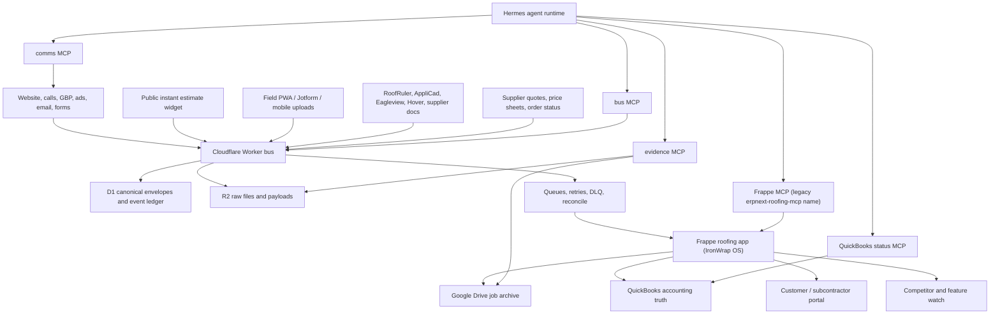

# IronWrap OS Hermes + Frappe End-Product Blueprint

Status: repository production candidate; deployment/runtime/admin proof is still required.

Current repository truth is the Worker-owned D1/R2 bus, the proprietary Frappe-only
`ironwrap_roofing` operating core, the Hermes role/skill/MCP boundary, and a pinned deployment
and recovery contract. JobNimbus/GHL remain temporary bridges, Google Workspace/Drive remain the
human communication/archive path, and QuickBooks remains accounting truth. Legacy `erpnext-*`
file, package, tool, and environment names are retained for compatibility and refer to the plain
Frappe site; the ERPNext application is forbidden.

This file is both the target product contract and the repository implementation map. It does not
assert that the code is deployed, accounts are configured, real sources are cut over, backups are
restorable, or operators have accepted the system. Those live gates are recorded separately in
`docs/LAUNCH-RUNBOOK.md`, `docs/OPERATIONS-RUNBOOK.md`, and
`final-spec-pack/18-phase-1-source-truth-and-build-contract.md`.

Calendar estimates are intentionally omitted. Progress is framed as build slices, proof
artifacts, maturity gates, and blockers.

## Bottom Line

The strongest end product is not "ERPNext with AI" and not "a JobNimbus clone." It is an
evidence-first roofing operating system where:

- Cloudflare owns raw intake and event truth.
- Frappe (IronWrap OS) owns deterministic business records and workflow gates.
- Hermes owns agentic operation through narrow, auditable tools.
- QuickBooks owns accounting truth.
- Drive/R2 own human and raw evidence archives.
- JobNimbus/GHL remain temporary bridge systems only until owned slices replace them.

The wedge is narrower than JobNimbus, Roofr, AccuLynx, CompanyCam, and GoHighLevel:
IronWrap OS should prove every job from estimate to warranty, not merely track it.

Current implementation checkpoint: the Worker exposes `POST /ingest/estimate` for the 3D
estimator/configurator. It uses stable project/idempotency keys for retry-safe replay, stores the
accepted estimator payload in R2, creates a D1 envelope, and mirrors Frappe-site Lead Envelope /
Roof Job / Instant Estimate Session rows when enabled. This is the owned handoff that lets JobNimbus/GHL
stay bridges instead of product dependencies.

Closeout/comms/market checkpoint (2026-07-08): the Frappe app now carries the full closeout
spine (Completion Packet, Warranty Packet, Review Request), policy-gated Communication Event,
Supplier Quote with validity and per-line pricing, and Market Watch Item. The `erpnext-roofing-mcp`
server exposes read plus dry-run/approved-write pairs for each, all funneled through one shared
audited-write helper so the read -> dry_run -> approval -> write -> audit contract cannot drift.
Review Requests are blocked by deterministic stop conditions (approved completion packet, payment
evidence, consent); Communication Events enforce CASL-style consent and quiet hours and are
record-only (no tool can send). Field intake now recognizes voice-note attachments and transcripts
(gate 9). White-label tenant configs live in `config/tenants/` with a validator
(`tools/validate-tenant-config.mjs`), a clone playbook (`docs/WHITE-LABEL-CLONE-PLAYBOOK.md`), and
an operations runbook (`docs/OPERATIONS-RUNBOOK.md`) covering gates 11 and 13.

Operational-safety checkpoint (2026-07-10): the Worker separates cheap liveness (`GET /health`)
from D1-schema/binding/config readiness (`GET /ready`) and exposes authenticated aggregate
operating truth at `GET /admin/status`. Readiness does not contact every downstream service;
runtime probes and status evidence remain separate. Dead-letter recovery is envelope-scoped by
default, compare-and-set safe, and requires bounded `run_id`, human approver, and reason evidence.
Bulk recovery requires the exact hard confirmation and is intentionally not available to Hermes.
Replay success and failure are written to the audit ledger. A D1 replay-request ledger binds `run_id` to the exact
selection and approval identity: an exact completed retry returns the stored outcome without a
second queue/audit mutation; changed intent conflicts; concurrent execution reports in-progress;
and failed rolled-back attempts can reclaim the same run safely.

Hermes runtime checkpoint (2026-07-09): the agent layer is codified under `hermes/`. Per-role MCP
tool allowlists for all eight agent roles are the source of truth in `hermes/agents/roles.json`,
with a human-readable profile per role, the launch/tool-filter manifest `hermes/mcp-servers.json`,
and the eleven skill packs under `hermes/skills/`. `tools/validate-hermes-config.mjs` proves the
roles and the manifest against the implemented MCP source inventory and enforces the safety contract at
config level: every referenced tool exists, buckets are correctly typed, and no approved-write tool
is granted without its `dry_run` counterpart in the same role. No tool sends a customer message or
mutates accounting.

Frappe-only checkpoint (updated 2026-07-10): the ERPNext (GPL-3.0) dependency is removed for 100% IP
ownership. `ironwrap_roofing` now deploys on a plain Frappe site (never install the erpnext app)
and is proprietary IronWrap IP on the MIT Frappe framework. The app carries the complete
46-DocType blueprint: 39 top-level business/audit objects plus seven child tables. The thirteen
latest operating objects are Crew Profile, Job Assignment, Change Order, Safety Plan, Job Compliance
Record, Communication Consent, Customer Decision, Contract Acceptance, Integration Reconciliation,
Tenant Export Run, Crew Member, Change Order Item, and Safety Acknowledgement. Every top-level DocType uses a shared
server-side policy adapter; identities/evidence have immutable or write-once rules; approvals,
production, proposal, supplier, and closeout transitions fail closed; and site-local roles are
installed from a least-privilege matrix with delete disabled. Frappe core `User` remains the only
non-custom Link target.

MCP/deploy checkpoint (2026-07-10): both MCP clients enforce production HTTPS, bounded timeouts,
redirect refusal, and structured transport errors. The Frappe MCP server requires a canonical role
and actor, registers only that role's allowlist, assignment-scopes Field Companion, requires
verified evidence, and binds every write to a current dry-run receipt plus separately signed human
approval receipt for one approver and one site. A stable `run_id` is a single mutation claim; a
completed run returns stored truth and an in-flight/failed claim never re-applies a mutation.
Audit finalization fails closed and distinguishes a non-mutating `Failed` run from an
`Audit Failed` run where the target mutation applied and an Automation Incident must reconcile
the audit. `deploy/runtime-lock.json` pins Frappe, frappe_docker, Hermes, and container digests;
the build rejects floating/dirty/ERPNext inputs; backups are complete-set, locally encrypted,
verified, marker-committed, and retention-gated. `tools/production-readiness.mjs` proves the
repository contract separately from live environment shape.

Operator-UI checkpoint (2026-07-10): the standard `IronWrap OS` Workspace now makes the owned
records navigable and links to a role-scoped `IronWrap Control Center` Desk Page. The cockpit is
read-only and exception-first: blocked gates, human reviews, Automation Incidents, stale jobs,
permission-scoped pipeline counts, a focused job runway, production gates, evidence, and the
Worker public readiness probe appear before generic lists. Every action opens its source record;
mutations remain in the dry-run/approval/audit path. This is repository proof only until a plain
Frappe site loads the Page and each role passes a live permission/empty/error-state smoke test.
It is the back-office fallback, not the finished product UI.

Product-layer checkpoint (2026-07-11): `docs/UIUX-NORTHSTAR-PLAN.md` is the binding product plan
for the installable React PWA and Worker `/api/v1/*` BFF. `docs/ROOFING-DEMAND-EVIDENCE.md`
grounds its acceptance contracts in fresh 2025-2026 Canadian/U.S. owner/operator discussions,
verified reviews, paid roles, and current regulatory sources. The product signature is Proof
Stream plus physical gate locks; canonical job identity, owned export/restore, locale policy,
role-shaped read models, offline verified outbox, field proof, owner exceptions, traceable
estimation, and customer-safe closeout are required slices rather than future polish.

Owner Now + Approvals checkpoint (2026-07-11): the PWA's owner/ops routes are locally implemented
as an exception-first BFF decision board and a governed approval inbox. Now separates verified crew
work-stops/blocked gates, operating exceptions, and lead attention into compact signals and durable
decision rows; source freshness, bounded totals, unavailable action guidance, and missing due timing
are disclosed once as data-confidence state. Job-packet links render only with the BFF's `job.read`
capability. A Lead Envelope separates `triage_status` from bus-owned, audited transport status;
`Untriaged` is created before the JobNimbus bridge and legacy rows become explicit `Unknown`
data-quality work. MCTB displays only an append-only Gmail provider-acceptance receipt (within SLA
or late) or the distinct absence/no-channel state, never a claim of delivery or human follow-up.

The first browser-approved vertical is deliberately bounded to local lead triage. The Worker holds
the durable D1 approval ledger; a private HMAC-authenticated broker holds the signing key and fixed
actor-scoped MCP child; the PWA receives only an allowlisted review DTO. Sales now offers a
contextual preparation screen only for an explicitly `Untriaged` Lead Envelope when the BFF grants
`approval.prepare`; it submits the Frappe document name and one internal summary, while the Worker
derives request text and the existing `/approvals` queue remains the only decision surface. A
configured owner can act only with server-granted capability, CSRF, a recent session, expected
version, and idempotency key; ops remains review-only. A broker ambiguity becomes `Execution
Uncertain` and is never retried by the UI. Local contract/mocked-browser proof is not deployment
proof: remote D1/Frappe migration, enabled BFF and broker, real device/browser, provider receipt,
and operator acceptance remain launch gates.

Quote-revision approval checkpoint (2026-07-12): the append-only Draft Customer Quote revision
now has its own estimator-assistant private broker, HMAC key/secret/port, D1 request/event ledger,
lease sweep, Worker BFF routes, and recovery/backup invariants. It never extends the lead-triage
broker or `/approvals` inbox. The stored review projection contains only source identity/version/
status/modified time, blank Draft target/version/supersedes, correction reason, lifecycle evidence,
and fixed no-effect flags; the full receipt-bound dry run is represented by a one-way digest. The
broker re-runs its dry run before signing and fails closed on source/version/target drift. An
ambiguous invoked write becomes reconciliation work and is never retried. The PWA now has a
contextual workbench entry plus isolated prepare, queue, and detail routes; they render only the
redacted projection, submit only source identity plus correction reason, and enable decisions only
from the exact BFF capability. The routes are locally contract-, build-, and mocked-browser-tested,
including desktop/mobile no-overflow visual proof. That is not live proof: migration, private
service reachability, Frappe audit, authenticated production browser, and operator acceptance remain
separate gates.

Sales Desk checkpoint (2026-07-11): the PWA now has a locally tested, office-only `/sales` review
surface backed by a separate Worker read contract. It joins only narrow allowlisted Lead Envelope
contact/triage fields, linked Roof Job identity, the latest Instant Estimate Session, the latest
Customer Quote, and linked Communication Consent records. The generic owner/field read allowlist
remains unchanged, and the browser rejects raw payloads, price-policy snapshots, consent source
references, and other unbounded Frappe data. The screen makes non-binding estimate status, quote
state, consent-record presence, and capped-source uncertainty explicit. It cannot send a message,
issue a quote, collect payment, or triage a lead directly. It can only prepare a bounded local
triage review from an exact `Untriaged` Lead Envelope when the BFF grants `approval.prepare`; the
browser submits no request text, customer message, quote, or accounting data. The measurement/
repricing/proposal workbench, live Frappe data proof, and real-operator validation remain open.

Estimator Workbench checkpoint (2026-07-12): the PWA now has a locally tested, office-only
`/estimator/jobs/:jobId` source-review surface. It uses a distinct static estimator allowlist and
fixed direct-document reads for the selected Measurement Report and Material Takeoff. The Worker
uses the Measurement Report's `raw_key` internally only after enforcing the owned
`raw/measurements/YYYY-MM-DD/ow_<uuid>.json` path and a 2 MiB cap, then reparses the retained
source with the existing deterministic geometry engine. The browser receives only capped facets,
checks, derived source metrics, persisted measurement/takeoff source references, quote version and
price-book state, Proposal Evidence Pack state, and Scope Clauses. It cannot receive raw keys, XML,
report URLs, raw evidence JSON, customer messages, tax-policy snapshots, supplier cost, or a
generic Frappe record. Direct Frappe responses are byte- and child-row-capped; over-limit detail
degrades to a stale/unavailable state. The workbench selects takeoffs only through their Measurement
Report link and proposal packs only through their Customer Quote link, exposing mismatches rather
than silently combining independent latest records. The locally tested Commercial Decision Rail
also compares only an explicit `supersedes` quote lineage, labels a price-book/effective-date record
as a captured snapshot rather than live supplier pricing, and keeps pending Change Orders attributed
to the selected quote or visibly separate. Source-file recomputation is visibly distinct from field
verification; no price, takeoff, proposal, signature, payment, or communication mutation exists in
this vertical. The separate MCP contract now supports a receipt-bound, append-only Draft Customer
Quote revision shell: it binds source/job/customer/reason/fresh version, copies no commercial or
acceptance field, rejects duplicate targets, and rejects an accepted or contract-linked source in
favor of Change Order evidence. Its isolated estimator-assistant broker and Worker D1/BFF approval
lane are now locally contract-tested, with a redacted ledger projection and no lead-triage authority
reuse. A capability-gated `Request draft revision` link now appears only for a configured broker
and a current, positive-version, non-accepted source; it opens the isolated preparation route,
then a separate queue/detail review surface rather than `/approvals`. These surfaces never render
commercial values, receipts, raw write arguments, or a retry for an uncertain execution. The
separate proposal-pack MCP slice now creates only a Draft proof pack scoped to one explicit,
same-job `Approved`/`Accepted` Customer Quote. It requires an approved Measurement Report and
customer-safe Evidence Items with verified provenance, checksum, and proof slot; uses a
quote-owned pack identity; redacts source URIs, R2 keys, raw summaries, and customer messages; and
re-reads the quote before any audited write. Frappe resolves every retained source ID back to a
same-job approved/verified record, repeats the quote-anchor and immutable identity checks, and
permits only Draft status until a receipt-verifying delivery command exists. There is still no browser
assembler, customer renderer/send, e-sign, or live Frappe/R2/operator proof.

Quote price-rule provenance checkpoint (2026-07-12): a Draft or Needs Review Customer Quote can
now bind one internal, immutable Price Book Rule snapshot through the receipt-bound
`dry_run_bind_quote_price_rules` → `request_bind_quote_price_rules` pair. The MCP fetches the
specified source rules server-side and returns only rule identity/count/effective-window context;
it never exposes supplier costs or raw rule JSON in its preview. Frappe re-resolves every source at
write time, requires an Approved rule effective at the quote timestamp, locks the snapshot to the
quote version, and freezes approved rule content while allowing only Approved → Retired. An
Approved/Accepted quote and a Proposal Evidence Pack now require that snapshot. This is immutable
provenance, not repricing, a live supplier-price feed, a browser control, or a customer-send path.
Insurance/supplement evidence, authenticated production-browser, and estimator/operator acceptance
proof remain open.

## Research Basis

Primary sources reviewed:

- Hermes documents itself as an agent with memory, skills, messaging gateways, cron,
  MCP support, an API server, and security controls. Its docs also state MIT license.
  Sources: [Hermes docs](https://hermes-agent.nousresearch.com/docs/),
  [Hermes API server](https://hermes-agent.nousresearch.com/docs/user-guide/features/api-server),
  [Hermes MCP](https://hermes-agent.nousresearch.com/docs/user-guide/features/mcp),
  [Hermes security](https://hermes-agent.nousresearch.com/docs/user-guide/security).
- Frappe supports custom apps, DocTypes, ORM-backed database tables, and generated REST
  APIs for DocTypes. ERPNext is GPL-3.0 and covers accounting, order management,
  manufacturing, assets, and projects. Sources:
  [Frappe create app](https://docs.frappe.io/framework/user/en/tutorial/create-an-app),
  [Frappe DocTypes](https://docs.frappe.io/framework/user/en/basics/doctypes),
  [Frappe REST API](https://docs.frappe.io/framework/user/en/api/rest),
  [ERPNext GitHub](https://github.com/frappe/erpnext).
- Competitor bar:
  [JobNimbus](https://www.jobnimbus.com/) covers roofing CRM, measurements, mobile,
  communications, production, billing, proposals, integrations, and QuickBooks sync.
  [Roofr](https://roofr.com/) covers CRM, instant estimator, measurement reports,
  proposals, material ordering, invoices, payments, and calendar. [AccuLynx](https://acculynx.com/)
  positions as an all-in-one roofing platform, with production management around crew
  scheduling and material ordering. [CompanyCam](https://companycam.com/) owns field
  photo/progress documentation and AI-assisted reports. [GoHighLevel](https://www.gohighlevel.com/)
  owns broad capture, nurture, booking, conversations, workflows, and reactivation.
- Additional market bar checked during the 2026-07-08 self-audit:
  [Roofr Instant Estimator](https://roofr.com/estimator) gives homeowners a quote in
  seconds from contractor pricing and creates a qualified job card. [CompanyCam AI](https://companycam.com/ai-features)
  turns photos and voice into reports, checklists, captions, and updates. [AccuLynx
  Spring 2026 updates](https://acculynx.com/spring-2026-product-updates/) add custom
  fields, appointment outcomes, and estimating improvements. [ServiceTitan's 2026
  exterior report](https://www.servicetitan.com/press/2026-roofing-exterior-market-report)
  says contractors are shifting toward production features, configurability, and AI/automation.
  [Eagleview](https://www.eagleview.com/industry/roofing-and-siding/) and [Hover](https://hover.to/)
  raise the measurement/3D/material-list bar. [SumoQuote](https://www.sumoquote.com/)
  remains the proposal-presentation bar and is now part of the JobNimbus family.

## Self-Audit Findings And Fixes

The first version was directionally right but not sharp enough to beat the market. These
are the corrections.

| Gap in v1 | Why it was a problem | Blueprint correction |
| --- | --- | --- |
| Underweighted instant homeowner estimates | Roofr already competes before the first call with instant price ranges and lead qualification | Add public estimate/session model and proof gate |
| Underweighted field voice/photo AI | CompanyCam is turning voice plus photos into reports, checklists, and updates | Add field voice/photo parity as a product gate |
| Underweighted 3D/measurement vendors | Eagleview and Hover own remote measurements, 3D models, visual design, and material lists | Add provider-agnostic measurement and visual model layer |
| Underweighted production configurability | AccuLynx is expanding custom fields, appointment outcomes, and estimation controls | Make custom data, outcome tracking, and production gates first-class |
| Underweighted end-to-end platform pressure | ServiceTitan's research points to contractors wanting fewer stitched systems | Require one operator UX over the multi-service backend |
| Underweighted supplier/order workflows | JobNimbus, Roofr, AccuLynx, Hover, and Eagleview all press materials/order confidence | Add supplier quote/order/readiness objects and gates |
| Too soft on market drift | A one-time blueprint can go stale quickly | Add market-defense gates and a competitor watch object |

## Product Thesis

Roofing software usually optimizes one of these lanes:

| Product | Strong lane | Weakness IronWrap can exploit |
| --- | --- | --- |
| JobNimbus | Contractor CRM, mobile, workflows, billing, integrations | Generic contractor workflow; not IronWrap-specific evidence/proof graph |
| Roofr | Instant estimates, proposals, measurements, material ordering | Strong sales flow, less owned operating truth |
| AccuLynx | Roofing production suite | Broad roofing operations, not deeply agent-native |
| CompanyCam | Field photos, progress, reports | Photo system, not full business OS |
| GoHighLevel | Marketing, conversations, funnels, automations | Agency/growth layer, not roofing production truth |
| ServiceTitan | Enterprise end-to-end trades platform | Too broad/heavy for a one-shop roofing OS; high implementation weight |
| SumoQuote | Proposal presentation | Proposal layer only; now reinforces JobNimbus rather than replacing the OS |
| Eagleview / Hover | Measurements, 3D, visual material lists | Provider data, not full operating truth |

IronWrap can win by building a narrower system with stronger truth:

```text
lead -> evidence -> measurement -> scope -> material takeoff -> proposal
-> deposit -> production gates -> field proof -> invoice -> review -> warranty
```

Every step should answer:

- What evidence created this decision?
- Who approved it?
- What system owns the truth?
- What is blocked?
- What can Hermes do safely now?
- What must a human approve?

## Six-Month Market Defense Bar

The product should not claim "better than market" unless it clears these gates. The horizon
is a competitive durability bar, not a build plan.

| Market pressure | Required IronWrap answer |
| --- | --- |
| Roofr-style instant estimates | Public estimate widget creates a qualified Lead Envelope, gives a range with assumptions, and never creates a binding price without review |
| CompanyCam-style field AI | Field user can talk, snap, and submit; Hermes produces a checklist update, customer-safe summary, and evidence labels |
| AccuLynx-style configurable production | Custom fields, appointment outcomes, job gates, production outcomes, and reports are configurable per tenant |
| ServiceTitan-style end-to-end orchestration | One operator UX hides the backend stitching; bus/Frappe/Hermes/QB failures are visible and recoverable |
| Eagleview/Hover measurement and 3D pressure | System ingests third-party measurements, 3D/visual model links, material lists, and confidence metadata |
| SumoQuote/JobNimbus proposal polish | Proposal Evidence Pack must be visually strong, option-based, proof-linked, and e-sign/payment ready |
| GHL follow-up pressure | Comms automation must cover speed-to-lead, nurture, missed call, review, and reactivation with consent gates |
| AI product announcements | Hermes tools must be narrower, safer, and more business-contextual than generic "AI assistant" features |

## Architecture



### Layer Rules

| Layer | Owner | Rule |
| --- | --- | --- |
| Cloudflare bus | Raw intake and event truth | Every external event lands here first where practical |
| Frappe (IronWrap OS operating core) | Business workflow truth | Deterministic records, permissions, gates, and status |
| Hermes | Intelligent operator | Reads broadly; writes only through approved command tools |
| QuickBooks | Accounting truth | No final accounting mutation by Hermes without explicit approval |
| Drive/R2 | Evidence | R2 raw, Drive human archive; neither replaces Frappe workflow state |
| Google/Engage/email/voice | Communications | Customer-facing actions are policy-gated and logged |

## Frappe Product Model

The model is Frappe-only. `ironwrap_roofing` is a proprietary custom app on the MIT Frappe
framework, installed on a plain Frappe site; the erpnext app is never installed. The former
ERPNext reuse targets are replaced by owned DocTypes:

| Former ERPNext target | Owned replacement |
| --- | --- |
| Lead / Opportunity | Lead Envelope + Roof Job own the pipeline |
| Customer / Contact | Roofing Customer |
| Quotation | Customer Quote |
| Project / Task | Roof Job + Production Gate State + Field Check-in |
| Item / Material Request / Purchase Order | Material Takeoff + Supplier Quote + Supplier Order + Supplier Profile |
| Sales Invoice mirror | Payment Milestone; QuickBooks stays accounting truth |
| User / Role / Permission, Web Forms, Workflow | MIT Frappe framework features |

Custom DocTypes:

| DocType | Purpose |
| --- | --- |
| Lead Envelope | Canonical bus event mapped into the Frappe site |
| Roofing Customer | Owned customer/party record (homeowner or company); replaces ERPNext Customer/Contact |
| Roofing Property | Address, structure, access, roof metadata, hazards |
| Roof Job | Job wrapper tying Roofing Customer, Roofing Property, Customer Quote, files, and accounting refs |
| Customer Quote | Owned commercial quote object; replaces ERPNext Quotation |
| Evidence Item | Photo, PDF, XML, transcript, email, signed document, invoice, or field note |
| Instant Estimate Session | Public estimate interaction, assumptions, selected options, range, and lead score |
| Price Book Rule | Material/labor/option pricing rule with source, approval, and effective state |
| Measurement Report | RoofRuler/AppliCad/EagleView-style report metadata and parsed quantities |
| Visual Property Model | Hover/Eagleview/other 3D model link, screenshots, measurements, and confidence metadata |
| Roof Area | Area, pitch, facets, penetrations, edges, notes |
| Material Takeoff | Panels, trim, fasteners, underlayment, waste, supplier, readiness |
| Option Package | Good/better/best system, upgrades, financing/payment assumptions, warranty differences |
| Proposal Evidence Pack | The proposal proof bundle shown to owner/customer |
| Scope Clause | Included, excluded, assumption, risk, optional upgrade, warranty clause |
| Payment Milestone | Deposit, progress, final, holdback, status mirror |
| Production Gate State | Deposit, material, WCB/safety, access, weather, crew, completion |
| Field Check-in | Crew update with photos, GPS/device metadata, notes, blockers |
| Completion Packet | Completion photos, customer signoff, deficiency list, warranty readiness |
| Warranty Packet | Final warranty terms, proof, dates, material system, exclusions |
| Review Request | Review eligibility, channel, sent state, stop conditions |
| Communication Event | SMS/email/call/portal action, consent basis, template, status, and audit result |
| Supplier Profile | Owned supplier master; replaces ERPNext Supplier |
| Supplier Quote | Supplier, requested materials, price, validity, substitutions, delivery terms |
| Supplier Order | Approved material order, delivery status, shortages, substitutions, received proof |
| Hermes Run | Hermes prompt, tools, inputs, dry-run output, approval, write result, audit link |
| Automation Incident | Failed automation, stuck envelope, bad parse, policy block |
| Market Watch Item | Competitor/product change, source link, risk level, required response |
| White-Label Tenant | Customer/company config for future productization |
| Crew Profile | Active crew, members, safety coverage, and default workflow profile |
| Job Assignment | Append-only direct or crew assignment with schedule/lifecycle history |
| Change Order | Versioned scope/price change draft and internal review evidence |
| Safety Plan | Versioned ready-plan evidence and acknowledgement parent |
| Job Compliance Record | Permit, licence, inspection, HOA, utility, and waiver facts |
| Communication Consent | Append-only consent/revocation lineage; record-only |
| Customer Decision | Evidence-backed customer decision record; never a signature surrogate |
| Contract Acceptance | Provider/customer acceptance evidence; strictly read-only to Hermes |
| Integration Reconciliation | Evidence-backed mirror discrepancy and resolution record |
| Tenant Export Run | Requested export audit record; archive/key creation is separate |

The seven child-table DocTypes are Measurement Value, Material Takeoff Item, Supplier Quote Item,
Supplier Order Item, Crew Member, Change Order Item, and Safety Acknowledgement. Repository validation requires exactly these 46 DocTypes, exact field
contracts, shared controllers for every top-level object, owned/Frappe-core Link targets only, and
the canonical role matrix.

## Evidence Graph

The Evidence Graph is the product moat.

Every important object links to evidence:

```text
Lead Envelope
  -> Roofing Customer / Roofing Property
  -> Measurement Report
  -> Evidence Items
  -> Material Takeoff
  -> Proposal Evidence Pack
  -> Payment Milestones
  -> Production Gates
  -> Field Check-ins
  -> Completion Packet
  -> Invoice/payment refs
  -> Warranty Packet
  -> Review Request
```

This lets the system generate:

- proof-backed proposals
- customer-ready progress summaries
- owner stuck-job reports
- dispute packets
- warranty packets
- margin/profit leakage reports
- white-label demo data
- market-defense reports showing which competitor claims are covered, exceeded, or still open

## Hermes Agent Architecture

Hermes should be the operating brain, not the database.

Hermes capabilities that matter:

- MCP lets Hermes connect to external tool servers and expose only selected tools.
- Hermes can run as an OpenAI-compatible API backend for custom UIs.
- Hermes supports cron/background jobs.
- Hermes supports memory and reusable skills.
- Hermes security includes command approval modes, allowlists, gateway user allowlists,
  and MCP tool filtering.

### Agent Roles

| Agent | Reads | Writes | Forbidden |
| --- | --- | --- | --- |
| Owner Operator | Everything except secrets | Draft tasks, approve-safe status changes | Final accounting, contract/legal sends without approval |
| Lead Concierge | New leads, contact history, source | Draft reply, create follow-up task after approval | Price promises, legal claims |
| Estimator Assistant | Measurements, photos, price tables, scope templates | Draft scope, takeoff, proposal pack | Final price without estimator approval |
| Production Controller | Jobs, gates, material status, field updates | Draft schedule changes, blocker tasks | Start job if hard gates fail |
| Field Companion | Assigned jobs, upload forms, safety/completion checklist | Field notes, photo labels, completion draft | Delete evidence, bypass completion gate |
| Finance Reconciler | Invoice/payment status mirrors | Create reconciliation task | Create final invoice/payment mutation without approval |
| Closeout Agent | Completion packet, invoice status, review eligibility | Draft warranty/review request | Send review request if stop/compliance block exists |
| Support/Admin Agent | Tenant config, failed automations, logs | Draft support diagnosis | Cross-tenant access |

### MCP Servers

Build narrow MCP servers, not one giant god tool.

| MCP server | Repository state | Capability boundary |
| --- | --- | --- |
| `ironwrap-bus-mcp` | Implemented: 7 tools | Read readiness/status/envelopes/dead letters; preview and request one targeted replay. No bulk Hermes replay |
| `erpnext-roofing-mcp` | Implemented under compatibility name: 121 tools | 73 bounded reads plus 24 dry-run/request pairs across job, proof, estimator, quote revision, price-rule provenance, production, safety, compliance, consent, customer-decision, lead triage, reconciliation, export, closeout, comms, and market truth; runtime role/actor filtering is enforced in-server |
| `evidence-mcp` | Planned split | Evidence search, packet assembly, and approved attachment only |
| `measurement-mcp` | Planned split | Deterministic parsing/comparison and review flags |
| `instant-estimate-mcp` | Planned split | Range/qualification drafts and quote-review request |
| `supplier-mcp` | Planned split | Quote comparison, substitution review, material-order request |
| `qbo-status-mcp` | Planned read-only boundary | Invoice/payment status and unmatched-payment diagnostics; no accounting mutation |
| `comms-policy-mcp` | Planned split | Draft, consent/quiet-hours check, and approved send boundary |
| `market-watch-mcp` | Planned split | Watch-item read/write and response-gap draft |
| `tenant-admin-mcp` | Planned split | Tenant readiness and clone dry-run; no cross-tenant data access |

`tools/validate-hermes-config.mjs` currently validates all eight roles and the launch manifest
against 128 implemented tools. It also rejects an approved-write grant that lacks the matching
dry-run grant in the same role and verifies the runtime receipt/role/evidence enforcement seams.

Mutation pattern:

```text
read -> propose -> dry_run -> policy_check -> human_approval -> write -> audit_event
```

No direct free-form writes to Frappe, QuickBooks, Drive, or customer channels. Each approved
Frappe request requires a stable `run_id`. Completed runs replay their stored result. A target
mutation followed by audit-finalization failure becomes `Audit Failed`, not a false success, and
must carry incident/correlation/result evidence for reconciliation.

### Hermes Skills

Codify procedures as skills:

| Skill pack | What it contains |
| --- | --- |
| `ironwrap-lead-triage` | qualification, urgency, source attribution, missing-info checks |
| `instant-estimate-qualifier` | range logic, assumptions, no-price-promise guardrails |
| `roofing-scope-builder` | inclusions, exclusions, risk clauses, upgrade options |
| `metal-roofing-takeoff` | panels, trim, gauges, colors, waste, supplier assumptions |
| `proposal-proof-pack` | customer-facing evidence narrative and packet assembly |
| `field-voice-report` | voice/photo capture into checklist, report, progress summary, customer-safe draft |
| `production-gatekeeper` | deposit/material/safety/access/weather/completion gate rules |
| `field-closeout` | photo requirements, deficiency list, completion and warranty readiness |
| `alberta-compliance` | CASL, privacy, call recording, WCB/safety policy prompts |
| `market-defense` | competitor change triage and feature-gap response |
| `white-label-onboarding` | tenant setup checklist, brand/config/template validation |

## Workflow Design

### Public Instant Estimate To Qualified Lead

1. Homeowner enters address, service type, material interest, urgency, photos if available, and consent.
2. Bus writes the raw session before any scoring or reply.
3. Frappe creates Instant Estimate Session, Lead Envelope, Roofing Customer, and Roofing Property.
4. Hermes generates a range with explicit assumptions, exclusions, and confidence level.
5. The system creates a qualified sales task and follow-up draft.
6. Any displayed number is labeled as a non-binding range until estimator review.

Proof gate: a homeowner-facing estimate session produces a qualified lead, source attribution,
assumption-backed range, and follow-up without bypassing review or data ownership.

### Lead to Qualification

1. Lead enters website/call/form/email/ad.
2. Bus writes envelope and raw payload.
3. Frappe creates/updates Lead Envelope, Roofing Customer, Roofing Property, and Roof Job.
4. Hermes classifies urgency, service type, missing fields, source, brand.
5. Hermes drafts first response and owner task.
6. Human approval or configured safe-send sends response.
7. Reconcile confirms source count, bus count, and Frappe consumer state.

Proof gate: a real lead can be traced from source event to bus envelope to Frappe record to
owner/customer communication.

### Qualification to Measurement

1. Sales confirms service fit, address, access, desired scheduling need, contact consent.
2. Measurement report, visual model, photos, or supplier docs are ordered/uploaded.
3. Bus stores PDF/XML/photos/model links/provider payloads.
4. Parser creates Measurement Report, Visual Property Model, and Roof Area records.
5. Hermes flags missing/ambiguous measurement values, model confidence gaps, and manual review needs.
6. Estimator approves parsed values before takeoff or proposal use.

Proof gate: measurement values used in the proposal are linked back to the original report.

### Measurement to Proposal

1. Estimator builds Material Takeoff from approved measurement/model evidence.
2. Supplier Quote and Supplier Order readiness are checked where materials matter.
3. Hermes drafts scope clauses, option packages, exclusions, and customer-facing proof.
4. Proposal Evidence Pack assembles photos, measurements, model links, options, warranty terms, and payment milestones.
5. Human approves price, scope, exclusions, substitutions, and payment terms.
6. Proposal is sent with audit link back to evidence.

Proof gate: every proposal line can be explained by measurement, photo, template, material, or human override.

### Won Job to Production

1. Signed proposal/accepted quotation is recorded.
2. Deposit/payment milestone is checked against QuickBooks/payment truth.
3. Production Gates are created.
4. Materials are requested and tracked.
5. Schedule is allowed only when required gates are green or explicitly waived.

Proof gate: no job reaches production without a visible gate state and override history.

### Field Execution

1. Crew sees only assigned jobs and required checklist.
2. Voice notes, photos, checklist changes, and check-ins go through bus first.
3. Evidence assets attach to the Roof Job and Drive folder.
4. Hermes converts voice/photo context into checklist updates, issue flags, captions, and report draft.
5. Owner/customer updates are drafted from verified field evidence.

Proof gate: a field update creates evidence, job state, and owner visibility without manual retyping.

### Closeout, Invoice, Warranty, Review

1. Completion Packet requires final photos, deficiencies, customer/owner signoff, and warranty readiness.
2. Invoice/payment status comes from QuickBooks or approved mirror.
3. Warranty Packet is generated from accepted scope, material system, and completion proof.
4. Review Request is allowed only if stop conditions are clear.
5. Hermes drafts customer closeout message and review request.

Proof gate: the job closes with invoice/payment state, warranty packet, review eligibility, and evidence archive.

## Product Surfaces

| Surface | Purpose | Must feel like |
| --- | --- | --- |
| Owner Cockpit | What is new, stuck, risky, unpaid, missing, or profitable | Dense command center |
| Public Estimate Widget | Fast homeowner range plus qualification | Trust-building lead capture, not a price-promise gimmick |
| Sales Desk | Lead triage, qualification, proposal follow-up | Fast CRM with evidence beside every lead |
| Estimator Workbench | Measurements, takeoff, scope, options, proposal proof | Review station, not chatbot |
| Production Board | Gates, materials, schedule, blockers, crews | Operational board with hard stops |
| Field PWA | Today's jobs, photos, voice, checklists, notes, offline queue | Minimal mobile tool |
| Customer Portal | Proposal, progress, invoices, warranty packet | Trust-building proof room |
| Admin Console | Brands, templates, users, tools, integrations, policy | White-label control plane |
| Agent Console | Hermes runs, approvals, failed tools, audit log | Human supervision panel |
| Market Watch Console | Competitor changes and response gaps | Strategic radar tied to product gates |

## White-Label Productization

Do not start with multi-tenant SaaS complexity. Start with one-shop truth and make the
architecture cloneable.

### Isolation Model

Preferred early model:

- one plain Frappe site per contractor (never the erpnext app)
- one Hermes profile per contractor
- one Cloudflare namespace/config set per contractor
- one Drive/R2/evidence namespace per contractor
- one QuickBooks connection per contractor
- one brand/template pack per contractor

Move to centralized multi-tenant services only after the repeatable product shape is proven.

### White-Label Config

| Config area | Examples |
| --- | --- |
| Brand | name, logo, colors, domains, sender mailboxes, review links |
| Geography | service areas, tax/compliance defaults, privacy text |
| Services | roofing, metal roofing, siding, gutters, soffit/fascia |
| Materials | suppliers, profiles, gauges, colors, warranties |
| Estimates | instant-estimate ranges, disclaimers, qualification fields, review gates |
| Proposal | templates, options, exclusions, payment milestones |
| Production | stages, gates, photo requirements, safety checklist |
| Communications | SMS/email templates, quiet hours, consent policy |
| Integrations | QuickBooks, Drive, forms, measurement vendors, visual model vendors, suppliers, phone/SMS |
| Agents | enabled roles, tool permissions, approval policies |
| Market defense | competitor set, required gates, watch cadence, escalation owner |

### Sellable Units

The white-label product should be packaged as:

- roofing operating core
- proposal and evidence pack
- field proof and closeout
- AI owner/operator assistant
- integration bus and reconciliation
- white-label setup/onboarding
- optional managed operations/support

## Maturity Gates

Repository support means code/contracts/tests exist. It is not the same as a passed live gate.

| Gate | Name | Repository state | Required live/product proof |
| --- | --- | --- | --- |
| 0 | Source truth | Documented and contract-validated | Reconcile Cloudflare, Frappe, Hermes, QB, Drive, bridge, and admin inventory |
| 1 | Intake spine | Worker route/storage/consumer/reconcile tests exist | One real source lands in R2, D1, Frappe, audit, ack, and bridge with zero gap |
| 2 | Operating core | 46 DocTypes, shared policy/RBAC, atomic safety append, and packaging tests exist | Install/migrate on plain Frappe; role-specific fixture workflow passes |
| 3 | Read-only Hermes | Eight roles and 128-tool inventory validate | Hermes answers owner questions from live bus/Frappe truth with zero writes |
| 4 | Approved-write Hermes | Dry-run/receipt/approval, single-claim idempotency, verified evidence, actor scope, and audit-failure tests exist | One approved live mutation has complete Hermes Run, receipt, and replay-safe proof |
| 5 | Instant estimate parity | Owned idempotent ingest/session contract exists | Public widget, range policy, consent, owner follow-up, and estimator review pass |
| 6 | Proposal proof | Evidence/takeoff/options/scope/quote/proposal records and tools exist | Customer-quality renderer plus selected e-sign path complete one signed packet |
| 7 | Supplier/material readiness | Quote/order/substitution policy objects and tools exist | Real supplier values and readiness state correctly block/allow one job |
| 8 | Production gatekeeper | Deterministic gate and Roof Job transition policies exist | Role-specific users cannot move an unsafe fixture/real job into production |
| 9 | Field voice/photo proof | Photo/voice intake and evidence/check-in records exist | Crew device/offline workflow creates usable evidence, checklist, and job update |
| 10 | Closeout truth | Completion/warranty/review/payment policy objects and tools exist | QB status, completion proof, warranty issue, and human-sent review reconcile |
| 11 | White-label clone | Tenant object/config validator and clone playbook exist | Second isolated site/brand passes cross-tenant negative tests and full smoke proof |
| 12 | Market defense loop | Market Watch object, role, tools, and skill exist | One sourced market change creates an approved product-gap disposition |
| 13 | Managed product | Pinned deploy/readiness/backup/runbook contracts exist | Monitoring, incident drill, encrypted restore, support ownership, and billing are accepted |

## Risk Register

| Risk | Why it matters | Control |
| --- | --- | --- |
| Agent overreach | AI writes can damage jobs, money, or customer trust | Narrow tools, dry-run, approval, audit |
| Framework customization debt | Heavy framework forks make upgrades painful | Proprietary custom app on stock MIT Frappe, no framework fork |
| License/commercial terms | ERPNext (GPL-3.0) dependency removed 2026-07-09; stack is MIT foundations (Frappe, Hermes, MCP SDK) plus the proprietary IronWrap app | Remaining legal gate is trademark hygiene and MIT notice preservation; one legal pass before the first external tenant |
| Accounting mistakes | Payments, invoices, taxes are high-risk | QuickBooks remains source of truth; Hermes read/draft only |
| Field adoption | Crew will reject slow tools | Field PWA is locally implemented: today, packet, proof stream, check-in, offline outbox, server verification, and device-bound QR pairing/revocation; real-device proof remains open |
| Data migration | Old GHL/JobNimbus/Drive data may be messy | Import ledger, manual exception queue |
| Tenant leakage | White-label product cannot mix customers | Site/profile/namespace isolation first |
| Compliance | SMS/privacy/call recording/reviews vary by region | Policy skill plus deterministic consent gates |
| Vendor dependence | Measurements, SMS, payments can be external blockers | Bus-first architecture and fallback tasks |
| False proposal confidence | AI can hallucinate scope/pricing | Evidence links and estimator approval required |
| Stitched-stack perception | Buyers want one platform, not a fragile bundle | One operator UX plus visible reconciliation and incident recovery |
| Market drift | Competitors are adding AI, estimates, and production features fast | Market Watch Item object and market defense gate |
| Instant-estimate liability | Fast ranges can become accidental price promises | Non-binding range language, assumption ledger, estimator approval |
| Supplier data drift | Materials, substitutions, and delivery state change quickly | Supplier Quote validity, substitution approval, readiness gates |

## Non-Goals

- Do not use Hermes memory as CRM.
- Do not let Hermes freestyle SQL/API writes.
- Do not reintroduce ERPNext: it was removed entirely (2026-07-09), not merely left unforked. The app stays Frappe-only; never install the erpnext app.
- Do not build multi-tenant SaaS before the single-shop system is proven cloneable.
- Do not replace QuickBooks accounting truth with ERPNext until accounting migration is explicitly chosen.
- Do not build custom mobile-native apps before the field PWA/form workflow proves the job.
- Do not optimize for generic contractors before IronWrap's roofing/metal-exteriors workflow is excellent.

## Resolved Proof Decisions

The artificial blockers below are collapsed in
[`HERMES-ERPNEXT-PROOF-PACK.md`](./HERMES-ERPNEXT-PROOF-PACK.md):

| Topic | Current Decision |
| --- | --- |
| ERPNext customization path | Frappe-only custom app; ERPNext removed entirely (2026-07-09) for 100% IP ownership. Never install the erpnext app. |
| Roofing record model | Exactly 46 owned DocTypes: 39 top-level objects plus seven child tables; the only non-custom Link target is Frappe core User. |
| Bus-to-Frappe sync | Worker/D1/R2 remains front door and source spine; the Frappe site consumes idempotent mirrors (`erpnext-*` names retained for compatibility). |
| Hermes boundary | Read-only first, draft second, narrow approved-write third; no raw SQL/API freestyle writes. |
| Measurement proof | Use the existing `/ingest/measurement` route and sample files; add deterministic extraction before OCR. |
| Activepieces | Bench as future Make replacement candidate; do not switch the current live path now. |
| DocuSeal | Retired permanently (AGPL), even as a fallback. E-sign direction: commercial e-sign API (e.g. Dropbox Sign or DocuSign API) or owned signing on the Proposal Evidence Pack; JobNimbus native e-sign dies with the JobNimbus retirement. |
| License posture | MIT foundations (Frappe, Hermes, MCP SDK) plus the proprietary IronWrap app; GPL eliminated by removing ERPNext. Remaining gate: trademark hygiene and MIT notice preservation before the first external tenant. |

## Remaining Decision Backlog

| Decision | Needed to move |
| --- | --- |
| Production host/topology | Choose and document the host, registry, persistent volumes, database/Redis layout, and operations owner that satisfy the runtime lock |
| Accounting boundary | QuickBooks permanent truth vs a future owned accounting migration |
| Proposal renderer | Frappe print formats, custom Frappe UI, or external PDF service |
| Public estimate policy | Range logic, disclaimers, required fields, estimator-review threshold |
| Product PWA acceptance | P0 shell/session/outbox, P1 Field Companion/BFF/QR pairing, and P2 Owner Now plus the receipt-safe governed lead-triage preparation and approval inbox are locally implemented; complete live backend, broker/Frappe, browser/device/provider receipt gates, and P3-P5 sales/portal/tenant protocols |
| Frappe fallback cockpit | Repository surface exists; prove live role filtering, Worker readiness reachability, empty/error states, responsive layout, and source-record navigation on the deployed site |
| Measurement/visual provider strategy | RoofRuler/AppliCad only vs Eagleview/Hover/provider-agnostic ingest |
| Supplier integration strategy | Manual supplier quote capture vs API/order integrations |
| Hermes deployment | Run the locked Hermes release on the application host or an isolated host; define supervision, secrets, logs, and upgrade ownership |
| White-label provisioning | Automate site-per-company creation, namespace validation, backups, and cross-tenant negative tests |
| Support model | software only, managed operations, or hybrid |

## Remaining Proof Order

1. Run the complete repository CI and archive the release commit plus readiness-contract output.
2. Build/publish the locked image, install/migrate a plain Frappe site, and run fixture/role proofs.
3. Deploy Worker migrations and prove `/ready`, `/admin/status`, and targeted replay against the
   intended account without mutating unrelated live records.
4. Prove bus-to-Frappe sync with a real envelope and idempotent retry.
5. Prove read-only Hermes and one approved Frappe write with a complete, replay-safe audit trail.
6. Install and role-test the exception-first Control Center; keep standard Frappe lists/forms as
   the truthful fallback and archive screenshots plus permission-negative evidence.
7. Prove the PWA/BFF foundation: canonical identity, session/tenant/RBAC, role-shaped read models,
   installability, offline shell/outbox, integration truth, and owned export/restore.
8. Prove field, owner/approvals, sales/estimator, customer/widget, and white-label slices in the
   North Star order, including the demand-backed automated and real-operator gates.
9. Prove public estimate, measurement/model, supplier, proposal/e-sign, production, field, and
   closeout domain paths end to end through the product surface.
10. Run encrypted backup plus isolated restore, monitoring, incident, and secret-rotation drills.
11. Clone a second site/brand and pass cross-tenant negative tests.
12. Obtain operator/legal/admin acceptance for communications, accounting, support, billing, and
    external-tenant packaging.
