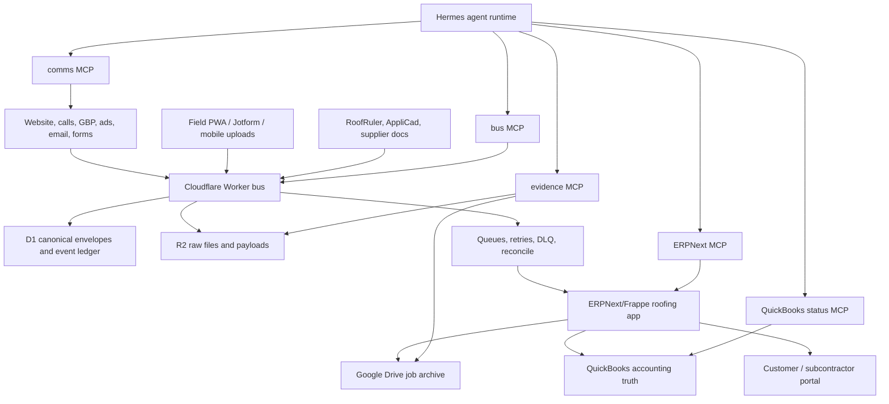

# IronWrap Hermes + ERPNext End-Product Blueprint

Status: strategy blueprint, not current implementation truth.

Current repo truth remains the Worker/Make owned bus, JobNimbus, Google Workspace/Drive,
and QuickBooks path described in `README.md`, `AGENTS.md`, `DELIVERY-PLAN.md`, and the
`final-spec-pack/`. This document defines the candidate end product: IronWrap first, then
a white-label operating system for similar roofing and exterior companies.

Calendar estimates are intentionally omitted. Progress is framed as build slices, proof
artifacts, maturity gates, and blockers.

## Bottom Line

The strongest end product is not "ERPNext with AI" and not "a JobNimbus clone." It is an
evidence-first roofing operating system where:

- Cloudflare owns raw intake and event truth.
- ERPNext/Frappe owns deterministic business records and workflow gates.
- Hermes owns agentic operation through narrow, auditable tools.
- QuickBooks owns accounting truth.
- Drive/R2 own human and raw evidence archives.

The wedge is narrower than JobNimbus, Roofr, AccuLynx, CompanyCam, and GoHighLevel:
IronWrap OS should prove every job from lead to warranty, not merely track it.

## Research Basis

Primary sources reviewed:

- Hermes documents itself as an agent with memory, skills, messaging gateways, cron,
  MCP support, an API server, and security controls. Its docs also state MIT license.
  Sources: [Hermes docs](https://hermes-agent.nousresearch.com/docs/),
  [Hermes API server](https://hermes-agent.nousresearch.com/docs/user-guide/features/api-server),
  [Hermes MCP](https://hermes-agent.nousresearch.com/docs/user-guide/features/mcp),
  [Hermes security](https://hermes-agent.nousresearch.com/docs/user-guide/security).
- Frappe supports custom apps, DocTypes, ORM-backed database tables, and generated REST
  APIs for DocTypes. ERPNext is GPL-3.0 and covers accounting, order management,
  manufacturing, assets, and projects. Sources:
  [Frappe create app](https://docs.frappe.io/framework/user/en/tutorial/create-an-app),
  [Frappe DocTypes](https://docs.frappe.io/framework/user/en/basics/doctypes),
  [Frappe REST API](https://docs.frappe.io/framework/user/en/api/rest),
  [ERPNext GitHub](https://github.com/frappe/erpnext).
- Competitor bar:
  [JobNimbus](https://www.jobnimbus.com/) covers roofing CRM, measurements, mobile,
  communications, production, billing, proposals, integrations, and QuickBooks sync.
  [Roofr](https://roofr.com/) covers CRM, instant estimator, measurement reports,
  proposals, material ordering, invoices, payments, and calendar. [AccuLynx](https://acculynx.com/)
  positions as an all-in-one roofing platform, with production management around crew
  scheduling and material ordering. [CompanyCam](https://companycam.com/) owns field
  photo/progress documentation and AI-assisted reports. [GoHighLevel](https://www.gohighlevel.com/)
  owns broad capture, nurture, booking, conversations, workflows, and reactivation.

## Product Thesis

Roofing software usually optimizes one of these lanes:

| Product | Strong lane | Weakness IronWrap can exploit |
| --- | --- | --- |
| JobNimbus | Contractor CRM, mobile, workflows, billing, integrations | Generic contractor workflow; not IronWrap-specific evidence/proof graph |
| Roofr | Instant estimates, proposals, measurements, material ordering | Strong sales flow, less owned operating truth |
| AccuLynx | Roofing production suite | Broad roofing operations, not deeply agent-native |
| CompanyCam | Field photos, progress, reports | Photo system, not full business OS |
| GoHighLevel | Marketing, conversations, funnels, automations | Agency/growth layer, not roofing production truth |

IronWrap can win by building a narrower system with stronger truth:

```text
lead -> evidence -> measurement -> scope -> material takeoff -> proposal
-> deposit -> production gates -> field proof -> invoice -> review -> warranty
```

Every step should answer:

- What evidence created this decision?
- Who approved it?
- What system owns the truth?
- What is blocked?
- What can Hermes do safely now?
- What must a human approve?

## Architecture



### Layer Rules

| Layer | Owner | Rule |
| --- | --- | --- |
| Cloudflare bus | Raw intake and event truth | Every external event lands here first where practical |
| ERPNext/Frappe | Business workflow truth | Deterministic records, permissions, gates, and status |
| Hermes | Intelligent operator | Reads broadly; writes only through approved command tools |
| QuickBooks | Accounting truth | No final accounting mutation by Hermes without explicit approval |
| Drive/R2 | Evidence | R2 raw, Drive human archive; neither replaces ERP workflow state |
| Google/Engage/email/voice | Communications | Customer-facing actions are policy-gated and logged |

## ERPNext/Frappe Product Model

Do not fork ERPNext. Build an app such as `ironwrap_roofing` on top of Frappe/ERPNext.

Reuse ERPNext where it already fits:

| Existing ERPNext/Frappe concept | Use |
| --- | --- |
| Lead / Opportunity | Sales intake and qualification |
| Customer / Contact / Address | Homeowner/company/property parties |
| Quotation | Proposal commercial object |
| Project / Task | Job execution and internal work |
| Item / Item Group | Product catalog, services, materials |
| Material Request / Purchase Order | Materials and supplier workflow |
| Sales Invoice mirror | Operational mirror only if QuickBooks remains accounting truth |
| User / Role / Permission | Office, owner, crew, subcontractor, white-label admin separation |
| Web Forms / Portal | Customer and field submission surfaces |
| Workflow / Assignment Rules | Hard stage gates and owner routing |

Custom DocTypes:

| DocType | Purpose |
| --- | --- |
| Lead Envelope | Canonical bus event mapped into ERPNext |
| Roofing Property | Address, structure, access, roof metadata, hazards |
| Roof Job | Job wrapper tying contact, property, opportunity, project, files, and accounting refs |
| Evidence Asset | Photo, PDF, XML, transcript, email, signed document, invoice, or field note |
| Measurement Report | RoofRuler/AppliCad/EagleView-style report metadata and parsed quantities |
| Roof Area | Area, pitch, facets, penetrations, edges, notes |
| Material Takeoff | Panels, trim, fasteners, underlayment, waste, supplier, readiness |
| Proposal Evidence Pack | The proposal proof bundle shown to owner/customer |
| Scope Clause | Included, excluded, assumption, risk, optional upgrade, warranty clause |
| Payment Milestone | Deposit, progress, final, holdback, status mirror |
| Production Gate | Deposit, material, WCB/safety, access, weather, crew, completion |
| Field Check-in | Crew update with photos, GPS/device metadata, notes, blockers |
| Completion Packet | Completion photos, customer signoff, deficiency list, warranty readiness |
| Warranty Packet | Final warranty terms, proof, dates, material system, exclusions |
| Review Request | Review eligibility, channel, sent state, stop conditions |
| Automation Incident | Failed automation, stuck envelope, bad parse, policy block |
| White-Label Tenant | Customer/company config for future productization |

## Evidence Graph

The Evidence Graph is the product moat.

Every important object links to evidence:

```text
Lead Envelope
  -> Contact / Property
  -> Measurement Report
  -> Evidence Assets
  -> Material Takeoff
  -> Proposal Evidence Pack
  -> Payment Milestones
  -> Production Gates
  -> Field Check-ins
  -> Completion Packet
  -> Invoice/payment refs
  -> Warranty Packet
  -> Review Request
```

This lets the system generate:

- proof-backed proposals
- customer-ready progress summaries
- owner stuck-job reports
- dispute packets
- warranty packets
- margin/profit leakage reports
- white-label demo data

## Hermes Agent Architecture

Hermes should be the operating brain, not the database.

Hermes capabilities that matter:

- MCP lets Hermes connect to external tool servers and expose only selected tools.
- Hermes can run as an OpenAI-compatible API backend for custom UIs.
- Hermes supports cron/background jobs.
- Hermes supports memory and reusable skills.
- Hermes security includes command approval modes, allowlists, gateway user allowlists,
  and MCP tool filtering.

### Agent Roles

| Agent | Reads | Writes | Forbidden |
| --- | --- | --- | --- |
| Owner Operator | Everything except secrets | Draft tasks, approve-safe status changes | Final accounting, contract/legal sends without approval |
| Lead Concierge | New leads, contact history, source | Draft reply, create follow-up task after approval | Price promises, legal claims |
| Estimator Assistant | Measurements, photos, price tables, scope templates | Draft scope, takeoff, proposal pack | Final price without estimator approval |
| Production Controller | Jobs, gates, material status, field updates | Draft schedule changes, blocker tasks | Start job if hard gates fail |
| Field Companion | Assigned jobs, upload forms, safety/completion checklist | Field notes, photo labels, completion draft | Delete evidence, bypass completion gate |
| Finance Reconciler | Invoice/payment status mirrors | Create reconciliation task | Create final invoice/payment mutation without approval |
| Closeout Agent | Completion packet, invoice status, review eligibility | Draft warranty/review request | Send review request if stop/compliance block exists |
| Support/Admin Agent | Tenant config, failed automations, logs | Draft support diagnosis | Cross-tenant access |

### MCP Servers

Build narrow MCP servers, not one giant god tool.

| MCP server | Example tools |
| --- | --- |
| `ironwrap-bus-mcp` | `list_recent_envelopes`, `get_envelope`, `list_dlq`, `dry_run_replay`, `request_replay` |
| `erpnext-roofing-mcp` | `get_roof_job`, `list_blocked_jobs`, `draft_task`, `dry_run_update_gate`, `request_update_gate` |
| `evidence-mcp` | `find_assets`, `get_evidence_pack`, `attach_asset_to_job`, `draft_customer_packet` |
| `measurement-mcp` | `parse_measurement_report`, `compare_takeoff_versions`, `flag_missing_values` |
| `qbo-status-mcp` | `get_invoice_status`, `get_payment_status`, `list_unmatched_payments` |
| `comms-policy-mcp` | `draft_email`, `check_consent`, `check_quiet_hours`, `request_send` |
| `tenant-admin-mcp` | `get_tenant_config`, `validate_tenant_readiness`, `dry_run_clone_template` |

Mutation pattern:

```text
read -> propose -> dry_run -> policy_check -> human_approval -> write -> audit_event
```

No direct free-form writes to ERPNext, QuickBooks, Drive, or customer channels.

### Hermes Skills

Codify procedures as skills:

| Skill pack | What it contains |
| --- | --- |
| `ironwrap-lead-triage` | qualification, urgency, source attribution, missing-info checks |
| `roofing-scope-builder` | inclusions, exclusions, risk clauses, upgrade options |
| `metal-roofing-takeoff` | panels, trim, gauges, colors, waste, supplier assumptions |
| `proposal-proof-pack` | customer-facing evidence narrative and packet assembly |
| `production-gatekeeper` | deposit/material/safety/access/weather/completion gate rules |
| `field-closeout` | photo requirements, deficiency list, completion and warranty readiness |
| `alberta-compliance` | CASL, privacy, call recording, WCB/safety policy prompts |
| `white-label-onboarding` | tenant setup checklist, brand/config/template validation |

## Workflow Design

### Lead to Qualification

1. Lead enters website/call/form/email/ad.
2. Bus writes envelope and raw payload.
3. ERPNext creates/updates Lead Envelope, Lead, Contact, Roofing Property.
4. Hermes classifies urgency, service type, missing fields, source, brand.
5. Hermes drafts first response and owner task.
6. Human approval or configured safe-send sends response.
7. Reconcile confirms source count, bus count, and ERP count.

Proof gate: a real lead can be traced from source event to bus envelope to ERPNext record to
owner/customer communication.

### Qualification to Measurement

1. Sales confirms service fit, address, access, desired scheduling need, contact consent.
2. Measurement report ordered or uploaded.
3. Bus stores PDF/XML/photos.
4. Parser creates Measurement Report and Roof Area records.
5. Hermes flags missing/ambiguous measurement values.
6. Estimator approves parsed values.

Proof gate: measurement values used in the proposal are linked back to the original report.

### Measurement to Proposal

1. Estimator builds Material Takeoff.
2. Hermes drafts scope clauses and exclusions from evidence.
3. Proposal Evidence Pack assembles photos, measurements, options, warranty terms, and payment milestones.
4. Human approves price, scope, exclusions, and payment terms.
5. Proposal is sent with audit link back to evidence.

Proof gate: every proposal line can be explained by measurement, photo, template, material, or human override.

### Won Job to Production

1. Signed proposal/accepted quotation is recorded.
2. Deposit/payment milestone is checked against QuickBooks/payment truth.
3. Production Gates are created.
4. Materials are requested and tracked.
5. Schedule is allowed only when required gates are green or explicitly waived.

Proof gate: no job reaches production without a visible gate state and override history.

### Field Execution

1. Crew sees only assigned jobs and required checklist.
2. Photos/notes/check-ins go through bus first.
3. Evidence assets attach to the Roof Job and Drive folder.
4. Hermes summarizes field progress and blockers.
5. Owner/customer updates are drafted from verified field evidence.

Proof gate: a field update creates evidence, job state, and owner visibility without manual retyping.

### Closeout, Invoice, Warranty, Review

1. Completion Packet requires final photos, deficiencies, customer/owner signoff, and warranty readiness.
2. Invoice/payment status comes from QuickBooks or approved mirror.
3. Warranty Packet is generated from accepted scope, material system, and completion proof.
4. Review Request is allowed only if stop conditions are clear.
5. Hermes drafts customer closeout message and review request.

Proof gate: the job closes with invoice/payment state, warranty packet, review eligibility, and evidence archive.

## Product Surfaces

| Surface | Purpose | Must feel like |
| --- | --- | --- |
| Owner Cockpit | What is new, stuck, risky, unpaid, missing, or profitable | Dense command center |
| Sales Desk | Lead triage, qualification, proposal follow-up | Fast CRM with evidence beside every lead |
| Estimator Workbench | Measurements, takeoff, scope, options, proposal proof | Review station, not chatbot |
| Production Board | Gates, materials, schedule, blockers, crews | Operational board with hard stops |
| Field PWA | Today's jobs, photos, checklists, notes, offline queue | Minimal mobile tool |
| Customer Portal | Proposal, progress, invoices, warranty packet | Trust-building proof room |
| Admin Console | Brands, templates, users, tools, integrations, policy | White-label control plane |
| Agent Console | Hermes runs, approvals, failed tools, audit log | Human supervision panel |

## White-Label Productization

Do not start with multi-tenant SaaS complexity. Start with one-shop truth and make the
architecture cloneable.

### Isolation Model

Preferred early model:

- one Frappe/ERPNext site per contractor
- one Hermes profile per contractor
- one Cloudflare namespace/config set per contractor
- one Drive/R2/evidence namespace per contractor
- one QuickBooks connection per contractor
- one brand/template pack per contractor

Move to centralized multi-tenant services only after the repeatable product shape is proven.

### White-Label Config

| Config area | Examples |
| --- | --- |
| Brand | name, logo, colors, domains, sender mailboxes, review links |
| Geography | service areas, tax/compliance defaults, privacy text |
| Services | roofing, metal roofing, siding, gutters, soffit/fascia |
| Materials | suppliers, profiles, gauges, colors, warranties |
| Proposal | templates, options, exclusions, payment milestones |
| Production | stages, gates, photo requirements, safety checklist |
| Communications | SMS/email templates, quiet hours, consent policy |
| Integrations | QuickBooks, Drive, forms, measurement vendors, phone/SMS |
| Agents | enabled roles, tool permissions, approval policies |

### Sellable Units

The white-label product should be packaged as:

- roofing CRM/ERP core
- proposal and evidence pack
- field proof and closeout
- AI owner/operator assistant
- integration bus and reconciliation
- white-label setup/onboarding
- optional managed operations/support

## Maturity Gates

| Gate | Name | Proof artifact |
| --- | --- | --- |
| 0 | Source truth | Current architecture, owners, secrets, and vendors documented without conflicts |
| 1 | Intake spine | Real source event lands in bus, R2/D1, ERPNext, and audit log |
| 2 | ERP operating core | Lead, property, job, task, gate, evidence, and proposal records work in ERPNext |
| 3 | Read-only Hermes | Hermes answers owner questions from live system truth without writes |
| 4 | Approved-write Hermes | Hermes can draft and execute one approved mutation with audit trail |
| 5 | Proposal proof | Measurement-to-proposal flow produces an evidence-backed packet |
| 6 | Production gatekeeper | Deposit/material/safety/completion gates block or allow work deterministically |
| 7 | Field proof | Field update creates evidence, summary, and job status without office retyping |
| 8 | Closeout truth | Invoice/payment/warranty/review readiness are visible and linked |
| 9 | White-label clone | A second demo company runs with separate brand/config/data/tools |
| 10 | Managed product | Tenant setup, monitoring, support, backups, billing, and incident playbooks exist |

## Risk Register

| Risk | Why it matters | Control |
| --- | --- | --- |
| Agent overreach | AI writes can damage jobs, money, or customer trust | Narrow tools, dry-run, approval, audit |
| ERPNext customization debt | Heavy forks make upgrades painful | Custom app, no core fork |
| GPL/commercial terms | ERPNext is GPL-3.0; white-label distribution needs legal review | License review before selling/distribution |
| Accounting mistakes | Payments, invoices, taxes are high-risk | QuickBooks remains source of truth; Hermes read/draft only |
| Field adoption | Crew will reject slow tools | Field PWA is minimal: today, photos, checklist, submit |
| Data migration | Old GHL/JobNimbus/Drive data may be messy | Import ledger, manual exception queue |
| Tenant leakage | White-label product cannot mix customers | Site/profile/namespace isolation first |
| Compliance | SMS/privacy/call recording/reviews vary by region | Policy skill plus deterministic consent gates |
| Vendor dependence | Measurements, SMS, payments can be external blockers | Bus-first architecture and fallback tasks |
| False proposal confidence | AI can hallucinate scope/pricing | Evidence links and estimator approval required |

## Non-Goals

- Do not use Hermes memory as CRM.
- Do not let Hermes freestyle SQL/API writes.
- Do not fork ERPNext unless there is no app-level alternative.
- Do not build multi-tenant SaaS before the single-shop system is proven cloneable.
- Do not replace QuickBooks accounting truth with ERPNext until accounting migration is explicitly chosen.
- Do not build custom mobile-native apps before the field PWA/form workflow proves the job.
- Do not optimize for generic contractors before IronWrap's roofing/metal-exteriors workflow is excellent.

## Decision Backlog

| Decision | Needed to move |
| --- | --- |
| ERPNext hosting path | Frappe Cloud, self-hosted Docker, or managed VPS |
| Accounting boundary | QuickBooks permanent truth vs future ERPNext accounting migration |
| Proposal renderer | ERPNext print formats, custom Frappe UI, or external PDF service |
| Field surface | Frappe portal/PWA, Jotform bridge, or small custom mobile web app |
| Hermes runtime | VPS/Docker, hosted runner, or local first |
| White-label isolation | site-per-company first, shared services later |
| License posture | GPL/AGPL/MIT obligations and commercial packaging review |
| Support model | software only, managed operations, or hybrid |

## Recommended Build Order By Proof

1. Prove ERPNext can hold the roofing record model without fighting the framework.
2. Prove bus-to-ERPNext sync with real envelopes and idempotency.
3. Prove read-only Hermes over live bus/ERPNext state.
4. Prove one approved Hermes write with a full audit trail.
5. Prove measurement-to-proposal evidence pack.
6. Prove production gates block unsafe job movement.
7. Prove field evidence intake from phone to job record to Drive/R2.
8. Prove closeout, warranty, invoice/payment visibility, and review readiness.
9. Clone the stack for a second brand/demo tenant with isolated data.
10. Package onboarding, monitoring, support, billing, and compliance playbooks.
