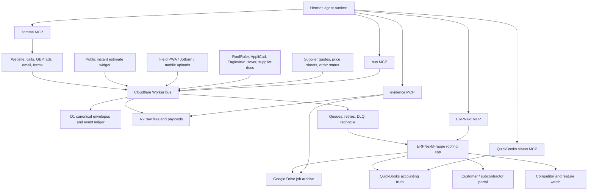

# IronWrap Hermes + ERPNext End-Product Blueprint

Status: strategy blueprint, not current implementation truth.

Current repo truth remains the Worker/Make owned bus, JobNimbus, Google Workspace/Drive,
and QuickBooks path described in `README.md`, `AGENTS.md`, `DELIVERY-PLAN.md`, and the
`final-spec-pack/`. This document defines the candidate end product: IronWrap first, then
a white-label operating system for similar roofing and exterior companies.

Calendar estimates are intentionally omitted. Progress is framed as build slices, proof
artifacts, maturity gates, and blockers.

## Bottom Line

The strongest end product is not "ERPNext with AI" and not "a JobNimbus clone." It is an
evidence-first roofing operating system where:

- Cloudflare owns raw intake and event truth.
- ERPNext/Frappe owns deterministic business records and workflow gates.
- Hermes owns agentic operation through narrow, auditable tools.
- QuickBooks owns accounting truth.
- Drive/R2 own human and raw evidence archives.

The wedge is narrower than JobNimbus, Roofr, AccuLynx, CompanyCam, and GoHighLevel:
IronWrap OS should prove every job from lead to warranty, not merely track it.

## Research Basis

Primary sources reviewed:

- Hermes documents itself as an agent with memory, skills, messaging gateways, cron,
  MCP support, an API server, and security controls. Its docs also state MIT license.
  Sources: [Hermes docs](https://hermes-agent.nousresearch.com/docs/),
  [Hermes API server](https://hermes-agent.nousresearch.com/docs/user-guide/features/api-server),
  [Hermes MCP](https://hermes-agent.nousresearch.com/docs/user-guide/features/mcp),
  [Hermes security](https://hermes-agent.nousresearch.com/docs/user-guide/security).
- Frappe supports custom apps, DocTypes, ORM-backed database tables, and generated REST
  APIs for DocTypes. ERPNext is GPL-3.0 and covers accounting, order management,
  manufacturing, assets, and projects. Sources:
  [Frappe create app](https://docs.frappe.io/framework/user/en/tutorial/create-an-app),
  [Frappe DocTypes](https://docs.frappe.io/framework/user/en/basics/doctypes),
  [Frappe REST API](https://docs.frappe.io/framework/user/en/api/rest),
  [ERPNext GitHub](https://github.com/frappe/erpnext).
- Competitor bar:
  [JobNimbus](https://www.jobnimbus.com/) covers roofing CRM, measurements, mobile,
  communications, production, billing, proposals, integrations, and QuickBooks sync.
  [Roofr](https://roofr.com/) covers CRM, instant estimator, measurement reports,
  proposals, material ordering, invoices, payments, and calendar. [AccuLynx](https://acculynx.com/)
  positions as an all-in-one roofing platform, with production management around crew
  scheduling and material ordering. [CompanyCam](https://companycam.com/) owns field
  photo/progress documentation and AI-assisted reports. [GoHighLevel](https://www.gohighlevel.com/)
  owns broad capture, nurture, booking, conversations, workflows, and reactivation.
- Additional market bar checked during the 2026-07-08 self-audit:
  [Roofr Instant Estimator](https://roofr.com/estimator) gives homeowners a quote in
  seconds from contractor pricing and creates a qualified job card. [CompanyCam AI](https://companycam.com/ai-features)
  turns photos and voice into reports, checklists, captions, and updates. [AccuLynx
  Spring 2026 updates](https://acculynx.com/spring-2026-product-updates/) add custom
  fields, appointment outcomes, and estimating improvements. [ServiceTitan's 2026
  exterior report](https://www.servicetitan.com/press/2026-roofing-exterior-market-report)
  says contractors are shifting toward production features, configurability, and AI/automation.
  [Eagleview](https://www.eagleview.com/industry/roofing-and-siding/) and [Hover](https://hover.to/)
  raise the measurement/3D/material-list bar. [SumoQuote](https://www.sumoquote.com/)
  remains the proposal-presentation bar and is now part of the JobNimbus family.

## Self-Audit Findings And Fixes

The first version was directionally right but not sharp enough to beat the market. These
are the corrections.

| Gap in v1 | Why it was a problem | Blueprint correction |
| --- | --- | --- |
| Underweighted instant homeowner estimates | Roofr already competes before the first call with instant price ranges and lead qualification | Add public estimate/session model and proof gate |
| Underweighted field voice/photo AI | CompanyCam is turning voice plus photos into reports, checklists, and updates | Add field voice/photo parity as a product gate |
| Underweighted 3D/measurement vendors | Eagleview and Hover own remote measurements, 3D models, visual design, and material lists | Add provider-agnostic measurement and visual model layer |
| Underweighted production configurability | AccuLynx is expanding custom fields, appointment outcomes, and estimation controls | Make custom data, outcome tracking, and production gates first-class |
| Underweighted end-to-end platform pressure | ServiceTitan's research points to contractors wanting fewer stitched systems | Require one operator UX over the multi-service backend |
| Underweighted supplier/order workflows | JobNimbus, Roofr, AccuLynx, Hover, and Eagleview all press materials/order confidence | Add supplier quote/order/readiness objects and gates |
| Too soft on market drift | A one-time blueprint can go stale quickly | Add market-defense gates and a competitor watch object |

## Product Thesis

Roofing software usually optimizes one of these lanes:

| Product | Strong lane | Weakness IronWrap can exploit |
| --- | --- | --- |
| JobNimbus | Contractor CRM, mobile, workflows, billing, integrations | Generic contractor workflow; not IronWrap-specific evidence/proof graph |
| Roofr | Instant estimates, proposals, measurements, material ordering | Strong sales flow, less owned operating truth |
| AccuLynx | Roofing production suite | Broad roofing operations, not deeply agent-native |
| CompanyCam | Field photos, progress, reports | Photo system, not full business OS |
| GoHighLevel | Marketing, conversations, funnels, automations | Agency/growth layer, not roofing production truth |
| ServiceTitan | Enterprise end-to-end trades platform | Too broad/heavy for a one-shop roofing OS; high implementation weight |
| SumoQuote | Proposal presentation | Proposal layer only; now reinforces JobNimbus rather than replacing the OS |
| Eagleview / Hover | Measurements, 3D, visual material lists | Provider data, not full operating truth |

IronWrap can win by building a narrower system with stronger truth:

```text
lead -> evidence -> measurement -> scope -> material takeoff -> proposal
-> deposit -> production gates -> field proof -> invoice -> review -> warranty
```

Every step should answer:

- What evidence created this decision?
- Who approved it?
- What system owns the truth?
- What is blocked?
- What can Hermes do safely now?
- What must a human approve?

## Six-Month Market Defense Bar

The product should not claim "better than market" unless it clears these gates. The horizon
is a competitive durability bar, not a build plan.

| Market pressure | Required IronWrap answer |
| --- | --- |
| Roofr-style instant estimates | Public estimate widget creates a qualified Lead Envelope, gives a range with assumptions, and never creates a binding price without review |
| CompanyCam-style field AI | Field user can talk, snap, and submit; Hermes produces a checklist update, customer-safe summary, and evidence labels |
| AccuLynx-style configurable production | Custom fields, appointment outcomes, job gates, production outcomes, and reports are configurable per tenant |
| ServiceTitan-style end-to-end orchestration | One operator UX hides the backend stitching; bus/ERP/Hermes/QB failures are visible and recoverable |
| Eagleview/Hover measurement and 3D pressure | System ingests third-party measurements, 3D/visual model links, material lists, and confidence metadata |
| SumoQuote/JobNimbus proposal polish | Proposal Evidence Pack must be visually strong, option-based, proof-linked, and e-sign/payment ready |
| GHL follow-up pressure | Comms automation must cover speed-to-lead, nurture, missed call, review, and reactivation with consent gates |
| AI product announcements | Hermes tools must be narrower, safer, and more business-contextual than generic "AI assistant" features |

## Architecture



### Layer Rules

| Layer | Owner | Rule |
| --- | --- | --- |
| Cloudflare bus | Raw intake and event truth | Every external event lands here first where practical |
| ERPNext/Frappe | Business workflow truth | Deterministic records, permissions, gates, and status |
| Hermes | Intelligent operator | Reads broadly; writes only through approved command tools |
| QuickBooks | Accounting truth | No final accounting mutation by Hermes without explicit approval |
| Drive/R2 | Evidence | R2 raw, Drive human archive; neither replaces ERP workflow state |
| Google/Engage/email/voice | Communications | Customer-facing actions are policy-gated and logged |

## ERPNext/Frappe Product Model

Do not fork ERPNext. Build an app such as `ironwrap_roofing` on top of Frappe/ERPNext.

Reuse ERPNext where it already fits:

| Existing ERPNext/Frappe concept | Use |
| --- | --- |
| Lead / Opportunity | Sales intake and qualification |
| Customer / Contact / Address | Homeowner/company/property parties |
| Quotation | Proposal commercial object |
| Project / Task | Job execution and internal work |
| Item / Item Group | Product catalog, services, materials |
| Material Request / Purchase Order | Materials and supplier workflow |
| Sales Invoice mirror | Operational mirror only if QuickBooks remains accounting truth |
| User / Role / Permission | Office, owner, crew, subcontractor, white-label admin separation |
| Web Forms / Portal | Customer and field submission surfaces |
| Workflow / Assignment Rules | Hard stage gates and owner routing |

Custom DocTypes:

| DocType | Purpose |
| --- | --- |
| Lead Envelope | Canonical bus event mapped into ERPNext |
| Roofing Property | Address, structure, access, roof metadata, hazards |
| Roof Job | Job wrapper tying contact, property, opportunity, project, files, and accounting refs |
| Evidence Asset | Photo, PDF, XML, transcript, email, signed document, invoice, or field note |
| Instant Estimate Session | Public estimate interaction, assumptions, selected options, range, and lead score |
| Price Book Rule | Material/labor/option pricing rule with source, approval, and effective state |
| Measurement Report | RoofRuler/AppliCad/EagleView-style report metadata and parsed quantities |
| Visual Property Model | Hover/Eagleview/other 3D model link, screenshots, measurements, and confidence metadata |
| Roof Area | Area, pitch, facets, penetrations, edges, notes |
| Material Takeoff | Panels, trim, fasteners, underlayment, waste, supplier, readiness |
| Option Package | Good/better/best system, upgrades, financing/payment assumptions, warranty differences |
| Proposal Evidence Pack | The proposal proof bundle shown to owner/customer |
| Scope Clause | Included, excluded, assumption, risk, optional upgrade, warranty clause |
| Payment Milestone | Deposit, progress, final, holdback, status mirror |
| Production Gate | Deposit, material, WCB/safety, access, weather, crew, completion |
| Field Check-in | Crew update with photos, GPS/device metadata, notes, blockers |
| Completion Packet | Completion photos, customer signoff, deficiency list, warranty readiness |
| Warranty Packet | Final warranty terms, proof, dates, material system, exclusions |
| Review Request | Review eligibility, channel, sent state, stop conditions |
| Communication Event | SMS/email/call/portal action, consent basis, template, status, and audit result |
| Supplier Quote | Supplier, requested materials, price, validity, substitutions, delivery terms |
| Supplier Order | Approved material order, delivery status, shortages, substitutions, received proof |
| Agent Run | Hermes prompt, tools, inputs, dry-run output, approval, write result, audit link |
| Automation Incident | Failed automation, stuck envelope, bad parse, policy block |
| Market Watch Item | Competitor/product change, source link, risk level, required response |
| White-Label Tenant | Customer/company config for future productization |

## Evidence Graph

The Evidence Graph is the product moat.

Every important object links to evidence:

```text
Lead Envelope
  -> Contact / Property
  -> Measurement Report
  -> Evidence Assets
  -> Material Takeoff
  -> Proposal Evidence Pack
  -> Payment Milestones
  -> Production Gates
  -> Field Check-ins
  -> Completion Packet
  -> Invoice/payment refs
  -> Warranty Packet
  -> Review Request
```

This lets the system generate:

- proof-backed proposals
- customer-ready progress summaries
- owner stuck-job reports
- dispute packets
- warranty packets
- margin/profit leakage reports
- white-label demo data
- market-defense reports showing which competitor claims are covered, exceeded, or still open

## Hermes Agent Architecture

Hermes should be the operating brain, not the database.

Hermes capabilities that matter:

- MCP lets Hermes connect to external tool servers and expose only selected tools.
- Hermes can run as an OpenAI-compatible API backend for custom UIs.
- Hermes supports cron/background jobs.
- Hermes supports memory and reusable skills.
- Hermes security includes command approval modes, allowlists, gateway user allowlists,
  and MCP tool filtering.

### Agent Roles

| Agent | Reads | Writes | Forbidden |
| --- | --- | --- | --- |
| Owner Operator | Everything except secrets | Draft tasks, approve-safe status changes | Final accounting, contract/legal sends without approval |
| Lead Concierge | New leads, contact history, source | Draft reply, create follow-up task after approval | Price promises, legal claims |
| Estimator Assistant | Measurements, photos, price tables, scope templates | Draft scope, takeoff, proposal pack | Final price without estimator approval |
| Production Controller | Jobs, gates, material status, field updates | Draft schedule changes, blocker tasks | Start job if hard gates fail |
| Field Companion | Assigned jobs, upload forms, safety/completion checklist | Field notes, photo labels, completion draft | Delete evidence, bypass completion gate |
| Finance Reconciler | Invoice/payment status mirrors | Create reconciliation task | Create final invoice/payment mutation without approval |
| Closeout Agent | Completion packet, invoice status, review eligibility | Draft warranty/review request | Send review request if stop/compliance block exists |
| Support/Admin Agent | Tenant config, failed automations, logs | Draft support diagnosis | Cross-tenant access |

### MCP Servers

Build narrow MCP servers, not one giant god tool.

| MCP server | Example tools |
| --- | --- |
| `ironwrap-bus-mcp` | `list_recent_envelopes`, `get_envelope`, `list_dlq`, `dry_run_replay`, `request_replay` |
| `erpnext-roofing-mcp` | `get_roof_job`, `list_blocked_jobs`, `draft_task`, `dry_run_update_gate`, `request_update_gate` |
| `evidence-mcp` | `find_assets`, `get_evidence_pack`, `attach_asset_to_job`, `draft_customer_packet` |
| `measurement-mcp` | `parse_measurement_report`, `compare_takeoff_versions`, `flag_missing_values` |
| `instant-estimate-mcp` | `score_estimate_session`, `draft_range`, `flag_price_risk`, `request_quote_review` |
| `supplier-mcp` | `list_supplier_quotes`, `compare_substitutions`, `dry_run_material_order`, `request_material_order` |
| `qbo-status-mcp` | `get_invoice_status`, `get_payment_status`, `list_unmatched_payments` |
| `comms-policy-mcp` | `draft_email`, `check_consent`, `check_quiet_hours`, `request_send` |
| `market-watch-mcp` | `list_market_watch_items`, `add_market_watch_item`, `draft_response_gap` |
| `tenant-admin-mcp` | `get_tenant_config`, `validate_tenant_readiness`, `dry_run_clone_template` |

Mutation pattern:

```text
read -> propose -> dry_run -> policy_check -> human_approval -> write -> audit_event
```

No direct free-form writes to ERPNext, QuickBooks, Drive, or customer channels.

### Hermes Skills

Codify procedures as skills:

| Skill pack | What it contains |
| --- | --- |
| `ironwrap-lead-triage` | qualification, urgency, source attribution, missing-info checks |
| `instant-estimate-qualifier` | range logic, assumptions, no-price-promise guardrails |
| `roofing-scope-builder` | inclusions, exclusions, risk clauses, upgrade options |
| `metal-roofing-takeoff` | panels, trim, gauges, colors, waste, supplier assumptions |
| `proposal-proof-pack` | customer-facing evidence narrative and packet assembly |
| `field-voice-report` | voice/photo capture into checklist, report, progress summary, customer-safe draft |
| `production-gatekeeper` | deposit/material/safety/access/weather/completion gate rules |
| `field-closeout` | photo requirements, deficiency list, completion and warranty readiness |
| `alberta-compliance` | CASL, privacy, call recording, WCB/safety policy prompts |
| `market-defense` | competitor change triage and feature-gap response |
| `white-label-onboarding` | tenant setup checklist, brand/config/template validation |

## Workflow Design

### Public Instant Estimate To Qualified Lead

1. Homeowner enters address, service type, material interest, urgency, photos if available, and consent.
2. Bus writes the raw session before any scoring or reply.
3. ERPNext creates Instant Estimate Session, Lead Envelope, Contact, and Roofing Property.
4. Hermes generates a range with explicit assumptions, exclusions, and confidence level.
5. The system creates a qualified sales task and follow-up draft.
6. Any displayed number is labeled as a non-binding range until estimator review.

Proof gate: a homeowner-facing estimate session produces a qualified lead, source attribution,
assumption-backed range, and follow-up without bypassing review or data ownership.

### Lead to Qualification

1. Lead enters website/call/form/email/ad.
2. Bus writes envelope and raw payload.
3. ERPNext creates/updates Lead Envelope, Lead, Contact, Roofing Property.
4. Hermes classifies urgency, service type, missing fields, source, brand.
5. Hermes drafts first response and owner task.
6. Human approval or configured safe-send sends response.
7. Reconcile confirms source count, bus count, and ERP count.

Proof gate: a real lead can be traced from source event to bus envelope to ERPNext record to
owner/customer communication.

### Qualification to Measurement

1. Sales confirms service fit, address, access, desired scheduling need, contact consent.
2. Measurement report, visual model, photos, or supplier docs are ordered/uploaded.
3. Bus stores PDF/XML/photos/model links/provider payloads.
4. Parser creates Measurement Report, Visual Property Model, and Roof Area records.
5. Hermes flags missing/ambiguous measurement values, model confidence gaps, and manual review needs.
6. Estimator approves parsed values before takeoff or proposal use.

Proof gate: measurement values used in the proposal are linked back to the original report.

### Measurement to Proposal

1. Estimator builds Material Takeoff from approved measurement/model evidence.
2. Supplier Quote and Supplier Order readiness are checked where materials matter.
3. Hermes drafts scope clauses, option packages, exclusions, and customer-facing proof.
4. Proposal Evidence Pack assembles photos, measurements, model links, options, warranty terms, and payment milestones.
5. Human approves price, scope, exclusions, substitutions, and payment terms.
6. Proposal is sent with audit link back to evidence.

Proof gate: every proposal line can be explained by measurement, photo, template, material, or human override.

### Won Job to Production

1. Signed proposal/accepted quotation is recorded.
2. Deposit/payment milestone is checked against QuickBooks/payment truth.
3. Production Gates are created.
4. Materials are requested and tracked.
5. Schedule is allowed only when required gates are green or explicitly waived.

Proof gate: no job reaches production without a visible gate state and override history.

### Field Execution

1. Crew sees only assigned jobs and required checklist.
2. Voice notes, photos, checklist changes, and check-ins go through bus first.
3. Evidence assets attach to the Roof Job and Drive folder.
4. Hermes converts voice/photo context into checklist updates, issue flags, captions, and report draft.
5. Owner/customer updates are drafted from verified field evidence.

Proof gate: a field update creates evidence, job state, and owner visibility without manual retyping.

### Closeout, Invoice, Warranty, Review

1. Completion Packet requires final photos, deficiencies, customer/owner signoff, and warranty readiness.
2. Invoice/payment status comes from QuickBooks or approved mirror.
3. Warranty Packet is generated from accepted scope, material system, and completion proof.
4. Review Request is allowed only if stop conditions are clear.
5. Hermes drafts customer closeout message and review request.

Proof gate: the job closes with invoice/payment state, warranty packet, review eligibility, and evidence archive.

## Product Surfaces

| Surface | Purpose | Must feel like |
| --- | --- | --- |
| Owner Cockpit | What is new, stuck, risky, unpaid, missing, or profitable | Dense command center |
| Public Estimate Widget | Fast homeowner range plus qualification | Trust-building lead capture, not a price-promise gimmick |
| Sales Desk | Lead triage, qualification, proposal follow-up | Fast CRM with evidence beside every lead |
| Estimator Workbench | Measurements, takeoff, scope, options, proposal proof | Review station, not chatbot |
| Production Board | Gates, materials, schedule, blockers, crews | Operational board with hard stops |
| Field PWA | Today's jobs, photos, voice, checklists, notes, offline queue | Minimal mobile tool |
| Customer Portal | Proposal, progress, invoices, warranty packet | Trust-building proof room |
| Admin Console | Brands, templates, users, tools, integrations, policy | White-label control plane |
| Agent Console | Hermes runs, approvals, failed tools, audit log | Human supervision panel |
| Market Watch Console | Competitor changes and response gaps | Strategic radar tied to product gates |

## White-Label Productization

Do not start with multi-tenant SaaS complexity. Start with one-shop truth and make the
architecture cloneable.

### Isolation Model

Preferred early model:

- one Frappe/ERPNext site per contractor
- one Hermes profile per contractor
- one Cloudflare namespace/config set per contractor
- one Drive/R2/evidence namespace per contractor
- one QuickBooks connection per contractor
- one brand/template pack per contractor

Move to centralized multi-tenant services only after the repeatable product shape is proven.

### White-Label Config

| Config area | Examples |
| --- | --- |
| Brand | name, logo, colors, domains, sender mailboxes, review links |
| Geography | service areas, tax/compliance defaults, privacy text |
| Services | roofing, metal roofing, siding, gutters, soffit/fascia |
| Materials | suppliers, profiles, gauges, colors, warranties |
| Estimates | instant-estimate ranges, disclaimers, qualification fields, review gates |
| Proposal | templates, options, exclusions, payment milestones |
| Production | stages, gates, photo requirements, safety checklist |
| Communications | SMS/email templates, quiet hours, consent policy |
| Integrations | QuickBooks, Drive, forms, measurement vendors, visual model vendors, suppliers, phone/SMS |
| Agents | enabled roles, tool permissions, approval policies |
| Market defense | competitor set, required gates, watch cadence, escalation owner |

### Sellable Units

The white-label product should be packaged as:

- roofing CRM/ERP core
- proposal and evidence pack
- field proof and closeout
- AI owner/operator assistant
- integration bus and reconciliation
- white-label setup/onboarding
- optional managed operations/support

## Maturity Gates

| Gate | Name | Proof artifact |
| --- | --- | --- |
| 0 | Source truth | Current architecture, owners, secrets, and vendors documented without conflicts |
| 1 | Intake spine | Real source event lands in bus, R2/D1, ERPNext, and audit log |
| 2 | ERP operating core | Lead, property, job, task, gate, evidence, and proposal records work in ERPNext |
| 3 | Read-only Hermes | Hermes answers owner questions from live system truth without writes |
| 4 | Approved-write Hermes | Hermes can draft and execute one approved mutation with audit trail |
| 5 | Instant estimate parity | Public widget creates qualified lead, non-binding range, assumptions, and follow-up |
| 6 | Proposal proof | Measurement-to-proposal flow produces an evidence-backed, option-based packet |
| 7 | Supplier/material readiness | Supplier quote/order/readiness state blocks or allows production accurately |
| 8 | Production gatekeeper | Deposit/material/safety/completion gates block or allow work deterministically |
| 9 | Field voice/photo proof | Field voice/photo update creates checklist, report, evidence, and job state |
| 10 | Closeout truth | Invoice/payment/warranty/review readiness are visible and linked |
| 11 | White-label clone | A second demo company runs with separate brand/config/data/tools |
| 12 | Market defense loop | Competitor watch items map to covered/exceeded/open product gates |
| 13 | Managed product | Tenant setup, monitoring, support, backups, billing, and incident playbooks exist |

## Risk Register

| Risk | Why it matters | Control |
| --- | --- | --- |
| Agent overreach | AI writes can damage jobs, money, or customer trust | Narrow tools, dry-run, approval, audit |
| ERPNext customization debt | Heavy forks make upgrades painful | Custom app, no core fork |
| GPL/commercial terms | ERPNext is GPL-3.0; white-label distribution needs legal review | License review before selling/distribution |
| Accounting mistakes | Payments, invoices, taxes are high-risk | QuickBooks remains source of truth; Hermes read/draft only |
| Field adoption | Crew will reject slow tools | Field PWA is minimal: today, photos, checklist, submit |
| Data migration | Old GHL/JobNimbus/Drive data may be messy | Import ledger, manual exception queue |
| Tenant leakage | White-label product cannot mix customers | Site/profile/namespace isolation first |
| Compliance | SMS/privacy/call recording/reviews vary by region | Policy skill plus deterministic consent gates |
| Vendor dependence | Measurements, SMS, payments can be external blockers | Bus-first architecture and fallback tasks |
| False proposal confidence | AI can hallucinate scope/pricing | Evidence links and estimator approval required |
| Stitched-stack perception | Buyers want one platform, not a fragile bundle | One operator UX plus visible reconciliation and incident recovery |
| Market drift | Competitors are adding AI, estimates, and production features fast | Market Watch Item object and market defense gate |
| Instant-estimate liability | Fast ranges can become accidental price promises | Non-binding range language, assumption ledger, estimator approval |
| Supplier data drift | Materials, substitutions, and delivery state change quickly | Supplier Quote validity, substitution approval, readiness gates |

## Non-Goals

- Do not use Hermes memory as CRM.
- Do not let Hermes freestyle SQL/API writes.
- Do not fork ERPNext unless there is no app-level alternative.
- Do not build multi-tenant SaaS before the single-shop system is proven cloneable.
- Do not replace QuickBooks accounting truth with ERPNext until accounting migration is explicitly chosen.
- Do not build custom mobile-native apps before the field PWA/form workflow proves the job.
- Do not optimize for generic contractors before IronWrap's roofing/metal-exteriors workflow is excellent.

## Resolved Proof Decisions

The artificial blockers below are collapsed in
[`HERMES-ERPNEXT-PROOF-PACK.md`](./HERMES-ERPNEXT-PROOF-PACK.md):

| Topic | Current Decision |
| --- | --- |
| ERPNext customization path | Custom Frappe app first; no ERPNext core fork for the first proof. |
| Roofing record model | Use ERPNext Lead/Opportunity/Customer/Quotation/Sales Order/Project/Task/Item/Material Request plus roofing custom DocTypes. |
| Bus-to-ERPNext sync | Worker/D1/R2 remains front door and source spine; ERPNext is added as a consumer after the current path is stable. |
| Hermes boundary | Read-only first, draft second, narrow approved-write third; no raw SQL/API freestyle writes. |
| Measurement proof | Use the existing `/ingest/measurement` route and sample files; add deterministic extraction before OCR. |
| Activepieces | Bench as future Make replacement candidate; do not switch the current live path now. |
| DocuSeal | Keep as stock fallback only if JobNimbus native e-sign fails. |
| License posture | MIT/GPL/AGPL obligations are inventoried; legal/commercial approval remains the sale/white-label gate. |

## Remaining Decision Backlog

| Decision | Needed to move |
| --- | --- |
| ERPNext hosting path | Frappe Cloud, self-hosted Docker, or managed VPS |
| Accounting boundary | QuickBooks permanent truth vs future ERPNext accounting migration |
| Proposal renderer | ERPNext print formats, custom Frappe UI, or external PDF service |
| Public estimate policy | Range logic, disclaimers, required fields, estimator-review threshold |
| Field surface | Frappe portal/PWA, Jotform bridge, or small custom mobile web app |
| Measurement/visual provider strategy | RoofRuler/AppliCad only vs Eagleview/Hover/provider-agnostic ingest |
| Supplier integration strategy | Manual supplier quote capture vs API/order integrations |
| Hermes runtime | VPS/Docker, hosted runner, or local first |
| White-label isolation | site-per-company first, shared services later |
| Support model | software only, managed operations, or hybrid |

## Recommended Build Order By Proof

1. Prove ERPNext can hold the roofing record model without fighting the framework.
2. Prove bus-to-ERPNext sync with real envelopes and idempotency.
3. Prove read-only Hermes over live bus/ERPNext state.
4. Prove one approved Hermes write with a full audit trail.
5. Prove public instant estimate capture with a non-binding range and review gate.
6. Prove measurement/3D/model ingest to approved takeoff values.
7. Prove supplier quote/order readiness and substitutions.
8. Prove measurement-to-proposal evidence pack.
9. Prove production gates block unsafe job movement.
10. Prove field voice/photo intake from phone to job record to Drive/R2.
11. Prove closeout, warranty, invoice/payment visibility, and review readiness.
12. Prove market-watch items can create product-gap decisions.
13. Clone the stack for a second brand/demo tenant with isolated data.
14. Package onboarding, monitoring, support, billing, and compliance playbooks.
