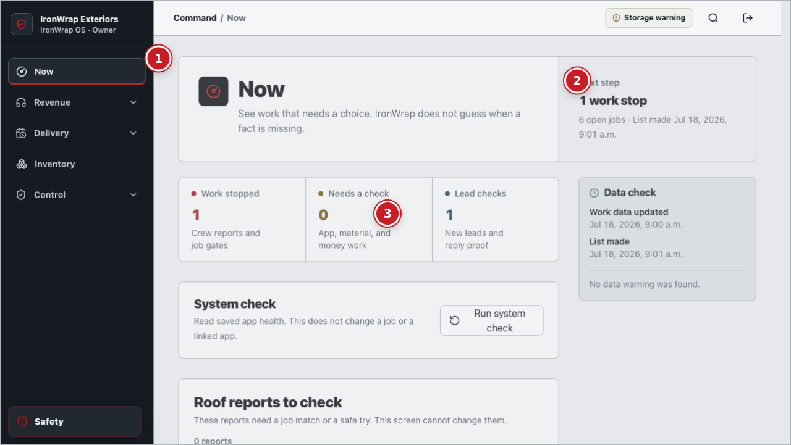
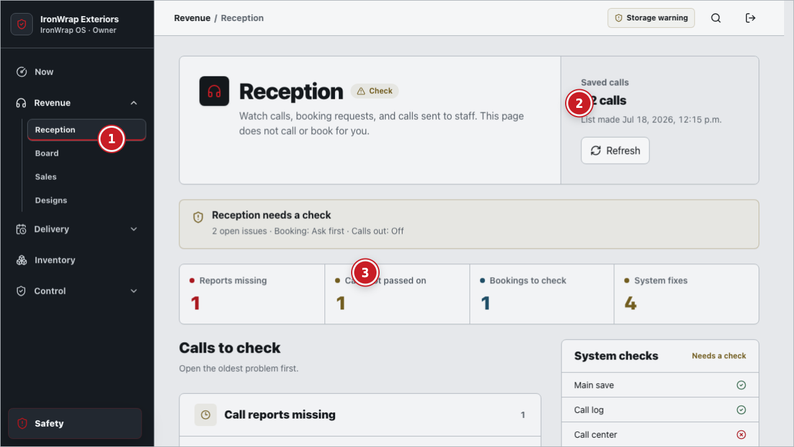
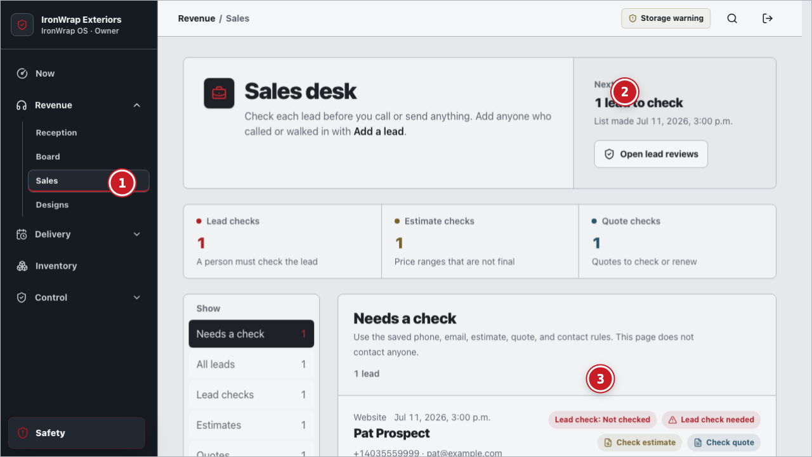
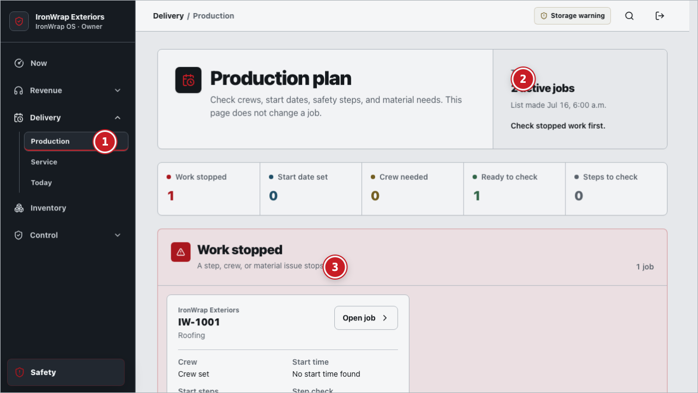
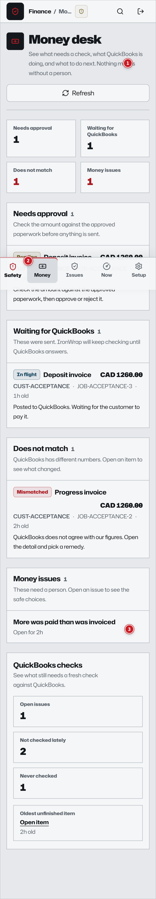
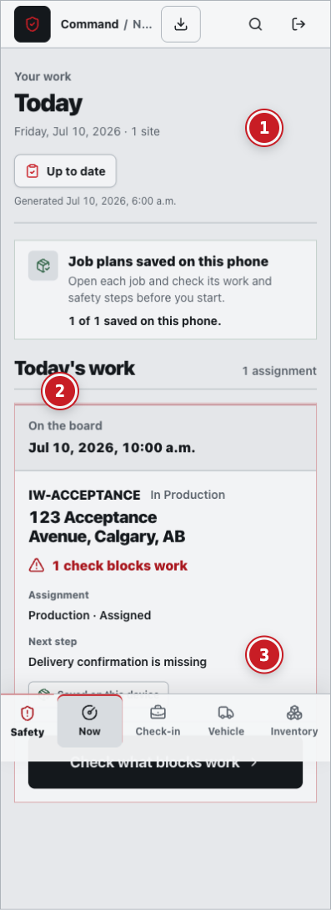
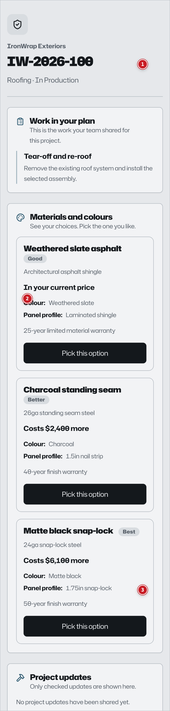
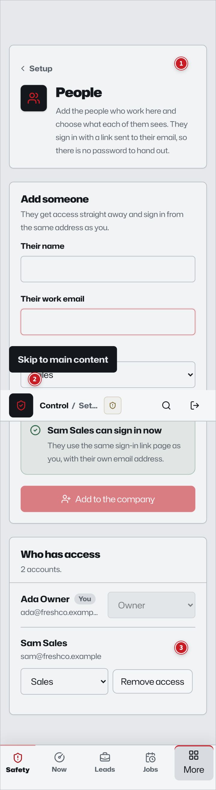

# IronWrap OS: Operations, Roles, Integrations, Scenarios, and UI Evidence Annex

> **Document class:** Developer annex and cross-functional acceptance baseline 
> **Snapshot:** `main` at `1e1d7ab0da3d5cb4b46b7a52dd4e332fdc68d956`, reviewed 2026-08-30 
> **Audience:** Product, operations, design, frontend, backend, data, AI, security, QA, support, compliance, and leadership 
> **Status:** Working synthesis. It does not create legal, safety, accounting, customer, provider, or release authority. 
> **Core specification:** [IronWrap OS Product and Delivery Specification](./IRONWRAP-OS-PRODUCT-TEAM-SPEC.md) 
> **Visual system map:** [IronWrap OS Product Atlas](./diagrams/ironwrap-os-product-atlas.html)

[Русская версия](./IRONWRAP-OS-OPERATIONS-AND-UI-ANNEX.ru.md)

## 1. Purpose and completeness contract

This annex is the operational detail layer for the core specification. It inventories every permanent
business function named by the current canonical operating model, every known actor class, every
current or target integration boundary, the required scenario classes, and the source-present UI
surfaces captured from the deterministic acceptance harness.

“Complete” here means complete for the product boundary and executable snapshot identified above.
It does not mean that every capability is configured, deployed, runtime-proven, accepted by the
business, or validated by customers. New jurisdictions, services, providers, roles, or product
capabilities must extend this annex before implementation is considered specified.

### 1.1 Evidence labels

This annex uses the single proof-label vocabulary defined in
[`DOCUMENTATION-CONTRACT.md`](./DOCUMENTATION-CONTRACT.md#required-truth-labels): Target,
Source-present, Locally-validated, Configured, Runtime-proven, Business-accepted, Customer-validated,
plus the Canonical and Partial qualifiers and the Blocked status flag. It does not define its own
labels.

Two annex-specific notes on applying that vocabulary to UI evidence:

- A screenshot proves the pictured surface rendered from this checkout — that is evidence toward
  Source-present, not Locally-validated on its own. Locally-validated additionally requires a named
  check to have passed, not just a render (see §1.2).
- "Not proven" is retired: per `DOCUMENTATION-CONTRACT.md`'s "proof classes never merge" rule, a
  capability that has not earned a class simply does not assert one — state the class actually reached
  (often Source-present) rather than a separate negative label.

### 1.2 Screenshot evidence rule

The screenshots in section 7 are annotated acceptance-fixture renders. They prove that the pictured
source surface rendered with deterministic fixture data. They do not prove production deployment,
tenant configuration, provider connectivity, real customer use, or role-specific runtime policy.
Office fixtures use an owner session to reach several permission-compatible surfaces; the chrome
label is therefore not evidence that every depicted workflow is owner-operated in production.

## 2. Actor and role model

### 2.1 Authenticated application roles

| Role | Accountable outcomes | Typical decisions and actions | Must never do | Primary surfaces |
|---|---|---|---|---|
| `owner` | Governance, material risk, capital, policy, operating health, exception ownership | Delegate, approve or reject within authority, contain risk, configure company and integrations | Manufacture regulator, customer, professional, provider, or safety authority; bypass segregation of duties | Now, Reception, Board, Sales, Designs, Production, Service, Today, Inventory, Approvals, Settings |
| `ops` | Complete intake, ready work, coordination, exception closure | Triage, assign, schedule, request evidence, resolve operational blockers, administer bounded configuration | Waive hard safety, legal, customer, accounting, evidence, or external-authority gates | Broad office operating surfaces within permission grants |
| `sales` | Qualified demand and exact, reviewable commercial decisions | Qualify, request survey, prepare estimate/quote revision, publish approved offer, follow up with consent | Promise unsupported scope, claims, price, warranty, approval, scarcity, or payment; publish stale revision | Now, Sales, Board, lead/measurement/estimate/quote flows |
| `production` | Ready, conflict-free, attributable physical work | Check gates, set assignment, release/supersede work package, coordinate delivery and holds | Schedule or start through a failed gate; self-approve quality where separation is required | Now, Production, job and work-package detail |
| `accounting` | Approved intents become reconciled financial truth | Review intent, approve/reject within policy, execute configured provider action, reconcile mismatch | Infer posting/payment from request, webhook, screenshot, or unmatched amount | Money, Exceptions, QuickBooks, invoice detail, Now |
| `field` | Safe execution of the current package and attributable evidence | Pair device, review Today, check in, acknowledge, capture evidence, record progress, stop work | Invent scope/change/completion; release own safety stop; start new consequential work on stale authority | Now/Today, Check-in, Vehicle, Inventory, job packet |

### 2.2 Non-application actors and system principals

| Actor | Participates in | Identity and authority requirement | Product obligation |
|---|---|---|---|
| Customer or authorized contact | Intake, options, contract, changes, portal, completion, service | Verified person plus authority for the exact property/entity/decision | Preserve presented revision and decision; offer correction, accessibility, complaint, cancellation, and person paths |
| Prospect or public visitor | Estimator, inquiry, consent, accessibility preferences | Bounded public session; no assumed customer authority | Separate estimate from quote/contract; minimize collection; resist manufactured urgency or claims |
| Employee or worker | Assignment, attendance, safety, evidence, training | Individual identity; no shared account; current assignment and competence | Attribute actions; preserve stop rights; expose only necessary worker/customer data |
| Subcontractor and its workers | Quote, clearance, assignment, package, safety, evidence, payment | Verified company/person, delegation, competence, WCB/insurance freshness | Bind scope and package version; never treat vendor status as IronWrap authority |
| Supplier or manufacturer | Quote, order, acknowledgement, delivery, warranty/recovery | Verified company and exact product/order relationship | Reconcile requested, acknowledged, shipped, received, returned, credited, and recovered facts |
| External authority or issuer | Permit, inspection, licence, WCB, tax, code, professional decision | Issuer authenticity, scope, jurisdiction, effective time, expiry/revocation | Store attributable evidence and readback; fail closed when required authority is stale or ambiguous |
| Engineer, inspector, insurer, lawyer, accountant, or other professional | Restricted conclusions and signoffs | Current professional authority for the exact subject | Keep conclusion scoped; do not let AI or internal role impersonate it |
| Service partner or recovery counterparty | Warranty diagnosis, remedy, credit, recovery | Verified relationship and settlement authority | Separate requested recovery from accepted settlement and cash receipt |
| Device, vehicle, equipment, sensor, or machine | Capture, custody, inspection, telemetry, fabrication | Registered identity, custody/user, calibration where relevant, trustworthy time | Record provenance and health; never turn a reading into authority without policy |
| Platform/release operator | Deploy, configure, restore, rotate, observe | Environment-scoped privileged identity and change approval | Preserve auditability, rollback, tenant isolation, secret boundaries, and proof receipts |
| Support and incident responder | Customer/worker support, containment, recovery | Time-bounded least privilege with case link and audit | Avoid silent data mutation; record containment, recovery, and customer impact |
| AI agent | Analyze, compare, derive, draft, and propose registered actions | Tenant/job-bounded context; maximum authority `observe`, `derive`, `propose` | Cite sources, expose uncertainty, hold no generic credentials or generic mutation tools |
| Deterministic coordinator/executor | Policy, permits, registered effects, readback | Machine principal constrained to one registered action contract | Commit only the permitted input; record idempotency, readback, reconciliation, and exceptions |

### 2.3 Responsibility and escalation model

`A` is accountable, `R` performs ordinary work, `C` must be consulted for a material decision, and
`I` receives the resulting fact. This is a product baseline, not a substitute for company delegation.

| Function | A | R | C | I / escalation |
|---|---|---|---|---|
| Governance, legal, brand | Owner | Owner/Ops | Legal, compliance, professionals | All affected roles; external authority when required |
| Intake, qualification, commercial | Sales lead | Sales/Ops | Customer, production, accounting where material | Owner on exception or policy breach |
| Survey, design, estimate | Sales/technical accountable person | Sales/Ops/qualified specialist | Customer, production, supplier/manufacturer | Owner or professional on uncertainty/out-of-scope work |
| Preconstruction, procurement, inventory, shop, dispatch | Operations/production lead | Ops/Production/warehouse/shop | Sales, accounting, field, suppliers | Owner on capital/material exception; safety on release blockers |
| Field, safety, quality, change, closeout | Production lead; every person retains stop authority | Production/Field/qualified inspectors | Customer, safety, professional, accounting | Owner and external authority for severe incident or regulated stop |
| Service and warranty | Service/operations lead | Ops/Field | Customer, supplier/manufacturer, accounting | Owner/legal/insurer when responsibility or recovery is disputed |
| Finance, people, fleet, platform, continuity | Named functional owner | Accounting/Ops/platform operators | Owner, professionals, affected workers | Regulator/issuer/insurer when reporting or authority requires it |
| Performance and improvement | Owner | Function owners | Product/data/QA/security | Whole team through governed change and training |

### 2.4 Route and permission baseline

| Surface group | `owner` | `ops` | `sales` | `production` | `accounting` | `field` |
|---|---:|---:|---:|---:|---:|---:|
| `/now` and search | Yes | Yes | Yes | Yes | Yes | Yes |
| `/sales`, `/sales/board`, lead/estimate/quote | Yes | Yes | Yes | No | No | No |
| `/production`, production job detail | Yes | Yes | No | Yes | No | No |
| `/today`, `/service`, `/approvals`, `/newo` | Yes | Yes | No | Permission-specific | No | No |
| `/accounting`, `/accounting/exceptions`, `/accounting/quickbooks` | Permission-specific | Permission-specific | No | No | Yes | No |
| `/check-in`, `/vehicle` | Permission-specific | Permission-specific | No | No | No | Yes |
| `/inventory` | Yes | Yes | No | Permission-specific | No | Yes |
| `/settings` company/team/devices/integrations | Yes | Yes within grant | No | No | QuickBooks scope only | No |
| Public estimator, portal, contract links | Bounded administration | Bounded administration | Commercial preparation only | No | Financial read only as granted | No |
| `GET /api/v1/capabilities` (capability state) | Full detail | Full detail | State and reason only | State and reason only | State and reason only | State and reason only |

The client route is a usability boundary, not the security boundary. The Worker and storage queries
must independently enforce tenant, role, action, object, version, and policy scope.

Capability state is its own permission boundary. Every authenticated role reads
`GET /api/v1/capabilities`, but each receives only the capabilities its permissions actually reach,
and only `owner`/`ops` receive binding names, declared flag literals, and the dependency graph — a
capability state leaks commercial and infrastructure facts, so every other role gets the minimum
that lets its screen be honest. `GET /api/v1/integrations/readiness` stays office-only and
unchanged; it answers proof, not reachability. See
[`CAPABILITY-SIGNAL-CONTRACT.md`](CAPABILITY-SIGNAL-CONTRACT.md).

## 3. Complete business-process catalog

Each process below names the ordinary trigger, accountable participation, governed core, exit
evidence, integration seam, and required exception behavior. The permanent process IDs are stable
for traceability; workflow implementations may contain additional subordinate steps.

### Govern

#### BP-01 Ownership and governance

- **Trigger / roles:** company formation or change, material decision, delegation, conflict, risk, or review; owner accountable, named function owners responsible.
- **Governed flow:** identify decision scope, current facts, affected entities, authority, conflicts, options, ceilings, and required consultations; record approve, reject, abstain, delegate, contain, or revisit.
- **Exit evidence:** immutable decision, actor/delegation, effective time, rationale, policy version, obligations, owner, deadline, and supersession chain.
- **Integrations / failure:** company registry, legal/professional evidence, notifications; missing authority, conflict of interest, or stale evidence blocks the decision and escalates.

#### BP-02 Legal, licence, permit, and compliance administration

- **Trigger / roles:** new jurisdiction/service, renewal, permit/inspection event, regulator request, or compliance change; owner/compliance accountable, ops responsible.
- **Governed flow:** determine applicable trigger, issuer and scope; collect attributable authority evidence; verify expiry/revocation and conditions; bind it to company, person, property, job, vehicle, or facility.
- **Exit evidence:** current authority record, scope, issuer, readback, validity window, conditions, next review, and required human signoff.
- **Integrations / failure:** government/municipal/WCB/professional sources; unknown applicability is routed for qualified review, and stale required authority fails the relevant work gate.

#### BP-03 Market, brand, communications, and claims

- **Trigger / roles:** campaign, content, channel, review response, offer, or claim; owner/marketing accountable, sales/ops responsible.
- **Governed flow:** select legal entity/brand/audience, substantiate every material claim, check consent/suppression/channel policy, approve exact content and recipients, publish through registered effect.
- **Exit evidence:** content revision, substantiation, approval, recipient policy, publication receipt/readback, spend and outcome attribution.
- **Integrations / failure:** website, Postiz, email/SMS/voice, advertising channels; unsupported claims, wrong brand, suppression, or ambiguous publication stop automation.

### Win work

#### BP-04 Lead intake and communication

- **Trigger / roles:** phone, web, estimator, portal, referral, import, walk-in, or internal entry; ops accountable, reception/sales responsible.
- **Governed flow:** capture raw source, brand, identity/contact, consent, property, request, urgency, channel preference, and attribution; detect duplicates and prohibited contact.
- **Exit evidence:** attributed lead, consent/source receipt, duplicate disposition, communication history, next owner and deadline.
- **Integrations / failure:** Newo/telephony, website, email/SMS, JobNimbus/import; ambiguous identity, consent, or duplicate fails into a review queue.

#### BP-05 Qualification and sales

- **Trigger / roles:** complete-enough lead; sales accountable and responsible, ops consulted.
- **Governed flow:** verify serviceability, geography, customer/property authority, urgency, competence, risk, claim language, inspection need, and value/fit; qualify, disqualify, or hold with reason.
- **Exit evidence:** versioned decision, reason, owned customer/property/job relationship when converted, next appointment or bounded follow-up.
- **Integrations / failure:** maps/territory, CRM imports, communications; out-of-scope or restricted work is refused or routed to genuine external authority.

#### BP-06 Property inspection and measurement

- **Trigger / roles:** qualified opportunity requiring site facts; technical/sales accountable, qualified inspector responsible, customer/production consulted.
- **Governed flow:** confirm access and hazards; capture source measurements, photos, condition, uncertainty, calibration, provenance, conflicts, and limitations; resolve or flag competing sources.
- **Exit evidence:** immutable survey/measurement revision with attributable sources and acceptance/rejection decision.
- **Integrations / failure:** Facet, device camera/sensors, imported reports; unsafe access, missing calibration, stale geometry, or unresolved conflict blocks dependent design/estimate.

#### BP-07 System design

- **Trigger / roles:** accepted survey and customer need; technical accountable person responsible, sales/production/manufacturer consulted.
- **Governed flow:** select controlled assemblies, drainage/ventilation/interfaces, performance assumptions, details, exclusions, professional triggers, alternates, and compatibility checks.
- **Exit evidence:** approved design revision, source lineage, assumptions, limitations, professional decisions, and downstream constraints.
- **Integrations / failure:** Facet/design tools, manufacturer libraries, professional issuers; incompatible or restricted design remains blocked pending qualified authority.

#### BP-08 Estimating and pricing

- **Trigger / roles:** accepted measurement/design inputs; sales accountable, estimator responsible, production/accounting consulted on cost/tax/margin.
- **Governed flow:** price versioned quantities, assemblies, labour, equipment, waste/yield, overhead, tax, risk, options, allowances, exclusions, and expiry under approval floors.
- **Exit evidence:** estimate revision with input hashes, calculation lineage, uncertainty, margin/risk flags, approval state, and supersession.
- **Integrations / failure:** pricing/material library, supplier quotes, tax/accounting mappings; stale inputs or unsupported price claims block publication.

#### BP-09 Proposal, contract, and customer decision

- **Trigger / roles:** approved commercial revision; sales accountable/responsible, customer decision-maker and owner/accounting as required.
- **Governed flow:** generate exact publication, verify recipient identity/authority, deliver, preserve readback, display terms/options/disclosures, and record accept/reject/cancel/change against that revision.
- **Exit evidence:** immutable publication and customer decision, presented content hash, timestamp, identity/authority proof, and derived deposit intent where applicable.
- **Integrations / failure:** document generator, portal/public link, email/SMS, QuickBooks intent; stale/superseded content, identity mismatch, or delivery ambiguity prevents binding acceptance.

### Prepare

#### BP-10 Preconstruction

- **Trigger / roles:** accepted scope; production accountable, ops responsible, sales/field/customer consulted.
- **Governed flow:** assemble scope/design, permits, access, utility/adjacent conditions, hazard plan, selections, long-lead items, customer obligations, inspection and hold-point plan.
- **Exit evidence:** current readiness gate set, owners/deadlines, approved production basis, and explicit blockers.
- **Integrations / failure:** authority sources, Facet, customer portal, weather and provider manifests; no schedule release while a required fact is missing, stale, or contradictory.

#### BP-11 Supplier and procurement

- **Trigger / roles:** approved material/service demand; ops/procurement accountable and responsible, production/accounting consulted.
- **Governed flow:** obtain comparable quotes, verify supplier/product/terms, approve exact order intent, transmit once, capture acknowledgement, track changes, receive, inspect, match, return, and credit.
- **Exit evidence:** requisition/order versions, supplier acknowledgement, delivery/receipt/inspection, variance, invoice match, return/credit reconciliation.
- **Integrations / failure:** suppliers, email/EDI/API, QuickBooks/AP target; timeout or changed acknowledgement becomes an exception, never an assumed order.

#### BP-12 Inventory and warehouse

- **Trigger / roles:** receipt, reservation, issue, transfer, count, return, scrap, or adjustment; operations accountable, warehouse/field responsible.
- **Governed flow:** identify item/lot/location/custody, validate quantity/unit/condition, commit conservation event, allocate to job/package, and reconcile physical count.
- **Exit evidence:** append-only movement, before/after balance, actor/device, source document, condition, custody, variance and approved adjustment.
- **Integrations / failure:** mobile inventory, supplier receipts, shop, job costing/accounting; negative balance, duplicate scan, unknown item, or count mismatch blocks or escalates.

#### BP-13 Shop manufacturing

- **Trigger / roles:** approved fabrication demand and design; shop/production accountable, qualified operator responsible, quality/warehouse consulted.
- **Governed flow:** release controlled drawing/cut list, reserve material, verify tooling/machine/competence, fabricate, inspect hold points, record yield/scrap, label bundle, and transfer custody.
- **Exit evidence:** released revision, operator/machine/material lineage, QC results, yield, bundle identity, custody handover, nonconformance disposition.
- **Integrations / failure:** design library, inventory, equipment maintenance, dispatch/accounting; stale drawing, unsafe machine, material mismatch, or failed QC stops release.

#### BP-14 Production planning and dispatch

- **Trigger / roles:** accepted job approaching readiness; production accountable/responsible, ops/field/suppliers consulted.
- **Governed flow:** evaluate independent gates, capacity, competence, WCB, predecessor, weather, access, material, vehicle/cargo, equipment, and conflicts; create/supersede assignment and release exact package.
- **Exit evidence:** gate snapshot, assignment version, acknowledged work package, dispatch facts, conflict decisions, and expiry.
- **Integrations / failure:** weather, maps, supplier status, field PWA, fleet; failed/stale gate or version conflict leaves work stopped and visible.

### Execute

#### BP-15 Human field work

- **Trigger / roles:** current assignment and released package; production accountable, field responsible, customer/ops consulted.
- **Governed flow:** pair device, load package, check in, acknowledge, verify start holds, perform only exact scope, capture ordered evidence/progress/material/custody facts, and check out.
- **Exit evidence:** attributable attendance, acknowledgements, progress events, physical evidence, materials, holds, stops, changes, and completion claim.
- **Integrations / failure:** offline PWA/outbox, devices, inventory, communications; offline may preserve instructions/capture/stop but cannot create new authority or silently overwrite conflict.

#### BP-16 Safety

- **Trigger / roles:** planning, daily start, hazard, observation, incident, stop, corrective action, or return-to-work; safety/production accountable, every person may stop.
- **Governed flow:** assess hazards, competence/PPE/equipment/weather/access, conduct briefing, record inspections, stop immediately, contain, notify/report, investigate, correct, independently release where authorized.
- **Exit evidence:** hazard plan, acknowledgements, inspection, stop/incident record, notifications, corrective action, release authority and verification.
- **Integrations / failure:** weather, equipment/fleet, WCB/regulator/emergency channels; no internal objective or AI recommendation overrides a valid stop.

#### BP-17 Quality

- **Trigger / roles:** material receipt, fabrication/installation hold point, inspection, defect, or completion; production/quality accountable, qualified inspector responsible.
- **Governed flow:** inspect against exact specification/revision, preserve attributable evidence, accept/reject/hold, create nonconformance, define remedy, re-inspect independently where required.
- **Exit evidence:** inspection result, criteria/version, evidence, defect and disposition, verifier, hold release, trend classification.
- **Integrations / failure:** manufacturer/professional criteria, Facet/design, supplier/warranty; self-approval conflicts, missing evidence, or failed check prevents downstream completion.

#### BP-18 Change, delay, hidden condition, incident, and dispute

- **Trigger / roles:** discovered variance or requested deviation; production/ops accountable, detecting role responsible, customer/sales/accounting/professional consulted by impact.
- **Governed flow:** stop affected scope, capture facts, classify safety/scope/time/cost/authority impact, create exact revision/option, obtain required decisions, supersede package/order/schedule, then resume only released work.
- **Exit evidence:** original facts, attributable discovery, impact analysis, customer/internal/professional decision, revised commercial/production artifacts, notifications and reconciliation.
- **Integrations / failure:** portal/documents, provider accounting/procurement, external authority; no verbal or AI-inferred change silently alters scope, price, schedule, or completion.

#### BP-19 Completion and closeout

- **Trigger / roles:** field claims substantial completion; production accountable, field/quality responsible, customer/accounting/service consulted.
- **Governed flow:** verify required evidence, inspections, deficiencies, cleanup, customer decisions, documents, serials/warranties, material/custody return, and final financial basis; accept, hold, or reopen.
- **Exit evidence:** accepted completion packet, deficiency closure, customer acknowledgement, controlled closeout delivery/readback, warranty facts, archival/retention event.
- **Integrations / failure:** customer portal/documents, QuickBooks intent, manufacturer/warranty; missing independent or customer evidence blocks final closure and invoice intent.

### Sustain

#### BP-20 Warranty, service, and customer success

- **Trigger / roles:** complaint, leak, deficiency, maintenance, warranty request, review, or proactive follow-up; service/ops accountable, field responsible.
- **Governed flow:** verify identity/relationship/consent, deduplicate, contain safety, triage responsibility without promising fault/coverage, diagnose, issue package, remedy, verify separately, capture customer decision, pursue recovery.
- **Exit evidence:** service-case history, diagnosis, remedy, verification, customer acceptance/reopen reason, supplier/manufacturer/insurer recovery reconciliation.
- **Integrations / failure:** portal, reception/Newo, field PWA, suppliers/manufacturers/insurer, accounting; uncertainty remains explicit and prior job history is never rewritten.

#### BP-21 Finance, accounting, tax, and cash

- **Trigger / roles:** accepted contract, deposit, completion, supplier invoice, payment, credit/refund, tax, payroll/expense, close/reconciliation; accounting accountable/responsible, owner consulted by threshold.
- **Governed flow:** derive intent from owned facts, validate entity/currency/tax/mapping/approval, execute one permitted provider action, capture acknowledgement, read back detail, reconcile material fields, close or exception.
- **Exit evidence:** intent, approvals, provider IDs, attempt/readback, reconciliation, mismatch/compensation, balance and period-control evidence.
- **Integrations / failure:** QuickBooks and banking/payment targets; webhook or screenshot is not settlement, and timeout/duplicate/mismatch stops automatic success.

#### BP-22 People and subcontractors

- **Trigger / roles:** hire/onboard, invite, role/assignment, training, competence, time, performance, leave, discipline, subcontract, offboard; owner/function lead accountable, ops responsible.
- **Governed flow:** verify individual/company identity and lawful basis, grant least privilege, record competence/clearance and assignment, protect worker rights/privacy, review and revoke promptly.
- **Exit evidence:** invitation/session, role/delegation history, training/competence, acknowledgement, WCB/insurance, assignment/time facts, access revocation and retained audit.
- **Integrations / failure:** identity/email, WCB/insurer, payroll/HR targets; shared identity, expired clearance, coercive consent, or unrevoked access blocks assignment.

#### BP-23 Fleet, equipment, cargo, and facility

- **Trigger / roles:** booking, pre-use check, dispatch, defect, collision, maintenance, custody transfer, facility inspection; operations/fleet accountable, driver/operator responsible.
- **Governed flow:** verify identity/licence/competence, asset condition/maintenance, cargo/weight/securement, route/weather, custody; record use, defects, stops, repairs, return, and release.
- **Exit evidence:** inspection, custody, assignment, defect/maintenance, collision/incident, cargo handover, facility check and authorized return-to-service.
- **Integrations / failure:** mobile vehicle route, telematics target, maintenance/vendor, insurer/regulator; unsafe/unknown asset or custody mismatch blocks dispatch.

### Assure

#### BP-24 Data, software, privacy, security, and continuity

- **Trigger / roles:** product change, access, data collection, incident, backup/restore, dependency failure, retention deadline; platform/security/privacy accountable, engineering/operators responsible.
- **Governed flow:** classify data/trust, minimize, authorize, encrypt, audit, test, deploy, observe, detect/contain, recover, restore/rebuild projections, notify and delete/retain under policy.
- **Exit evidence:** change/approval, test and release receipts, access/audit events, dependency health, backup/restore proof, incident and notification, retention disposition.
- **Integrations / failure:** Cloudflare Worker/D1/R2/queues, identity, monitoring, all providers; cross-tenant access, secret exposure, unverified restore, or ambiguous effect is a hard exception.

#### BP-25 Insurance, legal claims, and business continuity

- **Trigger / roles:** incident, loss, claim, dispute, subpoena/hold, supplier failure, outage, key-person or facility disruption; owner accountable, legal/insurance/ops responsible as delegated.
- **Governed flow:** contain, preserve evidence, determine reporting/hold obligations, notify authorized parties, track claim/defence/recovery, activate continuity plan, verify restoration and lessons.
- **Exit evidence:** incident chronology, preserved evidence/legal hold, notices/readbacks, decisions, reserve/recovery facts, continuity activation and tested recovery.
- **Integrations / failure:** insurer, counsel, authority, accounting, backup/communications; no admission, coverage, settlement, deletion, or return-to-normal without exact authority.

#### BP-26 Performance and improvement

- **Trigger / roles:** scheduled review, KPI threshold, defect/incident trend, customer feedback, margin/yield drift, audit, or postmortem; owner accountable, function owners responsible.
- **Governed flow:** verify metric lineage and denominator, separate observation from causation, identify systemic control gap, approve bounded experiment/change, train, measure, accept/rollback and update owned artifacts.
- **Exit evidence:** metric snapshot, analysis and uncertainty, decision, change/test/training, measured result, owner acceptance, documentation/SOP revision.
- **Integrations / failure:** analytics/telemetry, issue/release systems, customer feedback; bad or incomplete data cannot justify automated policy, employment, safety, or customer decisions.

## 4. Integration and authority register

Every external effect follows `intent -> permit -> attempt -> acknowledgement -> readback ->
reconciliation -> terminal outcome or owned exception`. A provider ID is a mapping, not IronWrap's
primary identity.

| Boundary | Direction and material data | Source of authority | Required controls and readback | Safe degraded behavior | Snapshot maturity |
|---|---|---|---|---|---|
| PWA to Worker BFF | Commands, queries, sessions, role-scoped projections | Worker policy plus D1-owned facts | Auth/session, tenant/action/object/version checks, reason codes, audit | Read-only/cached safe views; block consequential writes without current authority | Strong source-present |
| D1 control plane | Canonical entities, events, policy, evidence metadata, intents, mappings, exceptions | IronWrap-owned transition contracts | Atomic state/event, optimistic concurrency, migrations, tenant predicates, restore proof | Fail closed; rebuild projections from owned history | Strong source-present; runtime proof separate |
| R2/evidence store | Photos, documents, immutable evidence payloads | Evidence class and retention policy | Hash, provenance, tenant/job scope, malware/content checks, lifecycle and deletion rules | Preserve metadata/exception; do not claim evidence received | Source-present/partial |
| Queues and deterministic executor | Registered internal/external effects and readback work | Consumed permit binding exact input | Idempotency, correlation, retry ceiling, timeout ambiguity, terminal audit | Stop duplication; query/read back; assign manual exception | Source-present/partial |
| QuickBooks Online | Customers/jobs, invoices, credits/refunds, payments and reconciliation detail | Approved accounting intent; QuickBooks owns provider posting truth | OAuth/scopes, entity/tax/mapping, external IDs, detail readback, amount/status reconciliation | Accounting stays operational in owned queue; posting/payment remains unproven and visible | Partial; live OAuth/sandbox proof open in reviewed snapshot |
| Facet | Measurement/design request, status, artifact/evidence | Approved job/survey scope; Facet owns its output | Tenant/job mapping, source provenance, callback/poll readback, artifact hash/version | Continue manual qualified survey/design; mark Facet unavailable, never synthesize result | Partial; source routes present, configured delivery proof open |
| Frappe compatibility bridge | Legacy projection/import compatibility | D1 remains authority; Frappe cannot regain write authority | Consumer inventory, direction allowlist, parity/cutover, rebuild and write-disable proof | Disable bridge; operate from owned system | Retirement in progress |
| JobNimbus and other CRM imports | Raw legacy leads/customers/jobs/documents and mapping | Imported source is evidence; accepted transition creates owned identity | Immutable raw archive, deterministic map, duplicate/reject queue, counts/hashes, re-runnable import | Hold ambiguous rows; never overwrite owned current facts | Migration path source/runbook present; live cutover proof separate |
| Public website and estimator | Inquiry, consent, assumptions, non-binding range, handoff | Bounded public policy; no customer/contract authority by default | Abuse/rate controls, consent, accessibility, disclosure, versioned assumptions, attributed conversion | Offer person path; do not present range as quote or promise | Source surface present; public config/runtime/customer proof open |
| Customer portal and proposal/contract links | Authorized status, plans, options, decisions, updates, service | Verified customer/contact plus exact relationship/revision | Token/session expiry, least-data projection, decision hash, correction/revocation, delivery readback | Hide sensitive/stale facts; provide support path; preserve prior decision | Source-present/partial |
| Newo reception/telephony | Calls, booking requests, transcripts/reports, staff handoff | Channel consent and registered receptionist policy | Disclosure/recording rules, caller/brand context, transcript provenance, handoff and call-log readback | Calls out off; ask-first/manual reception; visible missing-report exception | Default-off/partial in reviewed snapshot |
| Email | Invites, proposals, notifications, requests, receipts | Consent/transaction purpose plus exact recipient/content approval | Suppression, recipient verification, template/content version, provider ID, delivery/bounce readback | Queue or manual approved channel; never infer receipt from send request | Provider/configuration dependent |
| SMS and voice | Bounded reminders, consented contact, reception/handoff | Consent, timing, identity, brand and channel policy | Suppression, quiet hours, disclosure, content/recipient hash, delivery/call readback | Disable automation and route to permitted human contact | Partial/target depending channel |
| Postiz/social publishing | Approved brand content and publication | Exact content/brand/channel approval | Account mapping, recipient/channel scope, post ID and publication readback | Keep draft/intent; show unavailable integration | Default-off/partial in reviewed snapshot |
| Suppliers/manufacturers | Quotes, orders, acknowledgements, delivery, warranty/recovery | Approved procurement/recovery intent; counterparty owns its response | Company/item/order mapping, revision, idempotency, acknowledgement, receipt/credit/recovery reconciliation | Manual verified channel with uploaded evidence; no assumed acceptance | Mostly partial/target adapters |
| Authorities and professional issuers | Permit, inspection, licence, WCB, tax/code/professional decisions | External issuer for exact scope | Authenticity, scope, effective/expiry/revocation, issuer readback, human review | Block relevant gate and assign qualified review | Mixed manual/source evidence; live readbacks vary |
| Identity and magic-link email | Invitations, verification, sessions, role grants, revocation | Owner/delegated invitation plus identity proof | Single-use/expiry, tenant match, least privilege, session revocation, no shared account | Deny and provide recovery/support; preserve audit | Source-present/partial runtime proof |
| Device/offline PWA | Cached package, evidence capture, stop, ordered outbox | Last current package plus offline policy; no new authority | Device pairing, encrypted scoped cache, sequence/idempotency/version, reconnect reconciliation | Read/capture/stop only; block new scope/start/release/completion claims as policy requires | Source-present; real-device full-day proof open |
| Fleet/telematics/equipment | Identity, location/health, inspections, custody and maintenance | Registered asset and qualified actor; provider data is scoped evidence | Asset mapping, calibration/time, custody, defect/readback and maintenance verification | Manual inspection/custody; block unsafe or unknown release | Partial/target provider integration |
| Hermes/MCP/AI | Tenant/job-scoped context, proposals, bounded tool results | Deterministic context/policy; agent has no independent business authority | Prompt/source trust classes, citations, registered actions, ceilings, permit, readback, no generic credentials | Default off; deterministic product continues; draft only | Narrow pilot/target; not a universal operator |

### 4.1 Integration configuration checklist

No integration is “ready” until its tenant and provider identities, environments, scopes, allowed
directions/actions, secret references, object mappings, idempotency contract, retry/timeout ceilings,
readback query, reconciliation fields, proof TTL, degraded fallback, observability, data retention,
support owner, restore/replay behavior, and disabling/rotation procedure are named and exercised.

## 5. User journeys and scenario catalog

The eleven narrative journeys `UF-01` through `UF-11` in the core specification are the primary
flows. The following catalog is the mandatory scenario baseline for product, design, API, policy,
data, security, accessibility, QA, release, and operations. Every row needs explicit preconditions,
fixture/data ownership, expected state/evidence/effect, and proof receipt before the related
capability is called done.

### 5.1 Intake, identity, and commercial scenarios

| ID | Actors | Scenario and expected outcome |
|---|---|---|
| SCN-001 | Prospect, ops | Valid web/phone lead is attributed, consented, deduplicated, assigned, and given a bounded next step. |
| SCN-002 | Prospect, ops | Missing or ambiguous consent blocks non-transactional outreach and creates a reviewable reason. |
| SCN-003 | Ops, sales | Duplicate person/property/lead candidates are merged or kept separate through an attributable decision, never automatic destructive overwrite. |
| SCN-004 | Sales | Out-of-area, out-of-competence, or restricted work is refused or routed without fabricated authority. |
| SCN-005 | Customer, sales | A qualified lead converts atomically to owned customer/property/job identities; a retry creates no duplicate. |
| SCN-006 | Inspector, sales | Safe, attributable measurement is accepted with provenance, uncertainty, calibration, and source revision. |
| SCN-007 | Inspector, professional | Unsafe access or conflicting/uncalibrated measurement stops dependent design and estimate. |
| SCN-008 | Sales, production | A controlled design/estimate revision preserves source hashes, quantity/cost lineage, assumptions, exclusions, risk, and approvals. |
| SCN-009 | Sales | Stale measurement, price, template, tax, or superseded estimate cannot publish. |
| SCN-010 | Customer, sales | Verified decision-maker accepts the exact current proposal; displayed content and decision hash match. |
| SCN-011 | Customer | Wrong identity, expired token, or property/decision authority mismatch fails closed with a person path. |
| SCN-012 | Customer, sales | Customer requests change after publication; old revision remains historical and cannot be silently edited or accepted. |
| SCN-013 | Customer | Public estimate clearly remains non-binding and does not become contract, approval, invoice, or warranty. |

### 5.2 Readiness, dispatch, field, safety, and quality scenarios

| ID | Actors | Scenario and expected outcome |
|---|---|---|
| SCN-014 | Production | All required current gates pass; one versioned assignment and package are released and acknowledged. |
| SCN-015 | Production | Missing deposit, permit, material, crew, WCB, weather, access, equipment, or predecessor leaves work stopped with reason and owner. |
| SCN-016 | Production | A gate expires after scheduling; start authority is invalidated before field execution. |
| SCN-017 | Production, field | Competing assignment/version produces a visible conflict; no last-write-wins overwrite occurs. |
| SCN-018 | Field | Paired worker loads Today and the exact current work package, checks in, acknowledges, and starts only after online hold validation. |
| SCN-019 | Field | Offline worker reads cached instructions, captures ordered evidence, records allowed progress, and can issue an immediate stop. |
| SCN-020 | Field | Offline worker cannot start new scope, approve a change, release a stop, or claim completion where current authority is required. |
| SCN-021 | Field, platform | Reconnect replays each idempotency key at most once and turns a version conflict into an owned exception. |
| SCN-022 | Any worker, production | Safety stop immediately blocks work and remains until the exact authorized independent release path completes. |
| SCN-023 | Field, professional | Hidden condition stops affected work, preserves evidence, and routes scope/time/cost/authority impact before a new package. |
| SCN-024 | Customer, production | Approved change supersedes commercial, procurement, schedule, and package revisions consistently. |
| SCN-025 | Quality, field | Failed hold point creates nonconformance/remedy/reinspection; installer cannot self-release when separation is required. |
| SCN-026 | Production, customer | Completion packet with every required inspection, deficiency, document, and customer fact is accepted. |
| SCN-027 | Production | Missing closeout evidence or open deficiency blocks final-invoice intent and archival closure. |
| SCN-028 | Fleet, field | Unsafe vehicle/equipment, missing inspection, wrong custody, or cargo conflict blocks dispatch. |
| SCN-029 | Warehouse, field | Receipt/issue/return conserves quantity and custody; duplicate scan or negative balance is rejected. |
| SCN-030 | Shop, quality | Current drawing/material/tool/competence pass; fabrication yield, QC and bundle handover are attributable. |

### 5.3 Accounting, service, provider, and recovery scenarios

| ID | Actors | Scenario and expected outcome |
|---|---|---|
| SCN-031 | Accounting | Approved deposit/final-invoice intent executes once and reconciles entity, amount, currency, tax, lines, IDs and status from provider detail. |
| SCN-032 | Accounting | Missing OAuth, account/item/tax mapping, approval, or segregation condition blocks provider execution without blocking owned review. |
| SCN-033 | Accounting | Provider timeout yields unknown/ambiguous outcome; system reads back before any retry and never manufactures success. |
| SCN-034 | Accounting | Webhook/acknowledgement without matching provider detail remains in flight or exception, not posted/paid. |
| SCN-035 | Accounting | Amount, entity, tax, line, balance, credit, or payment mismatch is visible, owned, and recoverable through correction/compensation. |
| SCN-036 | Customer, service | Valid service request deduplicates, binds customer/property/job/asset/consent, and enters triage without promising coverage or fault. |
| SCN-037 | Service, field | Safety containment, diagnosis, exact service package, remedy, independent verification, and customer decision preserve one history. |
| SCN-038 | Service | Reopened case appends a reason and new work; prior remedy/acceptance is not rewritten. |
| SCN-039 | Service, supplier/insurer | Recovery request remains an intent until counterparty readback and financial reconciliation prove settlement. |
| SCN-040 | Ops, supplier | Procurement timeout or changed acknowledgement creates an exception; no duplicate or assumed order is created. |
| SCN-041 | Platform, integration owner | Disabled provider is visibly unavailable with a safe manual/bounded fallback and no false completion. |
| SCN-042 | Platform, integration owner | Dependency recovers; projections rebuild from owned truth and only duplicate-safe pending work replays. |

### 5.4 Security, privacy, configuration, accessibility, and continuity scenarios

| ID | Actors | Scenario and expected outcome |
|---|---|---|
| SCN-043 | Any role | Cross-tenant object, cache, queue, evidence, provider mapping, or search access is denied and audited. |
| SCN-044 | Owner, worker | Invitation is single-use and scoped; role change/session revocation takes effect without shared-account residue. |
| SCN-045 | Owner, ops | Pipeline/field/form/document/recipient/automation change is versioned, authorized, previewed, tested, and rollback-capable. |
| SCN-046 | Owner, platform | Provider configuration exposes readiness and proof expiry without exposing raw secrets to UI, logs, docs, or AI. |
| SCN-047 | Customer, worker | Data minimization, consent, correction, retention, legal hold, export, and deletion route through exact authority and preserve required audit. |
| SCN-048 | AI agent, coordinator | Untrusted content or prompt injection cannot add tools, credentials, authority, recipients, or actions; unknown/stale/conflicting context is rejected. |
| SCN-049 | AI agent, human | Proposal cites exact sources, versions and uncertainty; human approval binds one action input and cannot authorize a changed payload. |
| SCN-050 | Release operator | Failed dependency/readiness gate prevents release; source/test/CI/merge/deploy/runtime/business/customer statuses remain separate. |
| SCN-051 | Platform operator | Backup restore plus projection rebuild reproduces owned truth, tenant isolation and pending-effect safety before return to service. |
| SCN-052 | Incident responder | Security/privacy/availability incident is contained with attributable actions, customer/regulator assessment, recovery and retrospective evidence. |
| SCN-053 | Keyboard/screen-reader user | Every journey supports logical headings, labels, focus order, status announcements, error recovery, contrast and keyboard completion. |
| SCN-054 | Low vision/motor/cognitive user | Zoom, text reflow, target size, reduced motion, plain-language reasons and sufficient time preserve the same authority and capability. |
| SCN-055 | Customer | Language/accessibility/channel preference does not change price, authority, evidence, correction or person-access rights. |
| SCN-056 | Owner, platform | Second tenant setup proves data/config/provider isolation, upgrade compatibility, export/restore and rollback before Operating Pack reuse is claimed. |

## 6. Cross-cutting UI behavior specification

Every role surface must implement the same truth pattern:

1. **Context:** tenant/brand, role, object identity, location, relationship, and current revision.
2. **Current fact:** owning system, effective/observed time, freshness and conflicts.
3. **Reason:** policy/gate result and stable reason code in plain language.
4. **Next valid action:** actor, exact action, prerequisite, impact, deadline, and escalation/person path.
5. **Evidence:** source and derived evidence, completeness, integrity, and missing slots.
6. **Effect state:** requested, permitted, attempted, acknowledged, read back, reconciled, ambiguous, rejected, compensated, or manually resolved.

### 6.1 Required screen states

All relevant screens require loading, empty, ready, warning, blocked, stale, offline, conflict,
permission-denied, provider-unavailable, retry-safe, ambiguous-result, partial-readback, success,
superseded, and archived states. Empty states must explain whether there is no work, no access, no
configuration, no current data, or a failed dependency; these are not interchangeable.

### 6.2 Forms and consequential actions

- Preserve entered data through correctable validation errors; identify the field and resolution.
- Show evidence/authority requirements before submission, not only after denial.
- Require explicit confirmation for external, destructive, financial, customer-binding, or safety-sensitive effects.
- Bind confirmation to the exact version and payload; any change invalidates prior approval.
- Disable double submission and surface the idempotent in-flight state.
- Never use color alone for status, never trap keyboard focus, and never hide a person/escalation path.

## 7. Annotated UI evidence gallery

### 7.1 Owner: exception-first command view

1. Role-scoped navigation groups work by operating purpose; the persistent Safety entry remains available.
2. “Next step” names the highest-priority outcome instead of implying that a dashboard count resolved it.
3. Independent stop/check categories remain visible; the System check is read-only and does not mutate jobs or providers.

**Evidence:** locally rendered source surface. **Not proven:** deployed owner policy, live data freshness, provider health, or business acceptance.

### 7.2 Operations: reception and channel health

1. Reception is an operations surface inside Revenue, separated from sales decision work.
2. Saved-call/readback timestamp exposes when the list was produced; refresh is an explicit read action.
3. Missing reports, handoffs, bookings, and system fixes remain distinct exception classes instead of one optimistic “calls handled” status.

**Evidence:** locally rendered deterministic reception fixture. **Not proven:** live Newo/telephony configuration or call delivery.

### 7.3 Sales: controlled commercial queue

1. Sales route exposes the bounded revenue workspace rather than general administration.
2. The next action points to lead review and identifies list time; the screen does not contact anyone by itself.
3. Lead, estimate, and quote checks stay separate so one green state cannot hide another stale or unapproved revision.

**Evidence:** locally rendered source surface. **Not proven:** live lead sources, Facet, document delivery, tax, or customer acceptance.

### 7.4 Production: stopped work before scheduling

1. Production is a separate delivery workspace with role-compatible access.
2. The summary directs the user to stopped work first and states when the list was made.
3. A failed readiness condition is rendered as “Work stopped”; scheduling presentation cannot bypass the owning gate.

**Evidence:** locally rendered source surface. **Open acceptance finding:** the current fixture no longer exposes the test-expected `Start schedule check for IW-1004` link, so the targeted production-plan assertion fails.

### 7.5 Accounting: intent, provider, mismatch, and issue separation

1. The Money desk explicitly states that nothing moves without a person and offers refresh rather than hidden mutation.
2. Mobile navigation separates Money, Issues, Now, Setup, and persistent Safety; approval and provider wait remain different states.
3. A financial mismatch is not collapsed into provider success; the issue remains open and QuickBooks freshness is reported separately.

**Evidence:** locally rendered accounting fixture; six targeted accounting acceptance scenarios passed. **Not proven:** live OAuth, posting, payment, tax mapping, or accountant acceptance.

### 7.6 Field: current package and hard blocker

1. The worker sees generation time and “Up to date” state for the saved daily plan.
2. Today contains one attributable assignment and makes locally saved job-plan availability explicit.
3. “Delivery confirmation is missing” blocks work and provides a check path; the UI does not invent start authority.

**Evidence:** locally rendered paired-device fixture. **Not proven:** real-device full-day offline/reconnect, field acceptance, or live assignment delivery.

### 7.7 Customer: plan, options, and safe status

1. The portal binds the view to company, job identity, service and current production phase.
2. Material options distinguish included price from incremental cost and preserve product/profile/warranty facts with an explicit choice action.
3. Project updates are a separate checked channel and truthfully show that none were shared.

**Evidence:** locally rendered mobile portal fixture; four targeted portal scenarios passed. **Not proven:** real customer identity, configured products/prices, live publication, accessibility acceptance, or customer validation.

### 7.8 Owner setup: individual identity and role management

1. People setup explains individual email-link sign-in and avoids shared-password distribution.
2. The add-person form collects name, work email, and role; the captured validation/focus state is visible rather than silently discarded.
3. Existing accounts show owner immutability and explicit role/removal controls for another person.

**Evidence:** locally rendered source surface. **Open acceptance findings:** two onboarding assertions are stale against the current UI (`Not set yet` is absent and `Company name` is not found); four of six targeted onboarding scenarios passed.

## 8. Acceptance-harness receipt for this annex

The app was installed from the committed lockfile and built successfully with TypeScript, Vite, PWA
generation, and the repository’s distribution verification. The deterministic targeted UI runs used
for the gallery produced these results:

| Suite / surface | Result | Interpretation |
|---|---:|---|
| Accounting desktop scenarios | 6 / 6 passed | Current accounting fixture behavior matched targeted assertions. |
| Customer portal mobile scenarios | 4 / 4 passed | Current portal fixture behavior matched targeted assertions. |
| Owner/reception/sales/service targeted desktop scenarios | 4 / 4 passed | The selected office views rendered and met their targeted assertions. |
| Production-plan targeted scenario | 0 / 1 passed | Test expects a schedule-check link that current UI does not expose. |
| Owner onboarding mobile scenarios | 4 / 6 passed | Two assertions no longer match current onboarding UI. |
| Field Today capture | Rendered after deterministic device-proof seed | Proves the pictured fixture only; it was not a full-day offline test. |

These receipts are local source/test evidence only. The failing assertions are preserved as backlog
items for product/test-contract review; this documentation change does not alter application behavior.

## 9. Process-to-flow-to-UI traceability

| Process IDs | Primary user flows | Primary roles | Key boundaries | Gallery evidence |
|---|---|---|---|---|
| BP-01 to BP-03 | UF-01, UF-09, UF-10 | Owner, ops, external authority, AI/coordinator | configuration, authorities, Postiz/channels | Owner Now, team setup |
| BP-04 to BP-05 | UF-02, UF-07 | Ops, sales, prospect/customer | Newo, website, email/SMS, imports | Reception, Sales |
| BP-06 to BP-09 | UF-03, UF-07 | Sales, customer, technical/professional | Facet, documents, portal, QuickBooks intent | Sales, customer portal |
| BP-10 to BP-14 | UF-04 | Ops, production, supplier, warehouse, shop | authorities, suppliers, inventory, field PWA | Production, Field |
| BP-15 to BP-19 | UF-05 | Production, field, quality, customer | device/offline, inventory, evidence, portal | Field, Production, portal |
| BP-20 | UF-07, UF-08 | Customer, ops/service, field, recovery parties | reception, portal, suppliers/insurer, accounting | Reception, portal |
| BP-21 | UF-06, UF-11 | Accounting, owner, provider executor | QuickBooks, queues/readback | Money desk |
| BP-22 to BP-23 | UF-04, UF-05, UF-09 | Owner, ops, field, subcontractor | identity/email, WCB, fleet/device | Team setup, Field |
| BP-24 to BP-26 | UF-01, UF-09, UF-10, UF-11 | Platform/security, owner, all function owners | Worker/D1/R2/queues, every provider | All views and validation receipt |

## 10. Team handoff and change rules

- **Product and operations:** own process intent, accountable role, exception semantics, KPI and business acceptance.
- **Design and content:** own comprehension, accessibility, decision framing, evidence display, degraded/empty/error states, and person paths.
- **Frontend:** own permission-compatible routes, deterministic state rendering, offline policy, safe submission, focus/status behavior, and no browser-side authority claims.
- **Backend/data:** own canonical transitions, tenant isolation, concurrency/idempotency, evidence lineage, mappings, effects, readback, reconciliation, migrations, restore and audit.
- **Integration owners:** own provider contracts, scopes, mapping, test/sandbox/live proof, degraded behavior, rotation/disable, monitoring and reconciliation playbooks.
- **AI:** owns only bounded observation/derivation/proposal quality, citations, evals and adversarial trust handling; deterministic systems own authority and effects.
- **Security/privacy/compliance:** own threat/privacy models, data lifecycle, external-authority triggers, controls and signoff boundaries.
- **QA:** owns scenario data, negative/degraded/recovery coverage, accessibility evidence, exact receipts and regression disposition.
- **Release/support:** own environment configuration, rollout/rollback, dependency health, incident paths, runtime readback and support readiness.

Any change to a role, route, business process, state, integration, externally visible claim, customer
decision, safety/accounting gate, or proof label must update the core specification, this annex,
affected diagrams/tests/runbooks, and the documentation manifest in the same delivery slice.
