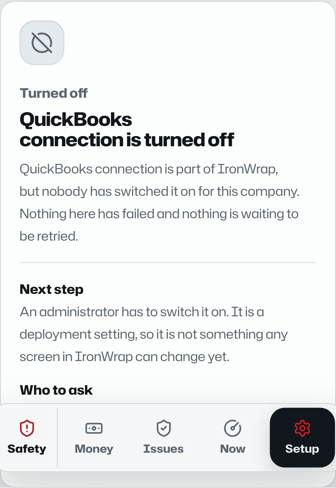

# IronWrap OS: приложение по операциям, ролям, интеграциям, сценариям и UI-доказательствам

> **Класс документа:** разработческое приложение и межфункциональная база приемки 
> **Снимок:** `main` на коммите `1e1d7ab0da3d5cb4b46b7a52dd4e332fdc68d956`, проверено 2026-08-30 
> **Аудитория:** продукт, операции, дизайн, frontend, backend, данные, AI, безопасность, QA, поддержка, compliance и руководство 
> **Статус:** рабочее обобщение. Документ не создает юридические, безопасностные, бухгалтерские, клиентские, провайдерские или релизные полномочия. 
> **Основная спецификация:** [Спецификация продукта и разработки IronWrap OS](./IRONWRAP-OS-PRODUCT-TEAM-SPEC.ru.md) 
> **Визуальная карта:** [Атлас продукта IronWrap OS](./diagrams/ironwrap-os-product-atlas.ru.html)

[English version](./IRONWRAP-OS-OPERATIONS-AND-UI-ANNEX.md)

## 1. Назначение и критерий полноты

Это приложение является операционным слоем детализации основной спецификации. В нем перечислены
все постоянные бизнес-функции текущей канонической операционной модели, все известные классы
участников, все текущие и целевые интеграционные границы, обязательные классы сценариев и
реализованные в исходном коде UI-поверхности, снятые с детерминированного приемочного стенда.

«Полнота» здесь означает полноту для указанной границы продукта и снимка исполняемого кода. Она не
означает, что каждая возможность настроена, развернута, проверена в runtime, принята бизнесом или
подтверждена клиентами. Новые юрисдикции, услуги, провайдеры, роли и возможности продукта должны
быть добавлены в это приложение до того, как их реализация может считаться специфицированной.

### 1.1 Метки доказанности

Это приложение использует единый словарь proof-label, определенный в
[`DOCUMENTATION-CONTRACT.md`](./DOCUMENTATION-CONTRACT.md#required-truth-labels): Target,
Source-present, Locally-validated, Configured, Runtime-proven, Business-accepted, Customer-validated,
а также квалификаторы Canonical и Partial и статусный флаг Blocked. Собственных меток это приложение
больше не определяет.

Два примечания по применению этого словаря к UI-доказательствам:

- Скриншот доказывает, что показанная поверхность отрисовалась из этого checkout — это доказательство
  в пользу Source-present, а не само по себе Locally-validated. Locally-validated дополнительно
  требует, чтобы прошла именованная проверка, а не просто рендер (см. §1.2).
- Метка «Не доказано» упразднена: по правилу «proof classes never merge» из
  `DOCUMENTATION-CONTRACT.md` возможность, которая не заработала класс, просто не заявляет его —
  указывайте фактически достигнутый класс (часто Source-present) вместо отдельной отрицательной метки.

### 1.2 Правило использования скриншотов

Скриншоты в разделе 7 являются размеченными изображениями приемочных фикстур. Они доказывают, что
показанная поверхность текущего исходного кода отрисовалась с детерминированными данными. Они не
доказывают production-deploy, настройку tenant, соединение с провайдером, реальное использование
клиентом или runtime-политику конкретной роли. Офисные фикстуры используют сессию владельца для
доступа к нескольким совместимым по разрешениям поверхностям, поэтому подпись роли в chrome не
доказывает, что показанный процесс в production выполняет именно владелец.

## 2. Модель участников и ролей

### 2.1 Аутентифицированные роли приложения

| Роль | Результаты под ответственностью | Типичные решения и действия | Что запрещено | Основные поверхности |
|---|---|---|---|---|
| `owner` | Governance, существенные риски, капитал, политика, здоровье операций, владение исключениями | Делегировать, одобрять или отклонять в пределах полномочий, сдерживать риск, настраивать компанию и интеграции | Создавать полномочия регулятора, клиента, специалиста, провайдера или safety; обходить разделение обязанностей | Now, Reception, Board, Sales, Designs, Production, Service, Today, Inventory, Approvals, Settings |
| `ops` | Полный intake, готовая работа, координация, закрытие операционных исключений | Проводить triage, назначать, планировать, запрашивать доказательства, устранять блокеры, администрировать ограниченную конфигурацию | Отменять жесткие барьеры safety, права, клиента, учета, доказательств или внешних полномочий | Широкий набор офисных поверхностей в пределах выданных прав |
| `sales` | Квалифицированный спрос и точное, проверяемое коммерческое решение | Квалифицировать, заказывать survey, готовить версию estimate/quote, публиковать одобренное предложение, связываться при наличии consent | Обещать неподтвержденные scope, claims, price, warranty, approval, scarcity или payment; публиковать устаревшую версию | Now, Sales, Board, lead/measurement/estimate/quote flows |
| `production` | Готовая, бесконфликтная и атрибутируемая физическая работа | Проверять барьеры, создавать назначение, выпускать/заменять пакет работ, координировать поставку и hold points | Планировать или начинать через непройденный барьер; самостоятельно принимать собственное качество при обязательном разделении | Now, Production, job и work-package detail |
| `accounting` | Одобренные намерения становятся сверенной финансовой истиной | Проверять намерение, одобрять/отклонять по политике, выполнять настроенное действие провайдера, разбирать расхождение | Выводить факт проводки/оплаты из запроса, webhook, скриншота или несопоставленной суммы | Money, Exceptions, QuickBooks, invoice detail, Now |
| `field` | Безопасное выполнение текущего пакета и атрибутируемые доказательства | Привязать устройство, открыть Today, выполнить check-in, подтвердить пакет, собрать доказательства, записать прогресс, остановить работу | Придумывать scope/change/completion; снимать собственный safety stop; начинать новую существенную работу по устаревшим полномочиям | Now/Today, Check-in, Vehicle, Inventory, job packet |

### 2.2 Участники вне приложения и системные принципы

| Участник | В каких процессах участвует | Требование к идентичности и полномочию | Обязанность продукта |
|---|---|---|---|
| Клиент или уполномоченный контакт | Intake, варианты, contract, changes, portal, completion, service | Проверенный человек и полномочие на точные property/entity/decision | Сохранить показанную версию и решение; дать пути исправления, accessibility, complaint, cancellation и связи с человеком |
| Prospect или публичный посетитель | Estimator, inquiry, consent, предпочтения доступности | Ограниченная публичная сессия; клиентские полномочия не предполагаются | Отделять estimate от quote/contract; минимизировать сбор; не создавать искусственную срочность или утверждения |
| Работник | Assignment, attendance, safety, evidence, training | Индивидуальная идентичность, без общих аккаунтов; актуальные назначение и компетенция | Атрибутировать действия, сохранять право stop-work, показывать только необходимые данные |
| Субподрядчик и его работники | Quote, clearance, assignment, package, safety, evidence, payment | Проверенные компания/человек, делегирование, competence, актуальные WCB/insurance | Связывать scope и версию пакета; не считать статус подрядчика полномочием IronWrap |
| Поставщик или производитель | Quote, order, acknowledgement, delivery, warranty/recovery | Проверенная компания и точная связь с product/order | Сверять requested, acknowledged, shipped, received, returned, credited и recovered facts |
| Внешний орган или issuer | Permit, inspection, licence, WCB, tax, code, professional decision | Подлинность issuer, scope, jurisdiction, effective time, expiry/revocation | Хранить атрибутируемое доказательство и контрольное чтение; fail closed при просроченном или неоднозначном обязательном полномочии |
| Engineer, inspector, insurer, lawyer, accountant или другой специалист | Ограниченные выводы и подписи | Актуальное профессиональное полномочие для точного предмета | Не расширять scope вывода; не позволять AI или внутренней роли имитировать специалиста |
| Сервисный партнер или контрагент по recovery | Warranty diagnosis, remedy, credit, recovery | Проверенная связь и полномочие на settlement | Отделять запрос на recovery от принятого settlement и поступления денег |
| Device, vehicle, equipment, sensor или machine | Capture, custody, inspection, telemetry, fabrication | Зарегистрированная идентичность, custody/user, calibration при необходимости, доверенное время | Записывать provenance и health; не превращать показание в полномочие без политики |
| Оператор платформы/релиза | Deploy, configure, restore, rotate, observe | Привилегированная идентичность в рамках environment и одобрение изменения | Сохранять audit, rollback, tenant isolation, границы секретов и proof receipts |
| Поддержка и incident responder | Поддержка клиента/работника, containment, recovery | Ограниченный по времени least privilege, связанный с case и audit | Не делать скрытые мутации данных; фиксировать containment, recovery и влияние на клиента |
| AI agent | Анализировать, сравнивать, выводить, создавать черновики и предлагать зарегистрированные действия | Контекст в рамках tenant/job; максимум полномочий `observe`, `derive`, `propose` | Цитировать источники, показывать uncertainty, не иметь общих credentials или mutation tools |
| Детерминированный coordinator/executor | Policy, permits, registered effects, readback | Machine principal, ограниченный контрактом одного зарегистрированного действия | Выполнять только разрешенный input; фиксировать idempotency, readback, reconciliation и exceptions |

### 2.3 Ответственность и эскалация

`A` отвечает за итог, `R` выполняет обычную работу, `C` обязательно консультируется при существенном
решении, `I` получает итоговый факт. Это продуктовая база, а не замена делегированию компании.

| Функция | A | R | C | I / эскалация |
|---|---|---|---|---|
| Governance, legal, brand | Owner | Owner/Ops | Legal, compliance, специалисты | Все затронутые роли; внешний орган, когда требуется |
| Intake, qualification, commercial | Руководитель sales | Sales/Ops | Customer, production, accounting при существенном влиянии | Owner при исключении или нарушении политики |
| Survey, design, estimate | Ответственное техническое/sales-лицо | Sales/Ops/квалифицированный специалист | Customer, production, supplier/manufacturer | Owner или специалист при uncertainty/out-of-scope |
| Preconstruction, procurement, inventory, shop, dispatch | Руководитель operations/production | Ops/Production/warehouse/shop | Sales, accounting, field, suppliers | Owner по capital/material exception; safety по release blocker |
| Field, safety, quality, change, closeout | Production lead; каждый сохраняет stop authority | Production/Field/qualified inspectors | Customer, safety, professional, accounting | Owner и внешний орган при серьезном incident или регулируемой остановке |
| Service и warranty | Руководитель service/operations | Ops/Field | Customer, supplier/manufacturer, accounting | Owner/legal/insurer при споре о responsibility/recovery |
| Finance, people, fleet, platform, continuity | Именованный functional owner | Accounting/Ops/platform operators | Owner, специалисты, затронутые работники | Regulator/issuer/insurer, когда требуется reporting/authority |
| Performance и improvement | Owner | Владельцы функций | Product/data/QA/security | Вся команда через управляемое изменение и training |

### 2.4 База маршрутов и разрешений

| Группа поверхностей | `owner` | `ops` | `sales` | `production` | `accounting` | `field` |
|---|---:|---:|---:|---:|---:|---:|
| `/now` и search | Да | Да | Да | Да | Да | Да |
| `/sales`, `/sales/board`, lead/estimate/quote | Да | Да | Да | Нет | Нет | Нет |
| `/production`, production job detail | Да | Да | Нет | Да | Нет | Нет |
| `/today`, `/service`, `/approvals`, `/newo` | Да | Да | Нет | По отдельному permission | Нет | Нет |
| `/accounting`, `/accounting/exceptions`, `/accounting/quickbooks` | По permission | По permission | Нет | Нет | Да | Нет |
| `/check-in`, `/vehicle` | По permission | По permission | Нет | Нет | Нет | Да |
| `/inventory` | Да | Да | Нет | По permission | Нет | Да |
| `/settings` company/team/devices/integrations | Да | В пределах grant | Нет | Нет | Только QuickBooks scope | Нет |
| Public estimator, portal, contract links | Ограниченное администрирование | Ограниченное администрирование | Только commercial preparation | Нет | Financial read в рамках grant | Нет |
| `GET /api/v1/capabilities` (состояние возможностей) | Полная детализация | Полная детализация | Только state и reason | Только state и reason | Только state и reason | Только state и reason |

Клиентский маршрут является границей удобства, а не границей безопасности. Worker и storage query
обязаны независимо проверять tenant, role, action, object, version и policy scope.

Состояние возможности само по себе является границей разрешений. `GET /api/v1/capabilities` читает любая
аутентифицированная роль, но каждая получает только те возможности, до которых дотягиваются её разрешения,
и только `owner`/`ops` получают имена bindings, объявленные литералы флагов и граф зависимостей — состояние
возможности раскрывает коммерческие и инфраструктурные факты, поэтому остальные роли получают минимум,
достаточный для честного экрана. `GET /api/v1/integrations/readiness` остаётся office-only и без изменений:
он отвечает про доказательство, а не про достижимость. См.
[`CAPABILITY-SIGNAL-CONTRACT.md`](CAPABILITY-SIGNAL-CONTRACT.md).

## 3. Полный каталог бизнес-процессов

Для каждого процесса ниже указаны обычный триггер, ответственные участники, управляемое ядро,
выходное доказательство, интеграционный шов и обязательное поведение при исключении. Постоянные ID
стабильны для трассируемости; реализация может содержать дополнительные подчиненные шаги.

### Управление

#### BP-01 Ownership и governance

- **Триггер / роли:** создание или изменение компании, существенное решение, делегирование, конфликт, риск или review; owner отвечает, именованные владельцы функций выполняют.
- **Управляемый поток:** определить scope решения, текущие факты, затронутые entities, authority, conflicts, options, ceilings и консультации; записать approve, reject, abstain, delegate, contain или revisit.
- **Выходное доказательство:** неизменяемое решение, actor/delegation, effective time, rationale, policy version, obligations, owner, deadline и цепочка supersession.
- **Интеграции / отказ:** company registry, legal/professional evidence, notifications; отсутствие authority, конфликт интересов или stale evidence блокирует решение и эскалируется.

#### BP-02 Legal, licence, permit и compliance administration

- **Триггер / роли:** новая jurisdiction/service, renewal, permit/inspection event, запрос регулятора или изменение compliance; owner/compliance отвечает, ops выполняет.
- **Управляемый поток:** определить применимый trigger, issuer и scope; собрать attributable authority evidence; проверить expiry/revocation и conditions; связать с company, person, property, job, vehicle или facility.
- **Выходное доказательство:** current authority record, scope, issuer, readback, validity window, conditions, next review и обязательная human signoff.
- **Интеграции / отказ:** government/municipal/WCB/professional sources; неизвестная применимость направляется на квалифицированную проверку, stale required authority закрывает соответствующий work gate.

#### BP-03 Market, brand, communications и claims

- **Триггер / роли:** campaign, content, channel, review response, offer или claim; owner/marketing отвечает, sales/ops выполняет.
- **Управляемый поток:** выбрать legal entity/brand/audience, доказать material claims, проверить consent/suppression/channel policy, одобрить точный content и recipients, опубликовать зарегистрированным effect.
- **Выходное доказательство:** content revision, substantiation, approval, recipient policy, publication receipt/readback, spend и outcome attribution.
- **Интеграции / отказ:** website, Postiz, email/SMS/voice, advertising channels; unsupported claim, wrong brand, suppression или ambiguous publication останавливает automation.

### Получение работы

#### BP-04 Lead intake и communication

- **Триггер / роли:** phone, web, estimator, portal, referral, import, walk-in или internal entry; ops отвечает, reception/sales выполняют.
- **Управляемый поток:** сохранить raw source, brand, identity/contact, consent, property, request, urgency, channel preference и attribution; найти duplicates и prohibited contact.
- **Выходное доказательство:** attributed lead, consent/source receipt, duplicate disposition, communication history, следующий owner и deadline.
- **Интеграции / отказ:** Newo/telephony, website, email/SMS, JobNimbus/import; ambiguous identity, consent или duplicate поступает в очередь review.

#### BP-05 Qualification и sales

- **Триггер / роли:** достаточно полный lead; sales отвечает и выполняет, ops консультируется.
- **Управляемый поток:** проверить serviceability, geography, customer/property authority, urgency, competence, risk, claim language, inspection need и fit; qualify, disqualify или hold с причиной.
- **Выходное доказательство:** versioned decision, reason, owned customer/property/job relationship после conversion, next appointment или bounded follow-up.
- **Интеграции / отказ:** maps/territory, CRM imports, communications; out-of-scope/restricted work отклоняется или направляется к настоящему external authority.

#### BP-06 Property inspection и measurement

- **Триггер / роли:** qualified opportunity, требующий site facts; technical/sales отвечает, qualified inspector выполняет, customer/production консультируются.
- **Управляемый поток:** подтвердить access и hazards; собрать source measurements, photos, condition, uncertainty, calibration, provenance, conflicts и limitations; разрешить или отметить competing sources.
- **Выходное доказательство:** immutable survey/measurement revision с attributable sources и решением acceptance/rejection.
- **Интеграции / отказ:** Facet, device camera/sensors, imported reports; unsafe access, missing calibration, stale geometry или unresolved conflict блокирует design/estimate.

#### BP-07 System design

- **Триггер / роли:** accepted survey и customer need; technical accountable person отвечает и выполняет, sales/production/manufacturer консультируются.
- **Управляемый поток:** выбрать controlled assemblies, drainage/ventilation/interfaces, performance assumptions, details, exclusions, professional triggers, alternates и compatibility checks.
- **Выходное доказательство:** approved design revision, source lineage, assumptions, limitations, professional decisions и downstream constraints.
- **Интеграции / отказ:** Facet/design tools, manufacturer libraries, professional issuers; incompatible/restricted design блокируется до решения qualified authority.

#### BP-08 Estimating и pricing

- **Триггер / роли:** accepted measurement/design inputs; sales отвечает, estimator выполняет, production/accounting консультируются по cost/tax/margin.
- **Управляемый поток:** оценить versioned quantities, assemblies, labour, equipment, waste/yield, overhead, tax, risk, options, allowances, exclusions и expiry по approval floors.
- **Выходное доказательство:** estimate revision с input hashes, calculation lineage, uncertainty, margin/risk flags, approval state и supersession.
- **Интеграции / отказ:** pricing/material library, supplier quotes, tax/accounting mappings; stale inputs или unsupported price claims блокируют publication.

#### BP-09 Proposal, contract и customer decision

- **Триггер / роли:** approved commercial revision; sales отвечает/выполняет, customer decision-maker и owner/accounting участвуют при необходимости.
- **Управляемый поток:** создать точную publication, проверить recipient identity/authority, доставить, сохранить readback, показать terms/options/disclosures и записать accept/reject/cancel/change для этой версии.
- **Выходное доказательство:** immutable publication и customer decision, presented content hash, timestamp, identity/authority proof и derived deposit intent.
- **Интеграции / отказ:** document generator, portal/public link, email/SMS, QuickBooks intent; stale/superseded content, identity mismatch или delivery ambiguity не дает связать acceptance.

### Подготовка

#### BP-10 Preconstruction

- **Триггер / роли:** accepted scope; production отвечает, ops выполняет, sales/field/customer консультируются.
- **Управляемый поток:** собрать scope/design, permits, access, utility/adjacent conditions, hazard plan, selections, long-lead items, customer obligations, inspection и hold-point plan.
- **Выходное доказательство:** current readiness gate set, owners/deadlines, approved production basis и явные blockers.
- **Интеграции / отказ:** authority sources, Facet, customer portal, weather/provider manifests; schedule release запрещен при missing, stale или contradictory required fact.

#### BP-11 Supplier и procurement

- **Триггер / роли:** approved material/service demand; ops/procurement отвечает и выполняет, production/accounting консультируются.
- **Управляемый поток:** получить сопоставимые quotes, проверить supplier/product/terms, одобрить exact order intent, передать один раз, получить acknowledgement, вести changes, receive, inspect, match, return и credit.
- **Выходное доказательство:** requisition/order versions, supplier acknowledgement, delivery/receipt/inspection, variance, invoice match, return/credit reconciliation.
- **Интеграции / отказ:** suppliers, email/EDI/API, QuickBooks/AP target; timeout или changed acknowledgement становится exception, а не предполагаемым order.

#### BP-12 Inventory и warehouse

- **Триггер / роли:** receipt, reservation, issue, transfer, count, return, scrap или adjustment; operations отвечает, warehouse/field выполняют.
- **Управляемый поток:** определить item/lot/location/custody, проверить quantity/unit/condition, записать conservation event, выделить для job/package и сверить physical count.
- **Выходное доказательство:** append-only movement, before/after balance, actor/device, source document, condition, custody, variance и approved adjustment.
- **Интеграции / отказ:** mobile inventory, supplier receipts, shop, job costing/accounting; negative balance, duplicate scan, unknown item или count mismatch блокируется/эскалируется.

#### BP-13 Shop manufacturing

- **Триггер / роли:** approved fabrication demand и design; shop/production отвечает, qualified operator выполняет, quality/warehouse консультируются.
- **Управляемый поток:** выпустить controlled drawing/cut list, зарезервировать material, проверить tooling/machine/competence, fabricate, проверить hold points, записать yield/scrap, label bundle и передать custody.
- **Выходное доказательство:** released revision, operator/machine/material lineage, QC results, yield, bundle identity, custody handover, nonconformance disposition.
- **Интеграции / отказ:** design library, inventory, equipment maintenance, dispatch/accounting; stale drawing, unsafe machine, material mismatch или failed QC останавливает release.

#### BP-14 Production planning и dispatch

- **Триггер / роли:** accepted job близок к readiness; production отвечает и выполняет, ops/field/suppliers консультируются.
- **Управляемый поток:** проверить independent gates, capacity, competence, WCB, predecessor, weather, access, material, vehicle/cargo, equipment и conflicts; create/supersede assignment и release exact package.
- **Выходное доказательство:** gate snapshot, assignment version, acknowledged work package, dispatch facts, conflict decisions и expiry.
- **Интеграции / отказ:** weather, maps, supplier status, field PWA, fleet; failed/stale gate или version conflict оставляет work stopped и видимым.

### Выполнение

#### BP-15 Human field work

- **Триггер / роли:** current assignment и released package; production отвечает, field выполняет, customer/ops консультируются.
- **Управляемый поток:** pair device, load package, check in, acknowledge, verify start holds, выполнить только exact scope, собрать ordered evidence/progress/material/custody facts и check out.
- **Выходное доказательство:** attributable attendance, acknowledgements, progress events, physical evidence, materials, holds, stops, changes и completion claim.
- **Интеграции / отказ:** offline PWA/outbox, devices, inventory, communications; offline разрешает instructions/capture/stop, но не создает authority и не перезаписывает conflict.

#### BP-16 Safety

- **Триггер / роли:** planning, daily start, hazard, observation, incident, stop, corrective action или return-to-work; safety/production отвечает, каждый вправе остановить.
- **Управляемый поток:** оценить hazards, competence/PPE/equipment/weather/access, провести briefing, записать inspections, немедленно stop, contain, notify/report, investigate, correct и независимо release при наличии authority.
- **Выходное доказательство:** hazard plan, acknowledgements, inspection, stop/incident record, notifications, corrective action, release authority и verification.
- **Интеграции / отказ:** weather, equipment/fleet, WCB/regulator/emergency channels; внутренний objective или AI recommendation не отменяет valid stop.

#### BP-17 Quality

- **Триггер / роли:** material receipt, fabrication/installation hold point, inspection, defect или completion; production/quality отвечает, qualified inspector выполняет.
- **Управляемый поток:** inspect по exact specification/revision, сохранить attributable evidence, accept/reject/hold, создать nonconformance, определить remedy, независимо re-inspect при необходимости.
- **Выходное доказательство:** inspection result, criteria/version, evidence, defect/disposition, verifier, hold release и trend classification.
- **Интеграции / отказ:** manufacturer/professional criteria, Facet/design, supplier/warranty; self-approval conflict, missing evidence или failed check не дает завершить downstream process.

#### BP-18 Change, delay, hidden condition, incident и dispute

- **Триггер / роли:** обнаруженная variance или requested deviation; production/ops отвечает, обнаружившая роль выполняет, customer/sales/accounting/professional консультируются по impact.
- **Управляемый поток:** stop affected scope, собрать facts, классифицировать safety/scope/time/cost/authority impact, создать exact revision/option, получить decisions, supersede package/order/schedule, затем возобновить только released work.
- **Выходное доказательство:** original facts, attributable discovery, impact analysis, customer/internal/professional decision, revised commercial/production artifacts, notifications и reconciliation.
- **Интеграции / отказ:** portal/documents, provider accounting/procurement, external authority; verbal или AI-inferred change не меняет scope, price, schedule или completion скрыто.

#### BP-19 Completion и closeout

- **Триггер / роли:** field заявляет substantial completion; production отвечает, field/quality выполняют, customer/accounting/service консультируются.
- **Управляемый поток:** проверить required evidence, inspections, deficiencies, cleanup, customer decisions, documents, serials/warranties, material/custody return и final financial basis; accept, hold или reopen.
- **Выходное доказательство:** accepted completion packet, deficiency closure, customer acknowledgement, controlled closeout delivery/readback, warranty facts, archival/retention event.
- **Интеграции / отказ:** customer portal/documents, QuickBooks intent, manufacturer/warranty; missing independent/customer evidence блокирует final closure и invoice intent.

### Поддержание деятельности

#### BP-20 Warranty, service и customer success

- **Триггер / роли:** complaint, leak, deficiency, maintenance, warranty request, review или proactive follow-up; service/ops отвечает, field выполняет.
- **Управляемый поток:** проверить identity/relationship/consent, deduplicate, contain safety, провести triage responsibility без обещания fault/coverage, diagnose, issue package, remedy, verify separately, capture customer decision, pursue recovery.
- **Выходное доказательство:** service-case history, diagnosis, remedy, verification, customer acceptance/reopen reason, supplier/manufacturer/insurer recovery reconciliation.
- **Интеграции / отказ:** portal, reception/Newo, field PWA, suppliers/manufacturers/insurer, accounting; uncertainty остается явной, prior job history не переписывается.

#### BP-21 Finance, accounting, tax и cash

- **Триггер / роли:** accepted contract, deposit, completion, supplier invoice, payment, credit/refund, tax, payroll/expense, close/reconciliation; accounting отвечает и выполняет, owner консультируется по threshold.
- **Управляемый поток:** derive intent из owned facts, проверить entity/currency/tax/mapping/approval, выполнить один permitted provider action, сохранить acknowledgement, read back detail, reconcile material fields, close или exception.
- **Выходное доказательство:** intent, approvals, provider IDs, attempt/readback, reconciliation, mismatch/compensation, balance и period-control evidence.
- **Интеграции / отказ:** QuickBooks и banking/payment targets; webhook или screenshot не равен settlement, timeout/duplicate/mismatch останавливает автоматический success.

#### BP-22 People и subcontractors

- **Триггер / роли:** hire/onboard, invite, role/assignment, training, competence, time, performance, leave, discipline, subcontract, offboard; owner/function lead отвечает, ops выполняет.
- **Управляемый поток:** проверить individual/company identity и lawful basis, выдать least privilege, записать competence/clearance и assignment, защитить worker rights/privacy, своевременно review/revoke.
- **Выходное доказательство:** invitation/session, role/delegation history, training/competence, acknowledgement, WCB/insurance, assignment/time facts, access revocation и retained audit.
- **Интеграции / отказ:** identity/email, WCB/insurer, payroll/HR targets; shared identity, expired clearance, coercive consent или unrevoked access блокирует assignment.

#### BP-23 Fleet, equipment, cargo и facility

- **Триггер / роли:** booking, pre-use check, dispatch, defect, collision, maintenance, custody transfer, facility inspection; operations/fleet отвечает, driver/operator выполняет.
- **Управляемый поток:** проверить identity/licence/competence, asset condition/maintenance, cargo/weight/securement, route/weather, custody; записать use, defects, stops, repairs, return и release.
- **Выходное доказательство:** inspection, custody, assignment, defect/maintenance, collision/incident, cargo handover, facility check и authorized return-to-service.
- **Интеграции / отказ:** mobile vehicle route, telematics target, maintenance/vendor, insurer/regulator; unsafe/unknown asset или custody mismatch блокирует dispatch.

### Обеспечение надежности

#### BP-24 Data, software, privacy, security и continuity

- **Триггер / роли:** product change, access, data collection, incident, backup/restore, dependency failure, retention deadline; platform/security/privacy отвечает, engineering/operators выполняют.
- **Управляемый поток:** classify data/trust, minimize, authorize, encrypt, audit, test, deploy, observe, detect/contain, recover, restore/rebuild projections, notify и delete/retain по policy.
- **Выходное доказательство:** change/approval, test/release receipts, access/audit events, dependency health, backup/restore proof, incident/notification, retention disposition.
- **Интеграции / отказ:** Cloudflare Worker/D1/R2/queues, identity, monitoring, все providers; cross-tenant access, secret exposure, unverified restore или ambiguous effect является hard exception.

#### BP-25 Insurance, legal claims и business continuity

- **Триггер / роли:** incident, loss, claim, dispute, subpoena/hold, supplier failure, outage, key-person/facility disruption; owner отвечает, legal/insurance/ops выполняют по delegation.
- **Управляемый поток:** contain, preserve evidence, определить reporting/hold obligations, notify authorized parties, track claim/defence/recovery, активировать continuity plan, проверить restoration и lessons.
- **Выходное доказательство:** incident chronology, preserved evidence/legal hold, notices/readbacks, decisions, reserve/recovery facts, continuity activation и tested recovery.
- **Интеграции / отказ:** insurer, counsel, authority, accounting, backup/communications; admission, coverage, settlement, deletion или return-to-normal требуют exact authority.

#### BP-26 Performance и improvement

- **Триггер / роли:** scheduled review, KPI threshold, defect/incident trend, customer feedback, margin/yield drift, audit или postmortem; owner отвечает, function owners выполняют.
- **Управляемый поток:** проверить metric lineage и denominator, отделить observation от causation, найти systemic control gap, одобрить bounded experiment/change, train, measure, accept/rollback и обновить owning artifacts.
- **Выходное доказательство:** metric snapshot, analysis/uncertainty, decision, change/test/training, measured result, owner acceptance, documentation/SOP revision.
- **Интеграции / отказ:** analytics/telemetry, issue/release systems, customer feedback; плохие или неполные данные не обосновывают automated policy, employment, safety или customer decisions.

## 4. Реестр интеграций и полномочий

Каждый внешний эффект проходит цепочку `intent -> permit -> attempt -> acknowledgement -> readback
-> reconciliation -> terminal outcome или owned exception`. ID провайдера является mapping, а не
первичной идентичностью IronWrap.

| Граница | Направление и существенные данные | Источник полномочия | Обязательные controls и readback | Безопасный degraded mode | Зрелость снимка |
|---|---|---|---|---|---|
| PWA -> Worker BFF | Commands, queries, sessions, role-scoped projections | Worker policy и D1-owned facts | Auth/session, tenant/action/object/version checks, reason codes, audit | Read-only/cached safe views; блокировать consequential writes без current authority | Strong source-present |
| D1 control plane | Canonical entities, events, policy, evidence metadata, intents, mappings, exceptions | IronWrap-owned transition contracts | Atomic state/event, optimistic concurrency, migrations, tenant predicates, restore proof | Fail closed; rebuild projections from owned history | Strong source-present; runtime proof отдельно |
| R2/evidence store | Photos, documents, immutable evidence payloads | Evidence class и retention policy | Hash, provenance, tenant/job scope, malware/content checks, lifecycle/deletion | Сохранить metadata/exception; не заявлять receipt | Source-present/partial |
| Queues и deterministic executor | Registered effects и readback work | Consumed permit с exact input | Idempotency, correlation, retry ceiling, timeout ambiguity, terminal audit | Остановить дублирование, выполнить readback, назначить manual exception | Source-present/partial |
| QuickBooks Online | Customers/jobs, invoices, credits/refunds, payments, reconciliation detail | Approved accounting intent; QuickBooks владеет provider posting truth | OAuth/scopes, entity/tax/mapping, external IDs, detail readback, amount/status reconciliation | Owned review продолжает работу; posting/payment остается unproven и видимым | Partial; live OAuth/sandbox proof открыт |
| Facet | Measurement/design request, status, artifact/evidence | Approved job/survey scope; Facet владеет output | Tenant/job mapping, provenance, callback/poll readback, artifact hash/version | Manual qualified survey/design; показать unavailable, не синтезировать result | Partial; source routes есть, configured delivery proof открыт |
| Frappe compatibility bridge | Legacy projection/import compatibility | D1 остается authority; Frappe не получает write authority | Consumer inventory, direction allowlist, parity/cutover, rebuild/write-disable proof | Отключить bridge; работать из owned system | Retirement in progress |
| JobNimbus и другие CRM imports | Raw legacy leads/customers/jobs/documents и mapping | Imported source является evidence; accepted transition создает owned identity | Immutable raw archive, deterministic map, duplicate/reject queue, counts/hashes, re-runnable import | Hold ambiguous rows; не перезаписывать owned current facts | Migration path source/runbook есть; live cutover отдельно |
| Public website и estimator | Inquiry, consent, assumptions, non-binding range, handoff | Bounded public policy; по умолчанию нет customer/contract authority | Abuse/rate controls, consent, accessibility, disclosure, versioned assumptions, attributed conversion | Person path; не выдавать range за quote/promise | Source surface есть; public config/runtime/customer proof открыт |
| Customer portal и proposal/contract links | Authorized status, plans, options, decisions, updates, service | Verified contact и exact relationship/revision | Token/session expiry, least-data projection, decision hash, correction/revocation, delivery readback | Скрыть sensitive/stale facts; support path; сохранить prior decision | Source-present/partial |
| Newo reception/telephony | Calls, booking requests, transcripts/reports, staff handoff | Channel consent и registered receptionist policy | Disclosure/recording, caller/brand context, transcript provenance, handoff/call-log readback | Calls out off; ask-first/manual reception; missing-report exception | Default-off/partial |
| Email | Invites, proposals, notifications, requests, receipts | Consent/transaction purpose и exact recipient/content approval | Suppression, recipient verification, template/content version, provider ID, delivery/bounce readback | Queue или manual approved channel; send request не равен receipt | Provider/config dependent |
| SMS и voice | Bounded reminders, consented contact, reception/handoff | Consent, timing, identity, brand, channel policy | Suppression, quiet hours, disclosure, content/recipient hash, delivery/call readback | Отключить automation, направить к разрешенному human contact | Partial/target |
| Postiz/social publishing | Approved brand content и publication | Exact content/brand/channel approval | Account mapping, channel scope, post ID и publication readback | Сохранить draft/intent; показать unavailable | Default-off/partial |
| Suppliers/manufacturers | Quotes, orders, acknowledgements, delivery, warranty/recovery | Approved procurement/recovery intent; counterparty владеет response | Company/item/order mapping, revision, idempotency, acknowledgement, receipt/credit/recovery reconciliation | Manual verified channel с uploaded evidence; без assumed acceptance | Mostly partial/target adapters |
| Authorities и professional issuers | Permit, inspection, licence, WCB, tax/code/professional decisions | External issuer для exact scope | Authenticity, scope, effective/expiry/revocation, issuer readback, human review | Блокировать gate и назначить qualified review | Mixed manual/source evidence; live readbacks различаются |
| Identity и magic-link email | Invitations, verification, sessions, role grants, revocation | Owner/delegated invitation и identity proof | Single-use/expiry, tenant match, least privilege, session revocation, no shared account | Deny и recovery/support; сохранить audit | Source-present/partial runtime proof |
| Device/offline PWA | Cached package, evidence capture, stop, ordered outbox | Last current package и offline policy; без new authority | Device pairing, encrypted scoped cache, sequence/idempotency/version, reconnect reconciliation | Read/capture/stop only; block new scope/start/release/completion по policy | Source-present; real-device full-day proof открыт |
| Fleet/telematics/equipment | Identity, location/health, inspections, custody, maintenance | Registered asset и qualified actor; provider data лишь scoped evidence | Asset mapping, calibration/time, custody, defect/readback, maintenance verification | Manual inspection/custody; block unsafe/unknown release | Partial/target provider integration |
| Hermes/MCP/AI | Tenant/job-scoped context, proposals, bounded tool results | Deterministic context/policy; у agent нет independent business authority | Prompt/source trust classes, citations, registered actions, ceilings, permit, readback, no generic credentials | Default off; deterministic product работает; draft only | Narrow pilot/target; не universal operator |

### 4.1 Checklist конфигурации интеграции

Интеграция не готова, пока не названы и не проверены tenant/provider identities, environments,
scopes, разрешенные directions/actions, secret references, object mappings, idempotency contract,
retry/timeout ceilings, readback query, reconciliation fields, proof TTL, degraded fallback,
observability, data retention, support owner, restore/replay и процедура disable/rotation.

## 5. Пользовательские потоки и каталог сценариев

Одиннадцать потоков `UF-01` - `UF-11` в основной спецификации являются главными journeys. Каталог
ниже задает обязательную базу для product, design, API, policy, data, security, accessibility, QA,
release и operations. Для каждой строки нужны явные preconditions, владелец fixture/data, ожидаемые
state/evidence/effect и proof receipt до объявления связанной capability готовой.

### 5.1 Intake, identity и commercial scenarios

| ID | Участники | Сценарий и ожидаемый результат |
|---|---|---|
| SCN-001 | Prospect, ops | Валидный web/phone lead атрибутирован, consent подтвержден, duplicate проверен, owner назначен, next step ограничен. |
| SCN-002 | Prospect, ops | Missing/ambiguous consent блокирует non-transactional outreach и создает проверяемую причину. |
| SCN-003 | Ops, sales | Duplicate person/property/lead объединяется или разделяется атрибутируемым решением, без destructive overwrite. |
| SCN-004 | Sales | Out-of-area, out-of-competence или restricted work отклоняется/маршрутизируется без выдуманного authority. |
| SCN-005 | Customer, sales | Qualified lead атомарно создает owned customer/property/job identities; retry не создает duplicate. |
| SCN-006 | Inspector, sales | Safe attributable measurement принято с provenance, uncertainty, calibration и source revision. |
| SCN-007 | Inspector, professional | Unsafe access или conflicting/uncalibrated measurement останавливает design/estimate. |
| SCN-008 | Sales, production | Controlled design/estimate revision сохраняет hashes, quantity/cost lineage, assumptions, exclusions, risk и approvals. |
| SCN-009 | Sales | Stale measurement/price/template/tax или superseded estimate не публикуется. |
| SCN-010 | Customer, sales | Verified decision-maker принимает exact current proposal; displayed content и decision hash совпадают. |
| SCN-011 | Customer | Wrong identity, expired token или property/decision authority mismatch fail closed с person path. |
| SCN-012 | Customer, sales | Изменение после publication создает новую revision; старая остается history и не редактируется скрыто. |
| SCN-013 | Customer | Public estimate явно non-binding и не превращается в contract, approval, invoice или warranty. |

### 5.2 Readiness, dispatch, field, safety и quality scenarios

| ID | Участники | Сценарий и ожидаемый результат |
|---|---|---|
| SCN-014 | Production | Все current gates пройдены; выпущены и acknowledged одна versioned assignment и package. |
| SCN-015 | Production | Missing deposit/permit/material/crew/WCB/weather/access/equipment/predecessor оставляет work stopped с reason/owner. |
| SCN-016 | Production | Gate истекает после scheduling; start authority инвалидируется до field execution. |
| SCN-017 | Production, field | Competing assignment/version дает visible conflict; last-write-wins отсутствует. |
| SCN-018 | Field | Paired worker загружает Today и current package, check-in/acknowledge, start только после online hold validation. |
| SCN-019 | Field | Offline worker читает cache, собирает ordered evidence, пишет allowed progress и немедленно stop. |
| SCN-020 | Field | Offline worker не начинает new scope, не approves change, не releases stop и не claims completion без current authority. |
| SCN-021 | Field, platform | Reconnect проигрывает idempotency key не более одного раза, version conflict становится owned exception. |
| SCN-022 | Любой worker, production | Safety stop немедленно блокирует работу до exact authorized independent release. |
| SCN-023 | Field, professional | Hidden condition останавливает scope, сохраняет evidence и маршрутизирует safety/scope/time/cost/authority impact. |
| SCN-024 | Customer, production | Approved change согласованно supersedes commercial, procurement, schedule и package revisions. |
| SCN-025 | Quality, field | Failed hold point создает nonconformance/remedy/reinspection; installer не self-releases при separation. |
| SCN-026 | Production, customer | Полный completion packet с inspections/deficiencies/documents/customer facts принимается. |
| SCN-027 | Production | Missing closeout evidence или open deficiency блокирует final-invoice intent и archival closure. |
| SCN-028 | Fleet, field | Unsafe vehicle/equipment, missing inspection, wrong custody или cargo conflict блокирует dispatch. |
| SCN-029 | Warehouse, field | Receipt/issue/return сохраняет quantity/custody; duplicate scan/negative balance отклоняется. |
| SCN-030 | Shop, quality | Current drawing/material/tool/competence проходят; yield, QC и bundle handover атрибутируемы. |

### 5.3 Accounting, service, provider и recovery scenarios

| ID | Участники | Сценарий и ожидаемый результат |
|---|---|---|
| SCN-031 | Accounting | Approved deposit/final-invoice intent выполняется один раз и сверяет entity/amount/currency/tax/lines/IDs/status. |
| SCN-032 | Accounting | Missing OAuth/mapping/approval/segregation блокирует provider execution, сохраняя owned review. |
| SCN-033 | Accounting | Provider timeout дает unknown/ambiguous outcome; до retry выполняется readback, success не выдумывается. |
| SCN-034 | Accounting | Webhook/ack без matching provider detail остается in flight/exception, а не posted/paid. |
| SCN-035 | Accounting | Amount/entity/tax/line/balance/credit/payment mismatch видим, назначен и исправим через correction/compensation. |
| SCN-036 | Customer, service | Valid service request deduplicates, связывает relationship/consent и входит в triage без promise coverage/fault. |
| SCN-037 | Service, field | Safety containment, diagnosis, exact package, remedy, independent verification и customer decision сохраняют одну history. |
| SCN-038 | Service | Reopened case добавляет reason/new work, не переписывая prior remedy/acceptance. |
| SCN-039 | Service, supplier/insurer | Recovery request остается intent до counterparty readback и financial reconciliation. |
| SCN-040 | Ops, supplier | Procurement timeout/changed acknowledgement создает exception, без duplicate/assumed order. |
| SCN-041 | Platform, integration owner | Disabled provider явно unavailable, есть safe manual/bounded fallback и нет false completion. |
| SCN-042 | Platform, integration owner | После recovery projections rebuild из owned truth, replay только duplicate-safe pending work. |

### 5.4 Security, privacy, configuration, accessibility и continuity scenarios

| ID | Участники | Сценарий и ожидаемый результат |
|---|---|---|
| SCN-043 | Любая роль | Cross-tenant object/cache/queue/evidence/provider mapping/search access отклоняется и аудируется. |
| SCN-044 | Owner, worker | Invitation single-use/scoped; role change и session revocation вступают в силу без shared-account residue. |
| SCN-045 | Owner, ops | Pipeline/field/form/document/recipient/automation change versioned, authorized, previewed, tested и rollback-capable. |
| SCN-046 | Owner, platform | Provider config показывает readiness/proof expiry, не раскрывая raw secrets в UI/logs/docs/AI. |
| SCN-047 | Customer, worker | Minimization, consent, correction, retention, legal hold, export/deletion идут через exact authority с audit. |
| SCN-048 | AI agent, coordinator | Untrusted content/prompt injection не добавляет tools/credentials/authority/recipients/actions; stale/conflict rejected. |
| SCN-049 | AI agent, human | Proposal цитирует sources/versions/uncertainty; approval связывает один input и не разрешает changed payload. |
| SCN-050 | Release operator | Failed dependency/readiness gate блокирует release; source/test/CI/merge/deploy/runtime/business/customer разделены. |
| SCN-051 | Platform operator | Backup restore и projection rebuild воспроизводят owned truth, isolation и pending-effect safety до return to service. |
| SCN-052 | Incident responder | Security/privacy/availability incident содержит attributable containment, assessment, recovery и retrospective evidence. |
| SCN-053 | Keyboard/screen-reader user | Journeys поддерживают headings, labels, focus order, status announcements, error recovery, contrast и keyboard completion. |
| SCN-054 | Low vision/motor/cognitive user | Zoom, reflow, target size, reduced motion, plain-language reasons и время сохраняют capability/authority. |
| SCN-055 | Customer | Language/accessibility/channel preference не меняет price, authority, evidence, correction или person-access rights. |
| SCN-056 | Owner, platform | Second tenant доказывает isolation, upgrade compatibility, export/restore и rollback до Operating Pack reuse. |

## 6. Сквозная спецификация поведения UI

Каждая ролевая поверхность реализует один и тот же шаблон истины:

1. **Контекст:** tenant/brand, role, object identity, location, relationship и current revision.
2. **Текущий факт:** owning system, effective/observed time, freshness и conflicts.
3. **Причина:** результат policy/gate и стабильный reason code понятным языком.
4. **Следующее допустимое действие:** actor, exact action, prerequisite, impact, deadline и escalation/person path.
5. **Доказательства:** source/derived evidence, completeness, integrity и missing slots.
6. **Состояние эффекта:** requested, permitted, attempted, acknowledged, read back, reconciled, ambiguous, rejected, compensated или manually resolved.

### 6.1 Обязательные состояния экранов

На применимых экранах обязательны loading, empty, ready, warning, blocked, stale, offline, conflict,
permission-denied, provider-unavailable, retry-safe, ambiguous-result, partial-readback, success,
superseded и archived. Empty state обязан различать отсутствие работы, доступа, конфигурации,
актуальных данных и отказ зависимости.

### 6.2 Формы и существенные действия

- Сохранять введенные данные при исправимой ошибке и называть поле/решение.
- Показывать требования evidence/authority до submit, а не только после denial.
- Требовать явное confirmation для external, destructive, financial, customer-binding и safety-sensitive effects.
- Связывать confirmation с exact version/payload; изменение инвалидирует approval.
- Не допускать double submission и показывать idempotent in-flight state.
- Не использовать только цвет, не запирать keyboard focus и не скрывать person/escalation path.

### 6.3 Представление недоступной capability

Capability, которой экран не может воспользоваться, показывается в своем настоящем состоянии, и
состояния никогда не сливаются друг с другом или с обычной пустотой. Runtime-источник —
`GET /api/v1/capabilities`, его контракт запроса/ответа — `docs/CAPABILITY-SIGNAL-CONTRACT.md`;
клиентская половина — `app/src/capabilities/`.

| Состояние | Что показывает экран | Тон | Предлагается retry |
|---|---|---|---|
| `absent` | Ничего. Id не называет ничего, что получает пользователь, поэтому не отрисовывается как capability ни в каком виде — ни disabled, ни выключенной. | — | Нет |
| `off` | «Turned off»: в сборке есть, никто не включил. Ожидаемо, а не инцидент. | Нейтральный | Нет |
| `unconfigured` | «Setup not finished»: включено, нужной настройки нет, первое же использование упадет. Никогда не формулируется как «недоступно». | Warning | Нет |
| `dependency_blocked` | Ждет названную зависимость, а не сломано. | Warning | Нет |
| `unknown` | Ни работает, ни сломано; остается обязательство readback. | Warning | Нет |
| `available` | Экран отрисовывается обычным образом. Reachable никогда не показывается как proven, verified или connected. | — | н/п |

К каждой такой панели применяются четыре правила содержания:

1. **Причина понятным языком.** `configuration_incomplete` и `configuration_rejected` получают
   разный текст, потому что это разные задачи: первая называет пустую настройку, вторая говорит,
   что пустых настроек нет и отвергнуты сами переданные значения.
2. **Следующее допустимое действие с actor и prerequisite.** Эти флаги — Worker bindings, а не
   экраны, до которых администратор доходит внутри IronWrap, поэтому текст говорит именно это, а не
   называет путь в настройках, который не может ничего изменить. Закрытие разрыва — продуктовая
   работа, а не работа с текстом; см. §6.3.1.
3. **Путь к человеку**, и никогда мертвая ссылка. Ни одна из этих capabilities не имеет
   встроенного request flow, поэтому путь описан словами.
4. **Никаких мертвых элементов управления.** Контрол, capability которого в состоянии `off`,
   `unconfigured` или `dependency_blocked`, отключается — сохраняя accessible name и полную высоту
   44 px, чтобы включение capability не сдвигало его, — либо, для финансового действия, которое
   принципиально не может выполниться, не показывается вовсе. `unknown` не отключает ничего:
   состояние, которое не удалось определить, не является доказательством отказа.

Две границы, которые удерживает это представление:

- **Reachability — не proof.** `/api/v1/capabilities` отвечает, есть ли capability в сборке,
  включена ли она и настроена ли. `/api/v1/integrations/readiness` отвечает, доказана ли она
  против provider. Там, где обе появляются на одном экране, они разделены заголовками и текстом;
  capability может быть одновременно reachable и недоказанной, и оба утверждения верны.
- **Состояние, которое не прочитали, — не «off».** Offline-сессия сигнал не запрашивает, а
  неудавшееся чтение не сообщает ничего ни об одной capability. Ни то, ни другое не показывается
  как выключенная capability, и недоступность из-за конфигурации никогда не подается как offline.

Роли получают разные payload намеренно: `owner` и `ops` — office projection с именами bindings,
остальные роли — только состояние и причину. Экраны не должны зависеть от office-полей, а
отсутствие capability в списке роли означает «не видно этой роли», а не «выключено».

#### 6.3.1 Открытый разрыв: включение пока не является конфигурационной поверхностью

Каждая capability этого раздела включается изменением Worker binding и redeploy. Экрана
администратора для этого нет, поэтому честное следующее действие называет человека вне приложения,
а не путь внутри него. Это реальное расстояние до «администратор должен уметь», записанное здесь, а
не скрытое за текстом, который подразумевает несуществующий экран. Закрытие — изменение
конфигурационной поверхности в G6, а не изменение представления.

## 7. Галерея размеченных UI-доказательств

### 7.1 Владелец: командный экран, начинающийся с исключений

1. Навигация группирует работу по операционной цели; постоянный вход Safety остается доступным.
2. “Next step” называет наиболее приоритетный результат, не выдавая счетчик dashboard за решение.
3. Независимые stop/check categories видимы отдельно; System check только читает и не меняет jobs/providers.

**Доказательство:** локально отрисованная source surface. **Не доказано:** deployed owner policy, live freshness, provider health или business acceptance.

### 7.2 Операции: reception и здоровье каналов

1. Reception является операционной поверхностью внутри Revenue и отделен от sales decisions.
2. Saved calls/readback timestamp показывает время построения списка; Refresh является явным read action.
3. Missing reports, handoffs, bookings и system fixes остаются разными exceptions, а не одним оптимистичным статусом.

**Доказательство:** локальная deterministic reception fixture. **Не доказано:** live Newo/telephony config или call delivery.

### 7.3 Продажи: управляемая коммерческая очередь

1. Sales route открывает bounded revenue workspace, а не общую администрацию.
2. Next action ведет к lead review и показывает list time; экран сам никому не пишет и не звонит.
3. Lead, estimate и quote checks разделены, чтобы одна green state не скрывала stale/unapproved revision.

**Доказательство:** локально отрисованная source surface. **Не доказано:** live lead sources, Facet, delivery, tax или customer acceptance.

### 7.4 Production: остановленная работа до scheduling

1. Production является отдельным delivery workspace с role-compatible access.
2. Summary направляет сначала к stopped work и показывает время построения списка.
3. Failed readiness condition отображается как “Work stopped”; scheduling UI не обходит owning gate.

**Доказательство:** локально отрисованная source surface. **Открытый acceptance finding — владелец ELEC-239, зафиксировано 2026-08-31:** production plan вообще не дает пути к schedule check. Job в “Ready to check” с `scheduling_preparation_allowed: true` показывает только “Open job”, этот флаг нигде не читается, а маршрута `/production/schedule/{job}` не существует. Cutover IRO-195 убрал точку входа эпохи approvals и выпустил API-половину преемника (`POST /api/v1/jobs/{job}/schedule`, покрыта unit-тестами) без его UI-половины. Это product defect, а не design choice и не просто устаревшая fixture: targeted assertion production-plan намеренно оставлен падающим, потому что это единственный сигнал в стенде, указывающий на этот разрыв. Он закроется, когда ELEC-239 выпустит экран назначения и ссылку на него.

### 7.5 Accounting: разделение intent, provider, mismatch и issue

1. Money desk прямо сообщает, что без человека ничего не двигается, и предлагает Refresh вместо hidden mutation.
2. Mobile navigation разделяет Money, Issues, Now, Setup и persistent Safety; approval и provider wait различны.
3. Financial mismatch не превращается в provider success; issue открыт, freshness QuickBooks показана отдельно.

**Доказательство:** локальная accounting fixture; 6 из 6 targeted scenarios прошли. **Не доказано:** live OAuth, posting, payment, tax mapping или accountant acceptance.

### 7.6 Field: текущий пакет и жесткий blocker

1. Работник видит generation time и статус “Up to date” для сохраненного daily plan.
2. Today содержит одно attributable assignment и явно сообщает о сохраненном на устройстве job plan.
3. “Delivery confirmation is missing” блокирует work и дает check path; UI не выдумывает start authority.

**Доказательство:** локальная paired-device fixture. **Не доказано:** real-device full-day offline/reconnect, field acceptance или live assignment delivery.

### 7.7 Клиент: план, варианты и безопасный статус

1. Portal связывает view с company, job identity, service и current production phase.
2. Material options различают included price и incremental cost, сохраняют product/profile/warranty facts и явное choice action.
3. Project updates является отдельным checked channel и правдиво показывает отсутствие опубликованных updates.

**Доказательство:** локальная mobile portal fixture; 4 из 4 targeted scenarios прошли. **Не доказано:** real customer identity, configured products/prices, live publication, accessibility acceptance или customer validation.

### 7.8 Setup владельца: индивидуальная идентичность и роли

1. People setup объясняет individual email-link sign-in и не распространяет общий пароль.
2. Форма собирает name, work email и role; captured validation/focus state видим и не теряет данные молча.
3. Existing accounts показывают immutable owner и явные role/removal controls для другого человека.

**Доказательство:** локально отрисованная source surface; прошли 6 из 6 targeted onboarding scenarios (`npm run test:pwa:onboarding`, mobile-chromium Pixel 5), повторно подтверждено 2026-08-31 на `9686d80e` (ELEC-237/G1.8). **Закрыто 2026-08-31 (ELEC-233):** оба ранее открытых finding оказались дрейфом acceptance-fixture, а не дефектами UI. Fixture заполняла компанию уже готовым именем, поэтому setup list никогда не доходил до состояния, которое видит новая компания — теперь reset дает компанию без имени, и шаг company читается как “Later”, текущее слово для “здесь еще ничего не сделано”. Ответ fixture по company-profile также не содержал полей, обязательных по клиентскому контракту, поэтому `/settings/company` отрисовывал error state и этот suite вообще не проверял форму; теперь fixture отдает тот же envelope, что и Worker. §8 теперь перегенерирован на поставленном коммите ниже. Примечание: этот suite запускается только вручную через `test:pwa:onboarding` — ни один шаг CI не задает `ACCEPTANCE_MODE=onboarding`, поэтому это доказательство остается только локальным, не проверяется CI (ELEC-251).

### 7.9 Любая роль: выключенная capability

1. Состояние названо видимым текстом («Turned off»), а не только тоном и иконкой, поэтому цвет никогда не несет смысл в одиночку.
2. Сообщение говорит, что верно и что нет: это часть продукта, никто ее не включил, ничего не упало и ничего не ждет повтора.
3. «Next step» называет actor и prerequisite и прямо говорит, что это deployment setting, а не указывает на экран, который не может это изменить (§6.3.1). «Who to ask» идет ниже границы кадра; контрола повтора на панели нет нигде, потому что никакой retry не включает capability.

**Доказательство:** Source-present — локальная отрисовка из acceptance-фикстуры `accounting` на viewport класса Pixel, снято `app/e2e/capability-honesty.spec.ts`. Регенерация: `npm run test:pwa:capabilities:accounting --prefix app`.

## 8. Receipt приемочного стенда для этого приложения

Перегенерировано 2026-08-31 (ELEC-237/G1.8) из реального прогона на `ironwrap-os` @
`9686d80ea381c57d0aeaaecedbeb952d059620db` (`main`; включает ELEC-233/#232, ELEC-240/#233,
ELEC-244/#234 и ELEC-236/#235). Каждое число ниже получено на этом checkout, а не перенесено из
предыдущего receipt. Полные команды и сырой вывод — в evidence-комментарии ELEC-237; эта таблица —
сводка.

**Полный harness:** `npm test --prefix workers-bus` (1622/1622 passed) плюс `npm run typecheck`
(чисто после `npm run typegen`); `npm test --prefix app` (971/971 passed, 120 файлов); `npm run
build --prefix app` (успешно; TypeScript, Vite, PWA generation и distribution verification прошли);
`npm run test:pwa --prefix app` (258 тестов, 95 passed, 162 self-skip из-за несовпадающего
`ACCEPTANCE_MODE`, 1 failed — см. строку Field Today). Timing-чувствительность
`app/src/inventory/inventory-page.test.tsx` из ELEC-246 в этом прогоне не воспроизвелась, но зелёный
статус этого suite подтвержден на конкретном железе этого прогона, а не как детерминированное
свойство — более узкое утверждение, чем подразумевает "locally validated", именно для шага `app
test`.

| Suite / поверхность | Результат | Интерпретация |
|---|---:|---|
| Accounting desktop scenarios | 3–4 / 6 passed (недетерминированно) | Два assertion падают в каждом прогоне (`app/e2e/accounting-money-desk.spec.ts:144`, `:156`) — strict-mode коллизия заголовков и отсутствующая кнопка "Approve external invoice"; третий (проверка 44px touch-target) упал один раз из трёх на 0.00002px, вероятно шум точности рендеринга. Заведено как ELEC-249. Этот suite никогда не запускается в CI (ни один шаг не задаёт `ACCEPTANCE_MODE=accounting`) — заведено как ELEC-251. |
| Customer portal mobile scenarios | 4 / 4 passed | Current portal fixture совпала с targeted assertions. |
| Owner/reception/sales/service desktop | 4 / 4 passed | Выбранные office views отрисовались и прошли targeted assertions. Чисто прошли в двух изолированных повторах; touch-target проверка в `service-calls.spec.ts` один раз упала при параллельном запуске (на 0.00001px меньше 44px), но прошла в обоих изолированных повторах — тот же паттерн точности рендеринга, что и в строке accounting, не считается отдельным сценарным провалом. |
| Production-plan targeted scenario | 0 / 1 passed | Держится падающим намеренно: приложение вообще не предлагает маршрут к schedule check, и это единственный сигнал harness, указывающий на этот gap. Gap принадлежит **ELEC-241** под G3 (inline-комментарий в файле теста, `app/e2e/production-plan.spec.ts:113`, всё ещё говорит "owner ELEC-239" — дубликат, заведённый в тот же день; PO подтвердил, что ELEC-241 канонический, лучше специфицированный issue, и сверяет дубликат отдельно, вне этого slice). |
| Owner onboarding mobile scenarios | 6 / 6 passed | Рост с 4/6 в предыдущем receipt — исправление fixture по ELEC-233 подтверждено на этом коммите. Никогда не запускается в CI (ELEC-251), как и строка accounting. |
| Field Today capture | 4 / 5 passed | Доказана только pictured fixture; full-day offline test не выполнялся (это реальное устройство и полный день — задача G3). Пятый assertion в этом прогоне — axe-скан WCAG AA, и теперь он падает: серьёзное нарушение цветового контраста (~3.1–3.2:1 против требуемых 4.5:1) на постоянном пункте навигации Safety. Новый finding, воспроизведен в 2/2 изолированных прогонах. Заведено как ELEC-250. |

Дополнительные suites, тоже прогнанные на этом коммите, все зелёные и все под CI:
`test:pwa:board` (14/14), `test:pwa:placement` (2/2), `test:pwa:owner-configuration` (9/9), и
`test:pwa:capabilities` / `test:pwa:capabilities:accounting` (4/4 содержательных assertion в сумме
двух дополняющих прогонов, совпадает с доказательством §7.9).

**Заявление о классе доказательства.** Всё вышеперечисленное — local source/test evidence: это
доказывает только то, что работает на этом checkout под mocked acceptance server, не больше. Это не
merge, не deploy, не configuration, не runtime health, не business acceptance и не customer
validation — ничего из этого для данного коммита не существует (см. acceptance bundle в
evidence-комментарии ELEC-237). CI прогнан на этом же коммите (`9686d80e`, run `33425734349`) и
зелёный, но набор suites в CI не покрывает сценарии accounting и onboarding выше (ELEC-251),
поэтому "CI зелёный" и "строки этого receipt" — два разных, лишь частично пересекающихся
утверждения; одно не подтверждает другое. Три строки выше несут именованных владельцев и открытые
даты вместо закрытого disposition: ELEC-249 (accounting, заведено 2026-08-31), ELEC-250 (field
WCAG, заведено 2026-08-31) и ELEC-251 (CI gap, заведено 2026-08-31). Gap строки production-plan
принадлежит ELEC-241 под G3 — см. выше.

## 9. Трассируемость process -> flow -> UI

| Process IDs | Основные user flows | Основные роли | Ключевые boundaries | Gallery evidence |
|---|---|---|---|---|
| BP-01 - BP-03 | UF-01, UF-09, UF-10 | Owner, ops, external authority, AI/coordinator | configuration, authorities, Postiz/channels | Owner Now, team setup |
| BP-04 - BP-05 | UF-02, UF-07 | Ops, sales, prospect/customer | Newo, website, email/SMS, imports | Reception, Sales |
| BP-06 - BP-09 | UF-03, UF-07 | Sales, customer, technical/professional | Facet, documents, portal, QuickBooks intent | Sales, customer portal |
| BP-10 - BP-14 | UF-04 | Ops, production, supplier, warehouse, shop | authorities, suppliers, inventory, field PWA | Production, Field |
| BP-15 - BP-19 | UF-05 | Production, field, quality, customer | device/offline, inventory, evidence, portal | Field, Production, portal |
| BP-20 | UF-07, UF-08 | Customer, ops/service, field, recovery parties | reception, portal, suppliers/insurer, accounting | Reception, portal |
| BP-21 | UF-06, UF-11 | Accounting, owner, provider executor | QuickBooks, queues/readback | Money desk |
| BP-22 - BP-23 | UF-04, UF-05, UF-09 | Owner, ops, field, subcontractor | identity/email, WCB, fleet/device | Team setup, Field |
| BP-24 - BP-26 | UF-01, UF-09, UF-10, UF-11 | Platform/security, owner, function owners | Worker/D1/R2/queues, every provider | Все views и validation receipt |

## 10. Передача команде и правила изменения

- **Product и operations:** владеют process intent, accountable role, exception semantics, KPI и business acceptance.
- **Design и content:** владеют comprehension, accessibility, decision framing, evidence display, degraded/empty/error states и person paths.
- **Frontend:** владеет permission-compatible routes, deterministic rendering, offline policy, safe submission, focus/status и отсутствием browser-side authority claims.
- **Backend/data:** владеет canonical transitions, tenant isolation, concurrency/idempotency, evidence lineage, mappings, effects, readback, reconciliation, migrations, restore и audit.
- **Integration owners:** владеют provider contracts, scopes, mapping, test/sandbox/live proof, degraded behavior, rotation/disable, monitoring и reconciliation playbooks.
- **AI:** владеет только bounded observation/derivation/proposal quality, citations, evals и adversarial trust handling; authority/effects принадлежат deterministic systems.
- **Security/privacy/compliance:** владеют threat/privacy models, data lifecycle, external-authority triggers, controls и signoff boundaries.
- **QA:** владеет scenario data, negative/degraded/recovery coverage, accessibility evidence, exact receipts и regression disposition.
- **Release/support:** владеет environment config, rollout/rollback, dependency health, incident paths, runtime readback и support readiness.

Изменение role, route, business process, state, integration, externally visible claim, customer decision,
safety/accounting gate или proof label обязано в том же delivery slice обновить основную
спецификацию, это приложение, затронутые diagrams/tests/runbooks и documentation manifest.
