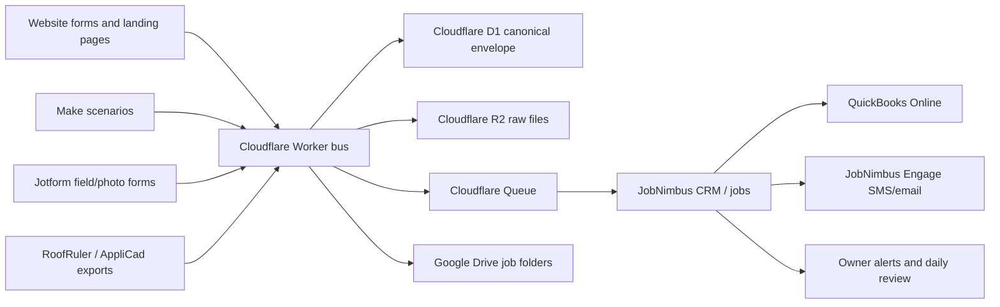

# IronWrap Final Clean Proposal - Operating System and Implementation Backlog

> Historical proposal. The repo has since moved to the Google Workspace/Drive Worker path.
> Use `final-spec-pack/00-final-decisions.md`, `docs/ACTIVATION-CHECKLIST.md`, and
> `SETUP-CHECKLIST.md` for current implementation truth.

Date: 2026-07-01

Audience: Ivan, Ilia, implementation agents, and any vendor/operator helping IronWrap.

Status: Consolidated proposal after cross-reviewing the current repository, the attached other-agent thread, the current worker bus implementation, the sample measurement files, and the live IronWrap website surface. Revised 2026-07-02 to separate executable implementation work from owner/access blockers.

## 1. Executive Decision

IronWrap should not buy or build a large custom ERP right now. The right system is a low-volume, owner-controlled operating spine:

1. Capture every lead and field submission into the owned Cloudflare bus first.
2. Store canonical raw data in Cloudflare D1/R2 before external tools mutate it.
3. Push operational work into JobNimbus because it is the job pipeline and crew-facing CRM.
4. Push accounting work into QuickBooks Online because it is the financial ledger.
5. Store human-readable job folders in Google Drive because that is now the owner-directed workspace.
6. Use Make only where it is useful connector glue, not as the source of truth.
7. Gate expensive/advanced tools until the lead volume and operating discipline justify them.

The business wedge is not "more automation." It is quote transparency and decision certainty: every prospect should see a cleaner, more evidence-backed, more scope-clear proposal than competitors provide.

## 2. Current Truth

| Area | Current truth | Risk | Proposal |
| --- | --- | --- | --- |
| Cloudflare bus | `workers-bus` validates locally: tests, typecheck, and dry-run bundle passed. It already has owned-store-first architecture. | Built code is ahead of operating reality. | Keep it as the integration spine and connect live sources to it. |
| Source of truth | Newer docs say Google Workspace/Drive and QuickBooks/Moneris refinement. Older docs/code still say Microsoft 365/OneDrive/Twilio. | Agents and vendors can implement the wrong stack. | Clean source-truth docs and either migrate or explicitly disable old Microsoft/Twilio adapters. |
| Website | Live homepage, quote, and contact forms still look broad and overlap in purpose. | Leads can still bypass the owned bus; attribution and qualification remain weak. | Website forms must forward server-side to `/ingest/website` with hidden attribution fields. |
| JobNimbus | Current account API works. Contact record type is `Customer`; job record type is `Retail`; `Lead` is rejected. | Bad record types or `source_name` values break writes. | Treat JobNimbus as operational CRM, not canonical data owner. Use tags/descriptions for source where needed. |
| Make | Existing scenarios are valuable but experimental GHL-heavy flows should not become permanent architecture. | Replacing scenarios wholesale can break live operations. | Add the bus as an additive HTTP forwarder and isolate bridge errors. |
| Google Workspace/Drive | Owner-directed target is now Google, not OneDrive/Microsoft. | Code and some docs still reflect the old file spine. | Make Google Drive the human file archive and R2 the raw archive. |
| SMS | JobNimbus Engage can be the SMS channel, but A2P/Canadian carrier registration is a hard gate. | Automated prospect SMS before approval risks deliverability/compliance issues. | Use email plus owner alerts first; enable prospect SMS only after A2P and consent rules are done. |
| Finance | QuickBooks Online should own invoices, tax, payments, and item catalog. | Moneris is not automatically a QuickBooks invoice payment gateway. | Default to QBO Payments for invoice links; use Moneris for terminal/reconciliation unless fees justify Benji Pays. |
| Samples | Samples include structured XML, text-readable roofing PDFs, and hard image-heavy siding/gutter/soffit PDFs. | OCR-first extraction would be expensive and less reliable. | Parse structured exports first; use text extraction next; OCR only for hard documents; keep human review before pricing. |

## 3. Operating Architecture



Principles:

1. Own the data before syncing it.
2. One owner per flow.
3. No browser-exposed ingest tokens.
4. External tools are consumers or workflow surfaces, not the canonical ledger.
5. Automate only what can be audited, retried, and manually recovered.
6. Keep the first version boring enough that Ilia can operate it.

## 4. Department Model

### 4.1 Ownership and Governance

Decision:

IronWrap needs a small operating system, not a software company. Ilia is the business owner; JobNimbus/QuickBooks/Google/Cloudflare/Make are the operating tools; Codex/Claude or a contractor can implement and maintain controlled changes.

Operating rules:

- Keep a single source-truth register for accounts, tokens, domains, and vendor decisions.
- Maintain a weekly owner review: new leads, uncontacted leads, aging proposals, deposits, scheduled jobs, blocked invoices, missing photos, and review requests.
- Use named owners for each flow: lead intake, CRM pipeline, measurement/proposal, field completion, accounting, files, and messaging.
- Require any new automation to answer: what triggers it, what it writes, where failure is visible, and how Ilia recovers manually.

Immediate fixes:

- Clean the Google-vs-Microsoft conflict across docs and code comments.
- Rotate any shared/previously exposed secrets.
- Confirm which repo or remote is the real publication target because the current folder is not a git checkout.

### 4.2 Marketing, Website, and Lead Capture

Decision:

The website should sell trust and decision certainty, then capture structured, attributable leads. It should not merely be a brochure with generic quote forms.

Website changes:

- Separate quote and contact jobs:
  - Quote form: structured project intake.
  - Contact form: general messages, service questions, and vendor/admin contact.
- Add server-side forwarding from website forms to `POST /ingest/website`.
- Capture and forward:
  - brand: IronWrap or iRoof
  - page URL
  - page type
  - form type
  - UTM source, medium, campaign, content, term
  - referrer
  - service category
  - address or service area
  - urgency
  - preferred contact method
  - consent to contact
  - uploaded measurement/report/photos when present
- Keep the ingest token only in the website server environment.
- Preserve visitor UX if the bus is temporarily unavailable: show success to the visitor, alert owner/dev, and retry from server logs if possible.

Marketing positioning:

- Lead with "scope-clear, evidence-backed exterior quotes" rather than generic contractor claims.
- Put proof near conversion moments: WCB/insurance, real photos, before/after work, measurement-backed proposal examples, warranty/process clarity.
- Use the samples and future completed-job packs to show "what you get with a quote."
- Keep paid acquisition gated until attribution, dedupe, and speed-to-lead are stable.

Do not do now:

- Do not redesign the whole website before connecting forms to the bus.
- Do not expose the Cloudflare token in browser JavaScript.
- Do not add more generic CTA buttons without improving qualification.

### 4.3 Sales and CRM Operations

Decision:

JobNimbus is the sales/job workflow surface. The owned bus is the canonical capture layer. QuickBooks is the financial ledger.

Recommended pipeline:

1. New lead
2. Contact attempted
3. Contacted
4. Measurement needed
5. Measurement received
6. Estimate in progress
7. Proposal sent
8. Follow-up due
9. Won / deposit requested
10. Deposit paid
11. Scheduled
12. In production
13. Completion review
14. Invoiced
15. Paid
16. Review requested
17. Warranty / closed

JobNimbus implementation notes:

- Use contact record type `Customer`.
- Use job record type `Retail`.
- Do not send record type `Lead`.
- Avoid unknown `source_name`; carry source in tags, external ID, custom fields, and description unless the account has configured a matching source.
- Use the bus envelope ID as idempotency proof.
- Use D1 status as the instant idempotency guard and JobNimbus search as the backstop.
- Keep manual recovery visible: failed pushes should land in retry/DLQ/admin review, not silently disappear.

Sales automations:

- On new bus lead: owner alert immediately.
- On new JobNimbus lead: assigned owner and first-contact SLA.
- On proposal sent: follow-up tasks at fixed intervals.
- On won/deposit paid: create production checklist.
- On completion: trigger invoice/review workflow.

### 4.4 Field Operations and Production

Decision:

Field operations should use simple forms and job checklists before any custom mobile app.

Recommended field pack:

- Pre-job photos.
- Access notes.
- Safety or site constraints.
- Material delivery confirmation.
- In-progress photos.
- Completion photos.
- Deficiency list.
- Owner/customer signoff.
- Warranty notes.
- Review-request readiness.

Jotform use:

- Use a "Jobsite Photo / Completion Pack" form tied to JobNimbus job number.
- Use separate required upload fields if a minimum photo count must be enforced.
- Treat device GPS/location as helpful evidence, not a perfect compliance control; validate behavior on the exact field devices.
- Accept submissions into the bus first even if Google Drive sync is temporarily unavailable.

Do not do now:

- Do not build a custom field app.
- Do not rely on file upload alone as job completion proof.
- Do not make Google Drive the system of record; Drive is the human archive.

### 4.5 Measurements, Estimating, Materials, and Proposals

Decision:

The proposal system should start from real measurement artifacts and produce a transparent scope package. It should not start from AI guessing off PDFs.

Sample data findings:

| Sample type | What can be fetched | How to use it | Why it matters |
| --- | --- | --- | --- |
| AppliCad XML | Structured project geometry, roof faces, points, line segments, areas, pitches, and measurements. | Deterministic parser fixture; material takeoff QA; geometry-to-scope mapping. | Highest reliability and cheapest extraction path. |
| RoofRuler metal-roofing PDFs | Text-readable roof area, facets, pitch, eaves, valleys, hips, ridges, rakes, flashing, and linear lengths. | Text extraction fixture; estimate line-item population; proposal proof table. | Good enough for semi-automated proposal preparation without OCR. |
| Metal-siding PDFs | Mostly image-heavy elevations and sparse text. | Hard-document fixture for OCR/computer-vision fallback and manual review queue. | Prevents false confidence; should not be auto-priced without review. |
| Gutter/soffit/fascia PDFs | Sparse or vector/image-heavy length evidence depending on report. | Checklist and secondary verification; OCR fallback only when direct data is missing. | Useful for scope clarity but risky as sole estimate authority. |
| Raw PDFs and filenames | Customer/job hints, dates, report types, address clues, and attachments. | Job-folder linking and audit evidence. | Makes every proposal traceable to source material. |
| Duplicate sample files | Byte-identical duplicates. | Dedupe tests or cleanup after owner approval. | Keeps parser fixtures clean and storage lean. |

Extraction ladder:

1. Direct structured export: XML, ESX, CSV, RXF, or vendor export where available.
2. Text extraction: `pdftotext`, Cloudflare `toMarkdown()`, or equivalent for text-readable PDFs.
3. OCR: Mistral OCR only for hard image-heavy siding/gutter/soffit/fascia documents.
4. Human estimate review before pricing or sending.

Proposal package:

- Scope summary in plain language.
- Measurement proof table.
- Included/excluded work.
- Material options.
- Warranty/process notes.
- Deposit/payment instructions.
- Expected schedule assumptions.
- Change-order rule.
- Photos or marked excerpts when useful.

Materials:

- QuickBooks products/services catalog should become the finance-facing item master.
- JobNimbus proposal templates can consume those line items.
- Supplier-specific price lists should be imported only when recurring volume justifies maintenance.

### 4.6 Finance, Accounting, and Payments

Decision:

QuickBooks Online owns accounting. JobNimbus owns job workflow. The bus owns captured raw data. Moneris is payment infrastructure, not automatically the invoice-payment product.

Recommended setup:

- QuickBooks Online as ledger, tax, item catalog, invoices, payments, expenses, and mileage.
- QuickBooks products/services catalog as the master list for recurring services and materials.
- JobNimbus-to-QuickBooks sync for customers, estimates/invoices, payments, and job references where supported.
- QBO Payments as the default online invoice payment link unless fees or account constraints make it unattractive.
- Moneris terminal/reconciliation for card-present or existing merchant use.
- Benji Pays only if IronWrap specifically wants Moneris-backed invoice payment links and the fees justify another vendor.

Accounting process:

1. Proposal accepted in JobNimbus.
2. Deposit invoice/payment request generated through QuickBooks or synced workflow.
3. Job scheduled after deposit.
4. Completion pack reviewed.
5. Final invoice sent.
6. Payment reconciled.
7. Review request triggered only after payment/completion state is clean.

Do not do now:

- Do not make Make the accounting ledger.
- Do not build custom invoicing.
- Do not keep both QBO Payments and a Moneris invoice workaround unless there is a clear fee or operational reason.

### 4.7 Communications, Phone, and AI

Decision:

Communications should be reliable, compliant, and staged. Fast human/owner response matters more than flashy AI.

Email:

- Google Workspace is the target for brand mailboxes.
- Use Google SMTP/API/app-password path only after confirming the exact account/security settings.
- Keep Resend deferred unless bulk or transactional deliverability requires it.

SMS:

- JobNimbus Engage is the preferred SMS path after A2P/Canadian carrier registration.
- Before A2P approval, use email plus owner alerts.
- Store consent, source, and opt-in context.
- Respect quiet hours and CASL expectations.

Phone AI:

- Evaluate JobNimbus AssistAI first because it fits the CRM context.
- Confirm Canadian number support, call handling behavior, recordings/transcripts, pricing, and fallback handling.
- Start as missed-call or after-hours assistant, not full call replacement.
- Keep voicemail/human callback as the floor.

Do not do now:

- Do not revive a four-vendor DIY voice stack.
- Do not send prospect SMS before registration and consent are ready.
- Do not automate messages that Ilia cannot audit.

### 4.8 Data, Integration, and Automation

Decision:

Cloudflare bus is the durable integration layer. Make is connector glue. JobNimbus, Google Drive, and QuickBooks are consumers or workflow surfaces.

Cloudflare bus responsibilities:

- Receive website leads.
- Receive Make-forwarded leads.
- Receive Jotform/photos.
- Receive measurement/report files.
- Store raw files in R2.
- Store canonical envelope and statuses in D1.
- Queue downstream sync.
- Push or reconcile JobNimbus writes.
- Record audit events.
- Expose admin/retry/reconcile views or endpoints.

Make-to-bus contract:

- Make to bus: HTTP POST to `/ingest/website`, `/ingest/photo`, or future `/ingest/measurement`.
- Auth: bearer token stored in Make keychain/connection config, never in form/browser code.
- Payload: source, brand, contact, job reference, payload, timestamp, attachments, scenario metadata.
- Error handling: ignore/route bus-forward failures so current live CRM sync does not break.
- Editing live scenarios: use Make UI, not blind API blueprint rewrites.

Bus-to-Make contract:

- Use Make Custom Webhooks only for flows where Make is the natural connector, such as a specific vendor action not worth coding directly.
- The bus should send normalized data; Make should not reinterpret canonical meaning.

Migration note:

The current worker includes Microsoft Graph/OneDrive-oriented code and Twilio-oriented notification assumptions from the previous target stack. Because the owner-directed target is now Google Workspace/Drive and JobNimbus Engage, those adapters should be either migrated, disabled, or clearly marked legacy before more implementation happens.

### 4.9 Files, Storage, and Document Control

Decision:

R2 is the raw technical archive. Google Drive is the human job-folder archive.

Recommended folder structure:

```text
IronWrap Shared Drive/
  Jobs/
    JN-<job-number> - <customer> - <address>/
      01 Intake/
      02 Measurements/
      03 Proposal/
      04 Contract Deposit/
      05 Production Photos/
      06 Completion Warranty/
      07 Invoice Payment/
  Company/
    Insurance WCB/
    Templates/
    Price Lists/
    SOPs/
```

Rules:

- JobNimbus job number is the durable folder key.
- R2 keeps the raw original even if Google sync fails.
- Drive filenames should be human readable but not relied on as IDs.
- Sensitive credentials and API keys do not belong in Drive docs.

### 4.10 Legal, Compliance, Privacy, and Security

Decision:

Compliance must be simple enough to operate but explicit enough to avoid hidden risk.

Controls:

- Rotate any API keys or tokens that were exposed during setup.
- Use least-privilege service accounts where possible.
- Store production secrets in Cloudflare secrets, Make connections, or vendor secret stores.
- Keep ingest tokens server-side.
- Log enough to audit but avoid storing unnecessary payment or sensitive personal data.
- Document CASL/SMS consent and opt-out handling.
- Complete A2P/Canadian carrier registration before prospect SMS.
- Use WCB clearance letter and account number workflow; do not assume a WCB API.
- Keep lawyer/insurance documents in the company folder and link them to proposals when helpful.

### 4.11 Reporting and Owner Dashboard

Decision:

Start with an owner operating report before building a custom dashboard.

Weekly metrics:

- New leads by source and brand.
- Speed to first contact.
- Uncontacted leads.
- Leads by stage.
- Aging proposals.
- Close rate by source.
- Deposit requested vs deposit paid.
- Jobs scheduled and in production.
- Missing completion packs.
- Invoices outstanding.
- Review requests sent.
- Failed automation events.
- Measurement extraction confidence and review queue.

Recommended first implementation:

- D1/admin query or simple exported report from the bus.
- JobNimbus saved views for pipeline operations.
- QuickBooks reports for receivables and payment status.
- Optional Looker Studio or lightweight dashboard only after the flow is producing clean data.

Do not do now:

- Do not build a custom BI app before lead capture and job operations are stable.
- Do not add vanity dashboards that do not drive daily action.

### 4.12 Accounts, Access, and Vendor Register

The access register is a reference artifact, not the implementation backlog. Do not block repo work on expanding this list; use it only to track external setup outside the agent-owned implementation path.

Minimum register:

| Area | System | Required decision/action |
| --- | --- | --- |
| CRM | JobNimbus | Confirm plan caps, automations, Engage, AssistAI, API access, record templates. |
| Bus | Cloudflare | Confirm account ownership, D1/R2/Queue bindings, secrets, admin token rotation. |
| Automation | Make | Keep Core seat; document live scenario owners; add bus forwarders safely. |
| Accounting | QuickBooks Online | Confirm plan, item catalog, taxes, payments, mileage, JobNimbus sync. |
| Payments | QBO Payments / Moneris / optional Benji Pays | Choose invoice payment path and reconciliation process. |
| Storage | Google Workspace / Drive | Create Shared Drive, service account/API path, mailbox send rules. |
| Field forms | Jotform | Confirm offline/location/upload behavior on real devices. |
| Measurements | RoofRuler / AppliCad | Confirm structured export formats and access to XML/ESX/CSV/RXF. |
| Website | Current web vendor/admin | Implement server-side bus forwarding and attribution fields. |
| Domain/DNS | Cloudflare or registrar | Confirm SPF/DKIM/DMARC, website DNS, mail DNS, ownership. |
| Compliance | WCB / insurance / lawyer | Store clearance letters, ACN, insurance, terms, proposal language. |

## 5. Executable Implementation Backlog

This replaces the broad rollout plan with the shortest implementation path that can prove the system end to end. Owner/vendor access tasks are intentionally not listed as work items here.

### Slice 1 - Clean Source Truth

Actions:

- Update active docs so Google Workspace/Drive, QuickBooks, JobNimbus, Cloudflare bus, Make glue, and Engage-after-A2P are the current target stack.
- Mark Microsoft/OneDrive/Twilio/GHL-as-spine/DocuSeal/OCR-first paths as legacy or deferred.
- Keep the source-truth cleanup separate from implementation code.

Exit criteria:

- No active implementation doc tells an agent to build a new OneDrive/MS365/Twilio-first flow.
- The lead-spine implementation target is unambiguous: website or Make -> bus -> D1/R2 -> JobNimbus -> owner alert.

### Slice 2 - Worker Bus Baseline

Actions:

- Keep the existing Worker architecture; do not rewrite it.
- Preserve `/ingest/website`, D1 envelope write, R2 raw write, queue push, retry/dead-letter/reconcile, and JobNimbus push.
- Disable or mark legacy any Microsoft Graph/OneDrive and Twilio prospect-SMS behavior that conflicts with the Google/Engage target.
- Ensure owner alert remains the first notification path.

Validation:

- `cd workers-bus && npm test`
- `cd workers-bus && npm run typecheck`
- `cd workers-bus && npx wrangler deploy --dry-run`

Exit criteria:

- Worker validation passes.
- A valid lead can be stored before any external push.
- Downstream failures do not lose raw data.

### Slice 3 - Website Lead Handoff

Actions:

- Update the website handoff doc/snippet so quote/contact forms POST server-side to `/ingest/website`.
- Require the server-side handler to include brand, page URL, form type, UTM/referrer, service category, address/service area, urgency, contact method, consent, and attachments when present.
- State clearly that `INGEST_TOKEN` must never be in browser JavaScript.
- Preserve visitor success UX even if bus forwarding fails; log and alert server-side.

Exit criteria:

- Website implementer has one exact forwarding contract.
- Test payload shape matches the bus.
- Token exposure is impossible from the browser path.

### Slice 4 - Make Bridge Handoff

Actions:

- Update the Make handoff so live scenarios are edited in Make UI, not by API blueprint replacement.
- Add one HTTP forwarder step from existing lead scenarios to `/ingest/website`.
- Store bearer auth in Make connection/keychain.
- Add an ignore/error handler so bus-forward failure does not break the existing live scenario.
- Keep Make as field mapper/connector only; bus remains canonical.

Exit criteria:

- One Make-origin test payload can be forwarded to the bus.
- Existing Make scenario still succeeds if bus call fails.
- D1/R2 stores scenario metadata.

### Slice 5 - JobNimbus Push Hardening

Actions:

- Keep contact type `Customer` and job type `Retail`.
- Never send record type `Lead`.
- Omit `source_name` unless it is known to exist in the account.
- Carry source in tags, description, external ID, and bus envelope ID.
- Preserve D1 status as the instant idempotency guard and JobNimbus search as the backstop.

Exit criteria:

- Test envelope creates or reuses the correct contact/job.
- Invalid source cannot 400 the write path.
- Failed JobNimbus push retries or dead-letters visibly.

### Slice 6 - Google Drive And Jotform, After Lead Spine Works

Actions:

- Replace the OneDrive filing path with the smallest Google Drive module needed for new jobs/photos.
- Use JobNimbus job number as folder key.
- Keep R2 as raw archive; Drive is only the human-readable archive.
- Route Jotform photo/completion submissions to `/ingest/photo`.
- Use separate required upload fields for minimum photo count; do not build a custom widget yet.

Exit criteria:

- A test job can create or reuse a Google Drive folder.
- A photo/completion submission lands in D1/R2 even if Drive upload fails.
- Drive failures are audit-visible.

### Slice 7 - Measurement Fixtures And Proposal Proof

Actions:

- Add fixtures for one AppliCad XML, one text-readable RoofRuler roofing PDF, and one hard image-heavy PDF.
- Extract structured XML/ESX/CSV/RXF first, text extraction second, OCR only as fallback.
- Mark low-confidence image-heavy outputs as `review_required`.
- Feed reviewed measurement evidence into one JobNimbus-native proposal template.

Exit criteria:

- Structured sample extracts deterministic fields.
- Text PDF extracts the useful measurement fields.
- Hard PDF does not auto-price.
- Proposal proof links back to source measurements.

### Slice 8 - Finance And Reporting, After A Real Job Flow Exists

Actions:

- Use QuickBooks Online as ledger/catalog/invoice/payment owner.
- Use QBO Payments as the default invoice payment path unless a later Moneris/Benji decision overrides it.
- Add only the minimum bus/JobNimbus references needed for owner reporting.
- Start reporting with D1/admin query plus JobNimbus/QuickBooks views, not a custom dashboard.

Exit criteria:

- Accepted/won job can reach the invoice/payment workflow.
- Owner can see new leads, failed pushes, aging proposals, deposit state, missing completion packs, and unpaid invoices.

### Deferred Until The Lead Spine Is Operating

- Prospect SMS and Engage automations.
- AssistAI / phone AI.
- Custom dashboards.
- Historical file migration.
- Paid acquisition expansion.
- Supplier price feeds.
- DocuSeal (since retired permanently 2026-07-09, AGPL; e-sign direction is a commercial e-sign API or owned signing).
- Deeper proposal automation.

## 6. Cross-Thread Corrections Applied

The attached other-agent thread was directionally useful, but the final proposal should apply these corrections:

1. JobNimbus API access already works in the current account. Do not claim an upgrade is required for API access. Confirm plan caps separately.
2. Google Workspace/Drive is now the owner-directed target, but code still contains Microsoft/OneDrive assumptions. Treat this as a migration item.
3. JobNimbus Engage is the preferred SMS path, but A2P/Canadian carrier registration is still required before prospect SMS.
4. Moneris is not automatically the online payment link for QuickBooks invoices. Use QBO Payments by default unless fees/process justify Moneris plus Benji Pays.
5. DocuSeal should stay benched unless JobNimbus native e-sign fails in practice. (Superseded 2026-07-09: DocuSeal retired outright, AGPL; commercial e-sign API or owned signing instead.)
6. MileIQ is not needed initially if QuickBooks mileage tracking covers the actual requirement.
7. WCB should be handled with clearance letters/account number workflow, not assumed API automation.
8. RoofRuler/AppliCad structured exports should beat AI/OCR extraction whenever available.
9. Make live scenario edits should be done through the Make UI and with additive HTTP forwarding, not destructive blueprint replacement.

## 7. What Not To Build Or Buy Now

- Full custom ERP.
- GHL as permanent CRM/source of truth.
- Custom field mobile app.
- Custom BI/dashboard product.
- OCR-first measurement extraction.
- Four-vendor DIY phone AI.
- DocuSeal, ever (retired 2026-07-09, AGPL; use a commercial e-sign API or owned signing).
- Resend/bulk email unless Google Workspace deliverability cannot meet the need.
- Paid lead channels before attribution and response QA are stable.
- Any automation that has no owner-visible failure state.

## 8. Final Owner-Facing Answer

IronWrap can run this with a disciplined low-cost stack. The important decision is to own the data first, then let JobNimbus, QuickBooks, Google Drive, Make, and communication tools each do the job they are good at.

The first milestone is not a perfect automation universe. The first milestone is simple and measurable: a real lead comes from the website or Make into the Cloudflare bus, is stored in D1/R2, creates the right JobNimbus record, alerts the owner, and can be followed through proposal, deposit, completion, invoice, and review without losing the thread.

After that, the samples become a real asset. AppliCad XML and RoofRuler reports can feed a measurement-backed proposal system, while hard image-heavy documents become review fixtures instead of unreliable AI guesses. That is how IronWrap turns operations into market differentiation: clearer quotes, stronger proof, faster follow-up, and fewer dropped jobs.

## 9. Acceptance Criteria For "Done"

The system should not be called done until these are true:

1. A website quote submission reaches the bus, D1/R2, JobNimbus, and owner alert.
2. A Make-origin lead can be bridged into the bus without breaking the existing scenario.
3. A JobNimbus job can produce or link to a Google Drive job folder.
4. A field/completion form lands in the bus and job archive.
5. A proposal can reference measurement evidence from at least one structured sample and one PDF sample.
6. QuickBooks receives or owns the invoice/payment workflow for a completed job.
7. SMS is either disabled or fully registered/consented.
8. Failed syncs are visible and recoverable.
9. The active docs no longer contradict the target stack.
10. Ilia has a one-page operating checklist for daily/weekly review.
