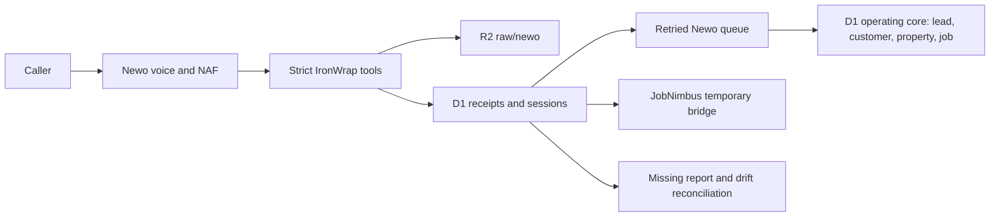

# Newo Receptionist and NAF Federation

## Authority boundary

Newo owns live voice, ConvoAgent execution, NAF reasoning and tool selection, AKB delivery, and telephony. IronWrap owns customer and business truth, policy, approvals, evidence, reconciliation, and audit.

Newo never writes directly to Frappe, JobNimbus, QuickBooks, email, SMS, or another customer communication provider. Every accepted event lands in IronWrap D1 and R2 before downstream work.



## Implemented surface

Receptionist routes:

| Route | Purpose | Credential |
|---|---|---|
| `POST /webhook/newo/lookup` | Verified caller lookup with minimal job state | `NEWO_WEBHOOK_TOKEN` |
| `POST /webhook/newo` | Capture a distinct reception lead/session | `NEWO_WEBHOOK_TOKEN` |
| `POST /webhook/newo/handoff` | Record a callback request on the session (handoff status `requested`) | `NEWO_WEBHOOK_TOKEN` |
| `POST /webhook/newo/report` | Structured terminal session report | `NEWO_WEBHOOK_TOKEN` |
| `POST /webhook/newo/availability` | Request-only availability response | `NEWO_BOOKING_TOKEN` |
| `POST /webhook/newo/booking` | Appointment request | `NEWO_BOOKING_TOKEN` |
| `POST /webhook/newo/booking/cancel` | Appointment request cancellation | `NEWO_BOOKING_TOKEN` |

The event adapter rejects extra properties, transcript text, and recording bodies. Exact event replay returns the original receipt. Reusing an event ID with a different canonical hash returns `409` and records conflict evidence. A repeated caller creates another `Reception Session`; contact matching only associates verified customer/property/job context.

The typed Worker client covers all 31 operations in the documented Newo API groups. Access and refresh tokens stay in Worker isolate memory. Governed mutations require an exact dry-run receipt, separately signed approval, one-time D1 claim, and applicable runtime gates. There is no raw Newo proxy.

The `newo-mcp` exposes role-filtered Worker operations. It never receives `NEWO_API_KEY` or a Newo bearer token. `owner-operator` receives governed controls, `support-admin` receives operational/configuration reads, and `lead-concierge` receives bounded session/conversation reads. Other roles receive no Newo tools.

## Handoff and SMS

The release contract is callback only. The AKB forbids transferring a call live to a person, an owner line, or voicemail. Each handoff calls `request_handoff` with the reason, the caller's urgency, and handoff status `requested`. The Worker accepts only `requested`, `failed`, or no status and refuses anything else with `422`, including a live connection (`connected`). A handoff request that arrives without a status is recorded as `requested`.

What the Worker does with each state:

| Session state | D1 session row | Owner email | Failed-handoff exception |
|---|---|---|---|
| `requested`, urgency `urgent` or `emergency` | `handoff_status = requested` | "Urgent Newo callback requested - <urgency>", with the caller's name, phone, address and reason | No |
| `requested`, urgency `routine` | `handoff_status = requested` | "Newo callback requested", with the same details | No |
| `failed`: the handoff request did not arrive or could not be processed, including an emergency session that closes without one | `handoff_status = failed` | "Urgent Newo callback required", once per session, with the caller's details | Yes, until a person records how it ended ([AUTHORITY-AND-EVIDENCE-CONTRACT.md](AUTHORITY-AND-EVIDENCE-CONTRACT.md#failed-newo-handoffs)) |
| A failed session (`session_failed`) with no failed handoff | `status = failed` | "Urgent Newo callback required", once per session | No |

A session keeps its strongest handoff status (failed over requested over none) and its highest urgency. The owner email is best effort: it is sent after the response through `waitUntil`. An alert counts as sent only once its send succeeds; the Worker then writes a sent marker to R2 (`raw/newo/owner-alerts/<session>/failure.json`, or `handoff-<event>.json` for a callback request). Whether an alert is owed rests on that marker, not on the session state an event finds, so a request that wrote a failed session and then failed still alerts on Newo's retry. A send that fails leaves a log line and no marker, and the session's next accepted event sends the alert. Two events of one session arriving together can both send it. Nothing else holds a requested callback today. No Frappe record or incident is written for a Newo session, and no D1 callback record that a person works and closes exists yet. Until that record exists, `node tools/validate-newo-config.mjs` and the readiness contract (`contract.newo.callback_record_gate`) refuse `NEWO_ENABLED=true`. The marker that lifts the gate is a migration named `NNNN_newo_callback_records.sql` that creates the `newo_callback_records` table (`tools/newo-enablement.mjs`); a file with that name and no such table does not count, and the gate reads `NEWO_ENABLED` as the Worker does, so a JSON boolean `true` counts as on. No transfer number or transfer policy is configured.

Newo's in-call SMS tool stays disabled, and the AKB forbids Newo SMS. SMS confirmations belong to IronWrap, and customer SMS stays record-only until the A2P/carrier gate passes.

`production.expected.json` records both rules in its `handoff` and `sms` blocks. `node tools/validate-newo-config.mjs` fails if a live handoff (a transfer, an owner line, forwarding the call, or a forwarding number) returns to the expected config, tools, console proof, Worker config, AKB, or evaluation cases, if anything tells Newo to text the caller, if callback only uses `failed` as the routine handoff status, or if Newo SMS is turned on. The matching Newo console settings are the `handoff_callback_only` and `newo_in_call_sms_disabled` proofs in `console-proof.json`; the repository does not prove them.

## Booking truth

Launch mode is `request_only`. The only caller-safe success phrase is:

> Appointment request received.

Confirmed booking is not implemented as production authority until the real JobNimbus appointment API passes controlled create, read, collision, update, cancel, retry, and timezone tests with 100 percent correctness. No Make, GHL, or unowned calendar fallback may be substituted silently.

## Data and retention

- D1 stores event receipts, provider-neutral session snapshots, control actions, slot reservations, and reconciliation runs.
- R2 stores validated raw provider events under `raw/newo/`, and the owner-alert sent markers under `raw/newo/owner-alerts/` (session and event ids and the send time, no caller details).
- The Newo queue projects each accepted session into the D1 operating core (lead, customer, property, roof job). No Frappe record is written for a Newo session.
- Transcript and recording bodies are not copied. Only approved provider or R2 pointers are stored.
- The production R2 lifecycle gate is 30 days for `raw/newo/` and remains unproven until Cloudflare evidence is attached.

## Release truth

The repository proves local code and contract behavior. It does not prove a published production actor, AKB publication, phone connector, Newo-owned number, forwarding, provider webhook configuration, usage alert, Worker deployment, live JobNimbus landing, or real-call outcome.

The secret-free expected state is [production.expected.json](../config/newo/production.expected.json). Run:

```bash
node tools/validate-newo-config.mjs
node tools/validate-newo-config.mjs --production
```

The first command validates the current staging package. The second must remain red until all provider/admin/live evidence is complete. Operational activation and rollback are defined in [NEWO-PRODUCTION-RUNBOOK.md](NEWO-PRODUCTION-RUNBOOK.md).
