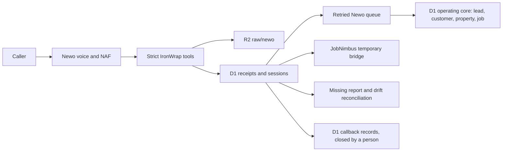

# Newo Receptionist and NAF Federation

## Authority boundary

Newo owns live voice, ConvoAgent execution, NAF reasoning and tool selection, AKB delivery, and telephony. IronWrap owns customer and business truth, policy, approvals, evidence, reconciliation, and audit.

Newo never writes directly to Frappe, JobNimbus, QuickBooks, email, SMS, or another customer communication provider. Every accepted event lands in IronWrap D1 and R2 before downstream work.



## Implemented surface

Receptionist routes:

| Route | Purpose | Credential |
|---|---|---|
| `POST /webhook/newo/lookup` | Verified caller lookup with minimal job state | `NEWO_WEBHOOK_TOKEN` |
| `POST /webhook/newo` | Capture a distinct reception lead/session | `NEWO_WEBHOOK_TOKEN` |
| `POST /webhook/newo/handoff` | Record a callback request: the session's handoff status `requested` and its D1 callback record | `NEWO_WEBHOOK_TOKEN` |
| `POST /webhook/newo/report` | Structured terminal session report | `NEWO_WEBHOOK_TOKEN` |
| `POST /webhook/newo/availability` | Request-only availability response | `NEWO_BOOKING_TOKEN` |
| `POST /webhook/newo/booking` | Appointment request | `NEWO_BOOKING_TOKEN` |
| `POST /webhook/newo/booking/cancel` | Appointment request cancellation | `NEWO_BOOKING_TOKEN` |

The event adapter rejects extra properties, transcript text, and recording bodies. Exact event replay returns the original receipt. Reusing an event ID with a different canonical hash returns `409` and records conflict evidence. A repeated caller creates another `Reception Session`; contact matching only associates verified customer/property/job context.

The typed Worker client covers all 31 operations in the documented Newo API groups. Access and refresh tokens stay in Worker isolate memory. Governed mutations require an exact dry-run receipt, separately signed approval, one-time D1 claim, and applicable runtime gates. There is no raw Newo proxy.

People close a callback on the app API, never through Newo, an agent or a connector: `POST /api/v1/newo/operations/handoffs/{session_id}/resolution` (owner or ops, their own cookie session, CSRF and `Idempotency-Key`) and `GET` on the same path ([AUTHORITY-AND-EVIDENCE-CONTRACT.md](AUTHORITY-AND-EVIDENCE-CONTRACT.md#newo-callbacks-and-failed-handoffs)).

The `newo-mcp` exposes role-filtered Worker operations. It never receives `NEWO_API_KEY` or a Newo bearer token. `owner-operator` receives governed controls, `support-admin` receives operational/configuration reads, and `lead-concierge` receives bounded session/conversation reads. Other roles receive no Newo tools.

## Handoff and SMS

The release contract is callback only. The AKB forbids transferring a call live to a person, an owner line, or voicemail. Each handoff calls `request_handoff` with the reason, the caller's urgency, and handoff status `requested`. The Worker accepts only `requested`, `failed`, or no status and refuses anything else with `422`, including a live connection (`connected`). A handoff request that arrives without a status is recorded as `requested`.

What the Worker does with each state:

| Session state | D1 session row | D1 callback record | Owner email | Where it waits for a person |
|---|---|---|---|---|
| `requested`, urgency `urgent` or `emergency` | `handoff_status = requested` | Yes, `callback_requested` | "Urgent Newo callback requested - <urgency>", with the caller's name, phone, address and reason | `open_callbacks` |
| `requested`, urgency `routine` | `handoff_status = requested` | Yes, `callback_requested` | "Newo callback requested", with the same details | `open_callbacks` |
| `failed`: the handoff request did not arrive or could not be processed, including an emergency session that closes without one | `handoff_status = failed` | Yes, `handoff_failed` | "Urgent Newo callback required", once per session, with the caller's details | `failed_handoffs` |
| A failed session (`session_failed`) with no failed handoff, and the session knows the caller's phone or email | `status = failed` | Yes, `session_failed` | "Urgent Newo callback required", once per session | `open_callbacks` |
| A failed session with no failed handoff and no phone or email | `status = failed` | No: there is no one to call back | "Urgent Newo callback required", once per session | None |

A session keeps its strongest handoff status (failed over requested over none) and its highest urgency.

**The callback record.** No caller rests on an owner email alone. When an accepted event leaves a callback owed, the Worker writes one `newo_callback_records` row (migration `0168`) in the same D1 batch as the session. Its `reason` says why: `callback_requested` (the handoff is `requested`), `handoff_failed` (the handoff is `failed`) or `session_failed` (the session failed with no failed handoff, and the session knows the caller's phone or email; D1 refuses such a record without either). The row also holds the tenant, the session, the event whose acceptance wrote it, the urgency at that moment, the receptionist's handoff summary, and the caller's name, phone, email and address as the session knows them. The row is append-only, one per tenant and session, and D1 stamps `recorded_at` from its own clock. An event that arrives after a newer one leaves the session row as it was, but its callback record is still written. The operations read model (`GET /api/v1/newo/operations`) lists each requested callback and each failed session's callback no person has closed in `exceptions.open_callbacks`, with its reason, and counts it in `counts.open_callbacks`; a callback whose handoff failed is listed once, under `failed_handoffs`. Either keeps the model in `attention` until a person records how it ended: an outcome (`called_back`, `unreachable` or `not_needed`) and a note. Neither list carries the caller's identity or words; the resolution route's `GET` returns the record, contact details included, to an owner or ops person.

**The owner email** is best effort. It is scheduled as soon as the session and its callback record are in D1, before the audit row and the queue sends, so a queue that stays down until Newo stops retrying does not stop it, and it is sent after the response through `waitUntil`. An alert counts as sent only once its send succeeds; the Worker then writes a sent marker to R2 (`raw/newo/owner-alerts/<session>/failure.json`, or `handoff-<event>.json` for a callback request). Whether an alert is owed rests on that marker, not on the session state an event finds. A send that fails leaves a log line and no marker, and what retries it depends on the alert:

- The failure alert is owed on every accepted event of the failed session until it is recorded as sent, so the session's next event, Newo's retry included, sends it.
- The callback-request alert is attempted while its own `handoff_requested` event is processed, Newo's retry of that event included. The five-minute sweep also retries any open callback without a confirmed sent marker, including a callback whose webhook returned success before Gmail timed out. It needs no further event from Newo. A person's resolution removes the callback from the sweep.

Each processing of an event sends its own attempt: the email ends with the event id and the processing attempt, so its content, and with it the Gmail effect's idempotency identity, is new each time. A send whose outcome is unknown (a timeout) stays unknown in the effect ledger and is never sent again as the same effect; the next attempt is a separate effect that says it may repeat an earlier alert, so the urgent alert never waits for that reconciliation. Two events of one session arriving together can both send an alert. No Frappe record or incident is written for a Newo session.

The sweep scans at most 25 open callback records per run, including failed handoffs. It uses a tenant-scoped keyset cursor at `state/newo/callback-alert-sweep/<tenant>.json`, outside the raw evidence prefix. This cursor contains only the last callback id and is never delivery evidence; losing it restarts the scan. Confirmed alerts in an earlier batch do not hide callbacks in later batches. Each sweep attempt carries a fresh `sweep-` identifier, and only a successful send writes the usual sent marker. The sweep completes before Newo queue recovery, so a queue outage cannot suppress callback alerts. Both five-minute and daily reconciliation remain `degraded` while an open callback or unresolved failed handoff exists; the operations read model remains in `attention`.

**The enablement gate.** `node tools/validate-newo-config.mjs` and the readiness contract (`contract.newo.callback_record_gate`) refuse `NEWO_ENABLED=true` unless every migration, applied to an in-memory SQLite, builds the reviewed installed callback contract. Source replay and Worker readiness share `workers-bus/src/newo-callback-schema.ts`: it fingerprints eleven table definitions, four tenant/admission indexes and twenty Newo guards with their table bindings and per-table creation order. Dependencies include owned envelopes, actors and native customer/property/job provenance. This binds all 15 callback columns, types, CHECKs, primary/unique keys and foreign keys. A placeholder table, quoted alias, view, dropped object, weakened guard or unexecutable migration cannot open the gate.

The fingerprints normalize only line endings and outer whitespace; formatting inside a definition also fails closed. A migration changing this contract must update the fingerprints and behavioral evidence together. The runtime `checks.newo_callback_schema` reads installed D1 schema without provider calls or business writes. The independent `checks.newo_tenant_binding` also requires explicit trusted deployment identity and zero unresolved provenance counts. Both feed the existing Newo `owned_database` check. A source replay pass does not prove the deployed D1 schema or provider delivery. `NEWO_ENABLED` stays `false` in every Wrangler environment; enablement and deployed readback remain separate gates. The flag uses the Worker's interpretation, so a JSON boolean `true` also counts as on. Corrected durable contact and the coordinated parent/child privacy lifecycle remain separate source slices.

**Tenant and event admission (`0172`).** Event ingest and caller lookup take tenant identity only from the explicit trusted `APP_TENANT_ID`, before claiming a receipt or retaining raw input. A globally identified session is never reassigned: another tenant receives `404`; unbound or conflicting legacy ownership receives `409`; missing deployment identity or schema receives `503`. Raw payload tenant labels, provider identifiers and the next caller do not grant ownership. Session, callback, queue and operations reads require the bound tenant.

The receipt's immutable `admission_json` stores only bounded event facts and contact-presence flags, with its identity/hash/raw reference. `newo_event_admissions` records acceptance into owned business state independently of transport acknowledgement (`newo_event_receipts.status`). A single D1 batch records that fact, conditionally creates/updates the ordered session projection and records the first callback. A queue error can leave the acknowledgement failed while the accepted business obligation survives. Retries reuse the original fact and callback; they do not invent another obligation or rewrite contact history. SQL binds derived status, urgency, callback reason, tenant and envelope/job links to that fact; insertion, replacement and later mutation cannot substitute an unrelated claimed event.

A callback is owed by an explicit incoming request/failure, an emergency close without a requested callback, or an accepted failed session with contact. Inherited latest handoff status alone cannot bless a new record. A legitimate older accepted request/failure may create an obligation while the latest session projection stays newer. Failure-alert recovery consults accepted business provenance, including that late event, and retains confirmed marker and unknown-effect semantics.

**Conservative legacy compatibility.** The forward migration preserves landed `0168` bytes, callback snapshots and resolution history. It derives a legacy tenant only from an original owned Newo envelope naming that session, an accepted receipt's such envelope, or a verified native job whose customer/property/lead and original source envelopes all corroborate the same tenant. `matched_property_id` contains the native property key. A single tenant produces an immutable `legacy_envelope`, `legacy_job` or `legacy_envelope_job` reference. Missing evidence stays `unbound`; invalid referenced evidence, multiple tenants or contradictory callback/resolution labels stay `conflict`, with no tenant assigned. A receipt needs its own original envelope, or exact hash/raw corroboration of the original verified job lookup; unsupported historical receipts remain unbound. No current deployment default or later event repairs this automatically.

The shared source/runtime gate reads nine counts: unbound/conflicting sessions, unbound/conflicting receipts, unproven callbacks, conflicting resolutions, missing admitted callbacks, invalid projections and legacy owed callbacks without a record. Every count must be a safe integer zero. Legacy callback reason evidence is accepted only where the original accepted event type proves it (`handoff_requested`/`callback_requested`, or `session_failed`/`session_failed`); opaque historical status is held. Holds apply across the shared database, expose counts without contact content, and require a separate reviewed owner mapping or lifecycle repair. A clean source replay proves no deployed legacy rows.


Newo's in-call SMS tool stays disabled, and the AKB forbids Newo SMS. SMS confirmations belong to IronWrap, and customer SMS stays record-only until the A2P/carrier gate passes.

`production.expected.json` records both rules in its `handoff` and `sms` blocks. `node tools/validate-newo-config.mjs` fails if a live handoff (a transfer, an owner line, forwarding the call, or a forwarding number) returns to the expected config, tools, console proof, Worker config, AKB, or evaluation cases, if anything tells Newo to text the caller, if callback only uses `failed` as the routine handoff status, if an evaluation case promises an incident for a callback (`callback incident` however it is joined, or "opens", "creates", "raises", "files" or "logs" an incident), or if Newo SMS is turned on. The matching Newo console settings are the `handoff_callback_only` and `newo_in_call_sms_disabled` proofs in `console-proof.json`; the repository does not prove them.

## Booking truth

Launch mode is `request_only`. The only caller-safe success phrase is:

> Appointment request received.

Confirmed booking is not implemented as production authority until the real JobNimbus appointment API passes controlled create, read, collision, update, cancel, retry, and timezone tests with 100 percent correctness. No Make, GHL, or unowned calendar fallback may be substituted silently.

## Data and retention

- D1 stores event receipts, provider-neutral session snapshots, callback records and their resolutions, control actions, slot reservations, and reconciliation runs. A callback record keeps the caller's contact details the owner email carries, for the person who calls back.
- R2 stores validated raw provider events under `raw/newo/`, and the owner-alert sent markers under `raw/newo/owner-alerts/` (session and event ids, the attempt and the send time, no caller details).
- The Newo queue projects each accepted session into the D1 operating core (lead, customer, property, roof job). No Frappe record is written for a Newo session.
- Transcript and recording bodies are not copied. Only approved provider or R2 pointers are stored.
- The production R2 lifecycle gate is 30 days for `raw/newo/` and remains unproven until Cloudflare evidence is attached.

## Release truth

The repository proves local code and contract behavior. It does not prove a published production actor, AKB publication, phone connector, Newo-owned number, forwarding, provider webhook configuration, usage alert, Worker deployment, live JobNimbus landing, or real-call outcome.

The secret-free expected state is [production.expected.json](../config/newo/production.expected.json). Run:

```bash
node tools/validate-newo-config.mjs
node tools/validate-newo-config.mjs --production
```

The first command validates the current staging package. The second must remain red until all provider/admin/live evidence is complete. Operational activation and rollback are defined in [NEWO-PRODUCTION-RUNBOOK.md](NEWO-PRODUCTION-RUNBOOK.md).
