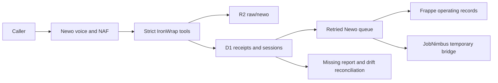

# Newo Receptionist and NAF Federation

## Authority boundary

Newo owns live voice, ConvoAgent execution, NAF reasoning and tool selection, AKB delivery, and telephony. IronWrap owns customer and business truth, policy, approvals, evidence, reconciliation, and audit.

Newo never writes directly to Frappe, JobNimbus, QuickBooks, email, SMS, or another customer communication provider. Every accepted event lands in IronWrap D1 and R2 before downstream work.



## Implemented surface

Receptionist routes:

| Route | Purpose | Credential |
|---|---|---|
| `POST /webhook/newo/lookup` | Verified caller lookup with minimal job state | `NEWO_WEBHOOK_TOKEN` |
| `POST /webhook/newo` | Capture a distinct reception lead/session | `NEWO_WEBHOOK_TOKEN` |
| `POST /webhook/newo/handoff` | Record the handoff reason and open the urgent callback incident | `NEWO_WEBHOOK_TOKEN` |
| `POST /webhook/newo/report` | Structured terminal session report | `NEWO_WEBHOOK_TOKEN` |
| `POST /webhook/newo/availability` | Request-only availability response | `NEWO_BOOKING_TOKEN` |
| `POST /webhook/newo/booking` | Appointment request | `NEWO_BOOKING_TOKEN` |
| `POST /webhook/newo/booking/cancel` | Appointment request cancellation | `NEWO_BOOKING_TOKEN` |

The event adapter rejects extra properties, transcript text, and recording bodies. Exact event replay returns the original receipt. Reusing an event ID with a different canonical hash returns `409` and records conflict evidence. A repeated caller creates another `Reception Session`; contact matching only associates verified customer/property/job context.

The typed Worker client covers all 31 operations in the documented Newo API groups. Access and refresh tokens stay in Worker isolate memory. Governed mutations require an exact dry-run receipt, separately signed approval, one-time D1 claim, and applicable runtime gates. There is no raw Newo proxy.

The `newo-mcp` exposes role-filtered Worker operations. It never receives `NEWO_API_KEY` or a Newo bearer token. `owner-operator` receives governed controls, `support-admin` receives operational/configuration reads, and `lead-concierge` receives bounded session/conversation reads. Other roles receive no Newo tools.

## Handoff and SMS

The release contract is callback only. The AKB forbids transferring a call live to a person, an owner line, or voicemail. Each immediate handoff calls `request_handoff` with the reason and handoff status `failed`, which means the caller was not put through. The Worker then alerts the owner, projects an urgent `Automation Incident`, and counts the session as a failed handoff until a person records how the callback ended ([AUTHORITY-AND-EVIDENCE-CONTRACT.md](AUTHORITY-AND-EVIDENCE-CONTRACT.md#failed-newo-handoffs)). No transfer number or transfer policy is configured.

Newo's in-call SMS tool stays disabled, and the AKB forbids Newo SMS. SMS confirmations belong to IronWrap, and customer SMS stays record-only until the A2P/carrier gate passes.

`production.expected.json` records both rules in its `handoff` and `sms` blocks. `node tools/validate-newo-config.mjs` fails if a transfer setting returns to the expected config, console proof, Worker config, AKB, or evaluation cases, or if Newo SMS is turned on. The matching Newo console settings are the `handoff_callback_only` and `newo_in_call_sms_disabled` proofs in `console-proof.json`; the repository does not prove them.

## Booking truth

Launch mode is `request_only`. The only caller-safe success phrase is:

> Appointment request received.

Confirmed booking is not implemented as production authority until the real JobNimbus appointment API passes controlled create, read, collision, update, cancel, retry, and timezone tests with 100 percent correctness. No Make, GHL, or unowned calendar fallback may be substituted silently.

## Data and retention

- D1 stores event receipts, provider-neutral session snapshots, control actions, slot reservations, and reconciliation runs.
- R2 stores validated raw provider events under `raw/newo/`.
- Frappe stores `Reception Session`, `Appointment Request`, and urgent `Automation Incident` records.
- Transcript and recording bodies are not copied. Only approved provider or R2 pointers are stored.
- The production R2 lifecycle gate is 30 days for `raw/newo/` and remains unproven until Cloudflare evidence is attached.

## Release truth

The repository proves local code and contract behavior. It does not prove a published production actor, AKB publication, phone connector, Newo-owned number, forwarding, provider webhook configuration, usage alert, Worker deployment, live Frappe/JobNimbus landing, or real-call outcome.

The secret-free expected state is [production.expected.json](../config/newo/production.expected.json). Run:

```bash
node tools/validate-newo-config.mjs
node tools/validate-newo-config.mjs --production
```

The first command validates the current staging package. The second must remain red until all provider/admin/live evidence is complete. Operational activation and rollback are defined in [NEWO-PRODUCTION-RUNBOOK.md](NEWO-PRODUCTION-RUNBOOK.md).
