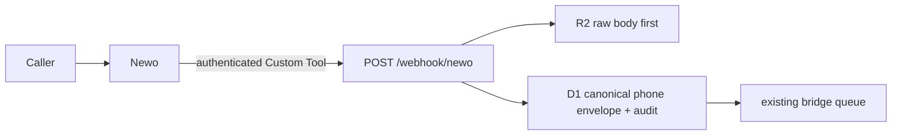

# Newo Phone-Intake Integration

## Scope and truth boundary

Newo is an optional voice/reception channel, not an IronWrap system of record. The
only implemented connection is Newo → the owned Worker lead-intake boundary:



`POST /webhook/newo` normalizes the input as the existing `phone` source and
adds `provider: "newo"` only to the normalized payload and audit evidence. The
original provider body is retained unchanged in R2. It does not add a Newo
database, SDK, background poller, direct Frappe/QuickBooks mutation, or an
outbound Newo client.

The route uses the same owned intake policy as any phone lead. A first valid
lead may invoke the already-configured acknowledgement and bridge queue; a
duplicate stays durably captured but skips the repeat acknowledgement and
queueing. An acknowledgement receipt is provider-acceptance evidence, never
proof that a prospect read it or that a person followed up.

This repository proves the route locally. It does **not** prove that a Newo
workspace, phone number, agent, Custom Tool, Cloudflare secret, Worker
deployment, or live-call delivery exists.

## Why the ingress uses a static bearer token

Newo's [Custom Tool integration](https://docs.newo.ai/docs/custom-tool-integration)
supports a `send_webhook` action with static request headers. The Worker therefore
requires one dedicated high-entropy secret:

```text
NEWO_WEBHOOK_TOKEN
```

It is deliberately not `INGEST_TOKEN`, an application credential, or a Newo API
key. The endpoint rejects a missing token with `503` and a wrong or absent bearer
with `401`, before any R2, D1, queue, or acknowledgement work.

Newo's public API-key flow is separate: an API key is exchanged at
[`POST /api/v1/auth/api-key/token`](https://docs.newo.ai/reference/obtaintokenbyapikey)
for a short-lived bearer/refresh pair; refreshes use the
[refresh-token endpoint](https://docs.newo.ai/reference/refreshaccesstoken).
Do not create `NEWO_API_KEY` or implement that client until a real approved
outbound or administrative Newo operation, connector ID, and live payload
contract exist. The current intake path needs neither.

## Production configuration

Perform these steps only after Wrangler is authenticated to the configured
IronWrap Cloudflare account, the deployed Worker origin is known, and the token
is held in the approved secret manager. Never paste its value into chat, source,
Newo prompt text, browser code, or a `.json` config file.

```bash
cd workers-bus
npx wrangler secret put NEWO_WEBHOOK_TOKEN
```

In the Newo agent, create a Custom Tool whose action is `send_webhook`:

| Setting      | Value                                                                                                 |
| ------------ | ----------------------------------------------------------------------------------------------------- |
| URL          | `https://<reviewed-worker-origin>/webhook/newo`                                                       |
| Method       | `POST`                                                                                                |
| Header       | `Authorization: Bearer <NEWO_WEBHOOK_TOKEN>`                                                          |
| Content type | `application/json`                                                                                    |
| Trigger      | only after the caller supplied a contact method and requested a quote, callback, or qualified handoff |

Use a minimal body that the existing lead normalizer understands. Keep the
provider's own transcript/session fields only when their retention purpose is
approved:

```json
{
  "contact_name": "{{caller_name}}",
  "phone": "{{caller_phone}}",
  "email": "{{caller_email}}",
  "service": "{{service}}",
  "service_intent": "{{service_intent}}",
  "message": "{{handoff_summary}}",
  "session_id": "{{session_id}}"
}
```

The placeholders are illustrative, not Newo syntax to copy blindly. Map them to
the actual variables exposed by the approved Newo tool configuration. Before
enablement, record the exact live JSON shape and any stable event/session ID.
Newo's public Custom Tool material documents a static authorization header, but
does not establish a universal event-signature or retry-header contract; do not
invent an HMAC verifier or event-ID receipt rule without the provider's real
contract.

## Release proof

1. Verify the target Cloudflare account, Worker deployment version, D1 database,
   R2 bucket, and queue before setting the secret.
2. Verify `GET /health` and `GET /ready` on the exact reviewed Worker origin.
3. Call `/webhook/newo` with a wrong bearer and prove `401` with no new R2/D1
   record; use a controlled non-customer payload for the valid-path smoke test.
4. Record the returned envelope ID and prove its raw R2 object, D1 row,
   `provider:newo` audit evidence, queue state, and any configured acknowledgement
   receipt. Do not call that receipt “delivered.”
5. Exercise one deliberate duplicate and prove one queue/acknowledgement run but
   two raw captures and a duplicate envelope.
6. Only then enable the Newo tool in a real agent and make an approved test call.
   Review the actual message fields, consent language, opt-out path, transcript
   retention, callback routing, and Canadian telephony compliance before broader
   traffic.

If the live provider payload needs a richer contract than the documented Custom
Tool body, capture a redacted example and extend the adapter with focused tests;
do not widen the generic intake route or grant Newo direct operating-system
writes.
