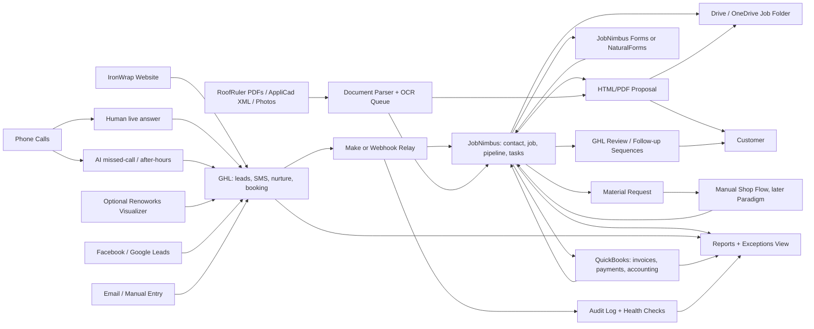
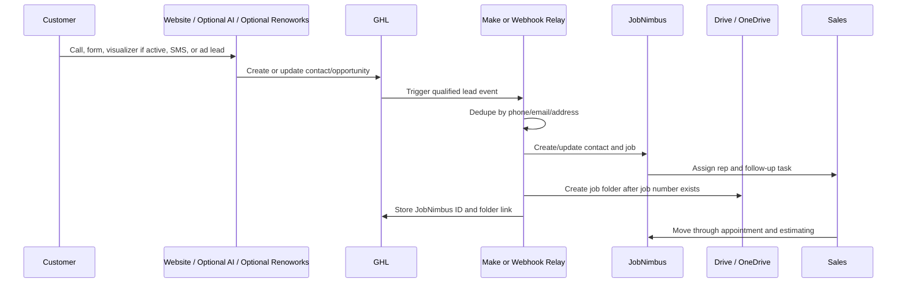
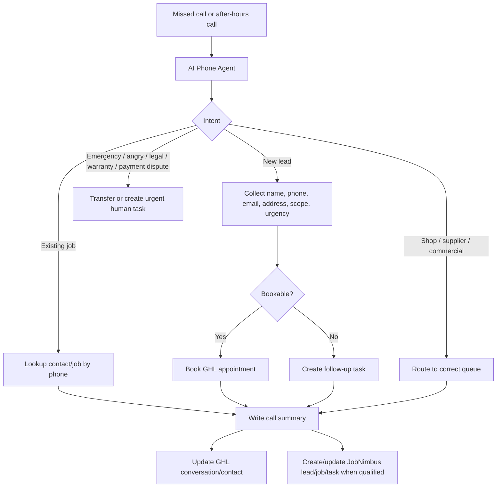

# IronWrap Task 1: Internal Operating System Execution Plan

> Superseded implementation reference. Use `final-spec-pack/00-final-decisions.md`,
> `docs/ACTIVATION-CHECKLIST.md`, and `SETUP-CHECKLIST.md` for current Google
> Workspace/Drive, QuickBooks Payments, and Worker-bus truth.

Date: 2026-06-27
Scope: IronWrap internal business system only. This is not the external metal-layout SaaS.

## Goal

Build and ship IronWrap OS for leads, calls, booking,
CRM, proposals, visualization, field work, materials, finance, reviews,
documents, reporting, and automation.

The default rule: use existing tools first, custom-build only the missing glue
and the pieces that create IronWrap-specific advantage.

## Self-Audit Of This Plan

This plan is intended to be buildable. The first version was too text-heavy and
did not make vendor/API alternatives or system flow obvious enough. This version
adds diagrams, explicit AI phone-agent options, fallback tools, and the API
surfaces needed to ship the system.

Still intentionally out of scope:

- The external SaaS for metal panel layout.
- A custom CRM replacement.
- Custom accounting.
- Full production ERP implementation before the material-request flow works.

## Current Truth

- JobNimbus account exists but is underconfigured.
- Make already has scenarios touching GHL, JobNimbus, and OneDrive/folders.
- GHL exists and should remain the lead, nurture, SMS, review, and AI front-door layer unless it fails a real test.
- Current incoming lead volume is low, so the main near-term risk is overpaying
  for unused systems, not missing high-volume automation capacity.
- JobNimbus should become the canonical customer/job/task/pipeline record.
- QuickBooks should remain accounting truth only.
- Renoworks is not active yet but is important for website visualization and lead intent.
- NaturalForms is not active yet and should be added only if JobNimbus forms/mobile cannot cover field paperwork.
- Paradigm is not active yet and should wait until materials/shop flow is clean.
- AppliCad XML already contains structured geometry. Use that before OCR.
- RoofRuler PDFs provide measurements, but some siding/gutter/soffit reports are image-heavy.
- Credentials were shared in chat and must be rotated before production work.

## Final Low-Volume Corrections

These corrections override any earlier "full stack" interpretation of Task 1.

1. Build the operating backbone first: JobNimbus cleanup, GHL intake, Make audit,
   job numbering, folders, appointment flow, proposal path, and review/payment
   follow-up.
2. Treat AI receptionist as a controlled pilot first: missed-call recovery,
   after-hours calls, and scripted test calls. Do not replace human live-answer
   flow until real recordings prove it helps.
3. Do not buy Renoworks, NaturalForms, Paradigm, or non-GHL voice platforms
   during build/config/test unless a specific blocker appears.
4. Roof reports are per-qualified-job spend. Do not budget `60 reports/month`
   unless current sales volume proves that number.
5. Use JobNimbus/GHL reports and a simple exceptions view before building a
   custom dashboard.
6. Custom code is limited to glue that existing tools cannot do safely:
   dedupe/idempotency, audit logging if Make logs are insufficient, document
   parsing, proposal generation if JobNimbus proposals are weak, and AI tool
   handlers only after the voice provider is chosen.
7. Security/access hardening remains the final phase after build/config/test,
   but no new production work should depend on pasted shared credentials.

Buy/upgrade gates:

| Item | Do Not Buy Yet | Buy / Upgrade When |
|---|---|---|
| GHL AI / Voice AI | If humans can answer and missed-call flow is enough | Missed calls, after-hours calls, or delayed response are losing real leads |
| Vapi / ElevenLabs / Retell | While GHL voice passes evals | GHL fails booking, transcript, transfer, or call-quality tests |
| Renoworks | Before website visualizer is part of the sales strategy | Visualizer-led leads or proposal demos are a deliberate sales channel |
| RoofRuler volume budget | Before qualified job volume proves it | Per-report usage becomes predictable enough to negotiate/forecast |
| NaturalForms | While JobNimbus mobile/checklists work | Field paperwork fails because of offline, GPS, conditional forms, or UX |
| Paradigm | Before material request format is stable | Manual material requests are repeatable and shop volume/errors justify setup |
| Custom dashboard | While reports plus exceptions are enough | Owner cannot see daily blockers across tools without manual chasing |

## Source Of Truth Map

| Area | System Of Record | Notes |
|---|---|---|
| Lead source and marketing attribution | GHL | Website, ads, calls, Renoworks forms, review campaigns |
| Phone/SMS conversations | GHL first | Human-first live calls; AI starts with missed-call/after-hours pilot |
| Appointment booking | GHL Calendar first | Cal.com only if GHL booking is insufficient |
| Customer/contact | JobNimbus | GHL can mirror lead/contact data |
| Job/project | JobNimbus | Canonical job number should live here |
| Job folders/files | Drive or OneDrive | Archive only, not truth |
| Estimate/proposal status | JobNimbus | Proposal HTML/PDF can be custom |
| Visualization | Renoworks later | Defer until visualizer-led selling is intentional |
| Measurements | Attachments plus parsed data | AppliCad XML, RoofRuler PDFs, OCR fallback |
| Field forms | JobNimbus or NaturalForms | Use NaturalForms if offline/GPS/forms are required |
| Materials request | JobNimbus first | Paradigm later, after manual material flow works |
| Production/shop/inventory | Paradigm later | Do not start here |
| Invoices/payments/accounting | QuickBooks | No broad two-way sync until tested |
| Automation logs | Make plus custom log table | Every mutation needs traceability |
| Ops dashboard | JobNimbus/GHL reports plus exceptions view | Custom dashboard only if reporting gaps persist |

## System Diagrams

### Operating System Map

### Lead-To-Job Flow

### AI Missed-Call / After-Hours Flow

### Proposal And Production Flow

```mermaid
flowchart LR
  JN["JobNimbus Job"] --> Docs["Measurement Docs + Photos"]
  Docs --> Extract["Parser / OCR / Human Review"]
  Extract --> Estimate["Internal Estimate Workspace"]
  Renoworks["Optional Renoworks Visualizer"] --> Estimate
  Estimate --> Proposal["HTML Proposal + PDF Export"]
  Proposal --> Sign["Approval / Signature"]
  Sign --> Deposit["Deposit Request"]
  Deposit --> Materials["Material Request"]
  Materials --> Shop["Shop / Supplier / Later Paradigm"]
  Shop --> Schedule["Ready To Schedule"]
  Schedule --> Complete["Completion Form"]
  Complete --> Invoice["QuickBooks Final Invoice"]
  Invoice --> Review["Review Request"]
```

## Cheap / Free Defaults

| Need | Default | Cheap Alternative | Custom Alternative |
|---|---|---|---|
| AI receptionist | GHL Voice AI / AI Employee | Vapi, ElevenLabs, Retell, Bland, Telnyx | Twilio + OpenAI Realtime or LiveKit Agents |
| Phone number/calls | Existing GHL/LeadConnector/Twilio setup | Twilio, Telnyx, ElevenLabs phone/SIP | SIP + LiveKit |
| Booking | GHL Calendar | Cal.com free/self-hosted | Custom booking page |
| Automation | Existing Make | n8n self-hosted if Make cost grows | Cloudflare Workers queues/webhooks |
| Database/logs | None if Make logs are enough | Neon/Supabase free | Postgres on VPS |
| Webhooks/API relay | Make first | Cloudflare Workers free/low cost | Small Node service |
| OCR | Deterministic extraction first | Tesseract/PaddleOCR local | Mistral OCR 4 for hard docs |
| PDF generation | HTML + Playwright | WeasyPrint | Paid PDF API only if scaling pain appears |
| E-sign | JobNimbus/native first | DocuSeal self-hosted | PandaDoc only if sales workflow requires it |
| Dashboard | JobNimbus/GHL reports first | Google Sheet/Looker Studio | Custom dashboard |
| File storage | Existing Drive/OneDrive | Google Drive | Custom object storage only if needed |

## Alternative Tools And API Options

### AI Phone Agent Options

| Option | Use When | API / Integration Surface | Keep / Reject Rule |
|---|---|---|---|
| GHL Voice AI / AI Employee | Fastest path because GHL is already in stack | GHL Voice AI APIs, workflows, calendars, contacts | Keep if it answers, qualifies, logs, and books reliably |
| ElevenLabs Conversational AI / ElevenAgents | Natural voice quality matters, and SIP/Twilio integration is acceptable | Twilio integration, SIP trunking, webhook tools, MCP/tools | Keep if call quality beats GHL without making CRM sync messy |
| Retell AI | Need managed phone agents with webhooks and pay-as-you-go | Inbound call/SMS webhook, call events, call analysis | Keep if pricing and webhook model are simpler than ElevenLabs |
| Vapi | Developer-friendly voice agent with server URLs and tools | Server URL events, tool calling, phone APIs | Keep if custom tool calling is the main need |
| Bland AI | Quick outbound/inbound experiments | Voice-agent APIs and webhooks | Keep only if it beats Retell/Vapi in real call tests |
| Telnyx Voice AI | Want telephony and voice AI under one carrier-style platform | Telnyx Voice AI, SIP, telephony APIs | Keep if replacing Twilio/GHL telephony is desirable |
| Twilio + OpenAI Realtime | Need full control and custom routing | Twilio Media Streams/WebSockets, OpenAI Realtime API | Build only if managed platforms fail |
| LiveKit Agents | Need open-source/custom realtime voice infra | LiveKit telephony/SIP, agents, model providers | Build only if we need long-term platform control |

Default test order:

1. GHL Voice AI because it is already in the stack.
2. Vapi if GHL fails tool calling, webhooks, booking, or logs.
3. ElevenLabs if GHL/Vapi work operationally but voice quality is the blocker.
4. Retell, Bland, or Telnyx only as benchmark options.
5. Twilio + OpenAI Realtime or LiveKit only if control matters more than setup speed.

Cost sanity notes as of 2026-06-27, verify before purchase:

- HighLevel AI Employee has pay-per-use, Growth, and Unlimited options; phone-system charges can still apply.
- ElevenAgents publishes plan-based included call minutes plus additional call-minute pricing.
- Vapi is usage-based and passes model costs through; concurrency lines can add cost.
- Retell positions itself as pay-as-you-go.
- Bland publishes plan-based connected-minute rates.
- Telnyx positions Voice AI as pay-as-you-go or volume contract pricing.
- The real bill is always: platform minutes + telephony + LLM + STT/TTS + SMS + concurrency + compliance add-ons.

Selection rule:

- Cheapest is not automatically best. For IronWrap, the winning agent is the one that handles Canadian phone calls clearly, books correctly, writes clean CRM notes, transfers safely, and does not create duplicate leads.

### Automation Options

| Option | Use When | Notes |
|---|---|---|
| Make | Keep existing scenarios, fast configuration, broad app coverage | Current default; must add logging and failure discipline |
| n8n self-hosted | Make cost/limits become painful or we need code-like ownership | Cheap but becomes our ops burden |
| Cloudflare Workers | Need small reliable webhook relay, validation, logging, retries | Good for custom glue without a server |
| Pipedream | Fast developer automation and API glue | Good alternative to Make/n8n for code-heavy workflows |
| Zapier | Non-technical admin workflows | Usually more expensive for complex branching |

### CRM / Job Management Options

| Option | Role |
|---|---|
| JobNimbus | Default internal job CRM; already present |
| AccuLynx | Roofing CRM alternative if JobNimbus fails later |
| Jobber / ServiceTitan | Broader field-service alternatives; likely too generic or expensive for current scope |
| Custom CRM | Rejected for Task 1 |

### Proposal / Signature Options

| Option | Role |
|---|---|
| JobNimbus estimates/templates | First thing to test |
| Custom HTML + PDF | Best IronWrap-specific proposal path |
| DocuSeal / Documenso | Cheap/self-hosted e-sign fallback |
| PandaDoc | Paid polished proposal/signature suite |
| DocuSign | Standard e-sign, less proposal-specific |

### Document / OCR Options

| Option | Role |
|---|---|
| AppliCad XML parser | First choice for roof geometry where available |
| `pdftotext` / local PDF parsing | First choice for text-based RoofRuler PDFs |
| Tesseract | Free OCR fallback |
| PaddleOCR | Stronger open-source OCR/document extraction option |
| Mistral OCR 4 | Paid/high-quality OCR for hard layouts, handwriting, multilingual docs |
| Google Cloud Vision / Document AI | Paid OCR alternative if Google stack is preferred |

### Hosting / Data Options

| Option | Role |
|---|---|
| Cloudflare Workers | Webhooks, relay, small APIs, health checks |
| Supabase / Neon | Postgres for audit logs, dashboard, mapping tables |
| Vercel / Netlify | Proposal frontend or small admin UI |
| Railway / Render / Fly.io | Small Node service if Workers are too constrained |
| Google Sheets | Temporary audit dashboard only |

## Integration API Matrix

| System | Needed API Surface | Direction | Notes |
|---|---|---|---|
| GHL / LeadConnector | Contacts, opportunities, conversations, workflows, calendars, webhooks, Voice AI APIs | In/out | Front door for leads, SMS, AI, booking |
| JobNimbus | Contacts, jobs, tasks, notes, attachments, boards/statuses, automations/webhooks, API keys | In/out | Canonical job/customer system |
| Make | Scenario triggers, webhooks, error handlers, data stores if used | In/out | Existing glue layer; must be audited |
| QuickBooks Online | Customers, products/services, estimates/invoices, payments, webhooks | Mostly out from JobNimbus/approved flow | Accounting truth; avoid messy two-way sync |
| Drive / OneDrive | Create folder, rename folder, upload files, permission links | Out | Archive only |
| Renoworks | Lead capture, selected products/colors, visualizer link/embed, analytics export if available | In | Must map product interest into CRM |
| AI Voice Provider | Call events, transcripts, tool calls, transfers, recordings, phone/SIP config | In/out | Provider chosen after real call tests |
| Calendar | Appointment availability, booking, cancel/reschedule | In/out | GHL Calendar first |
| OCR / Parser | File input, extracted text/blocks/tables, confidence, reviewed state | In | Never writes final price without human review |
| Proposal Generator | Job data in, HTML/PDF out, view/accept/sign state back | In/out | Custom if JobNimbus templates are too weak |
| NaturalForms | Form submissions, PDFs, metadata, GPS/offline state if available | In | Only if field UX requires it |
| Paradigm | Material/production order API or import format | Out/in later | Do not integrate until material request shape is stable |

## Core Data Events

These are the events the system should recognize. Each event needs an idempotency
key so retries do not create duplicates.

| Event | Producer | Consumer | Required Outcome |
|---|---|---|---|
| `lead.created` | GHL, website, Renoworks, ads, phone agent | Dedupe relay, JobNimbus | Contact/opportunity/job task exists |
| `call.completed` | AI voice provider or GHL | GHL, JobNimbus | Transcript, summary, next action |
| `appointment.booked` | GHL Calendar | JobNimbus | Calendar/task/status updated |
| `job.qualified` | JobNimbus or sales action | Folder automation | Canonical folder created once |
| `measurement.uploaded` | Staff or folder watcher | Parser/OCR | Extracted metrics or review-needed flag |
| `proposal.sent` | Proposal tool or JobNimbus | GHL, JobNimbus, folder | Status, PDF/archive, follow-up |
| `proposal.accepted` | Proposal/signature tool | JobNimbus, QuickBooks task | Signed/deposit workflow starts |
| `deposit.paid` | QuickBooks/payment flow | JobNimbus, materials workflow | Materials task/request starts |
| `materials.ready` | Office/shop/Paradigm later | JobNimbus | Scheduling task/status updated |
| `job.completed` | Field form/JobNimbus | QuickBooks/review flow | Invoice and review sequence starts |
| `invoice.paid` | QuickBooks | JobNimbus/folder/archive | Close/archive workflow |
| `automation.failed` | Make/relay | Admin | Alert and retry/manual fix task |

## Module 0: Preflight Access Containment

I will:

- Stop using credentials pasted into chat for any new production integration.
- Identify which accounts, API keys, webhooks, and Make connections are live.
- Use sandbox/test records wherever possible while building and configuring.
- Avoid creating broad new admin/API access until the workflows are proven.
- Keep a running access inventory so final hardening is not guesswork.

Done when:

- We know which credentials and connections exist.
- We know which connections are safe to use for testing.
- No new production workflow depends on a shared personal login.
- Any live write access used during testing is explicitly approved and logged.

## Module 1: Current-State Audit

I will audit:

- GHL locations, numbers, calendars, forms, funnels, workflows, pipelines, AI settings.
- Make scenarios, connections, webhooks, error handling, schedules, and folder mutations.
- JobNimbus boards, statuses, fields, forms, templates, automations, integrations, API keys, users.
- QuickBooks connection state, products/services, customers, invoice/deposit behavior.
- Drive/OneDrive folder structure and naming.
- Website forms and lead destinations.
- Existing RoofRuler/AppliCad/Renoworks-style files.

Done when:

- We have an inventory of every live automation.
- Every workflow is tagged as keep, fix, pause, or delete.
- We know which system currently creates leads, jobs, folders, invoices, and tasks.

## Module 2: Canonical Data Model

I will define the minimum shared schema:

- Contact: name, phone, email, address, lead source, consent, owner, tags.
- Lead: source, campaign, service interest, urgency, insurance flag, location, notes.
- Job: canonical job number, customer, property, division, scope, stage, owner, crew, dates.
- Scope: roof, siding, gutter, soffit, fascia, commercial, shop/supply.
- Measurement package: provider, report files, extracted metrics, confidence, reviewed by.
- Proposal: version, options, price bands, selected products, visualizer link, sent/signed state.
- Finance: deposit status, invoice status, payment method, financing interest.
- Materials: product profile, color, supplier, list status, shop status, ready status.
- Communication: call transcript, SMS/email history, next follow-up.

Done when:

- GHL, JobNimbus, Make, and folders use the same IDs and field names.
- No automation depends on parsing free-text notes when a structured field exists.

## Module 3: Job Numbering And Folder Rules

Default decision:

- JobNimbus owns canonical job number.
- GHL lead number can exist, but it is not the job number.
- Folder name is derived from JobNimbus job number plus customer/property label.

I will implement:

- Job number format decision, likely `26-###-TYPE` or IronWrap's final preferred format.
- Folder naming convention.
- Duplicate prevention before folder creation.
- Folder rename only after canonical job number exists.
- One folder per job, linked back into JobNimbus and GHL.

Done when:

- A lead cannot create two job folders.
- A folder cannot be renamed by two competing Make scenarios.
- JobNimbus, GHL, and Drive/OneDrive all show the same canonical job reference.

## Module 4: Lead Intake

Sources to cover:

- Website contact form.
- Phone calls.
- SMS.
- Email.
- Facebook/Google leads.
- Renoworks visualizer leads.
- Manual office entry.
- Referrals.
- Commercial/shop inquiries.

I will build one intake path:

1. Capture lead in GHL.
2. Dedupe by phone/email/address.
3. Enrich with source, service interest, urgency, and notes.
4. Create or update JobNimbus contact/job.
5. Assign rep or queue.
6. Create follow-up task.
7. Create folder only when lead qualifies as a real job opportunity.
8. Log every action.

Done when:

- Every lead source lands in one queue.
- New leads get a response path.
- Duplicate leads update existing records instead of creating noise.

## Module 5: AI Receptionist And Booking Agent

Primary build path:

- Use GHL Voice AI / AI Employee first because IronWrap already has GHL.
- Configure missed-call recovery first.
- Configure after-hours inbound receptionist second.
- Route normal business-hours calls to humans until AI call recordings prove
  the agent improves response quality.
- Configure outbound follow-up only after inbound/missed-call behavior works.

Provider shortlist:

- GHL Voice AI / AI Employee for lowest integration friction.
- ElevenLabs Conversational AI / ElevenAgents for better voice quality and SIP/Twilio paths.
- Vapi for developer-friendly webhooks and tool calls.
- Retell as a managed benchmark option.
- Twilio + OpenAI Realtime if we need full control over prompts, tools, logs, and routing.
- LiveKit Agents if we want open-source realtime voice infrastructure.

Capabilities:

- Answer inbound calls.
- Identify caller and intent.
- Capture name, phone, email, address.
- Classify service: roof, siding, gutter, soffit, fascia, commercial, supply/shop, warranty, emergency.
- Ask insurance/hail questions where relevant.
- Answer basic FAQ from approved knowledge base.
- Book appointment into GHL calendar.
- Create/update contact and opportunity.
- Trigger JobNimbus creation/update after qualification.
- Escalate urgent, angry, complex, commercial, legal, warranty, and payment disputes to a human.
- Send call summary to GHL and JobNimbus.
- Add follow-up task if not booked.

Tool calls the agent needs:

- `lookup_contact_by_phone`
- `create_or_update_contact`
- `create_or_update_lead`
- `get_available_appointment_slots`
- `book_appointment`
- `create_jobnimbus_task`
- `create_jobnimbus_note`
- `send_sms_confirmation`
- `transfer_to_human`
- `log_call_summary`

Fallback build path if GHL is too limited:

- Vapi, ElevenLabs, or Retell for fast managed AI phone agents.
- Twilio + OpenAI Realtime for maximum control.
- LiveKit Agents for open-source/custom voice infrastructure.

Guardrails:

- The assistant cannot quote final prices.
- The assistant cannot promise schedule availability beyond calendar slots.
- The assistant cannot make warranty/legal/insurance determinations.
- The assistant must disclose it is an AI assistant if required by policy or local practice.
- All calls are logged with transcript and handoff summary.

Knowledge base:

- Company identity and service area.
- Services: metal roofing, siding, gutters, soffit, fascia, commercial exteriors, shop/supply.
- Hail/insurance positioning approved by IronWrap.
- Financing/deposit language approved by IronWrap.
- Appointment rules and service-area constraints.
- What the agent must not answer: legal, warranty determinations, final pricing, insurance coverage, disputes.

Human handoff triggers:

- Angry customer.
- Existing active job issue.
- Warranty/service complaint.
- Payment dispute.
- Commercial/large custom project.
- Supplier/shop/wholesale inquiry above simple intake.
- Emergency or safety concern.
- Caller asks for a human.
- Confidence is low.

Evaluation calls:

- New homeowner asking for metal roof estimate.
- Hail/insurance lead.
- Siding lead.
- Gutter-only lead.
- Commercial lead.
- Shop/supply inquiry.
- Existing customer asking for job status.
- Angry customer.
- Missed call recovery.
- Duplicate lead with same phone number.
- Caller refuses email or address.

Pilot done when:

- Test callers can call, qualify, book, and appear in GHL/JobNimbus.
- Failed calls create a human task.
- Staff can read the call summary without listening to the whole recording.
- Provider choice is backed by real call recordings/transcripts, not vendor demos.

Production switch happens only when:

- Missed-call/after-hours pilot handles real calls cleanly.
- Human handoff works every time.
- Duplicate-contact/job rate is effectively zero.
- Ilya approves recordings, summaries, and escalation behavior.

## Module 6: Booking And Calendar

Default:

- Use GHL Calendar.

I will configure:

- Appointment types by service.
- Territories/service areas.
- Buffers and working hours.
- Assignment rules for Ilya, residential sales, commercial, shop/materials.
- Confirmation SMS/email.
- Reschedule/cancel links.
- No-show follow-up.
- JobNimbus calendar/task mirror if needed.

Done when:

- AI, website, and staff all book into the same system.
- Booked appointments create JobNimbus tasks/events.
- The customer receives confirmation.

## Module 7: JobNimbus Rebuild

I will configure:

- Boards for Residential, Commercial, and Shop/Supply only if their workflows differ.
- Stages:
  Lead, Appointment, Estimating, Proposal Sent, Pending Signature, Signed,
  Deposit, Materials, Scheduled, In Progress, Completion, Invoice, Closed Won,
  Closed Lost.
- Role profiles: owner/admin, office, sales, estimator, production, field tech, subcontractor.
- Fields for roof/siding/gutter/soffit/fascia/materials/finance.
- Task types and note types.
- Attachment categories.
- Lead sources.
- Templates for tasks, emails, estimates, and internal checklists.

Done when:

- JobNimbus can run a real job without Make hacks or free-text workarounds.
- Each stage has required fields and next actions.

## Module 8: Website And Optional Renoworks Flow

Default low-volume path:

1. Keep the website contact path simple.
2. Send every form/phone/SMS lead into GHL.
3. Track source, service interest, address, and urgency.
4. Use manual photos/product references in proposals before buying visualizer
   infrastructure.

If Renoworks is purchased, I will design the path as:

1. Visitor lands on IronWrap site.
2. Visitor uploads home photo or selects visualizer.
3. Visitor changes roof/walls/colors/products.
4. Renoworks captures product interest and engagement.
5. Lead submits contact info.
6. GHL receives lead and selected preferences.
7. JobNimbus gets a lead/job after qualification.
8. Proposal can include Renoworks link or embedded visualizer.

Done when:

- Website leads reliably reach GHL and JobNimbus after qualification.
- If Renoworks is active, lead data does not stay trapped in Renoworks.
- If Renoworks is active, product/color interest becomes structured CRM data.
- If Renoworks is active, sales can see what the customer played with before calling.

## Module 9: Measurements, OCR, And Document Intake

Order of preference:

1. Parse structured exports like AppliCad XML.
2. Extract text/tables from normal PDFs with local tools.
3. Use OCR for image-heavy PDFs.
4. Use Mistral OCR 4 for hard, multilingual, handwritten, or layout-sensitive docs.
5. Human review before numbers become pricing/material truth.

I will build:

- Measurement package upload convention.
- Parser for AppliCad XML basics.
- PDF text extraction for RoofRuler reports.
- OCR fallback queue.
- Extracted metrics table.
- Confidence/review status.
- Attachment back to JobNimbus.

Done when:

- Roof area, facets, pitch, eaves, rakes, ridges, valleys, flashing, siding/gutter relevant measurements can be captured or flagged.
- The system never silently trusts low-confidence extraction.

## Module 10: Proposal And Quote Packet

I will build a proposal flow:

- Internal estimate workspace.
- Customer-facing HTML proposal.
- PDF export.
- Renoworks visualizer link/embed.
- Product/color/options.
- Good/better/best options where useful.
- Deposit/payment instructions.
- Financing option if approved.
- Contract/signature path.
- Version history.
- JobNimbus attachment and status update.

Default stack:

- HTML proposal template plus Playwright PDF export.
- JobNimbus native signing/templates if sufficient.
- DocuSeal if cheap self-hosted e-sign is needed.
- PandaDoc only if IronWrap wants a polished paid proposal/signature suite.

Done when:

- Sales can send a proposal from a job record.
- Customer can view it on mobile.
- Signed/accepted state returns to JobNimbus.
- PDF is archived to the job folder.

## Module 11: Forms And Field Operations

Forms to cover:

- Work order.
- Additional/change work order.
- Equipment and machinery request.
- Completion form.
- Inspection form.
- Materials request.
- Safety form.
- Contract/signature form if not handled elsewhere.
- Invoice/receipt references from QuickBooks.
- Material list.
- Customer approval.
- Warranty/service issue.

Default:

- Use JobNimbus tasks/forms/checklists if enough.
- Add NaturalForms if offline mode, GPS stamp, conditional forms, or field UX requires it.

Done when:

- Field staff can complete required paperwork on mobile.
- Office sees completed forms on the job.
- Material requests and completion forms trigger the right next action.

## Module 12: Materials, Suppliers, And Shop

Current state:

- JobNimbus supplier settings show connection buttons for SRS, ABC, and QXO.
- Supplier/shop flow is not production-ready yet.

I will implement in two levels:

Level 1:

- Simple material request form.
- JobNimbus task and attachment.
- Office/shop review.
- Supplier/order status fields.
- Ready-for-scheduling trigger.

Level 2:

- Paradigm integration after the request format is stable.
- Rollforming/production order mapping.
- Inventory/shop status.
- B2B supply-only workflow.

Done when:

- Installers stop texting ad hoc material lists.
- Materials status is visible before scheduling.
- Paradigm is not introduced until the manual flow is proven.

## Module 13: QuickBooks, Payments, And Financing

I will configure conservatively:

- QuickBooks owns invoices, receipts, payments, tax, accounting.
- JobNimbus can trigger invoice-prep tasks or approved sync only after tests.
- No automatic invoice creation from messy pipeline states.
- Deposit due, deposit paid, final invoice due, paid, overdue fields visible in JobNimbus.
- Payment reminders via GHL or QuickBooks.
- Moneris/Interac/FinanceIT options validated before being added to customer proposal.

Done when:

- A signed job can request deposit.
- A completed job can issue final invoice.
- Payment status is visible without staff checking three systems.
- Failed/overdue payment creates follow-up.

## Module 14: Review Chasing And Customer Follow-Up

I will build:

- Post-completion review request.
- Separate satisfied/issue branch.
- SMS and email sequence.
- Stop conditions: review left, customer complained, job not complete, invoice dispute.
- Internal alert for unhappy feedback.
- Optional testimonial/photo request.

Done when:

- Completed happy customers are asked for reviews automatically.
- Unhappy customers are routed to a human before public review pressure.

## Module 15: Reporting And Ops Dashboard

Dashboard metrics:

- New leads by source.
- Speed to lead.
- Missed calls.
- AI-handled calls.
- Booked appointments.
- Appointment show rate.
- Jobs by stage.
- Stale leads/tasks.
- Estimates sent.
- Proposals signed.
- Deposits pending.
- Materials pending.
- Jobs ready to schedule.
- Jobs complete not invoiced.
- Invoices overdue.
- Reviews requested/received.
- Make failures.
- Integration disconnects.

Default:

- Use JobNimbus/GHL reports where enough.
- Add a simple exceptions sheet/view before building a custom dashboard.
- Build a lightweight custom dashboard only for cross-system gaps that staff
  cannot manage from existing reports.

Done when:

- Owner can see daily exceptions without opening every tool.
- Staff knows what to do next.

## Module 16: Automation Architecture

Rules:

- Every automation has one owner.
- Every automation has one trigger.
- Every mutation writes a log.
- Every failure creates an alert or retry.
- No hidden business logic in scenario names.
- No broad two-way sync unless absolutely needed.
- Human approval gates remain for pricing, contracts, accounting, and complex customer issues.

Core automations:

- New GHL lead to JobNimbus.
- New/qualified JobNimbus job to folder.
- Appointment booked to JobNimbus task/calendar.
- Proposal sent to status/task.
- Proposal accepted to signed/deposit workflow.
- Deposit paid to materials workflow.
- Materials ready to scheduling.
- Completion form to invoice/review workflow.
- Invoice paid to closed/archive.
- Missed call to AI/human follow-up.
- Make failure to admin alert.

Done when:

- Each automation can be tested with a fake lead/job.
- Each automation can be disabled without breaking unrelated workflows.

## Module 17: Custom Components We Actually Build

I will build only these if existing tools do not cover them cleanly:

1. Data mapping and dedupe service.
2. Webhook relay and audit logger only if Make logs/errors are insufficient.
3. AppliCad XML parser.
4. RoofRuler/PDF extraction and OCR queue.
5. Proposal HTML/PDF generator.
6. AI receptionist knowledge base and tool handlers after provider choice.
7. Lightweight ops dashboard only after reports/exceptions view fail.
8. Integration health checker.

Skipped until proven needed:

- Full custom CRM.
- Full custom accounting.
- Full custom field-form app.
- Full custom phone system.
- Full Paradigm bridge before manual material flow works.
- External metal-layout SaaS features.

## Module 18: QA And Launch Checks

Test cases:

- Website lead.
- Missed-call/after-hours phone lead answered by AI.
- Missed call.
- Existing customer calling again.
- Bad phone/email.
- Duplicate lead.
- Appointment booked.
- Appointment cancelled/rescheduled.
- Lead moved to estimate.
- Proposal sent.
- Proposal accepted.
- Deposit requested.
- Material request submitted.
- Job scheduled.
- Completion form submitted.
- Invoice requested.
- Review request sent.
- Automation failure.
- API key revoked.

Done when:

- Every critical path has a test record.
- Every failure mode creates a human-visible task or alert.
- Staff can run the workflow without me sitting beside them.

## Module 19: Final Security And Access Hardening

This phase happens after the system is built, configured, and tested, but before
full production launch.

I will:

- Rotate every credential that was pasted into chat or used during build/testing.
- Revoke old sessions, stale API keys, and temporary test credentials.
- Enable MFA everywhere possible.
- Replace shared logins with named users.
- Create service/API accounts where supported.
- Store credentials in a password manager, not docs, prompts, chats, or Make notes.
- Create least-privilege access profiles for API keys.
- Lock down GHL, JobNimbus, Make, QuickBooks, Drive/OneDrive, AI voice, OCR, and proposal-tool access.
- Define field-level allowlists per integration.
- Confirm finance data does not leak into AI transcripts, Make logs, broad CRM notes, or shared folders.
- Confirm call-recording, AI disclosure, CASL/DNCL, consent, retention, and deletion rules.
- Create a vendor/DPA/subprocessor register for every active production vendor.
- Confirm every automation has a kill switch and owner.
- Document owner, billing owner, admin owner, and backup owner per tool.

Done when:

- No exposed or temporary credential remains valid.
- Every production integration key has an owner, purpose, scope, and rotation date.
- Every human user has named access and MFA where available.
- Every vendor handling customer data has an approved privacy/security row.
- Every outbound communication checks consent before sending.
- Every call recording/transcript flow has notice, retention, and access rules.
- Every failed automation creates an owner-assigned alert or task.

## Final Ship Definition

Task 1 is shipped when:

- Leads from website, phone, ads, and manual entry are captured.
- Renoworks leads are captured if Renoworks is active.
- AI missed-call/after-hours pilot can qualify, book, summarize, and escalate.
- Full AI live answering is enabled only if the pilot passes real-call evals.
- GHL and JobNimbus are synchronized without duplicates.
- JobNimbus fields and boards reflect IronWrap's real work.
- Job folders are created and linked consistently.
- Measurement docs are attached and key data can be extracted or flagged.
- Proposal HTML/PDF flow works.
- Field forms/material requests have a clear path.
- QuickBooks/payment flow is controlled and tested.
- Review/payment follow-up works.
- Owner has an exception dashboard.
- Staff has SOPs.
- Final security/access hardening is complete.

## Source Notes

- HighLevel API v1 reached end-of-support on 2025-12-31; new integrations should use current OAuth/API paths.
- HighLevel has Voice AI, AI Agent Studio, calendars, workflows, webhooks, and public Voice AI APIs.
- JobNimbus has Open API/API keys, Make modules, webhooks from automations, QuickBooks integration, HOVER, suppliers, and naturalForms integration paths.
- ElevenLabs Conversational AI supports managed voice agents, webhooks/tools, Twilio integration, and SIP trunking.
- Twilio plus OpenAI Realtime is viable for custom phone agents, but it is more engineering than GHL Voice AI.
- LiveKit Agents is an open-source/custom alternative for realtime voice AI.
- Retell/Vapi/Bland/Telnyx are managed voice-agent alternatives when speed matters more than full control.
- Cal.com is a cheap/free booking fallback.
- Cloudflare Workers, Neon/Supabase, n8n self-hosted, Tesseract/PaddleOCR, DocuSeal, and Playwright PDF are the cheap/default custom stack options.

Reference URLs:

- https://help.gohighlevel.com/support/solutions/articles/48001060529-highlevel-api-documentation
- https://help.gohighlevel.com/support/solutions/articles/155000004107-how-to-create-voice-ai-agents
- https://help.gohighlevel.com/support/solutions/articles/155000006058-how-to-use-the-ai-agent-studio-in-highlevel
- https://www.gohighlevel.com/ai-employee/pricing
- https://marketplace.gohighlevel.com/docs/
- https://support.jobnimbus.com/how-do-i-create-an-integration-using-jobnimbuss-open-api
- https://support.jobnimbus.com/how-do-i-create-an-api-key
- https://support.jobnimbus.com/what-are-the-different-actions-i-can-have-an-automation-execute
- https://apps.make.com/jobnimbus
- https://support.naturalformsapp.com/hc/en-us/articles/360010507894-JobNimbus-naturalForms-Integration
- https://elevenlabs.io/docs/conversational-ai/overview
- https://elevenlabs.io/docs/conversational-ai/phone-numbers/twilio
- https://elevenlabs.io/docs/conversational-ai/phone-numbers/sip-trunking
- https://elevenlabs.io/pricing
- https://www.twilio.com/en-us/voice/pricing/ca
- https://www.twilio.com/code-exchange/ai-voice-assistant-openai-realtime-api
- https://developers.openai.com/api/docs/pricing
- https://livekit.com/pricing
- https://www.retellai.com/pricing
- https://docs.retellai.com/deploy/phone-call
- https://vapi.ai/pricing
- https://docs.vapi.ai/calls
- https://docs.bland.ai/platform/billing
- https://telnyx.com/products/voice-ai
- https://telnyx.com/pricing/ai-agent
- https://cal.com/pricing
- https://developers.cloudflare.com/workers/platform/pricing/
- https://neon.com/pricing
- https://supabase.com/pricing
- https://n8n.io/pricing/
- https://docs.mistral.ai/studio-api/document-processing/basic_ocr
- https://mistral.ai/news/ocr-4/
- https://github.com/tesseract-ocr/tesseract
- https://github.com/PaddlePaddle/PaddleOCR
- https://www.docuseal.com/on-premises
- https://www.renoworks.com/manufacturers/integrations/
