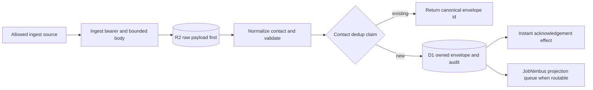

# Worker surface and the path of an inbound lead

Status: source-level component map
Owner: IronWrap OS product owner
Last verified: 2026-08-24
Review trigger: Worker route, guard, lead authority, or outbound-effect change

## Truth boundary

This page maps stable route families and the owned generic lead-ingest path. It is intentionally not
an exhaustive endpoint inventory, an environment URL registry, or a runtime-status report. Exact
dispatch and method handling live in `workers-bus/src/index.ts`, `workers-bus/src/app-api.ts`, and
their delegated handlers.

A route in source is only **Implemented**. Deployment, reachability, provider configuration, and
successful delivery require fresh release and runtime evidence. Use
[`CAPABILITY-MATRIX.md`](CAPABILITY-MATRIX.md) for current implementation gaps and
[`AUTHORITY-AND-EVIDENCE-CONTRACT.md`](AUTHORITY-AND-EVIDENCE-CONTRACT.md) for the proof boundary.
The repository does not establish a canonical public Worker base URL.

## HTTP boundary

`routeRequest` in `workers-bus/src/index.ts` is the top-level dispatcher. The table groups its
stable trust boundaries; each delegated handler still owns its exact methods, body limits,
validation, rate limits, idempotency, and authorization checks.

| Route family | Admission boundary | Source owner |
| --- | --- | --- |
| `/health` and `/ready` | Public liveness and reduced readiness; a valid admin bearer reveals the detailed readiness map | `workers-bus/src/index.ts` |
| `/public/*` and `/public/company-logo` | Public browser surface; estimator operations apply their own origin, Turnstile, and rate controls | `workers-bus/src/public-estimator.ts`, `workers-bus/src/index.ts` |
| `/api/v1/customer-portal/resolve`, `/acceptance/challenge`, `/acceptance/confirm`, and `/decision` | Opaque customer capability plus route-specific challenge, origin, expiry, and idempotency controls; invalid capabilities fail closed | customer-portal handlers called by `workers-bus/src/index.ts` |
| `/api/v1/auth/magic-link/request`, `/magic-link/consume`, `/device-pairing/consume`, and `/invites/accept` | Route-specific signed token, invite, pairing, and throttle controls; these entry routes do not require an existing app session | `workers-bus/src/app-api.ts` |
| Remaining application routes under `/api/v1/*` | Signed app session plus the route's role, action, CSRF, idempotency, and device requirements | `workers-bus/src/app-api.ts` and delegated domain handlers |
| `/ingest/photo`, `/ingest/measurement`, `/ingest/estimate`, `/ingest/<source>` | Dedicated ingest bearer, bounded body, and handler-specific validation; measurement and estimate accept idempotency keys | `workers-bus/src/index.ts` |
| `/ingest/facet-design` | Facet v2 rotating HMAC route authority; never the broad ingest bearer | `workers-bus/src/facet-design-ingest.ts` |
| `/webhook/quickbooks` | Intuit webhook signature validation; not an IronWrap bearer token | `workers-bus/src/quickbooks.ts` |
| `/webhook/newo*` | Newo handler-specific webhook identity and configuration | `workers-bus/src/newo.ts` |
| `/oauth/quickbooks/callback` | QuickBooks OAuth callback state and provider-response validation | QuickBooks OAuth handler called by `workers-bus/src/index.ts` |
| `/internal/v1/authority-records/*` | Timestamped request-body HMAC with a configured executor key, followed by actor/tenant/command binding | `workers-bus/src/authority-record-executor-api.ts` |
| `/admin/effects/*` | Effect-runtime bearer; claim, retry, reconcile, and settle remain separate from general administration and refuse every outside send (proposal publish and withdraw, customer and operations email), which only the bus executes; a `qa-synthetic-*` provider passes only on a synthetic Worker | effect-runtime handlers called by `workers-bus/src/index.ts` |
| Remaining `/admin/*` | Admin bearer plus route-specific method and input validation | `workers-bus/src/index.ts` and delegated admin handlers |

Application routes currently cover authentication and company administration; lead and operating
intake; search and role-specific work queues; jobs, work objects, assignments, work packages,
safety, fleet, inventory, and pipelines; Facet evidence; commercial approvals and proposals;
customer links; accounting and QuickBooks; Postiz; production; and service cases. This list describes
source domains, not environment readiness. Read `handleAppApi` for the exact current dispatch.

## Owned generic lead-ingest path

The flow below is specifically `ingestLead` in `workers-bus/src/lead-intake.ts`. Bearer-token
generic intake and authenticated office lead creation have different admission contracts, then
converge into this same envelope, deduplication, audit, and owned-store path. Public estimator,
Facet, measurement, photo, and provider webhook flows have their own handlers; do not infer that
every inbound record traverses this function.

The ordering is deliberate:

1. The raw payload is stored in R2 before downstream processing, so later failures do not erase the
   submitted evidence.
2. Normalized phone/email identity is deduplicated inside the configured window. A duplicate returns
   the already-owned envelope identity instead of creating a second operating lead.
3. The new canonical envelope and audit record are written to D1 before acknowledgement or provider
   projection is attempted.
4. Acknowledgement and JobNimbus delivery are downstream effects. Queueing an effect, or a status
   such as `pending_jn_push`, is not provider readback and does not prove external delivery.

## Outbound and runtime truth

The source tree contains bounded integrations for JobNimbus, QuickBooks, Newo, Postiz, Frappe
projection, email/SMS, and other effects. Their existence does not say which rails are configured,
enabled, reachable, or reconciled in any environment. Those claims may be made only from a fresh
named-environment readiness probe and release/effect receipts under the authority contract.

When this map and code disagree, code controls behavior and this component document must change in
the same pull request. When code and live provider state disagree, fail closed and use the release
and reconciliation evidence; never edit this file into a dated deployment snapshot.
