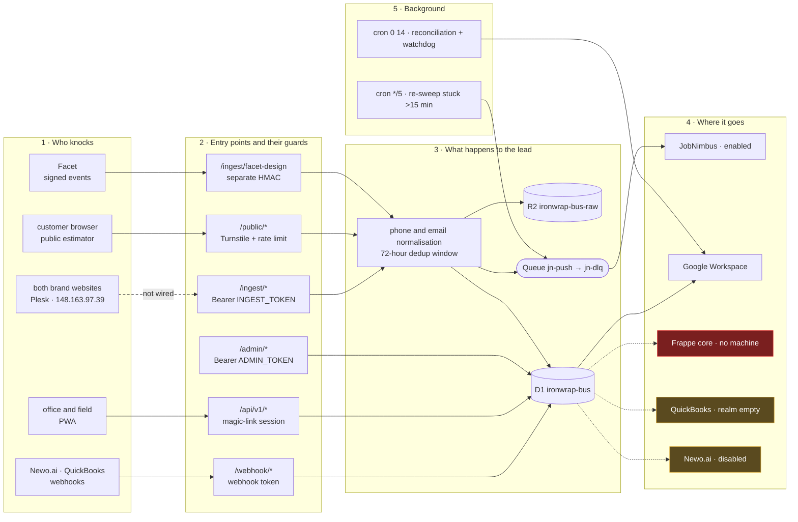

# Worker surface and the path of a lead

**What this page is.** The Worker's external HTTP surface — every route, what authenticates it, and
what it answers — followed by the path a lead takes through the system, from the form that submits
it to the record that results.

**What this page is not.** It is not the contract. The contract is the code: `workers-bus/src/index.ts`,
`src/app-api.ts` and `src/public-estimator.ts`. This page is a map drawn from that code on a stated
date, and a map goes stale — regenerate it against the deployed revision rather than trusting a table
when the two disagree.

**Provenance.** Both sections were written in the `iron-wrap-infra` repository between 2026-08-13 and
2026-08-17 and moved here on 2026-08-24. They were in the wrong place: an infrastructure record has no
CI that can notice when an application route changes, so they drifted unseen. Here they sit beside the
code they describe, under the documentation contract that checks them.

**Authority:** [`AUTHORITY-AND-EVIDENCE-CONTRACT.md`](AUTHORITY-AND-EVIDENCE-CONTRACT.md) governs what
a documented capability may claim. A route appearing below is evidence that it exists in source — not
that it is deployed, reachable, or proven.

---

## The Worker REST API

Source: `workers-bus/src/index.ts`, `src/app-api.ts`, `src/public-estimator.ts`.
Base: `https://ironwrap-bus.yellow-rain-7498.workers.dev`.

Global constraints: bodies capped by `MAX_BODY_BYTES` (`413 payload_too_large`), constant-time token
comparison, `401 unauthorized` on any failed credential.

### Open, no authentication

| Method | Path | Parameters | Response |
| --- | --- | --- | --- |
| `GET`/`HEAD` | `/health` | — | `200 {"ok":true}` — isolate liveness only |
| `GET`/`HEAD` | `/ready` | `?scope=core` — owned intake spine only | `200`/`503 {"ok":bool}`; with `Bearer <ADMIN_TOKEN>` returns the full `checks` map |
| `GET` | `/estimate` | `?brand=ironwrap\|iroof` | public estimator PWA route |
| `GET`/`POST` | `/public/instant-estimate*` | `brand`, form fields, Turnstile token | estimate; must carry no contact data |

### Intake — `Authorization: Bearer <INGEST_TOKEN>`

| Method | Path | Body and headers |
| --- | --- | --- |
| `POST` | `/ingest/website` | `first_name`, `last_name`, `phone`, `email`, `service`, `message`, `brand`, attribution `source_url`, `page_type`, `utm_*`. JSON or form-encoded. Returns `{envelope_id, status, duplicate, queue}` |
| `POST` | `/ingest/photo` | jobsite photo payload |
| `POST` | `/ingest/measurement` | measurement report; accepts `Idempotency-Key` |
| `POST` | `/ingest/estimate` | configurator handoff; accepts `Idempotency-Key` |
| `POST` | `/ingest/<source>` | generic route, lowercase letters |
| `POST` | `/ingest/facet-design` | **does not accept `INGEST_TOKEN`** — separate HMAC authority |

### Webhooks

| Method | Path | Authentication |
| --- | --- | --- |
| `POST` | `/webhook/quickbooks` | `QB_WEBHOOK_TOKEN`, checked against `QB_EXPECTED_REALM_ID` |
| — | `/webhook/newo`, `/webhook/newo/*` | Newo webhook ids vs `NEWO_PROTECTED_WEBHOOK_IDS` |

### Administration — `Authorization: Bearer <ADMIN_TOKEN>`

| Method | Path | Parameters |
| --- | --- | --- |
| `GET` | `/admin/status` | `?audit_limit=<n>` |
| `GET` | `/admin/envelopes` | `?limit=<n>` |
| `GET` | `/admin/envelope/<envelope_id>` | — |
| `GET` | `/admin/dead-letter` | `?limit=<n>` |
| `GET` | `/admin/measurements/exceptions` | `?limit=<n>` |
| `GET` | `/admin/measurements/deltas` | `?limit=<n>`, `?roof_job_id=<id>` |
| `GET` | `/admin/dev-outbox` | local mode only |
| `POST` | `/admin/reconcile` · `/admin/source-count` · `/admin/replay` · `/admin/app-users/bootstrap` | — |
| — | `/admin/newo`, `/admin/newo/*` | voice-rail operations |

### Application — session issued by magic link

Everything under `/api/v1/`. Authentication is a session, not a bearer token. Rate limiting lives in
`app_auth_throttles` and `app_action_throttles`.

| Group | Paths |
| --- | --- |
| Sign-in | `/auth/magic-link/request`, `/auth/magic-link/consume`, `/auth/logout`, `/auth/device-pairing/consume`, `/device-pairings` |
| Field | `/field/bootstrap`, `/field-users` |
| Approvals | `/approvals`, `/approvals/lead-triage`, `/quote-revision-approvals`, `/production-schedule-approvals` |
| Work | `/production`, `/sales`, `/estimator/proposal-doc` |
| Owner | `/owner/now`, `/owner/runtime`, `/owner/measurement-intake-exceptions` |
| Facet | `/facet-design-evidence/associations`, `/facet-design-evidence/association-ready` |
| Customer portal | `/customer-portal/resolve`, `/customer-portal/links`, `/customer-portal/acceptance/challenge`, `/customer-portal/acceptance/confirm` |
| App admin | `/admin/app-users` |

The portal is fail-closed: an invalid request always returns the same "not found", and the token is
accepted only in a `POST` body, never from a path or query string.

---

## The path of a lead

Read it in stages: who knocks → how the Worker admits them and with what credential → what happens
to the data → where it goes. A dashed edge means the path exists in code but is disabled or unwired.

Three things this diagram exists to explain:

1. **Only one outbound rail is enabled — JobNimbus.** Frappe, QuickBooks and Newo exist in code but
   are switched off or unconfigured.
2. **Five entry points, each with its own credential.** A leaked `INGEST_TOKEN` opens neither the
   admin surface, nor the application, nor the Facet channel.
3. **The funnel is severed at the start** — hence six envelopes in total.
