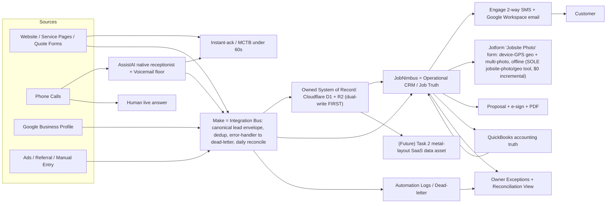
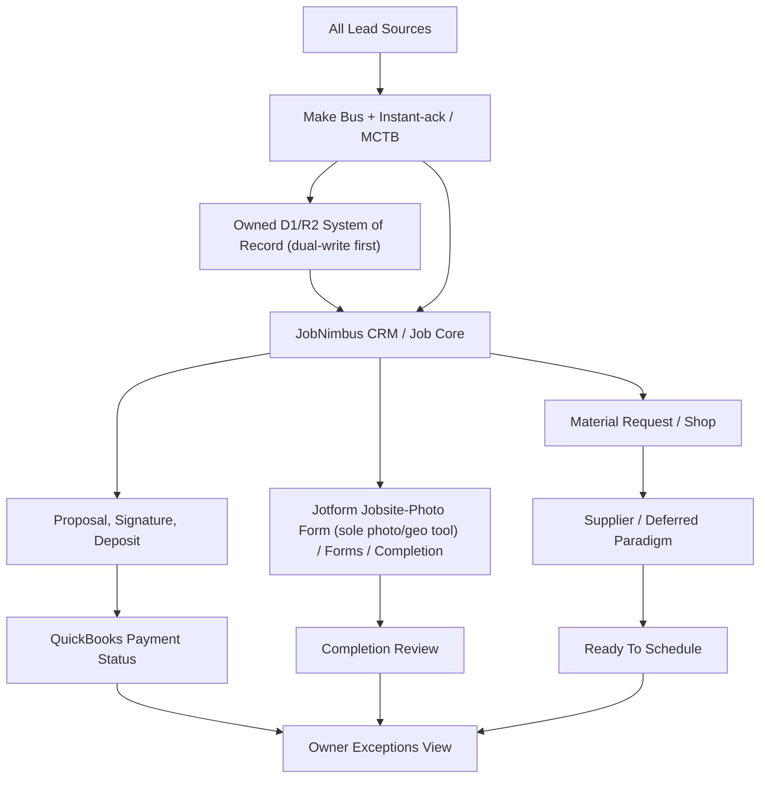

# 01 - System Architecture

## Architecture Principle

Use existing tools for what they already do well. Build only the glue that
prevents duplicates, missing next steps, bad handoffs, and invisible failures.

## Operating System Map



## First Version Flow

```mermaid
sequenceDiagram
  participant C as Customer
  participant R as Make Bus
  participant O as Owned D1/R2
  participant J as JobNimbus
  participant A as Instant-ack / MCTB
  participant S as Staff

  C->>R: Website form, phone (AssistAI/voicemail), GBP, or manual lead
  R->>R: Build canonical lead envelope {source, contact, job_ref, payload, ts}; dedup by phone/email
  R->>O: Dual-write raw submission + envelope FIRST (system of record)
  R->>A: Fire instant-ack / MCTB to prospect under 60s + owner alert
  R->>J: Create or update contact and job (JobNimbus is the consumer)
  J->>S: Assign owner and next task
  R->>R: Daily reconciliation: source-event counts vs records landed; failures to dead-letter (Sheet + email)
  S->>J: Move job through appointment, estimate, proposal, and production
```

## End-State Flow



## Component Responsibilities

| Component | Owns | Does Not Own |
|---|---|---|
| Owned data layer (Cloudflare D1 + R2) | **System of record**: canonical lead envelope `{source, contact, job_ref, payload, ts}`, raw pre-Make submissions, dual-written event log, future Task 2 data asset | CRM pipeline UI, customer messaging, accounting |
| JobNimbus | Operational CRM / job-truth: customer/job/property/stage/task/owner, lead front door (fronted by Make bus), 2-way SMS (Engage), booking, review requests | Canonical data ownership (it is a *consumer* of the owned store), accounting ledger, outbound email, broad nurture |
| AssistAI | Native 24/7 phone receptionist: answer, qualify, book natively into the JN calendar, route-flag | Custom voice stack, division logic beyond one-question intent, lead truth (writes via the bus) |
| Make | **Critical integration bus**: canonical envelope, dedup/idempotency on phone/email, dual-write-first, error-handler to dead-letter (Sheet + email), daily reconciliation | System-of-record ownership, unlogged critical mutations |
| JobNimbus Engage (2-way SMS) + Google Workspace email (brand mailboxes, SPF/DKIM/DMARC); dedicated ESP deferred for bulk | Engage: 2-way SMS; Google Workspace brand mailboxes: outbound email with SPF/DKIM/DMARC + bounce monitoring (JN native email unused; dedicated ESP deferred for bulk) | System of record, job stage truth |
| Jotform | **Sole jobsite-photo/geo capture ($0 incremental)**: "Jobsite Photo" form — JobNimbus job picker, Geolocation widget (device GPS lat/long at submit, coordinates-only, works offline in the Jotform Mobile App), multi-photo File Upload, auto timestamp; plus genuinely structured offline field forms (file, draw signature) via webhook → Make/Worker → JN/Google Drive/owned store. If crew capture friction appears, fix it inside the Jotform flow (kiosk mode, simpler/auto job-picker) — do not add a photo vendor. Do not rely on photo EXIF (iOS strips it on-device) | Canonical job stage, accounting |
| Webhook relay, if built | Dedupe, idempotency, logging, validation | CRM replacement |
| Google Drive (Google Workspace) | Job archive and attachments | Source of truth for job stage or payment status |
| QuickBooks | Invoices, payments, accounting records | CRM pipeline, job operations |
| Parser/OCR | Extracts document data and confidence | Final pricing without human review |
| Proposal generator | Customer-facing proposal and PDF archive | Final accounting invoice |

## Minimal Custom Components

Build only when existing tools fail the requirement (the owned data layer + Make
critical-infra items below are mandatory, not "if built"):

1. Owned data layer: Cloudflare D1 + R2 storing the canonical lead envelope and
   raw pre-Make submissions; every Make scenario dual-writes here FIRST, then
   pushes to JobNimbus.
2. Dedupe and idempotency service: idempotency key on phone/email across all
   inbound paths.
3. Make error-handler → dead-letter (Google Sheet + email alert) on every mutating
   scenario.
4. Daily reconciliation job: source-event counts vs records landed, with a named
   weekly owner.
5. Instant-ack / MCTB handler: web form → prospect SMS + owner alert on a pipe
   separate from nurture; unanswered call → SMS within ~10s.
6. AppliCad XML parser.
7. PDF/OCR extraction queue.
8. Proposal HTML/PDF generator.
9. AssistAI tool handlers + route-flag / dual-write webhook (AssistAI books natively into the JobNimbus calendar).
10. Lightweight exceptions + reconciliation view after reports/sheet fail.
11. Integration health checker.

Build-on-Cloudflare bus (option): Make's bus role can collapse into a
**Cloudflare Workers + D1 + R2 + Queues + Cron** bus that an AI agent builds
(~CAD $7/mo vs scaling Make on its credit model). Queues gives native retry +
dead-letter; Cron gives the daily reconciliation; the dual-write becomes a
**single write** (the owned store IS the bus), which also resolves the
partial-write problem. **Recommended hybrid:** the Worker does the heavy lifting
(envelope, dedup, dead-letter, reconcile, single-write) and a cheap **Make Core
seat (~$9/mo)** is kept for its native JobNimbus/QuickBooks/Twilio connectors +
owner-visible observability, until the custom JobNimbus integration is proven.
**Note:** this is owned product code IronWrap builds, operates, and resells; the owner
plus Claude Code is the engineering/ops capacity (see docs/OPERATIONS-RUNBOOK.md). (Make stays "critical infra"; this is
about *where the infra runs*, not abandoning the discipline.)

## Integration Contract

Every integration that mutates records must have:

- Owner (plus a named weekly reconciliation owner).
- Trigger.
- Input fields.
- Output fields.
- Dual-write: write the canonical envelope to the owned D1/R2 store FIRST, then push to JobNimbus.
- Idempotency key (keyed on phone/email; dedup across all inbound paths).
- Retry behavior.
- Error-handler → dead-letter (Google Sheet + email alert).
- Daily reconciliation: source-event counts vs records landed.
- Failure alert.
- Manual recovery step.
- Kill switch.
- Test record.

**Partial-write repair.** The JobNimbus push is an idempotent, auto-retried job
keyed on `envelope_id`, carrying a status field (`pending_jn_push` → `pushed` →
`reconciled`). A continuous retry sweep — not the once-daily count — re-drives any
envelope stuck in `pending_jn_push`. **Instant-ack/MCTB fires off the owned-store
write, never off the JobNimbus push**, so an acknowledgement still goes out when
JobNimbus is unavailable. The daily source-vs-landed count is the backstop that
*detects* gaps; the retry sweep is the mechanism that *repairs* them.
