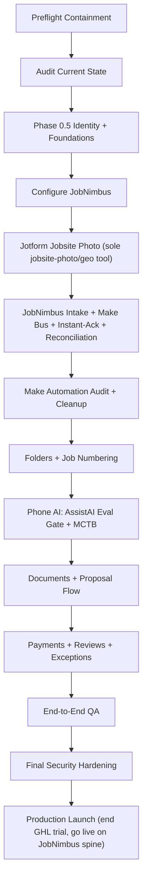

# 02 - Build And Configuration Plan

## Build Order

Security/access hardening is the final phase after build/config/test, per the
final decision. Basic containment still applies during build: do not create new
production dependencies on shared pasted credentials.



## Phase 0 - Preflight Containment

Goal: avoid making the current access situation worse before the final hardening phase.

Actions:

- Inventory current Make, JobNimbus, QuickBooks, storage, website, and phone access. (GHL was trial-evaluated only and is being declined before any production use; nothing to migrate — end the trial.)
- Identify live Make connections, API keys, webhooks, phone numbers, and folder automations.
- Use test contacts/jobs wherever possible.
- Pause or duplicate dangerous scenarios before editing.
- Do not create new broad admin/API keys unless required for testing.
- Keep an access inventory for final rotation.

Done when:

- We know which connections are live.
- We know which test records are safe to use.
- No new production workflow depends on a shared personal login.

## Phase 1 - Current-State Audit

Audit:

- Make scenarios, schedules, webhooks, error handlers, connections, data stores, folder mutations.
- JobNimbus boards, statuses, custom fields, automations, templates, users, roles, integrations.
- Field-capture state: confirm NaturalForms is being dropped; confirm Jotform account + Jotform Mobile App availability for the "Jobsite Photo" form (Geolocation widget, offline capture); inventory any existing structured-form needs that may later warrant Jotform.
- QuickBooks connection state, product/service setup, invoice/deposit behavior.
- Website form destinations.
- Website attribution fields, UTM handling, landing-page/source capture, and call source capture.
- Google Business Profile settings, review link, service categories, service areas, phone, hours, website URL, and photos.
- OneDrive naming and folder structure.
- RoofRuler email source, sender pattern, mailbox rules, attachment naming, and current proposal packet examples.

Current-state note (experimental Make setup being migrated to the JobNimbus spine):

- As of 2026-06-28 the experimental GHL-based Make setup (org "IronWrap Exteriors",
  Make Core plan, team "My Team", ~16 scenarios) already contains, on the GHL hub:
  a live RoofRuler report intake (Make AI Extract + OneDrive); OneDrive folder
  automation keyed by lead/job number; GHL->JobNimbus import scenarios (the
  in-progress cutover — note `record_type_name` must be an account-valid value:
  contact `Customer`, job `Retail`; `"Lead"` is rejected 400); a Jotform "Completion
  Form" workflow (scaffolded, inactive); and inactive Facebook Lead Ads scenarios.
  JobNimbus and Jotform are already connected in Make. These are experimental on GHL;
  Task 1 migrates/rebuilds the keep-worthy ones onto the JobNimbus spine + owned bus,
  then retires GHL.

Output:

- Keep/fix/pause/delete list for automations.
- Field gap list for JobNimbus.
- Integration dependency map.
- Duplicate risk list.

## Phase 0.5 - Identity And Foundations

Blocks everything downstream. GHL was trial-evaluated only and is being declined
before any production use; nothing to migrate — end the trial. These foundations
are real and independent of GHL: they are fresh stand-ups on the JobNimbus spine.

Actions:

- Provision and OWN the business phone number for AssistAI/Engage in Twilio so it
  is portable and a later provider swap is config-only, never a number change on
  site/GBP/trucks. (This is a fresh provisioning, not a port out of GHL.)
- Start A2P 10DLC + Canadian carrier registration now for JobNimbus Engage SMS
  (a FRESH registration, prerequisite before any automated texting, ~1-3 weeks,
  runs in the background). Messaging cannot go live until this is approved.
- Use the existing **Microsoft 365 brand mailboxes** for outbound email (IronWrap
  `quote@ironwrapexteriors.com` via MS365; iRoof `info@iroofalberta.ca` via Gmail)
  with SPF/DKIM/DMARC + a deliverability seed test. JN native email unused
  (unreliable; do not rely on it). A dedicated transactional ESP (Resend) is
  DEFERRED for bulk nurture/review only.
- Stand up the owned system of record: Cloudflare D1 + R2, plus the canonical
  lead envelope `{source, contact, job_ref, payload, ts}` that every Make scenario
  dual-writes to FIRST, before pushing to JobNimbus. Storage authority for the
  human-facing job-folder archive is **OneDrive (Microsoft 365)** (Cloudflare R2
  remains the owned raw store).
- Draft the privacy policy and the per-contact CASL consent ledger maintained in
  JobNimbus GOING FORWARD (system of record for consent provenance; no historical
  GHL export needed).

Done when:

- The business number is owned in Twilio.
- A2P 10DLC + Canadian carrier registration is submitted (approval tracked).
- Microsoft 365 brand mailboxes are live with SPF/DKIM/DMARC and a passing seed
  test; dedicated ESP (Resend) deferred for bulk nurture/review only.
- D1 + R2 are live and the canonical lead envelope schema is defined.
- Privacy policy draft and consent ledger structure exist.

## Phase 2 - JobNimbus Configuration

Configure JobNimbus as the job truth.

Boards:

- Start with one Residential board unless Commercial or Shop/Supply workflows truly differ.
- Add Commercial and Shop/Supply boards only if stages/owners/forms are different.

Stages:

1. Lead
2. Appointment
3. Estimating
4. Proposal Sent
5. Pending Signature
6. Signed
7. Deposit
8. Materials
9. Scheduled
10. In Progress
11. Completion
12. Invoice
13. Closed Won
14. Closed Lost

Required setup:

- Job number format.
- Lead source list.
- Service interest fields.
- Property fields.
- Division fields for Residential, Commercial, Shop/Supply, and Steel.
- Task types.
- Note types.
- Attachment categories.
- Owner/assignee roles.
- Required fields per stage.

Done when:

- A test job can move from lead to closed without unstructured workarounds.
- Every stage has an owner and next action.

## Phase 2B - Field Capture: Jotform "Jobsite Photo" (Sole jobsite-photo/geo tool)

NaturalForms is dropped (stagnant). The jobsite-photo capture ships in the core
deliverable at $0 incremental, reusing the already-paid Jotform stack: a single Jotform
"Jobsite Photo" form is the SOLE jobsite-photo/geo tool. Jotform also covers genuinely
structured forms but those remain deferred until a structured workflow actually hurts.
Adobe interactive PDFs are not a
structured-capture tool (flat output; structured JSON only via the paid Adobe dev API +
re-keying) — excluded. Self-hosted OSS photo servers (Immich/PhotoPrism/LibrePhotos) are
excluded (server to babysit, no auto-routing to the JobNimbus job; wrong trade for a
no-devops shop). A custom photo PWA is not built yet (offline-queue/silent-failure ops
burden); revisit only if Jotform UX fails crews. Prices are USD; CAD ~1.4x.

Jotform "Jobsite Photo" form (sole jobsite-photo/geo tool — $0 incremental, ships in core):

- One Jotform form with: a JobNimbus job picker, the Jotform **Geolocation widget**
  (captures DEVICE GPS lat/long at submit, coordinates-only, works OFFLINE in the
  Jotform Mobile App), a multi-photo File Upload, and an auto timestamp.
- Explicitly NOT the "GeoStamp" widget (needs internet / falls back to IP) and NOT the
  "GPS Location" widget (needs a Google Maps API key).
- Do NOT rely on photo EXIF for geo: iOS strips photo GPS by default, and direct
  camera-capture uploads lose metadata regardless — so capture device GPS at submit;
  don't depend on EXIF. (Unreliable for a mixed iPhone/Android crew.)
- The Geolocation widget records the **sync** date as the submission date, not capture
  time, in offline app mode — add an explicit capture-time/Date field so capture time
  is preserved. Validate on a real device that the widget returns **device GPS (not
  IP)** in offline app mode.
- Crew uses the Jotform Mobile App in Offline Mode (queues on-device, syncs on reconnect).
- Output path: Jotform webhook -> Make -> OneDrive job folder + JobNimbus job +
  dual-write to the owned store.
- If per-submission job-picking friction hurts crew compliance, improve the Jotform flow
  (kiosk mode / auto job-picker) — do NOT introduce a separate photo vendor.
- KoboToolbox managed tier is a distant fallback only if Jotform offline capture proves
  insufficient.

Jotform structured forms (deferred — introduce only when a specific structured workflow hurts):

- Genuinely structured forms: work orders, change orders, completion, inspection,
  material requests, safety forms.
- Offline mobile app: photo/file attach, draw signature, device-GPS geotag.
- Output path: Jotform webhook -> Make -> dual-write to owned store -> JobNimbus.

Done when:

- The Jotform "Jobsite Photo" form is live and photos + device-GPS geo route to the right
  JobNimbus job and OneDrive job folder from day one, with offline capture verified.
- The Jotform structured-form trigger criteria are documented (which workflow, what pain signal).
- When a structured Jotform form is introduced, one test form completes offline from
  mobile/tablet, archives to the job folder, lands in JobNimbus without duplicate jobs,
  and Make logs the event and failure path.

## Phase 3 - JobNimbus Intake + Make Bus + Instant-Ack + Reconciliation

JobNimbus is the operational CRM / job-truth / lead front door, fronted by a Make
integration bus and an instant-ack branch. Make is critical infrastructure, not
plumbing. Every inbound path normalizes into the canonical lead envelope, dual-writes
to the owned store (D1/R2) FIRST, then pushes to JobNimbus.

Intake sources (all normalize through the Make bus):

- Website form.
- Quote page.
- Contact page.
- Service page forms with service-specific hidden fields.
- Google Business Profile.
- Google Local Services Ads or paid traffic only after readiness gates pass.
- Phone call (via AssistAI / voicemail floor -> JobNimbus lead).
- SMS (JobNimbus Engage 2-way).
- Facebook/Google lead.
- Referral.
- Manual entry.
- Optional Renoworks.

Make bus (critical infrastructure):

- Canonical lead envelope `{source, contact, job_ref, payload, ts}` on every path.
- Raw submission stored pre-Make (so nothing is lost if a scenario fails).
- Dual-write to owned D1/R2 store FIRST, then push to JobNimbus.
- Idempotency / dedup keyed on phone/email across all inbound paths.
- Mandatory error-handler -> dead-letter (Google Sheet + email) on every scenario.
- Daily reconciliation: source-event counts vs records landed, with a named weekly owner.

Instant-ack / MCTB branch (separate from nurture):

- Every web form -> instant prospect SMS + owner alert on a pipe separate from nurture.
- Every unanswered call -> SMS within ~10s.
- Target <60s human-or-AI touch, 24/7.

JobNimbus pipeline (job truth):

- New Lead.
- Contacted.
- Appointment Booked.
- Estimate Needed.
- Proposal Sent.
- Won.
- Lost.

These are the lead-funnel stages, a rollup of the full board above; the 14-stage
board in Phase 2 is canonical.

Calendar (JobNimbus; AssistAI books natively into the JobNimbus calendar — Make is
used for route-flagging + the owned-store dual-write, not necessarily the booking call):

- Appointment types by service.
- Working hours.
- Buffers.
- Territory/service area rules.
- First-response tracking.
- Confirmation SMS/email (Engage SMS + Microsoft 365 brand-mailbox email).
- Reschedule/cancel path.
- No-show follow-up.

Verify the existing website forms' current post destinations and point them at the
Make bus (the site was not confirmed to post anywhere specific; do not assume).

Call attribution is deferred: UTM + manual Lead Source +
one tracked number; add CallRail only when paid ads start.

Done when:

- Every new lead dual-writes to the owned store and lands in JobNimbus.
- Web leads preserve source URL, landing page, page type, service, city, UTM/source
  data, attachment, and message.
- The instant-ack / MCTB branch fires on every web form and every unanswered call.
- Dead-letter + dedup are live and daily reconciliation runs green with a named owner.
- Google Business Profile has an approved review link and source label.
- Appointment confirmation works.

## Phase 4 - Make Automation Audit And Cleanup

Rules:

- One automation owns one action.
- No two scenarios create/rename the same folder.
- No hidden logic in scenario names.
- Every scenario has error handling.
- Every scenario has a test record.
- Every production scenario has a kill switch.

Cleanup steps:

1. Export or document current scenario settings.
2. Label each scenario keep/fix/pause/delete.
3. Disable duplicates and dangerous competing folder automations.
4. Add dedupe before creating JobNimbus jobs.
5. Add idempotency keys before folder creation.
6. Add failure notifications.

Done when:

- A duplicate inbound lead (same phone/email) does not create duplicate JobNimbus jobs.
- A job number update does not create duplicate folders.
- Failed automation creates a visible admin task or alert.

## Phase 5 - Job Numbering And Folders

Final decision:

- JobNimbus owns canonical job number.
- The owned-store record ID and any external lead ID can exist but are not the job number.
- Folder name is derived from JobNimbus job number plus customer/property label.
- Job folders live in **OneDrive (Microsoft 365)** (the storage authority for the
  human-facing job-folder archive).

Folder pattern:

```text
{job_number} - {customer_last_or_company} - {property_short_address}
```

Folder substructure:

```text
01 Intake
02 Measurements
03 Photos
04 Proposal
05 Contract
06 Materials
07 Field
08 Invoice
09 Warranty
```

Done when:

- One qualified job creates one folder.
- Folder link appears in JobNimbus and the owned store.
- Folder archive does not decide job status.

## Phase 6 - Phone AI: AssistAI Eval Gate + MCTB

JobNimbus AssistAI is P0: a native 24/7 receptionist that answers, qualifies, routes
(one-question intent: residential / commercial / shop / steel), and books natively into
the JobNimbus calendar (creating the lead record in-CRM; the Make webhook may be
redundant for the booking call itself). Enforce a hard monthly minute cap / budget alert
(verify AssistAI's native cap support — it bills pure-metered at ~$0.15/min; if there is
no native cap, enforce via usage monitoring + an overage alert). Placeholder cap =
owner-set, e.g. ~500 min/mo; keep the spam/robocall buffer rationale.
The hand-assembled 4-vendor stack (Retell + Twilio + Gemini + ElevenLabs) is killed as
a standing build; Vapi excluded (needs on-call engineer); Google Voice excluded (no
media API — do not conflate with Google's Gemini Live API, a legitimate real-time
voice backend; only the Google Voice consumer product is excluded). Own the phone DID
in Twilio so a provider swap is config-only.

Written scored eval-call gate (before AssistAI goes live):

- Run a written, scored eval-call set: >=85% capture + routing accuracy, zero
  catastrophic failures. Document the rubric and the score.
- Pass -> AssistAI live with the hard minute cap / budget alert enforced.
- Fail -> escalate ONLY to a MANAGED Retell (bundled telephony/LLM/voice, one config),
  never the 4-vendor hand-wired stack.

Floor fallback (never breaks, zero ops):

- Voicemail -> JobNimbus lead + human callback.

MCTB / instant-response (headline deliverable):

- Every unanswered call -> SMS within ~10s on a pipe separate from nurture.
- Target <60s human-or-AI touch, 24/7.
- Interim pre-A2P ack path: JobNimbus Engage SMS cannot send until the fresh A2P 10DLC
  + Canadian carrier registration is approved (~1-3 wks). Until then the instant-ack /
  MCTB runs on an interim channel — an email acknowledgement to the prospect (via the
  ESP) + an owner phone/SMS alert from the owner's own line — so the <60s touch SLA
  holds from day one. The prospect-SMS leg of MCTB switches on at A2P approval. Be
  honest in the pitch: the email/owner-alert form of instant-ack ships day one; the
  prospect-SMS form ships at A2P approval.

Scope of AssistAI = capture + book + route-flag (not a custom intelligent router).
Do not replace human live-answer during business hours until the eval gate passes.

Done when:

- The written eval gate is passed and documented (>=85%, zero catastrophic failures).
- Test calls qualify, book (natively into the JobNimbus calendar), summarize, and escalate.
- AssistAI creates a JobNimbus lead record (not just a calendar event); records dual-write to the owned store.
- Every unanswered call triggers MCTB SMS within ~10s.
- The hard minute cap / budget alert and overage alert are live; voicemail floor is verified.
- Failed calls create human tasks.
- Ilya approves the eval recordings and summaries.

## Phase 7 - Documents And Proposal Flow

Build:

- RoofRuler email intake for automatically delivered report PDFs. (Already
  implemented in Make today via AI Extract + OneDrive; the deterministic-first ->
  `toMarkdown()` -> Mistral OCR ladder below is the hardening target.)
- Upload convention for manual reports/photos.
- AppliCad XML parser (deterministic text-PDF / XML parse first).
- Cloudflare `toMarkdown()` (Workers AI binding — free, on-stack) as the first OCR pass
  for text PDFs/DOCX, before any paid OCR.
- Claude/LLM read only when structured field extraction/reasoning is needed.
- Mistral OCR only for hard cases (image-heavy/scanned/handwritten/layout-sensitive).
- Human review before price/material truth.
- Simple proposal HTML/PDF.
- JobNimbus native e-sign / HTML+PDF contract path FIRST (NaturalForms is dropped); if
  it fails the workflow, adopt DocuSeal (open-source; managed Cloud ~CAD $30/mo or one
  self-hosted container; webhooks fire completion back through Make -> JobNimbus) as the
  e-sign escape hatch, before PandaDoc/DocuSign.
- PDF archive to folder.
- Contract decision: JobNimbus native contract/signature; Jotform structured signature only if a structured workflow requires it.
- Material list decision: one multi-scope list versus per-scope material-list forms.

Done when:

- Measurement docs are attached and extracted or flagged.
- RoofRuler email attachments archive to the correct job folder.
- Proposal can be sent from a job record.
- Customer can view on mobile.
- Signed/accepted/deposit state returns to JobNimbus.

## Phase 8 - Payments, Reviews, Exceptions

Payments:

- QuickBooks owns invoices and payment records.
- JobNimbus shows deposit status, invoice status, paid/overdue flag.
- No automatic invoice creation from unreviewed pipeline state.
- Validate accepted payment methods before customer-facing proposal launch:
  cash/cheque/draft/direct deposit, Interac e-Transfer, Interac debit, credit
  card, and FinanceIT.
- Keep Moneris/FinanceIT details out of AI logs and broad CRM notes.

Reviews:

- Review request after completion and eligible-customer signal.
- Stop if issue, complaint, dispute, or incomplete job.

Exceptions:

- New unassigned leads.
- Missed calls.
- Leads not contacted.
- Appointment no-shows.
- Stale jobs by stage.
- Pending proposals.
- Deposit missing.
- Materials not ready.
- Completed not invoiced.
- Overdue invoices.
- Failed automations.

Done when:

- Owner can see daily blockers without manual cross-system reconciliation.

## Phase 9 - End-To-End QA

Run test jobs across every path before launch.

Required test records:

- Website lead.
- Service-page website lead.
- Quote-page website lead.
- Phone lead.
- Phone AI lead.
- Duplicate lead.
- Appointment booked.
- Proposal sent.
- Proposal accepted.
- Deposit requested.
- RoofRuler report email received.
- Manual measurement uploaded.
- Material request submitted.
- Completion form submitted.
- Invoice requested.
- Review request sent.
- Automation failure.
- API key revoked.

## Phase 10 - Final Security And Access Hardening

This happens after build/config/test, before full production launch.

Actions:

- Rotate pasted/shared credentials.
- Revoke stale API keys and sessions.
- Replace shared logins with named users.
- Enable MFA where possible.
- Create service accounts where supported.
- Store secrets in password manager.
- Lock down integration scopes.
- Approve vendor register.
- Approve retention and call-recording rules.
- Approve CASL/DNCL handling.

## Phase 11 - Production Launch

GHL was trial-evaluated only and is being declined before any production use; nothing
to migrate — end the trial. Launch is a clean go-live on the JobNimbus spine:

1. A2P 10DLC + Canadian carrier registration approved (wait for approval). The
   email/owner-alert form of instant-ack ships before this; the prospect-SMS leg of
   MCTB switches on only at A2P approval.
2. Confirm the business number is owned and live in Twilio.
3. Confirm website forms/tracking post through the Make bus.
4. Run the launch smoke test (instant-ack fires — interim email/owner-alert pre-A2P,
   prospect SMS once approved; reconciliation green).
5. End the GHL trial.

Launch only when:

- Test records pass.
- Staff SOPs are reviewed.
- Failure alerts work (dead-letter + reconciliation).
- Kill switches are documented.
- Compliance gates are approved (A2P approved, consent ledger live, privacy policy published).
- Number is owned in Twilio and messaging verified live.
- Owner signs off.
