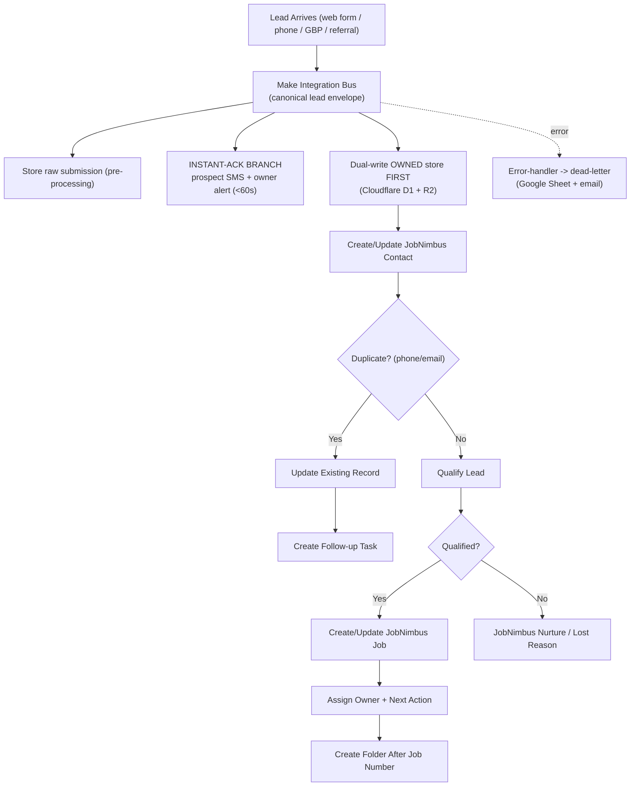
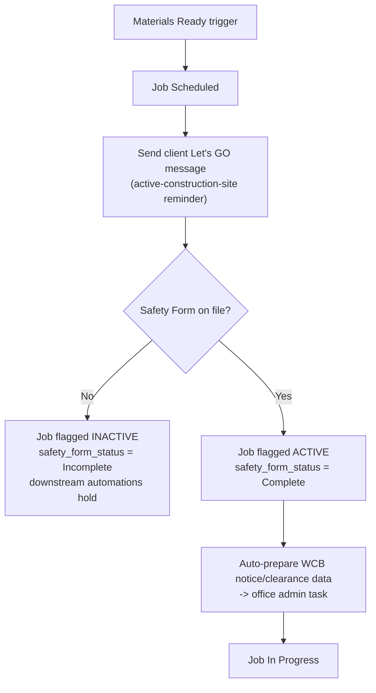
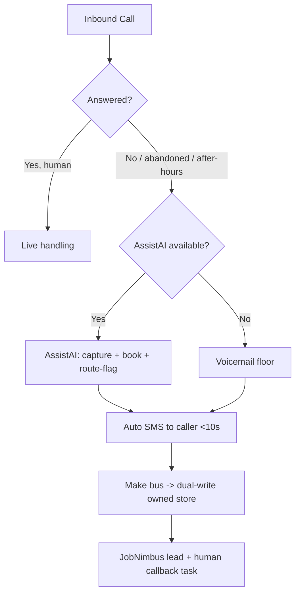

# 04 - Core Workflows And SOPs

## Workflow 1 - Lead Intake

Goal: every lead lands in one queue, gets deduped, dual-written to the owned
store, and receives a next action - with an instant acknowledgement that fires
before any qualification or nurture.

SOP:

1. Lead enters through the Make bus and is normalized into the canonical lead
   envelope `{source, contact, job_ref, payload, ts}`. Store the raw submission
   before any processing.
2. INSTANT-ACK BRANCH (separate pipe from nurture): immediately send the prospect
   an acknowledgement SMS and alert the owner. This fires before dedup/qualify so
   the <60s human-or-AI touch SLA is met 24/7.
3. Dual-write to the owned store (Cloudflare D1 + R2) FIRST, then push to
   JobNimbus. JobNimbus is a consumer of IronWrap's data, not the owner.
4. Dedupe by phone and email (idempotency key across all inbound paths); address
   as a secondary signal.
5. Capture source, service interest, urgency, property, and notes.
6. If qualified, create/update JobNimbus contact/job; if not, JobNimbus nurture or
   lost reason.
7. Assign owner.
8. Create next action.
9. Create folder only after JobNimbus job number exists.

**Partial-write repair.** The JobNimbus push is an idempotent, auto-retried job
keyed on `envelope_id`, carrying a status field (`pending_jn_push` -> `pushed` ->
`reconciled`). A continuous retry sweep - not the once-daily count - re-drives any
envelope stuck in `pending_jn_push`. **Instant-ack/MCTB fires off the owned-store
write, never off the JobNimbus push**, so an acknowledgement still goes out when
JobNimbus is unavailable. The daily source-vs-landed count is the backstop that
*detects* gaps; the retry sweep is the mechanism that *repairs* them.

Acceptance:

- Instant-ack SMS + owner alert fire within the SLA, on a pipe separate from
  nurture, before qualification.
- Every lead is dual-written to the owned store before it reaches JobNimbus.
- Duplicate phone/email does not create duplicate job.
- Every new lead has owner or queue.
- Every lead has next action or lost reason.
- Any failed Make step lands in the dead-letter (Google Sheet + email).

## Workflow 2 - Appointment Booking

Goal: website, staff, and AI book into the same calendar path.

SOP:

1. Use the JobNimbus calendar as the primary booking system; AssistAI and the
   website book into it via a Make webhook (not direct).
2. Service type determines appointment type.
3. Calendar confirmation goes to customer via Engage (SMS) / the Google Workspace brand mailbox.
4. JobNimbus task/event mirrors booking where needed.
5. Reschedule/cancel updates JobNimbus (and the owned store via the bus).

Acceptance:

- Customer receives confirmation.
- Staff sees appointment.
- JobNimbus shows next task.
- No double-booking from separate calendars.

## Workflow 3 - Estimate And Proposal

Goal: create a clear customer-facing proposal package and archive it.

SOP:

1. Attach measurements/photos to job.
2. Extract measurement data or flag for review.
3. Human reviews quantities and pricing inputs; line-item pricing pulled from the QuickBooks
   catalog (single source of truth for prices — see `00` Accounting truth).
4. Build proposal version.
5. Send customer URL.
6. Export PDF to the job's JobNimbus attachment AND the Google Drive backup folder
   (owner-directed 2026-07-01: dual-archived, never JobNimbus-only).
7. Update JobNimbus proposal status.
8. Start follow-up sequence: reminders on a fixed cadence (e.g., day 2, day 5, day 10) until the
   customer accepts, declines, or a human pauses it (owner-directed 2026-07-01, Scenario
   "Proposal Sent").

Acceptance:

- Proposal opens on mobile.
- PDF is archived in both JobNimbus and the Google Drive backup.
- Proposal status is visible in JobNimbus.
- Proposal can embed or link to Renoworks only if Renoworks is approved.
- Follow-up stops when customer accepts, declines, or complains.

## Workflow 3C - Contract Signed

Goal: the moment a customer signs, the job visibly moves stage and the deposit process starts
without a manual handoff being forgotten. (Owner-directed 2026-07-01, Scenario "Contract Signed".)

SOP:

1. A signed contract (JobNimbus native e-sign, or DocuSeal if native e-sign fails the workflow —
   see Workflow 3/Proposals decision) moves the job to the "Contract Signed" pipeline stage.
2. Send the customer a "thanks and welcome" message (Engage SMS + Google Workspace brand
   mailbox email) that includes the approximate start date.
3. Issue the deposit invoice in QuickBooks, referencing the catalog items from the accepted
   proposal, and start the deposit reminder cadence.
4. A missing deposit past the reminder window creates a human follow-up task; it does not
   auto-escalate the pipeline further on its own.

Acceptance:

- Every signed contract produces a customer welcome message within the SLA.
- Every signed contract produces a deposit invoice; no silent misses.
- The job does not advance to "Deposit Paid" without a recorded QuickBooks payment.

## Workflow 3B - Hail / Insurance Sales Handling

Goal: support IronWrap's hail and insurance sales motion without letting staff
or AI make unsafe claims.

SOP:

1. Capture hail/insurance interest as a structured flag.
2. Use only owner-approved wording for insurance, Class 4, financing, and upgrade conversations.
3. Route coverage, claim, legal, warranty, and dispute questions to a human.
4. If FinanceIT is offered, use only approved dealer economics and customer-facing wording.
5. Store insurance-sensitive notes with limited access.

Acceptance:

- AI and staff scripts do not promise insurance approval, premium discounts, legal outcomes, or warranty decisions.
- Hail/insurance lead source and follow-up status are visible.
- Financing interest is captured without storing finance documents in AI or broad CRM notes.

## Workflow 4 - Deposit And Payment

Goal: QuickBooks owns finance truth while operations see status.

SOP:

1. Proposal accepted.
2. JobNimbus marks signed/accepted (see Workflow 3C — this is the same "Contract Signed" event).
3. Staff or approved automation prepares deposit request in QuickBooks. Payments are taken via
   **QuickBooks Payments on the invoice** (card/Apple Pay/EFT - native in Canada). Moneris
   dropped (owner, 2026-07-02); no separate processor or gateway. BookIPI/Stripe retire.
4. QuickBooks payment status mirrors back to JobNimbus status fields.
5. Missing deposit creates follow-up.

Acceptance:

- No automatic invoice from unreviewed CRM state.
- Payment status visible in JobNimbus.
- Finance data not copied into AI prompts/transcripts.

## Workflow 5 - Materials

Goal: material requests become visible production work instead of informal text messages.

SOP:

1. Deposit Paid moves the job to the "Deposit Paid" stage and triggers the material request
   (owner-directed 2026-07-01, Scenario "Deposit Paid").
2. Staff completes material request form/task; quantities pulled from the QuickBooks catalog
   where possible.
3. Attach product, color, profile, measurements, supplier notes.
4. Shop reviews and places the supplier purchase order in QuickBooks (tied to the vendor and
   catalog items — see `00` Accounting truth).
5. Office assigns the subcontractor/crew for the job.
6. A work order is issued to the assigned subcontractor (JobNimbus task/document; Workflow 5B
   row 1).
7. The job holds at "Deposit Paid" / "Materials Ordered" until the shop fires the "Materials
   Ready" trigger.
8. "Materials Ready" moves the job to "Job Scheduled" and unlocks the Job Start Safety Gate
   (Workflow 5C).

Acceptance:

- Installer does not text material lists as the source of truth.
- Blockers are visible before scheduling.
- Paradigm is deferred until this manual flow is stable.
- A job cannot reach "Job Scheduled" without a work order on file.

Material list design decision:

- The first deliverable uses one material request task/form attached to the JobNimbus job.
- The owner can approve one multi-scope material list or separate roof/siding/gutter/soffit/fascia lists after field testing.
- A Jotform "Jobsite Photo" form is the sole tool for jobsite photos/geo ($0 incremental; reuses already-paid Jotform): JobNimbus job picker, the Jotform Geolocation widget (captures device GPS lat/long at submit, coordinates-only, works offline in the Jotform Mobile App; NOT the GeoStamp or GPS Location widgets), multi-photo File Upload, auto timestamp -> webhook -> Make -> Google Drive job folder + JobNimbus job + dual-write to the owned store. Do not rely on photo EXIF for geo: iOS strips photo GPS by default, and direct camera-capture uploads lose metadata regardless - so capture device GPS at submit; don't depend on EXIF. If crew capture friction hurts photo compliance, fix the Jotform flow (kiosk mode, a simpler/auto job-picker) rather than adding a photo vendor. A Jotform structured material-request form (offline app: photo/file, draw signature, device-GPS geotag, webhook -> Make -> JobNimbus) is introduced only when this manual flow hurts. NaturalForms is dropped (stagnant).

## Workflow 5C - Job Start Safety Gate

Goal: no job starts without the safety paperwork on file; the gate is enforced by data, not by
memory. (Owner-directed 2026-07-01, Scenario "Job Started".)

SOP:

1. When the job reaches "Job Scheduled" (post-Materials-Ready), send the client a "Let's GO!"
   message (Engage SMS + email) including the active-construction-site reminder.
2. The contractor/crew must complete the Safety Form (Jotform, structured — the buy gate is
   cleared, see `00`) before work begins.
3. **Enforcement mechanism:** a JobNimbus custom field `safety_form_status` (Incomplete/Complete)
   defaults to Incomplete when the job enters "Job Scheduled". Every automation downstream of job
   start (WCB filing, further scheduling confirmations, invoicing triggers) checks this field
   and holds while it is Incomplete. The job is visibly flagged INACTIVE in JobNimbus while held.
4. Safety Form submission (Jotform webhook, via the bus or a native JobNimbus integration) flips
   `safety_form_status` to Complete, which releases the hold and flags the job ACTIVE.
5. WCB step: **already operational** (owner confirmed 2026-07-02) - the WCB account is active and
   Automatic Clearance Notifications are configured: an automatic email arrives if a
   subcontractor's WCB is cancelled, and the check runs daily. The only optional build is a JN
   task auto-created at Job Scheduled ("confirm clearance letter on file for [sub]"); there is
   no WCB API, so nothing auto-submits.
6. Once active, the job moves to "Job In Progress".

Acceptance:

- No job reaches "Job In Progress" with `safety_form_status = Incomplete`.
- The client "Let's GO" message fires on every job entering "Job Scheduled".
- The WCB task is created for every job entering "Job Scheduled", with no silent misses.

## Workflow 5D - Progress Check-ins And Progress Payments

Goal: multi-stage jobs report progress and bill on schedule instead of only at the end.
(Owner-added 2026-07-02.)

SOP:

1. At Contract Signed, jobs above an owner-set threshold (size/duration) get a progress
   schedule: check-in points and payment milestones (e.g., deposit -> materials delivered ->
   mid-install -> completion).
2. At each check-in: crew submits a short progress Jotform (photos + status) -> files to the
   job's Drive folder (03 Photos/Progress) + a JobNimbus note; the client receives a progress
   update (Engage SMS / brand mailbox email).
3. At each payment milestone: a progress invoice is issued from the estimate using **QuickBooks
   native progress invoicing**; reminders run on the same cadence as deposit reminders.
4. An overdue progress payment holds further scheduling (same hold mechanic as the safety gate)
   and creates a human task; the owner can override.

Acceptance:

- No milestone invoice is missed or issued twice (idempotent per milestone).
- The client receives a progress update at every check-in.
- An overdue progress payment is visible and blocks new scheduling until resolved or overridden.

## Workflow 5B - Forms And Documents Library

Goal: every recurring field, office, and customer document has a known owner,
storage location, and status effect.

| # | Form / Document | Task 1 Owner | Task 1 System |
|---:|---|---|---|
| 1 | Work Order | Office / production | JobNimbus task/status; Jotform (structured) if needed |
| 2 | Additional Work Order / Change Order | Sales / office | JobNimbus note/task; Jotform (structured) if needed |
| 3 | Equipment And Machinery Request | Office / shop | JobNimbus task; Jotform (structured) if needed |
| 4 | Completion Form | Field / office | Jotform, structured, ACTIVE (2026-07-01): separate client + contractor forms, photo-count/warranty logic — see Workflow 6 |
| 5 | Inspection Form | Field / office | Jotform Jobsite Photo (default) + JobNimbus review task; Jotform if structured |
| 6 | Materials Request | Sales / production | JobNimbus material status; Jotform (structured) if needed |
| 7 | Safety Form | Field | Jotform, structured, ACTIVE (2026-07-01): job-start gate, see Workflow 5C |
| 8 | Contract | Sales / office | JobNimbus native e-sign / approved signing path |
| 9 | Invoice | Office/accounting | QuickBooks / QuickBooks Payments |
| 10 | Receipt | Office/accounting | QuickBooks |
| 11 | Material List | Sales / production | JobNimbus attachment/form; Jotform if structured; Paradigm after approval |
| 12 | Proposal | Sales | JobNimbus e-sign / HTML+PDF proposal first |
| 13 | Labor Warranty | Field / office | Auto-issued on a valid Contractor Completion Form submission (Workflow 6); JobNimbus + Google Drive archive |

Acceptance:

- Each document type has a template or deliberate deferral.
- Each document type has a storage location.
- Any document that changes job, payment, or production status has a human reviewer.

## Workflow 6 - Completion, Invoice, Review

Goal: completed jobs move through invoice, closeout, and eligible review follow-up.

SOP:

1. Client receives the Client Completion Form (Jotform): confirms the work is done to their
   satisfaction. (Owner-directed 2026-07-01, Scenario "Completion".)
2. Client submission triggers the Contractor Completion Form (Jotform) to the crew: signature, a
   "labor warranty" checkbox, and a minimum of 6 jobsite photos required to submit.
3. On a valid contractor submission (checkbox checked AND 6+ photos), the system issues the
   labor warranty and archives the completion package (JobNimbus + Google Drive).
4. The client receives a copy of the completion form and the warranty by email, WITHOUT the
   contractor's jobsite photos attached.
5. The contractor receives a confirmation copy back by email.
6. Office reviews open issues.
7. QuickBooks final invoice issued with QuickBooks Payments when online payment is needed.
8. Payment status updates.
9. If no complaint/dispute exists, a JobNimbus automation starts the review request (Google
   review link via Engage/Google Workspace email).
10. If complaint/dispute exists, create a human task instead of a review request.

Acceptance:

- A warranty is never issued on fewer than 6 photos or a missing warranty checkbox.
- The client-facing copy never includes the contractor's raw jobsite photos.
- Completed job cannot disappear without invoice/review path.
- Complaints and disputes are routed to a human.
- Review requests stop if dispute exists.

## Workflow 7 - Missed-Call-Text-Back (MCTB)

Goal: every unanswered or abandoned call gets an automatic SMS within ~10s and
becomes a tracked JobNimbus lead - the headline instant-response deliverable.

SOP:

1. Own the phone DID in Twilio so number swaps are config-only.
2. Any unanswered, abandoned, or after-hours call triggers an auto SMS to the
   caller within ~10s ("Sorry we missed you - how can we help?").
3. Floor fallback when AssistAI is unavailable = voicemail -> JobNimbus lead +
   human callback task. Never breaks, zero ops.
4. The event flows through the Make bus, dual-writes to the owned store, and
   creates a JobNimbus lead record (not just a calendar event).
5. Target: <60s human-or-AI touch, 24/7.

**Interim pre-A2P ack path.** JobNimbus Engage SMS cannot send until the fresh
A2P 10DLC + Canadian carrier registration is approved (~1-3 wks). Until then the
instant-ack/MCTB runs on an interim channel - an **email acknowledgement to the
prospect (via the ESP) + an owner phone/SMS alert from the owner's own line** - so
the <60s touch SLA holds from day one. The prospect-**SMS** leg of MCTB switches on
at A2P approval. Be honest in the pitch: the email/owner-alert form of instant-ack
ships day one; the prospect-SMS form ships at A2P approval.

Acceptance:

- Every missed/abandoned/after-hours call produces an SMS within ~10s.
- Every missed call becomes a JobNimbus lead with a callback task.
- MCTB runs on a pipe separate from nurture.

## Workflow 8 - Daily Reconciliation

Goal: detect silent lead leakage by comparing source-event counts against records
that actually landed - the #1 risk for a low-volume shop with no organic signal
for a missing lead.

SOP:

1. Each day, count source events per channel from an INDEPENDENT ground truth (not
   the pipeline being checked, or the count cannot detect a lead that never entered
   the bus): web-form submits from the form-provider/Cloudflare logs, inbound calls
   from Twilio call logs, GBP messages from the GBP dashboard. Referral and manual
   channels have no independent counter — reconcile those by a short daily owner
   attestation instead of counts.
2. Compare against records landed in the owned store and in JobNimbus.
3. Review the dead-letter for any failed Make steps. The dead-letter alert uses a
   REDUNDANT channel (Google Sheet + email, not SMS-only — the SMS leg rides the
   same A2P-gated path that may itself be down).
4. Investigate and reconcile every mismatch; re-drive dead-lettered items.
5. A named weekly owner is accountable; a BACKUP owner is named for absences.
6. A daily heartbeat ("reconciliation ran today / dead-letter is empty") must fire;
   if it does NOT fire, that silence escalates to the backup owner — a missing run
   is itself the alert (for a no-organic-signal shop, an un-run reconciliation is
   invisible lead loss).

Acceptance:

- Source counts (from independent logs) vs landed records reconcile daily.
- Dead-letter is reviewed daily and cleared; its alert channel is redundant (not
  SMS-only).
- A named weekly owner AND a backup owner exist; the daily heartbeat escalates on
  silence.

## Daily Owner SOP

Every morning, review:

- New unassigned leads.
- Leads not contacted.
- Missed calls.
- Appointments today/tomorrow.
- Stale jobs by stage.
- Pending proposals.
- Missing deposits.
- Material blockers.
- Completed not invoiced.
- Overdue invoices.
- Failed automations and the Make dead-letter.
- Reconciliation status (source counts vs records landed) is green.
- Instant-ack and MCTB fired on every new lead / missed call.

Done when:

- Each exception has an owner and next action.
