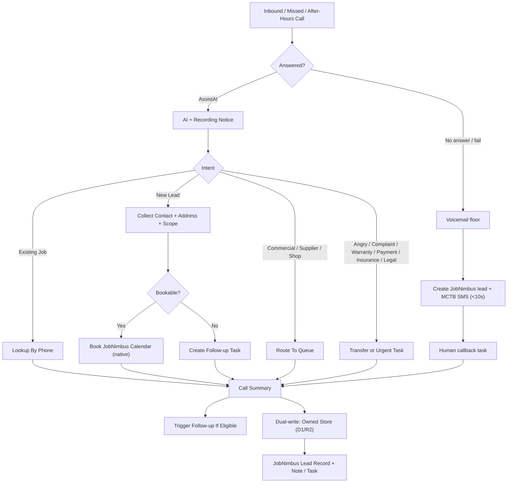

# 05 - Phone AI Automation Layer

## Final AI Decision

Phone AI is a phone automation layer, not only a missed-call bot. Its scope is
inbound calls, missed calls, after-hours coverage, lead qualification, booking,
CRM updates, call summaries, tasks, follow-up triggers, and escalation.

Roll out in phases:

1. Start with missed-call recovery and after-hours calls.
2. Expand to selected inbound calls only after pilot calls pass review.
3. Keep human live-answer for business-hour calls until Ilya approves the production behavior.

Humans stay in the loop for exceptions, disputes, sensitive decisions, and any
case where AI could create sales or liability risk.

## Provider Order

1. **JobNimbus AssistAI (P0).** Native 24/7 AI receptionist on the platform we are
   already standardizing on. Answers, qualifies, books natively into the JobNimbus
   calendar and creates a JobNimbus *lead record* in-CRM (not just a calendar
   event); the Make webhook may be redundant for the booking call itself — Make is
   used for route-flagging + the owned-store dual-write, not necessarily the booking
   call. ~$0.15/voice-min (≈ $15-30/mo at low volume); bills pure-metered, so
   **enforce a hard monthly minute cap / budget alert** (verify AssistAI's native
   cap support; if there is no native cap, enforce via usage monitoring + an overage
   alert). Cap = owner-set, e.g. ~500 min/mo; keep the spam/robocall buffer
   rationale. Behind the written scored eval-call gate below.
2. **Managed Retell — ONLY if AssistAI fails the eval gate.** Bundled
   telephony/LLM/voice, one configuration. A documented eval-gate failure is the
   *only* thing that unlocks it. Never run alongside AssistAI.
3. **Managed-OSS (LiveKit Cloud / Pipecat Cloud) — "tier 2.5", only if BOTH
   AssistAI and managed Retell fail the eval.** Managed-OSS hosting has removed the
   "media server to babysit" problem, so it is no longer an on-call-engineer
   disqualifier — but you'd still own the agent code/prompt/booking-glue, so it sits
   *below* the two fully-managed options. The 4-vendor hand-wired DIY stack stays
   KILLED (see below).

**Floor fallback (never breaks, zero ops):** voicemail → JobNimbus lead + human
callback. This is the always-on degraded path for any no-answer / failure, always
available regardless of which tier is live.

**Explicitly killed / excluded:**

- **KILLED — the hand-assembled Retell + Twilio + Gemini + ElevenLabs 4-vendor
  stack** as a standing build. It re-introduces the on-call-engineer burden and
  running it alongside AssistAI is the single most expensive failure mode in the
  plan. The escalation ladder is AssistAI → managed Retell → managed-OSS (LiveKit
  Cloud / Pipecat Cloud) "tier 2.5", never four hand-wired vendors.
- **Excluded — Vapi:** needs an on-call engineer (non-technical ops cannot run it).
- **Excluded — Google Voice:** the *consumer* Google Voice product has no real-time
  media API (confirmed adversarially); not buildable for this. Do NOT conflate this
  with Google's **Gemini Live API**, which is a legitimate real-time voice API and a
  valid LLM-voice backend — only the consumer *Google Voice* product is excluded.

**Own the Canadian phone DID in Twilio** and re-point it, so an AssistAI → managed
Retell swap is a config change — not a number change on the website / GBP / trucks.

## AI Call Flow

## Required Capabilities

The agent must:

- Disclose AI assistance and recording/transcription if active.
- **Missed-call-text-back (MCTB) — required:** every unanswered call fires an SMS
  within ~10s; target <60s human-or-AI touch, 24/7. Runs on a pipe separate from
  nurture.
  - **Interim pre-A2P ack path.** JobNimbus Engage SMS cannot send until the fresh
    A2P 10DLC + Canadian carrier registration is approved (~1–3 wks). Until then the
    instant-ack/MCTB runs on an interim channel — an **email acknowledgement to the
    prospect (via the Google Workspace brand mailbox) + an owner phone/SMS alert from
    the owner's own line** — so the <60s touch SLA holds from day one. The
    prospect-**SMS** leg of MCTB switches on at A2P approval. Be honest in the pitch:
    the email/owner-alert form of instant-ack ships day one; the prospect-SMS form
    ships at A2P approval.
- Capture name, phone, email if available, address, service interest, urgency.
- Classify lead type: roof, siding, gutter, soffit, fascia, commercial, supply/shop, warranty, emergency.
- Classify operating division: residential, commercial, shop/supply, or steel/distribution.
- Ask hail/insurance questions only from approved wording.
- Answer approved FAQ from the knowledge base.
- Book appointment natively into the JobNimbus calendar (Make is used for
  route-flagging + the owned-store dual-write, not necessarily the booking call).
- Create or update the JobNimbus contact and a JobNimbus **lead record** (not just
  a calendar event), dual-written to the owned store first.
- Update JobNimbus task/note when the lead is qualified or already tied to a job.
- Create a clear next step after every call.
- Trigger the appropriate follow-up sequence after the call when eligible (any
  email leg sends from the Google Workspace brand mailbox; SMS via Engage; JobNimbus
  native email unused).
- Escalate urgent, angry/complaint, legal, warranty, payment, insurance, low-confidence, and human-request calls.
- Send confirmation after booking — SMS via Engage; any booking-confirmation email
  sends from the Google Workspace brand mailbox (JobNimbus native email unused).
- On no-answer / failure, always degrade to a JobNimbus lead + human callback (voicemail floor).
- Write a short summary staff can read without listening to full recording.

## Tool Calls

Tool handlers needed after provider choice. All write to the owned store (D1/R2)
first, then JobNimbus:

- `lookup_contact_by_phone` (JobNimbus)
- `dual_write_lead_envelope` (owned store: `{source, contact, job_ref, payload, ts}` first)
- `create_or_update_jobnimbus_contact`
- `create_jobnimbus_lead_record`
- `get_available_appointment_slots` (JobNimbus calendar)
- `book_jobnimbus_appointment` (native into the JobNimbus calendar)
- `create_jobnimbus_task`
- `create_jobnimbus_note`
- `send_mctb_sms` (instant-ack pipe, separate from nurture)
- `send_sms_confirmation` (Engage)
- `trigger_follow_up_sequence`
- `transfer_to_human`
- `log_call_summary`

## Guardrails

The AI must not:

- Quote final prices.
- Promise schedules outside available calendar slots.
- Make warranty determinations.
- Make legal or insurance determinations.
- Promise financing approval or financing outcomes.
- Discuss payment disputes beyond routing to a human.
- Store credit card, banking, PAD, or financing data.
- Continue marketing communication after opt-out.
- Hide that it is AI if notice is required or approved policy requires disclosure.

## Knowledge Base

Must be approved before launch:

- Company identity.
- Service area.
- Services.
- Division routing: residential, commercial, shop/supply, and steel/distribution.
- Appointment rules.
- Hail/insurance wording.
- Financing/deposit wording.
- Office hours.
- Escalation contacts.
- What not to answer.

## Routing / Transfer Decision Matrix

No-answer **always** degrades to a JobNimbus lead + MCTB + human callback,
regardless of division or hour.

| Division | Business hours | After hours |
|---|---|---|
| Residential | AssistAI qualifies + books JN calendar; transfer on escalation | AssistAI qualifies + books; MCTB; callback task for next business open |
| Commercial | AssistAI captures + route-flags commercial queue; transfer to commercial owner | AssistAI captures + MCTB; commercial-queue task |
| Shop / supply | AssistAI captures + route-flags shop queue; transfer to shop line | AssistAI captures + MCTB; shop-queue task |
| Steel / distribution | AssistAI captures + route-flags steel queue; transfer to steel contact | AssistAI captures + MCTB; steel-queue task |
| Any (no answer / AI fail / low-confidence) | Voicemail floor → JN lead + callback | Voicemail floor → JN lead + callback |

## Written Scored Eval-Call Gate

AssistAI does not go to production until it **passes a written, scored eval**. This
gate is the *only* thing that authorizes go-live; a documented failure is the *only*
thing that unlocks managed Retell.

**Test set: 15-20 scripted calls** covering the 4 divisions plus edge personas:

1. New homeowner — metal roof estimate (residential).
2. Hail/insurance lead.
3. Siding lead.
4. Gutter-only lead.
5. Commercial lead.
6. Shop/supply inquiry.
7. Steel / slitting / cutting inquiry (distribution).
8. Existing customer asking for job status.
9. Angry / complaint escalation call.
10. Emergency call (active leak / storm).
11. Price-shopper pushing for a number.
12. ESL / heavy-accent caller.
13. Noisy-line / poor-audio caller.
14. Wrong number.
15. Missed-call recovery (MCTB fires).
16. Duplicate lead with same phone number.
17. Caller refuses email.
18. Caller asks for a human.
19. Call qualifies for post-call follow-up.
20. After-hours call for each division (routing degrades correctly).

**Scoring — each call is scored on capture + routing.** Record a numeric result per
call; keep the rubric and scores as a written artifact for sign-off.

**PASS requires BOTH:**

- **≥85% capture + routing accuracy** across the test set (correct contact/scope
  capture AND correct division/queue routing), AND
- **Zero catastrophic failures.** A catastrophic failure is any of: booked the wrong
  thing / wrong slot, hung up on (or mishandled) an emergency, or quoted a price.
  A single catastrophic failure fails the whole gate.

**Outcome:**

- **Pass** → AssistAI goes live with the minute cap/budget alert + voicemail floor + native JN-calendar booking + MCTB confirmed.
- **Documented fail** → unlock **managed Retell** (one config); re-run the same gate.

## Pass Criteria

Pilot passes only when:

- The written eval gate is passed (≥85% capture+routing, zero catastrophic failures).
- Booking natively into the JobNimbus calendar works.
- MCTB fires on every unanswered / abandoned / after-hours path.
- Transfer works.
- Summary is useful.
- CRM updates are correct (JobNimbus lead record created, dual-written to owned store).
- Duplicate lead is not created.
- Customer receives confirmation.
- Eligible post-call follow-up triggers correctly.
- Failed / no-answer call degrades to voicemail floor → JobNimbus lead + human callback.
- Call recording/transcript access is limited.
- Ilya approves production call behavior.
