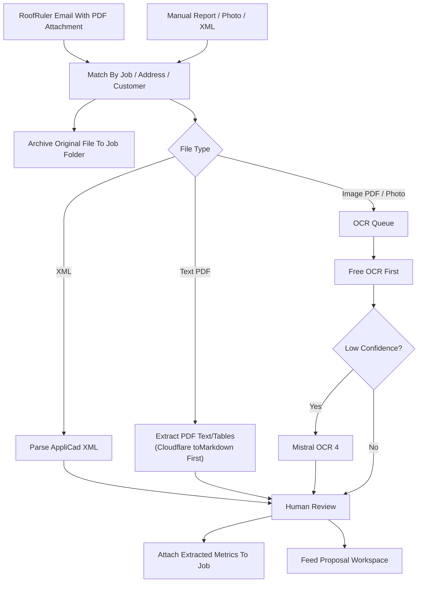
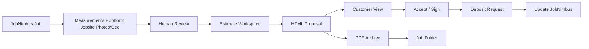

# 07 - Documents, Measurements, Proposals

> **Current authority (2026-07-16):** This retained document-flow record is planning/provenance.
> [`18-phase-1-source-truth-and-build-contract.md`](./18-phase-1-source-truth-and-build-contract.md)
> prevails on conflict: Worker/D1/R2 is the first write, the operating core is Frappe-only, the
> Field Companion PWA is primary, and JobNimbus, GHL, Make, and Jotform are bridges. Legacy
> `erpnext-*` names do not authorize ERPNext or DocuSeal.

## Measurement Intake Decision

Use deterministic extraction first:

1. RoofRuler report PDFs delivered automatically by email.
2. AppliCad XML.
3. Text-based PDF extraction.
4. Jotform "Jobsite Photo" form = default ($0 incremental) for site-evidence photos/geo: a JobNimbus job picker, the Jotform Geolocation widget (captures device GPS at submit, coordinates-only, works offline in the Jotform Mobile App), multi-photo File Upload, and auto timestamp -> webhook -> Make -> Google Drive job folder + JobNimbus + dual-write to the owned store. Do not rely on photo EXIF for geo (iOS strips it on-device). If Jotform capture friction appears, improve the Jotform flow (kiosk mode, simpler/auto job-picker) rather than adding a photo vendor.
5. Cloudflare `toMarkdown()` (Workers AI binding) as the free first pass for text PDFs/DOCX/etc. — on-stack, converts to clean Markdown, no extra vendor.
6. Free/local OCR.
7. Mistral OCR 4 only for hard image-heavy, handwritten, multilingual, or layout-sensitive documents.
8. Human review before pricing/material truth.

## Document Intake Flow

## RoofRuler Email Intake

The repo PDFs are samples of the RoofRuler reports IronWrap receives
automatically by email.

First-version handling:

1. Filter incoming RoofRuler emails by sender/subject/attachment type.
2. Save the original PDF attachment to the matching job folder.
3. Match by JobNimbus job number when present; otherwise match by address and customer name.
4. If no confident match exists, place the report in an unmatched-review queue.
5. Extract text/tables where possible.
6. Flag image-heavy or ambiguous reports for manual review.
7. Attach the report link and review status to JobNimbus.

## Extracted Measurement Fields

Roof:

- Roof area.
- Squares.
- Number of facets.
- Pitch.
- Eaves.
- Rakes.
- Ridges.
- Hips.
- Valleys.
- Flashing.
- Waste table, if provided.
- Waste factor, reviewed manually.

Siding:

- Wall areas.
- Openings.
- Corners.
- Trim.
- Material profile.
- Waste factor, reviewed manually.

Gutter/soffit/fascia:

- Gutter length.
- Downspouts.
- Soffit area/length.
- Fascia length.
- Corners/accessories.

Sample RoofRuler/AppliCad confirmation:

- RoofRuler email PDFs include usable fields such as roof area, facets, pitch,
  eaves, valleys, hips, ridges, rakes, flashing, squares, and waste tables.
- AppliCad XML includes structured faces, lines, pitch, size, orientation, and
  line types such as gable, fascia, ridge, valley, step, and tuck-under.
- Several siding, gutter, and soffit/fascia reports are image-heavy or sparse
  under text extraction, so OCR and human review must remain part of the flow.

## Confidence Rules

| Confidence | Meaning | Action |
|---|---|---|
| High | Structured source or clear text extraction | Staff review still required before price |
| Medium | OCR mostly readable but uncertain fields | Review task required |
| Low | Missing/ambiguous numbers or image-only report | Manual review required |

## Proposal Decision

Build a practical proposal path first:

- Customer-facing JobNimbus e-sign / HTML+PDF view.
- PDF export.
- Product options.
- Color/profile selections.
- Photos/visual links if available.
- Deposit/payment instructions.
- Signature/acceptance path, with contract/signature platform decided separately.
- Financing option only after FinanceIT economics and wording are approved.
- Version history.
- Archive PDF to job folder.
- Update JobNimbus status.

JobNimbus native e-sign / HTML+PDF is the bridge contract/signature path because it
consolidates onto the operational CRM with no added vendor; it dies with the JobNimbus
retirement. **DocuSeal is retired permanently (2026-07-09)**: AGPLv3 plus additional
terms conflict with the 100% IP-ownership posture, so it is not even a fallback. The
keeper path is a commercial e-sign API (a proprietary service, e.g. Dropbox Sign or
the DocuSign API) or owned signing built on the Proposal Evidence Pack. E-signatures
remain legally valid in Canada for ordinary commercial docs (audit-trail PDF; PIPEDA /
Alberta ETA recognize ordinary commercial e-signatures; PKI "secure electronic
signatures" are only needed for narrow federal cases, not roofing contracts).

The old "retire PandaDoc/DocuSign" line applied to the suites; the DocuSign API as a
commercial e-sign service is an acceptable candidate for the keeper path.

## Proposal Flow

## Proposal Acceptance Criteria

- Opens cleanly on mobile.
- Has clear options.
- Does not expose internal notes.
- Has approved terms.
- Has approved deposit/payment wording.
- Has version number.
- Saves PDF to job folder.
- Updates JobNimbus.
- Follow-up stops when accepted/declined/complaint.

## Renoworks Gate

Renoworks is added only when IronWrap commits to visualizer-led selling.

If active, capture:

- Visualizer session link.
- Uploaded home photo or selected 3D model.
- Selected product.
- Selected color.
- Selected surface: roof, siding, etc.
- Engagement/analytics if exportable.
- Lead contact info.
- Proposal embed/link state.

Renoworks data must flow through the Make bus into the owned store + JobNimbus. It must not stay trapped in Renoworks.

Open Renoworks checks before purchase/setup:

- Product library coverage for IronWrap's roof, wall, trim, and color options.
- Whether setup includes the profiles IronWrap actually sells.
- Export/API/webhook support for product, color, surface, and engagement data.
- Whether customer proposal pages can embed or link the visualizer cleanly.
- Privacy notice requirements for uploaded customer home photos.
