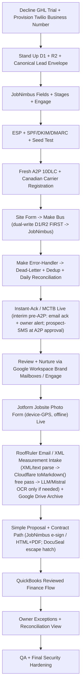

# 15 - First Deliverable Existing-Stack Plan

Date: 2026-06-27 (rev. 2026-07-07 — Google Workspace/Drive update)

Goal: deliver the maximum useful IronWrap internal OS with minimum new spend,
keystone-first. The first deliverable is building on JobNimbus: stand up
JobNimbus as the operational CRM with Engage + native automations, feed it through
a monitored Make bus that dual-writes to an owned data layer, and ship instant-ack
immediately after cutover. GHL is experimental/legacy scaffolding; retire it after the bus replacement
path is proven.

Assumption from current discovery: IronWrap already has subscriptions or active
access for Make, Google, RoofRuler, QuickBooks, and JobNimbus. GHL was trial-evaluated
only (never in production) and is being declined. NaturalForms is dropped.

Current state (2026-07-07): several key automations are already built experimentally
in the GHL-based Make setup (Make Core plan, ~16 scenarios — e.g., RoofRuler report
intake with AI Extract + legacy OneDrive, Google Drive folder automation keyed by lead/job
number, GHL→JobNimbus import scenarios, a scaffolded Jotform "Completion Form"
workflow, inactive Facebook Lead Ads). These run experimentally on the GHL hub; Task 1
migrates/rebuilds the keep-worthy ones onto the JobNimbus spine + owned bus, then
retires GHL.

Target new vendor spend for this first deliverable is deliberately small but not
zero: the keystone carries unavoidable line items — JobNimbus Engage
(~$49/mo USD), a Twilio-owned phone DID, and Cloudflare D1/R2 (~$0 at this volume).
Outbound email rides Google Workspace brand mailboxes and storage is Google Drive
Shared Drives. These are cheap, and the data layer + Make monitoring (dead-letter /
dedup / daily reconciliation) cannot be backfilled later, so they ship alongside the
core, not after it. Prices are USD; re-verify in CAD (~1.40 FX + GST).

First-deliverable incremental: ~CAD $120-220/mo (loaded, incl. ~1.40 FX + GST). The
driver is JobNimbus Engage (~CAD $90-140 loaded with SMS usage); the rest is small —
Twilio DID + usage (~CAD $5-30), the existing Make Core seat (~CAD $13, already
subscribed) or the bus on Cloudflare Workers (~CAD $20-30), and the A2P monthly
campaign fee (~CAD $5-15). Cloudflare D1/R2/Workers ≈ $0, email = Google Workspace,
storage = Google Drive Shared Drives, design = $0 (free Canva + free Affinity).
AssistAI minutes are a Phase-2 (post-eval) cost (~CAD $35-70 loaded when live), not
part of the first-deliverable incremental. One-time setup ~CAD $700-2,100 (A2P
registration, DID provisioning, Make/Workers bus build labor, mailbox SPF/DKIM/DMARC
domain auth, form re-pointing, training). "$0 new vendor setup" is false — Cloudflare,
the owned Twilio number, and (if adopted) DocuSeal are new vendor lines. GHL was never
adopted, so this still AVOIDS ~CAD $135-415/mo of GHL cost; frame as "simpler, more
portable, avoids GHL's cost," not a dramatic saving.

## First Deliverable Boundary

Build now (the keystone + the layers that cannot be backfilled):

- JobNimbus operating core as the operational CRM / job-truth.
- Engage (2-way SMS) + Google Workspace brand mailboxes for outbound email: IronWrap
  `sales@` with `info@`/`quote@` aliases, plus the separate iRoof Google account.
  JobNimbus native email stays unused; a dedicated transactional ESP is deferred.
- JobNimbus native automations (review-request + nurture sequences via the brand
  mailboxes / Engage).
- Existing website form → Make integration bus → dual-write owned store → JobNimbus.
- Owned data layer (Cloudflare D1 + R2) — every Make scenario dual-writes here FIRST.
- Make as critical infrastructure: error-handler → dead-letter (Google Sheet + email),
  idempotency/dedup keyed on phone/email, raw submission stored pre-Make, a DAILY
  source-vs-landed reconciliation with a named weekly owner.
- Instant-response / MCTB: unanswered call → SMS within ~10s; web form → instant
  prospect SMS + owner alert on a pipe SEPARATE from nurture; <60s human-or-AI touch.
  Interim pre-A2P: Engage SMS can't send until A2P 10DLC + Canadian carrier
  registration is approved, so until then instant-ack runs as an email ack
  to the prospect (via the Google Workspace brand mailbox) + an owner phone/SMS alert
  from the owner's own line; the prospect-SMS leg switches on at A2P approval.
- Jotform "Jobsite Photo" form = default for all jobsite photos/geo ($0 incremental,
  reuses already-paid Jotform/Make/Google): JobNimbus job picker + Jotform
  Geolocation widget (device GPS lat/long at submit, coordinates-only, works OFFLINE
  in the Jotform Mobile App — NOT the GeoStamp widget, which needs internet/falls back
  to IP, and NOT the GPS Location widget, which needs a Google Maps API key) +
  multi-photo File Upload + auto timestamp. Crew uses the Jotform Mobile App in
  Offline Mode → webhook → Make → Google Drive job folder + JobNimbus job + dual-write to
  the owned store. Capture device GPS at submit, don't depend on EXIF (see the Day One
  section for why). If capture friction emerges, improve the Jotform flow (kiosk mode,
  simpler/auto job-picker) — do not add a new photo vendor.
- Google Drive job folders/archive.
- RoofRuler email-report intake and AppliCad measurement intake. Extraction ladder:
  (1) deterministic AppliCad XML / text-PDF parse, (2) Cloudflare `toMarkdown()`
  (Workers AI binding — free, on-stack, text PDFs/DOCX → clean Markdown), (3)
  Claude/LLM read only for structured field extraction/reasoning, (4) Mistral OCR 4
  (cents/mo here) only for image-heavy/scanned/handwritten docs. Do NOT self-host an
  OCR engine.
- QuickBooks status visibility and reviewed payment workflow.
- Owner exception dashboard + reconciliation view using existing reports or Sheets.
- A2P 10DLC + Canadian carrier registration for JobNimbus Engage SMS — a FRESH
  registration needed before any automated texting.
- Provision/own the business phone number for AssistAI/Engage in Twilio (portable).
- CASL consent ledger maintained in JobNimbus going forward.
- Verify the existing website forms' current post destinations and point them at the
  Make bus.

Hold from Task 1 (gated):

- JobNimbus AssistAI (Phase 2, behind a written scored eval gate).
- Jotform structured field forms (introduced only when a structured workflow hurts).
- CallRail call attribution (deferred until paid ads start; UTM + manual Lead Source
  + one tracked number in the interim).
- Renoworks.
- Paradigm.
- DocuSeal (open-source e-sign escape hatch — adopt only if JobNimbus native e-sign /
  HTML+PDF fails the workflow; permanently retires the old PandaDoc/DocuSign line).
- Custom dashboard product.
- Standing custom voice stack (the Retell+Twilio+Gemini+ElevenLabs build is killed;
  escalation only to managed Retell if the AssistAI eval gate fails).
- Paid OCR by default.
- Moneris/FinanceIT customer-facing rollout unless already approved.

## Build Sequence

## Jotform Jobsite-Photo Form Day One

The Jotform "Jobsite Photo" form owns all jobsite photos/geo at cutover at $0
incremental — it reuses already-paid Jotform/Make/Google. The form pairs a JobNimbus
job picker, the Jotform Geolocation widget (captures DEVICE GPS lat/long at submit,
coordinates-only, works OFFLINE in the Jotform Mobile App — explicitly NOT the
GeoStamp widget, which needs internet/falls back to IP, and NOT the GPS Location
widget, which needs a Google Maps API key), a multi-photo File Upload, and an auto
timestamp. Crews capture in the Jotform Mobile App's Offline Mode (queues on-device,
syncs on reconnect) → webhook → Make → Google Drive job folder + JobNimbus job + dual-write
to the owned store. Do NOT rely on photo EXIF for geo: iOS strips photo GPS by
default, and direct camera-capture uploads lose metadata regardless — so capture
device GPS at submit; don't depend on EXIF. NaturalForms is dropped (stagnant;
cosmetic-only updates).

If per-submission job-picking friction tanks photo-documentation compliance, improve
the Jotform flow (kiosk mode, simpler/auto job-picker) — do NOT introduce a photo
vendor. Do NOT self-host an OSS photo server (Immich/PhotoPrism/LibrePhotos) — wrong
trade for a no-devops shop. Do NOT build a custom photo PWA yet
(offline-queue/silent-failure ops burden); revisit only if Jotform UX fails crews.

Adobe interactive PDFs are NOT a structured-capture tool — flat output; structured
JSON only via the paid Adobe developer API + re-keying.

Field/document jobs that previously rode NaturalForms templates now route as:

| Job | Day-one home | Notes |
|---|---|---|
| Jobsite photos / geo evidence | Jotform "Jobsite Photo" form ($0) | Device GPS at submit, offline; sole jobsite-photo tool |
| Work Order / dispatch | JobNimbus task/status | Jotform later if structured capture hurts |
| Completion / inspection evidence | Jotform photo form + JobNimbus status | Jotform later for structured pass/fail |
| Materials request | JobNimbus pipeline + (later) one Jotform | Paradigm deferred |
| Contract / customer acceptance | JobNimbus e-sign / HTML+PDF | DocuSeal (open-source) escape hatch if it fails; retires PandaDoc/DocuSign |
| Safety record | Jotform / JobNimbus note | Jotform later if a structured form is needed |

Integration priority for the keystone intake:

1. Site form → Make webhook (canonical lead envelope `{source, contact, job_ref,
   payload, ts}`).
2. Make dual-writes the envelope to the owned store (D1 + R2) FIRST, then pushes to
   JobNimbus — JobNimbus is a consumer of IronWrap's data, not the owner.
3. Make stores PDFs/measurement output in the right Google Drive job folder.
4. Make updates the JobNimbus lead/note/task/status using the canonical job number.
5. Jotform "Jobsite Photo" submissions webhook → Make → Google Drive job folder + JobNimbus
   job + owned store (device GPS captured at submit; offline-queued).

## Minimum-Cost / Critical-Infra Automation Rules

- Use Make webhooks and current app connections — but treat Make as critical
  infrastructure, not plumbing.
- Bus-on-Cloudflare hybrid (option, with caveat): Make's role can collapse into a
  Cloudflare Workers + D1 + R2 + Queues + Cron bus an AI agent builds (~CAD $7/mo vs
  scaling Make on its credit model). Queues gives native retry + dead-letter; Cron gives the daily
  reconciliation; the dual-write becomes a single write (the owned store IS the bus),
  which also resolves the partial-write problem. Recommended hybrid: the Worker does
  the heavy lifting (envelope, dedup, dead-letter, reconcile, single-write) and a cheap
  Make Core seat (~$9/mo) is kept for its native JobNimbus/QuickBooks/Twilio connectors
  + owner-visible observability, until the custom JobNimbus integration is proven.
  Caveat: this adds owned code a no-devops shop must maintain — name a
  build/maintenance owner before committing.
- Every Make scenario dual-writes the canonical envelope to D1/R2 FIRST, then JN.
- Store the raw submission pre-Make so nothing is lost if a scenario fails.
- Mandatory error-handler → dead-letter (Google Sheet + email alert) on every path.
- Idempotency/dedup keyed on phone/email across ALL inbound paths.
- DAILY reconciliation: source-event counts vs records landed; named weekly owner.
- Instant-ack/MCTB runs on a pipe SEPARATE from nurture (never delayed by sequences).
- Use Google Sheets only for exception dashboards, dead-letter, and logs — not a CRM.
- Use the JobNimbus job number as the folder/form matching key.
- Do not create QuickBooks invoices from form submissions without office review.
- Do not send customer documents/photos to cheap/free AI providers.

## First Working Demo

The first demo should prove the keystone loop end to end:

1. Submit the live website form as a test prospect.
2. Make stores the raw submission, builds the canonical envelope, and dual-writes
   it to D1/R2 BEFORE pushing to JobNimbus.
3. Instant-ack fires: prospect SMS within ~10s + owner alert on the separate pipe.
4. JobNimbus shows a new lead record with Lead Source set.
5. Force a scenario failure — confirm it lands in the dead-letter sheet with an email
   alert and a recovery task, and that the daily reconciliation flags the gap.
6. Engage 2-way SMS round-trips; a review/nurture step sends from Google Workspace
   (SPF/DKIM/DMARC domain auth passing the seed test).
7. Submit the Jotform "Jobsite Photo" form on mobile (offline, then reconnect);
   confirm device GPS + photos land on the JobNimbus job and the owned store.
8. Process a sample RoofRuler report email and archive the PDF to the job folder.
9. Owner exception + reconciliation view shows no blocker and counts reconcile.

## First Deliverable Acceptance

Accepted when:

- JobNimbus is the operational CRM / job truth; the owned D1/R2 store is the system
  of record and every inbound event was dual-written there FIRST.
- A2P 10DLC + Canadian carrier registration (fresh) is APPROVED before automated SMS.
- The business phone number is provisioned and owned in Twilio (portable).
- The CASL consent ledger is maintained in JobNimbus going forward.
- The website forms' post destinations are verified and pointed at the Make bus.
- Remaining GHL routes are retired after replacement proof.
- All inbound lands in JobNimbus + D1/R2 with Lead Source captured.
- Instant-ack / MCTB fires on every web-form and unanswered-call path, <60s touch.
  Interim pre-A2P ack path: JobNimbus Engage SMS cannot send until the fresh A2P 10DLC
  + Canadian carrier registration is approved. Until then instant-ack/MCTB
  runs on an interim channel — an email acknowledgement to the prospect (via the
  Google Workspace brand mailbox) + an owner phone/SMS alert from the owner's own line —
  The prospect-SMS leg switches on at A2P approval.
- Daily reconciliation runs green with a named owner; dead-letter + dedup live.
- Engage 2-way SMS works; outbound email goes through Google Workspace brand mailboxes
  with SPF/DKIM/DMARC and bounce monitoring (JN native email not used; dedicated ESP
  deferred).
- Jotform "Jobsite Photo" form captures photos + device GPS (offline-capable) and
  lands them on the JobNimbus job + owned store at cutover (sole jobsite-photo tool).
- RoofRuler email reports and AppliCad files are attached and either extracted or
  flagged for review.
- QuickBooks remains the accounting truth.
- Staff can run a test job without developer help.
- Final credential rotation, MFA, role cleanup, vendor register, privacy/consent,
  and call/SMS compliance gates are complete.

## Upgrade Triggers

Only spend more when a test proves a real blocker:

| Upgrade | Trigger |
|---|---|
| JobNimbus AssistAI (Phase 2) | Phase 1 stable AND AssistAI passes a written scored eval gate (≥85% capture+routing, zero catastrophic failures); cap minutes; voicemail floor remains |
| Managed Retell | AssistAI fails the eval gate — escalate to one managed Retell config (bundled telephony/LLM/voice), never the 4-vendor hand-built stack |
| Jotform structured forms | A specific structured field workflow becomes daily and painful |
| CallRail attribution | Paid ads start (interim: UTM + manual Lead Source + one tracked number) |
| Paid OCR / Mistral OCR | Real reports cannot be extracted with XML/PDF/free OCR and manual review cost is too high |
| Renoworks | Visualizer demos are part of a deliberate sales process and likely to improve close rate |
| Paradigm | Manual material request flow is stable and production/shop volume justifies ERP setup |
| Custom dashboard | Make + Google Sheets + native reports cannot show owner blockers or failure recovery |
