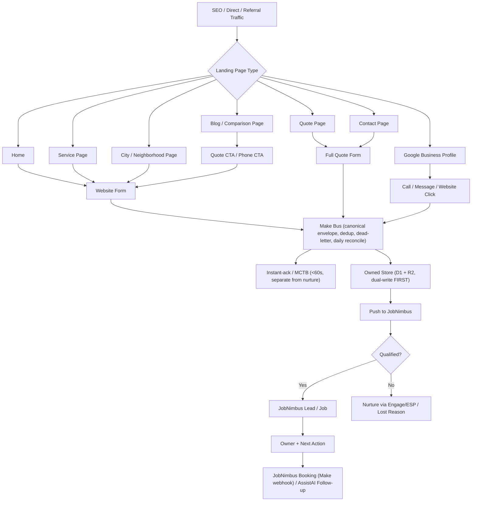

# 16 - Website Funnels & Qualified-Lead Capture

Date: 2026-06-27 (re-pointed 2026-06-28 to the JobNimbus spine)

Website work is intake, attribution, and follow-up cleanup — not a marketing-site
rebuild. Every web, GBP, phone, SMS, and referral lead normalizes through the Make
bus into the owned store (Cloudflare D1 + R2, **dual-write FIRST**) and then into
JobNimbus, with the instant-ack / MCTB branch firing in parallel. Attribution is
deferred (UTM + manual Lead Source + one tracked number; CallRail is added only when
paid ads start).

## Source Facts

Live site check on 2026-06-27:

- Both brand domains are intake sources: IronWrap Exteriors
  (`ironwrapexteriors.com`) and iRoof Alberta (`iroofalberta.ca`); the envelope
  carries `brand` (`ironwrap | iroof`).
- Website: `https://ironwrapexteriors.com/`
- Sitemap has 75 URLs.
- Page types: home, quote, contact, service, city/neighborhood metal-roofing,
  comparison, and blog.
- Homepage form fields: name, email, phone, city, service, message, file upload.
- `/quote/` and `/contact/` carry fuller forms: first name, last name, email, phone,
  address, city, province, postal, service, message, file upload.
- Service pages such as `/metal-roofing/`, `/siding-cladding/`, `/gutters/`, and
  `/commercial/` include service-specific lead forms.
- Raw HTML did not show obvious GHL/LeadConnector tracking. Verify current form post
  destinations before re-pointing forms to the Make bus.

Home-service funnel pattern: strong quote CTA, service/category routing, short
qualification, clear next step, trust/proof, fast booking or fast callback.

## Lead Envelope

Each inbound becomes a canonical **lead envelope** `{source, contact, job_ref,
payload, ts}`, written to the owned store first and then pushed to JobNimbus. A
website lead must carry:

- Brand (`ironwrap | iroof`) — which brand domain the lead came in on; selects
  the sender mailbox / GBP / review link.
- Source URL.
- Landing page.
- Page type: home, quote, contact, service, city, comparison, blog.
- UTM fields when present (source, medium, campaign, content, term).
- Call source/number when the visitor calls instead of submitting a form.
- Service intent.
- City/postal code.
- Contact details.
- Uploaded file/photo link if present.
- Message.
- Urgency if captured.
- Next action.
- Owner/queue.

## Website-Intake SOP

1. Website/GBP/form/phone lead enters the Make bus (raw submission stored first).
2. Build the canonical envelope; preserve source and intent fields.
3. Dual-write the envelope to the owned store (D1 + R2) **FIRST**.
4. Fire the instant-ack / MCTB branch (prospect SMS + owner alert, on a pipe separate
   from nurture) — target <60s human-or-AI touch.
5. Dedupe by phone, email, and normalized address.
6. Push to JobNimbus; create/update the JobNimbus record after qualification.
7. Create the OneDrive job folder only after the JobNimbus job number exists.
8. Trigger human or Phone AI follow-up when intent is high and the lead is not booked.

The owned store (D1 + R2) is the system of record; JobNimbus is the operational CRM /
job truth consuming it. Qualified leads land in JobNimbus without duplicate job
creation (idempotency/dedup keyed on phone/email across all inbound paths).

## Qualification Rule

A qualified lead has phone, service intent, service area, address or enough property
detail, and is not an obvious duplicate.

## Intent → Queue Route Rules

| Intent | Destination |
|---|---|
| Metal roofing | Residential sales queue |
| Siding/cladding | Residential sales queue |
| Gutters | Residential or light exterior queue |
| Soffit/fascia | Residential or light exterior queue |
| Commercial | Commercial/Ilya queue |
| Shop/supply | Shop/supply queue |
| Warranty/complaint | Human escalation |
| Insurance/hail | Approved script + sales queue |
| Not sure | Human qualification task |

## Google Business Profile Audit

Audit and tighten GBP in Task 1 (CAD $0). Verify:

- Categories.
- Service areas.
- Hours.
- Phone.
- Website URL.
- Photos.
- Services.
- Review link.
- Optional booking link.

## Funnel Map

## Do Not Do Now

- No website rebuild.
- No new landing-page platform.
- No paid ads launch.
- No CallRail until paid ads start.
- No Renoworks setup unless visualizer-led selling is approved.
